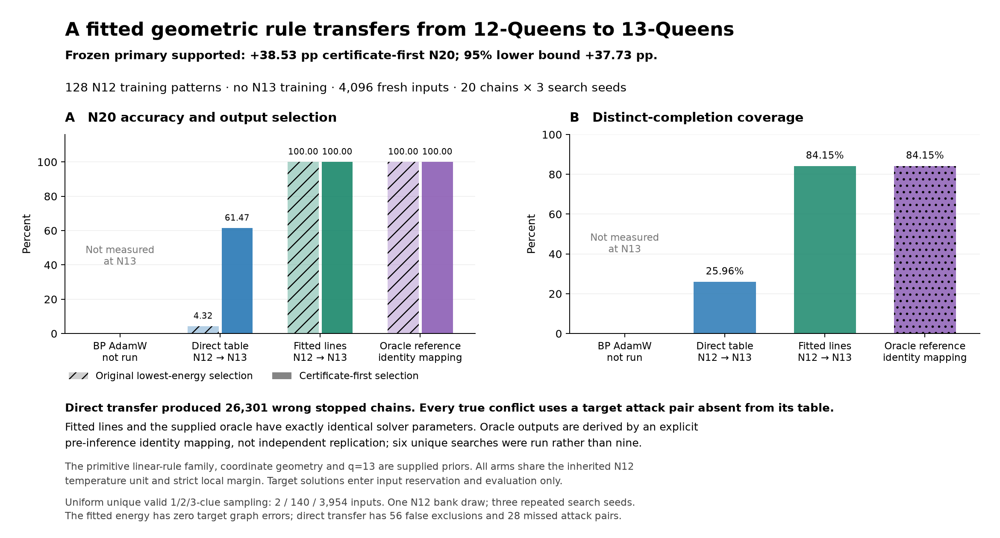

# H3j: a geometric rule fitted at N12 transfers to N13

**The frozen primary hypothesis is supported.** A primitive-line rule fitted only to 128 N12 training patterns reaches 100% certificate-first N20 accuracy on 4,096 fresh N13 inputs, compared with 61.474609% for direct transfer of the finite displacement table. The paired gain is 38.525391 percentage points; one-sided 95% bootstrap endpoints are [37.727865, 39.274495], exceeding the preregistered 10-point margin. The fitted-rule arm has zero wrong stopped chains. Coverage improves by 58.189698 points, from 25.959487% to 84.149184%.

| Method | N13 training patterns | Original N20 (%) | Certificate-first N20 (%) | Coverage (%) | Wrong stopped chains | Capped chains | Evidence |
|---|---:|---:|---:|---:|---:|---:|---|
| BP AdamW | — | Not run | Not run | Not run | — | — | No matched zero-shot control |
| Direct N12 displacement table | 0 | 4.321289 | 61.474609 | 25.959487 | 26,301 | 170,793 | Three new searches |
| N12-fitted line extrapolation | 0 | 100.000000 | 100.000000 | 84.149184 | 0 | 291 | Three new searches |
| Supplied N13 true-graph oracle | 0 | 100.000000 | 100.000000 | 84.149184 | 0 | 291 | Derived by exact parameter/output identity |

The oracle is an explicitly supplied-rule reference, not a learned baseline or an independent accuracy replication. Before any target search, the independent audit established equality of every solver-used model tensor and scalar—S, B, q, delta, tau and unit—between extrapolation and oracle. The input cohort, backend, settings and seeds are also identical. A timestamped pre-inference execution plan therefore deduplicated the three oracle searches and retained a hash-verified output mapping. Six unique searches ran instead of the original nine-job envelope; all three declared arms remain reported. Equality with the oracle is structural validation. The descriptive 0.1-point accuracy and 2-point coverage noninferiority margins are satisfied by that identity; no independent statistical replication is claimed.

The model fit reads only the frozen H3i raw-128 N12 bank. It reconstructs 264 displacement co-occurrence counts, then enumerates primitive homogeneous lines a×dr + b×dc = 0 with integer a,b in [−2,2], gcd 1 and canonical sign. A line is retained only if at least three observed forbidden offsets lie on it and no observed allowed offset does. All qualifying lines are retained. The fit selects (a,b) = (0,1), (1,−1), (1,0), (1,1). Extrapolation applies that union to every N13 offset; direct transfer retains the observed N12 support and treats unseen offsets as allowed. The finite line family, coordinate geometry and target cardinality q = 13 are explicit supplied priors. This result is not learning the puzzle rules without prior structure.

All arms use J = 13×forbidden − 1, zero unary terms, the same q-cardinality gate and strict local threshold 12 − 0.001. Delta = q − 1 and tau = −q(q − 1)/2 are declared symbolic design choices. The absolute temperature unit, 25.909505208333332, is inherited unchanged from the N12 offset-128 model and shared by all target arms. No N13 solution is used to select lines, set coefficients, calibrate thresholds or choose temperature. N13 solutions enter input reservation, exact completion counting and evaluation only.

After construction, the fitted-line energy has zero false exclusions and zero missed attack pairs on N13. The direct table has 56 false exclusions and misses 28 attack pairs at displacements (0,12), (12,0), (12,12), (12,−12). All **26,301** wrong stopped direct-transfer boards contain exactly 13 queens, satisfy the learned float64 local certificate, and violate the supplied true-graph certificate. Every actual attack in those boards belongs to a pair missing from the learned graph. The cardinality gate therefore cannot repair the incomplete graph's false certificates. There are no numerical certificate deficits.

Output selection matters sharply for the direct table. Original lowest-energy selection achieves 4.321289%, while certificate-first selection achieves 61.474609%. Across the 12,288 input–seed cases, certificate-first selection corrects 7,052 originally wrong choices and regresses 29 originally correct choices. Original selection chooses an invalid board with more than 13 queens in 11,490 cases; these are capped best-energy returns. Certificate-first selection still chooses 4,566 wrong certified boards and 168 invalid capped boards. Prior certificate-first improvements must therefore not be read as a universal correctness guarantee when the learned graph omits true constraints.

A post hoc exhaustive census finds at least one valid local certificate for 4,091 of 4,096 inputs under direct transfer, covering 125,360 of 329,411 compatible valid input–completion pairs. The fitted lines admit every one of the 329,411 valid completions. Unlike H3h/H3i, direct transfer's observed accuracy is far below its valid-certificate existence fraction: valid support alone does not ensure the search and selector return a valid answer when spurious certificates and lower-energy invalid states coexist. The census is a certificate-existence diagnostic, not an alternate search result.

The target solution universe contains 73,712 N13 boards, checked by an independent bit-mask exhaustive count and individual row/column/diagonal validity checks. Uniform sampling from the 359,025 unique valid one/two/three-clue inputs produces 2 one-clue, 140 two-clue and 3,954 three-clue evaluation inputs. Unlike H3g/H3i, no bank-incompatibility conditioning is needed: N13 complete patterns cannot occur in the N12 training bank by dimension. The sample remains different from the original GRAM multiplicity-weighted input distribution. Three search seeds repeat inference for one source training bank; the bootstrap clusters seeds within each input and does not estimate training-bank uncertainty.

Before launch, independent checks reconstructed literal N12 pair counts, every candidate-line decision and every target coefficient; checked 13 synthetic target energies and all 2,197 single-cell changes per model; and compared the common gated backend with the original backend on synthetic N13 fixtures on CPU and GPU. The final audit rescored **491,520 unique saved boards** and verified all three exact oracle mappings, including givens, exhaustive validity, both output selectors, coverage, saved energies, certificate margins, caps, floating operation counts and cardinality-check integer counts. Six unique searches used **150.707 aggregate GPU-worker seconds** on Loki, within the 20 GPU-minute envelope. The exact one-sided 95% upper probability of any extrapolation wrong stop per input is 0.073111%; zero observed wrong stops is the frozen primary requirement.

[Frozen protocol](protocol.json), [target cohort builder](prepare.py), [N12-only fitter and runner](driver.py), [independent prelaunch auditor](preflight.py), [oracle identity mapping](reuse_oracle.py), [saved-output auditor](analyze.py), [figure renderer](plot_public.py), [tracked summary and hashes](../../../../results/research/loki/h3j/summary.json), [integer per-seed counts](../../../../results/research/loki/h3j/per_seed.csv), [figure provenance](../../../../results/research/loki/h3j/plot-provenance.json).
