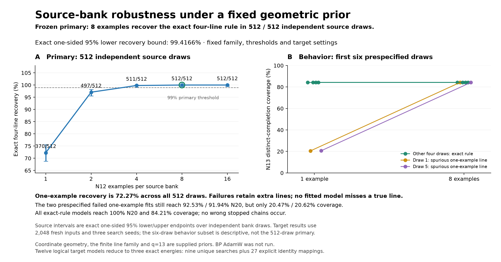

# H3k: very small source banks under the fixed line prior

**The frozen eight-pattern primary is supported.** Across 512 independent N12 source-bank draws, every eight-pattern bank recovers exactly the four true homogeneous attack lines. The exact one-sided 95% lower recovery bound is **99.416604%**, exceeding the preregistered 99% requirement. The line family and selection rule are unchanged from H3j. This measures the value and limits of a strong supplied geometric prior, not discovery without geometry.

| Method | N12 patterns per bank | Exact recoveries / independent draws | Recovery (%) | Exact one-sided 95% lower (%) | Exact one-sided 95% upper (%) | Role |
|---|---:|---:|---:|---:|---:|---|
| BP AdamW | — | Not run | — | — | — | Not studied |
| Fixed primitive-line family | 1 | 370 / 512 | 72.265625 | 68.822849 | 75.515962 | Descriptive |
| Fixed primitive-line family | 2 | 497 / 512 | 97.070313 | 95.524567 | 98.185600 | Descriptive |
| Fixed primitive-line family | 4 | 511 / 512 | 99.804688 | 99.076845 | 99.989982 | Descriptive |
| Fixed primitive-line family | 8 | 512 / 512 | 100.000000 | 99.416604 | 100.000000 | Frozen primary |
| Fixed primitive-line family | 16 | 512 / 512 | 100.000000 | 99.416604 | 100.000000 | Descriptive |

The lower and upper columns are separate one-sided 95% exact binomial endpoints. Sizes are nested within a draw; they are not independent experiments. Four examples also satisfy the numerical lower-bound criterion in this sample, but that size was descriptive and did not replace the frozen eight-example primary. Failures add spurious lines: 142 / 15 / 1 / 0 / 0 fits at sizes 1 / 2 / 4 / 8 / 16. None misses a true line. Every failed fitted line set is retained in the [2,560-row source export](../../../../results/research/loki/h3k/source_draws.csv), including source seeds, exact pattern indices and retained-line signatures.

Each independent draw samples 16 distinct N12 patterns without replacement from a fixed pool of 11,885 patterns. The earlier restricted H3g/H3i banks contribute 2,315 excluded patterns. Within a draw, sizes 1/2/4/8/16 are the fixed prefixes; overlap across draws is allowed. Seeds 2026111500 through 2026112011 define all 512 draws before fitting. Earlier full-universe studies considered every N12 pattern, so the study makes no never-seen mathematical-pattern claim. The binomial inference concerns independent bank draws from this fixed eligible population, not variation over puzzle families.

The N13 behavior sample was also fixed before outcomes: exactly the first six draw seeds at sizes one and eight, with no replacements. The two failed one-example fits are draws 1 and 5; each adds one spurious line, respectively (a,b) = (2,−1) and (2,1), producing 377 extra target exclusions. All twelve logical models share H3j's q = 13, unit 25.909505208333332, strict margin 12 − 0.001, cardinality gate and count-energy design. No target example calibrates the model. The fresh cohort has 2,048 inputs, excludes every H3j evaluation input, and contains 2 one-clue, 66 two-clue and 1,980 three-clue cases.

| Prespecified behavior group | Logical models | Exact fitted rule? | N20 (%) | Coverage (%) | Wrong stopped chains |
|---|---:|---|---:|---:|---:|
| BP AdamW | — | Not run | — | — | — |
| One example, draws 0/2/3/4 | 4 | Yes | 100.000000 | 84.209534 | 0 |
| One example, draw 1 | 1 | No: extra (2,−1) line | 92.529297 | 20.472828 | 0 |
| One example, draw 5 | 1 | No: extra (2,1) line | 91.943359 | 20.621253 | 0 |
| Eight examples, all first six draws | 6 | Yes | 100.000000 | 84.209534 | 0 |

Original and certificate-first N20 coincide for every model here. The equal-weight descriptive means over the six logical source draws are 97.412109% N20 / 62.988703% coverage at one example and 100% / 84.209534% at eight examples. These six-draw target results are not a population accuracy estimate over all 512 source draws. Three search seeds describe repeated inference; they do not multiply the independent source-bank sample count.

Full pre-inference equality of S, B, q, delta, tau and unit reduces the twelve logical models to three distinct solver energies. The first logical model in frozen order represents each group. Nine unique searches ran; 27 other logical model–seed records are explicitly mapped to identical outputs. All prespecified successes and failures remain represented. Identical logical models contribute their declared source-draw weight to descriptive means, but mapped outputs are never described as independent search replications. The [per-seed export](../../../../results/research/loki/h3k/per_seed.csv) identifies every representative and mapping.

A post hoc exact census explains the two failed models' reduced diversity. Their valid certificates cover 10,394 and 10,634 of the cohort's 168,576 compatible valid input–completion pairs, compared with all 168,576 for the exact rule. They retain at least one valid certificate for 1,895 and 1,883 of the 2,048 inputs, respectively; these counts equal their observed successful-input counts in every search seed. A high probability of finding one answer can therefore coexist with a severe loss of answer diversity when a small source bank retains a spurious line.

The independent prelaunch audit reconstructed all 2,560 source fits from literal occupied cell pairs, checked seeded bank selection and exclusions, verified target coefficients and all identity groups, and compared dense target energies and every single-cell change with literal pair sums for each distinct energy. Synthetic CPU/GPU checks preserved the established gated-backend behavior. The final audit checked **368,640 unique saved boards** and all 27 output mappings, including exact validity, givens, energies, local margins, selectors, coverage and operation counts. Source-bank uncertainty is reported with exact binomial bounds; search variation remains separately recorded. Nine searches used **113.141 aggregate GPU-worker seconds** on Loki, within the 20 GPU-minute envelope.

[Frozen protocol](protocol.json), [bank/cohort reservation](prepare.py), [source fitter and runner](driver.py), [independent source/model auditor](preflight.py), [identity mapping](reuse_identities.py), [output auditor](analyze.py), [figure renderer](plot_public.py), [tracked summary and hashes](../../../../results/research/loki/h3k/summary.json), [all source draws](../../../../results/research/loki/h3k/source_draws.csv), [source-recovery counts](../../../../results/research/loki/h3k/source_recovery.csv), [target per-seed counts](../../../../results/research/loki/h3k/per_seed.csv), [figure provenance](../../../../results/research/loki/h3k/plot-provenance.json).
