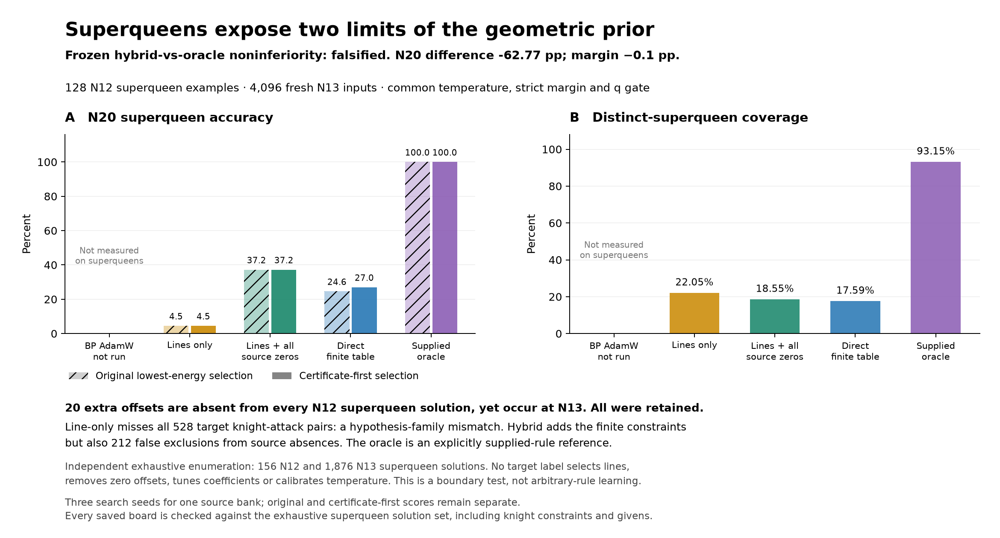

# H3l: superqueens expose a boundary of the geometric prior

**The frozen hybrid noninferiority hypothesis is falsified.** The hybrid of inferred lines and every observed-zero finite source offset reaches 37.231445% N20 accuracy, while the supplied target-graph oracle reaches 100%. The paired hybrid-minus-oracle difference is −62.768555 percentage points; one-sided 95% bootstrap endpoints are [−64.038086, −61.523438], far below the −0.1-point margin. Hybrid coverage is 18.554379%, compared with the oracle's 93.145723%. The hybrid has zero wrong stopped chains, but its extra exclusions prevent valid certificates for most inputs.

| Method | Original N20 (%) | Certificate-first N20 (%) | Coverage (%) | Wrong stopped chains | Capped chains |
|---|---:|---:|---:|---:|---:|
| BP AdamW | Not run | Not run | Not run | — | — |
| Inferred lines only | 4.532878 | 4.532878 | 22.053497 | 234,457 | 56 |
| Inferred lines + all source zero offsets | 37.231445 | 37.231445 | 18.554379 | 0 | 160,132 |
| Direct finite-offset transfer | 24.601237 | 27.018229 | 17.590787 | 34,536 | 163,091 |
| Supplied target-graph oracle | 100.000000 | 100.000000 | 93.145723 | 0 | 14,813 |

All metrics use the complete N13 **superqueen** solution set, including knight constraints and the input's givens. Ordinary-queen validity does not count as success. The table averages three search seeds for one source bank; wrong stops and capped chains sum across seeds. BP AdamW was not trained on this task, and earlier ordinary-queen results are not imported as matched controls. The oracle explicitly supplies target rules and is not learned. Its result shows that the declared search budget can solve every sampled input when given the correct energy.

Superqueens add knight-move attacks to ordinary queen attacks. Independent constraint-aware enumeration and filtering of the previously exhaustive ordinary-queen universes agree exactly: there are 156 N12 and 1,876 N13 complete solutions. Every enumerated board also passes literal pairwise validity checks. A fixed permutation selects 128 of the 156 source patterns. The fresh target cohort samples 4,096 unique valid partial inputs from 189,118 eligible cases, excluding prior H3j/H3k inputs; it contains 3 one-clue, 198 two-clue and 3,895 three-clue cases, with 15,068 compatible valid input–completion pairs in total.

The unchanged primitive-line inference rule retains the four ordinary queen-attack lines. Finite knight offsets are not homogeneous forbidden lines: longer displacements on those slopes can be allowed. Consequently, the line-only energy misses all **528** target knight-attack pairs and produces **234,457** wrong stopped boards. Those boards satisfy the inferred energy's float64 local certificate, but their true conflicts lie on omitted knight pairs. This is a mismatch between the supplied hypothesis family and the target constraints, not an implementation failure.

Adding every source zero offset supplies the missing finite knight constraints, but also imports extra exclusions. The source bank has 69 zero-count offsets: 48 correspond to actual queen/knight rules and 21 are extra. Exact post-construction counts over **all 156** N12 superqueen solutions show that 20 of those extra offsets are globally absent at the source size. Every one of those 20 offsets occurs in a valid N13 solution. They produce 200 false target pair exclusions; the remaining sample-only offset, (7,11), produces another 12. No extra offset was removed. The [tracked offset export](../../../../results/research/loki/h3l/extra_source_offsets.csv) preserves source-bank counts, full-source counts and full-target counts for all 21 cases.

This distinction matters: collecting the remaining N12 solutions cannot turn those 20 source-global zero counts into positive observations. Under the declared zero-support rule, source-size global impossibility is mistaken for a transferable local exclusion. The direct finite table contains the same 212 false exclusions and additionally misses 28 long-range queen pairs that have no N12 offset entry. Its 34,536 wrong stopped boards have true conflicts on those omitted long-range pairs. The hybrid repairs those missing queen pairs through extrapolated lines but retains all 212 false exclusions.

The exact post hoc certificate census makes the hybrid's ceiling concrete. It admits at least one valid superqueen certificate for only **1,525 / 4,096** inputs, precisely matching the successful-input set in every search seed. Only 2,747 of the 15,068 compatible valid input–completion pairs are certifiable under that energy. The oracle admits every valid completion. Direct transfer admits a valid certificate for 1,225 inputs but also has spurious certificates. Line-only admits all valid superqueen completions while also certifying many ordinary-queen boards that violate knight rules. Certificate existence therefore diagnoses different failures from certificate correctness; neither should be conflated with a universal guarantee about a decoder's accuracy.

All arms use the same declared q = 13, J = 13×forbidden − 1, strict local margin 12 − 0.001, q-cardinality gate, 20 chains, 20,000-move cap and inherited ordinary-queen N12 temperature unit 25.909505208333332. No superqueen target label calibrates temperature or thresholds. Model construction reads a separate N12 training archive; target labels are used only to reserve/validate inputs, count completions and audit outcomes. The source-global and target support diagnostics occur after construction and never edit a coefficient. This is a boundary test of declared priors, not broad arbitrary-rule learning or a reproduction of the original GRAM distribution.

Before target searches, independent checks reconstructed every source co-occurrence and line decision, every target coefficient, full model identities, and synthetic dense energies and single-cell costs. CPU/GPU backend checks passed; scoring fixtures explicitly rejected ordinary-queen boards with knight conflicts. All four solver energies were distinct, so all **12 searches** ran, with no deduplicated outcome claims. The final audit checked **983,040** saved boards, exact energies and certificate margins, givens, superqueen membership, both selectors, coverage and operation counts. It found no numerical certificate deficit. The study used **354.812 aggregate GPU-worker seconds** on Loki, within the 20 GPU-minute envelope. The final idle-GPU tail was preserved because only one distinct job remained.

[Frozen protocol](protocol.json), [independent enumeration](enumerate.py), [split reservation](prepare.py), [source fitter and runner](driver.py), [independent prelaunch auditor](preflight.py), [identity handling](reuse_identities.py), [saved-output auditor](analyze.py), [figure renderer](plot_public.py), [tracked summary and hashes](../../../../results/research/loki/h3l/summary.json), [integer per-seed counts](../../../../results/research/loki/h3l/per_seed.csv), [all extra source offsets](../../../../results/research/loki/h3l/extra_source_offsets.csv), [figure provenance](../../../../results/research/loki/h3l/plot-provenance.json).
