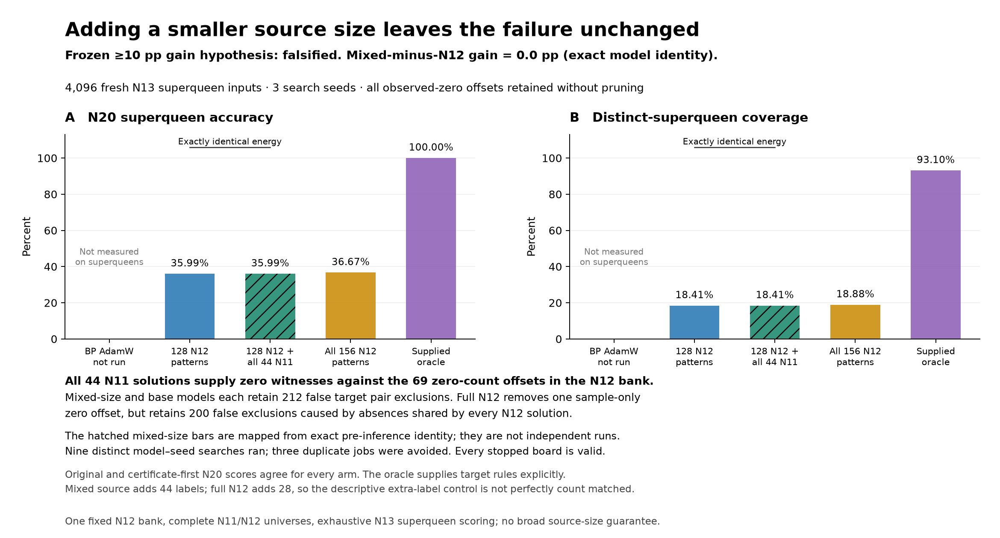

# H3m: a smaller source board does not remove source-global exclusions

**The frozen ≥10 percentage-point mixed-size improvement hypothesis is falsified.** Adding all 44 N11 superqueen patterns to the same 128 N12 patterns changes no zero-count offset and no inferred line. The complete solver parameters are exactly identical before inference. Both logical arms therefore score 35.986328% N20 accuracy and 18.411400% coverage on the new N13 cohort. Their paired accuracy difference and both one-sided 95% bootstrap endpoints are exactly zero. This is a structural identity result, not two independent replications.

| Method | Source patterns | Original N20 (%) | Certificate-first N20 (%) | Coverage (%) | Wrong stopped chains |
|---|---:|---:|---:|---:|---:|
| BP AdamW | Not run | Not run | Not run | Not run | — |
| N12 base | 128 | 35.986328 | 35.986328 | 18.411400 | 0 |
| N12 base + complete N11 | 172 | 35.986328 | 35.986328 | 18.411400 | 0 |
| Complete N12 | 156 | 36.669922 | 36.669922 | 18.884029 | 0 |
| Supplied N13 target-graph oracle | No source fit | 100.000000 | 100.000000 | 93.098664 | 0 |

N20 denotes accuracy of the answer selected from 20 search chains; the target board size is N13 and the per-chain cap is 20,000 moves. Scores average three search seeds; wrong stops sum across seeds. The mixed-size row is explicitly mapped from the N12-base row after exact equality of S, B, q, delta, tau and unit was established before target searches. BP AdamW was not trained or evaluated on superqueens, so earlier ordinary-queen results are not used as matched controls. The oracle supplies target rules explicitly.

The source bank is exactly the 128 N12 patterns used by H3l. Two independent exhaustive methods agree on all **44 N11 superqueen solutions**, drawn from 2,680 ordinary-queen solutions; every returned board also passes literal queen and knight pair checks. The complete N12 universe has 156 patterns. Mixed source adds 44 labels, while the full-N12 control adds 28. Source breadth and label count change together, and this descriptive control is not perfectly count matched.

For each board, occupied-pair displacements use that board's own size and coordinates. Counts are added over the declared source patterns. Each learned model applies the unchanged primitive-line rule and retains **every** observed-zero finite offset. No radius cutoff or target-geometry exception is applied. All three source arms recover the same four queen lines. The base and mixed sources have the same 69 zero offsets; full N12 has 68.

The extra N11 data supplies **zero positive witnesses against any of the 69 base-zero offsets**. Of the 21 extra offsets that do not express actual local queen/knight rules, 17 cannot even be represented on an N11 board; the other four are absent from every N11 solution. The [tracked offset table](../../../../results/research/loki/h3m/source_zero_offsets.csv) preserves all 69 entries, their N11 representability, literal counts at each source size and full N13 counts. These diagnostics do not edit the models.

The base and mixed models each retain **212 false target pair exclusions** and miss no true attack. Completing N12 removes only the sample-only offset (7,11), accounting for 12 false pairs; **200 false pairs remain** because their 20 offsets are absent from every N12 solution. Full-N12 accuracy improves by only **0.683594 percentage points**. This does not establish that arbitrary additional source sizes fail; it falsifies the prespecified addition of the complete smaller N11 universe under this rule.

The fresh cohort contains 4,096 unique valid N13 partial inputs sampled from 185,022 eligible cases, excluding all H3j/H3k/H3l evaluation inputs: 2 one-clue, 211 two-clue and 3,883 three-clue inputs. Ground truth comprises all 1,876 N13 superqueen solutions and 14,736 compatible input–completion pairs. Membership includes knight constraints and givens.

The exact post hoc certificate census finds a valid certificate for **1,474 / 4,096** inputs under both base and mixed models, with 2,675 compatible certified completions. Full N12 admits **1,502** inputs and 2,743 completions; the oracle admits all 4,096 inputs and all 14,736 completions. Each learned model's certificate-existence count matches its successful-input count in every seed. Certificate existence diagnoses lost support; it is not a general upper bound on arbitrary fallback-decoder accuracy.

All arms keep q = 13, J = 13×forbidden − 1, delta = 12, tau = −78, unit = 25.909505208333332, strict margin 12 − 0.001, q-cardinality gating, 20 chains, a 20,000-move cap and seeds 0/1/2. No target label fits a model or calibrates temperature. Three seeds repeat the search for fixed source sets; they do not provide independent source-bank draws. The primary paired bootstrap uses 2,000 draws with all three seeds clustered inside each input. Its degenerate zero interval follows exact identity.

Independent preflight checks reconstructed the source counts, every line decision and finite-zero set, target coefficients, synthetic energies and all single-cell flip costs. They verified the base model's equality to H3l and all declared model identities before inference. CPU/GPU backend checks passed. Three distinct energies required **nine new searches**, with three explicitly mapped duplicate jobs. The output audit checked **737,280 independently searched boards** plus 245,760 mapped records, float64 energies and stopped margins, exhaustive membership, selectors, coverage, move caps, floating operation counts and cardinality additions. No wrong stop or numerical certificate deficit was found. Loki used **310.660 aggregate GPU-worker seconds**, within the 20 GPU-minute envelope. Both GPUs progressed concurrently; the final single-job tail left one GPU idle.

[Frozen protocol](protocol.json), [N11 enumeration](enumerate.py), [split reservation](prepare.py), [source fitter and runner](driver.py), [independent preflight](preflight.py), [identity handling](reuse_identities.py), [output auditor](analyze.py), [figure renderer](plot_public.py), [tracked summary and hashes](../../../../results/research/loki/h3m/summary.json), [per-seed counts and mapping status](../../../../results/research/loki/h3m/per_seed.csv), [source-zero evidence](../../../../results/research/loki/h3m/source_zero_offsets.csv), [figure provenance](../../../../results/research/loki/h3m/plot-provenance.json).
