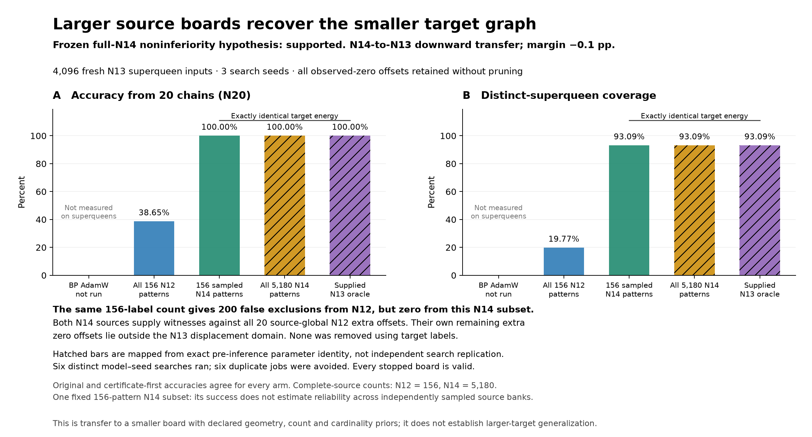

# H3n: larger-source evidence supports downward transfer

**The frozen full-N14 noninferiority hypothesis is supported.** The hybrid learned from all 5,180 N14 superqueen patterns has exactly the same solver parameters as the supplied N13 target-graph oracle. A prespecified random subset of only 156 N14 patterns also produces that exact target energy. They reach 100% N20 accuracy, 93.094794% coverage and zero wrong stops on the fresh N13 cohort. These outcomes share exact-identity mappings; they are not three independent search replications.

| Method | Source patterns | Original N20 (%) | Certificate-first N20 (%) | Coverage (%) | Wrong stopped chains |
|---|---:|---:|---:|---:|---:|
| BP AdamW | Not run | Not run | Not run | Not run | — |
| Complete N12 | 156 | 38.647461 | 38.647461 | 19.766719 | 0 |
| Sampled N14 | 156 | 100.000000 | 100.000000 | 93.094794 | 0 |
| Complete N14 | 5,180 | 100.000000 | 100.000000 | 93.094794 | 0 |
| Supplied N13 target-graph oracle | No source fit | 100.000000 | 100.000000 | 93.094794 | 0 |

N20 denotes accuracy of the answer selected from 20 search chains; target size is N13, with a 20,000-move cap per chain. Scores average three search seeds; wrong stops sum across seeds. The sampled-N14 energy represents its exact-identity group; full N14 and the oracle are explicitly mapped to its matched-seed records. BP AdamW was not trained or evaluated on superqueens, and previous ordinary-queen results are not matched controls. The oracle supplies target rules explicitly.

The primary full-N14-minus-oracle difference and its one-sided 95% bootstrap endpoints are zero. With no input showing a paired-seed regression, the declared exact one-sided upper probability is 0.073111%, below the 0.1% threshold, giving the conservative −0.073111 percentage-point accuracy lower bound. This satisfies the frozen −0.1-point noninferiority margin and zero-wrong-stop requirement. Exact model identity explains why the primary bootstrap interval is degenerate; it is stronger structural evidence of equality for this construction than a repeated stochastic comparison.

Independent constraint-aware enumeration and filtering all **365,596 ordinary N14 queen solutions** agree on exactly **5,180 superqueen solutions**. Every source board also passes literal queen/knight pair checks. The size-matched subset uses the first 156 indices of a frozen permutation with seed 2026112504. The complete N12 control is exactly the 156-pattern source from H3m. Thus N12 versus sampled N14 holds label count fixed while changing source size. Full N14 adds 5,024 labels, so its comparison also changes sample count. There is one prespecified source subset, not a sample-size reliability study over independent subsets.

Each arm pools occupied-pair displacement counts within its own source board domain. The unchanged primitive-line rule retains the four queen lines; the hybrid also retains **every** observed-zero finite offset. An offset outside that arm's source domain is unobserved, not an invented zero. No locality cutoff, orientation selection or target-label exception removes a source zero. All target coefficients use J = 13×forbidden − 1, with zero diagonal and unary terms.

Both N14 sources provide positive observations for all **20 extra offsets absent from every N12 solution**. Full N12 therefore retains 200 false target pair exclusions, while both N14 energies have zero false or missed target exclusions. The matched N14 source still has eight extra source-zero offsets and full N14 has four; all remain in their source tables. Full N14's four are (12,±13) and (13,±12). The matched subset additionally misses (11,±13) and (13,±11), whose full-N14 counts are 19 each. Every one of these eight offsets lies outside the N13 displacement domain, so none excludes any target pair. The [extra-offset table](../../../../results/research/loki/h3n/extra_source_offsets.csv) and [N12-zero witness table](../../../../results/research/loki/h3n/n12_zero_offset_witnesses.csv) preserve all counts.

This is **N14-to-N13 downward transfer**. Every N13 displacement fits within an N14 source board; the result does not need line extrapolation beyond the larger source domain. It does not establish upward transfer to a larger target, arbitrary-rule learning, or reliability across new source draws. Geometry, displacement pooling, the zero-count rule, target cardinality and inherited temperature remain declared priors.

The fresh target cohort samples 4,096 unique valid partial N13 inputs from 180,926 eligible cases, excluding all H3j/H3k/H3l/H3m inputs. It contains 2 one-clue, 216 two-clue and 3,878 three-clue cases. Ground truth is all 1,876 N13 superqueen solutions, with 14,467 compatible input–completion pairs. The post hoc certificate census admits a valid certificate for 1,583 inputs and 2,834 compatible completions under full N12, versus every input and every compatible completion under either N14 model. These certificate-existence counts match the successful-input sets in every seed; they are not general bounds on arbitrary fallback-decoder accuracy.

At the same 156-label count, N14 improves N20 accuracy by **61.352539 percentage points** over N12; descriptive one-sided 95% paired bootstrap endpoints are [60.058594, 62.622070]. Coverage rises by 73.328075 points. This identifies a source-size difference for the fixed subsets and sampling protocol; it does not estimate a population average across source banks.

All arms share q = 13, delta = 12, tau = −78, unit = 25.909505208333332, temperature multiplier 1, strict local margin 12 − 0.001, a q-cardinality gate, 20 chains, cap 20,000 and search seeds 0/1/2. No target label fits a coefficient or calibrates a threshold or temperature. Bootstrap draws number 2,000 with seed 20261114; all three search seeds remain clustered within each input. The input distribution differs from original GRAM multiplicities.

Before searches, independent checks reconstructed source counts, line decisions, retained zero offsets, target coefficients, synthetic energies and all single-cell costs. They verified exact equality of S, B, q, delta, tau and unit within each identity group, and checked the N12 control against H3m. CPU/GPU backend validations passed. Two distinct energies required **six actual searches**, with six explicitly mapped jobs. The final audit checked **491,520 independently searched boards** and 491,520 mapped records, exhaustive superqueen membership and givens, float64 energies and stopped margins, selectors, coverage, move caps and operation counts. No wrong stop or numerical certificate deficit was found. The study used **193.768 aggregate GPU-worker seconds**, within the 20 GPU-minute envelope; one GPU was idle during the final single-job tail.

[Frozen protocol](protocol.json), [N14 enumeration](enumerate.py), [split reservation](prepare.py), [source fitter and runner](driver.py), [independent preflight](preflight.py), [identity handling](reuse_identities.py), [output auditor](analyze.py), [figure renderer](plot_public.py), [tracked summary and hashes](../../../../results/research/loki/h3n/summary.json), [per-seed counts and mapping status](../../../../results/research/loki/h3n/per_seed.csv), [extra source offsets](../../../../results/research/loki/h3n/extra_source_offsets.csv), [source witnesses](../../../../results/research/loki/h3n/n12_zero_offset_witnesses.csv), [figure provenance](../../../../results/research/loki/h3n/plot-provenance.json).
