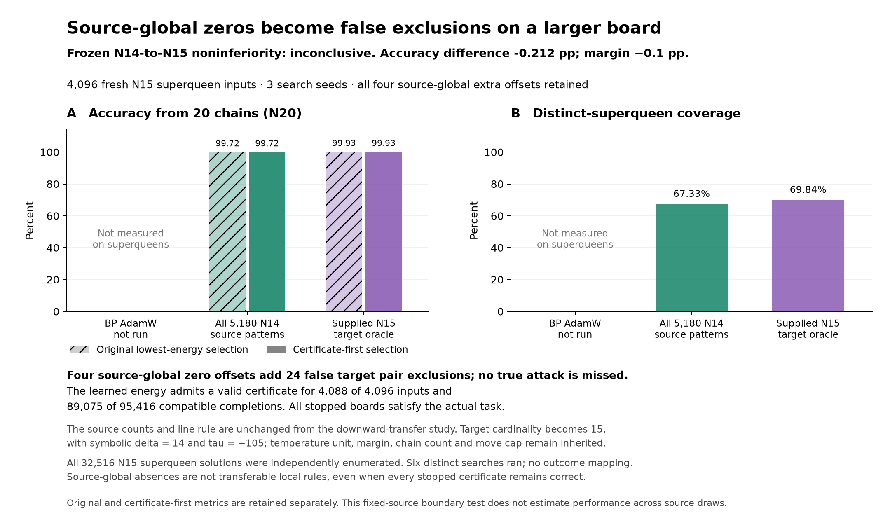

# H3o: upward transfer retains a measurable source-size artifact

**The frozen 0.1-point noninferiority hypothesis is inconclusive.** The unchanged full-N14 hybrid reaches 99.723307% N20 accuracy on N15 superqueens, versus 99.934896% for the supplied target-graph oracle. The paired difference is −0.211589 percentage points; one-sided 95% bootstrap endpoints are [−0.349935, −0.089518]. The upper endpoint does not fall below the −0.1-point falsification margin, and the conservative regression safeguard does not establish support. Zero wrong stops were observed. The point estimate alone is not a falsification decision.

| Method | Original N20 (%) | Certificate-first N20 (%) | Coverage (%) | Wrong stopped chains | Capped chains |
|---|---:|---:|---:|---:|---:|
| BP AdamW | Not run | Not run | Not run | — | — |
| Complete N14 hybrid | 99.723307 | 99.723307 | 67.326120 | 0 | 63,478 |
| Supplied N15 target-graph oracle | 99.934896 | 99.934896 | 69.843715 | 0 | 61,735 |

N20 denotes accuracy of the answer selected from 20 chains; target board size is N15, with a 20,000-move cap per chain. Accuracy and coverage average search seeds 0/1/2; wrong stops and capped chains sum across seeds. Original and certificate-first selections are preserved separately and agree here. BP AdamW was not trained on this task. The oracle explicitly supplies target rules; its finite-budget accuracy also falls slightly short of 100%.

This study tests **N14-to-N15 upward transfer**, following the earlier success transferring the same source evidence down to N13. Source counts, inferred lines and all finite zero offsets are unchanged. Independent literal reconstruction confirms exact source-support equality with H3n. No source-global zero is removed, and no target label tunes a model coefficient, threshold or temperature.

The four extra source-zero offsets are (12,±13) and (13,±12). Each is absent from every one of the **5,180 N14 superqueen solutions**, yet each has **550 occupied-pair occurrences** among complete N15 solutions. Each creates six false target pair exclusions, totaling **24**. The hybrid misses no true attack and contains 5,932 forbidden pairs, compared with the oracle's 5,908. These offsets were unrepresentable on the earlier N13 target but become representable at N15. The [tracked offset evidence](../../../../results/research/loki/h3o/extra_source_offsets.csv) retains the counts and target pair multiplicities.

N15 feasibility was independently verified before fitting: constraint-aware superqueen enumeration and filtering all **2,279,184 ordinary N15 queen solutions** agree on exactly **32,516 superqueen solutions**. Every returned board passes literal queen/knight pair checks. The full process used **104.293 CPU-wall seconds** on Loki, below the declared 300-second feasibility envelope. No support counts or fitted models were inspected during this feasibility step.

The first N15 evaluation cohort contains 4,096 unique valid partial inputs sampled from 836,069 eligible cases using seed 2026112506: 1 one-clue, 108 two-clue and 3,987 three-clue inputs. The exhaustive ground truth contains 95,416 compatible input–completion pairs. It checks both superqueen constraints and givens. The input distribution is uniform over unique partial inputs, differing from original GRAM multiplicities.

The exact post hoc certificate census shows that the hybrid admits a valid certificate for **4,088 / 4,096** inputs and **89,075 / 95,416** compatible completions. The oracle admits every input and every compatible completion. All eight inputs with no hybrid certificate fail in every seed; none succeeds through fallback selection. Beyond these eight, the hybrid also fails on 2, 1 and 7 inputs that do have a valid certificate in seeds 0, 1 and 2. Oracle failures are 2, 3 and 3 inputs, all with valid certificates available. This separates the structural loss of certificate support from failures under the finite search budget. Certificate existence is not a general bound on arbitrary fallback decoding.

The hybrid's descriptive coverage loss is **−2.517595 percentage points**, with one-sided 95% bootstrap endpoints [−2.738475, −2.302111]. Coverage was not a primary decision criterion. Seventeen unique inputs show at least one paired-seed accuracy regression. The exact one-sided upper regression probability is 0.621894%, above the 0.1% support threshold. The primary bootstrap uses 2,000 draws, seed 20261114, with all three repeated search seeds clustered within each input. Neither extra resampling nor a changed margin is used to force a decision.

The target cardinality is explicitly supplied as q = 15. Coefficients use J = 15×forbidden − 1, zero diagonal/unary terms, symbolic delta = 14 and tau = −105. The temperature unit remains 25.909505208333332, inherited from the earlier N12 control, with multiplier 1. The strict margin is delta − 0.001, with the same cardinality gate, 20 chains and 20,000-move cap. Target q and symbolic calibration therefore change with target size; the unit and search controls do not. The primitive-line family and displacement pooling remain supplied priors.

Independent preflight reconstructed literal source counts, every line decision and retained offset, target coefficients, synthetic energies and all single-cell flip costs. CPU/GPU backend checks passed at N15. Both energies were distinct, so all **six model–seed searches** ran with no derived outcomes. The final audit checked **491,520 saved boards**, exhaustive membership and givens, float64 energies and every stopped margin, selectors, coverage, move caps, floating counts (101,701 + 1,139×moves) and cardinality additions (224×(moves+1)). It found no numerical certificate deficit. The experiment used **265.343 aggregate GPU-worker seconds**, within the 20 GPU-minute envelope, with both GPUs productively occupied through nearly the entire queue.

The results expose a concrete limit of interpreting source-global absences as local exclusions, while leaving the prespecified accuracy noninferiority question unresolved at this sample size. They do not establish arbitrary-rule learning, source-bank reliability, or a universal upward-transfer guarantee.

[Frozen protocol](protocol.json), [bounded enumeration](enumerate.py), [cohort reservation](prepare.py), [source fitter and runner](driver.py), [independent preflight](preflight.py), [identity handling](reuse_identities.py), [output auditor](analyze.py), [figure renderer](plot_public.py), [tracked summary and hashes](../../../../results/research/loki/h3o/summary.json), [integer per-seed counts](../../../../results/research/loki/h3o/per_seed.csv), [extra source-zero evidence](../../../../results/research/loki/h3o/extra_source_offsets.csv), [figure provenance](../../../../results/research/loki/h3o/plot-provenance.json).
