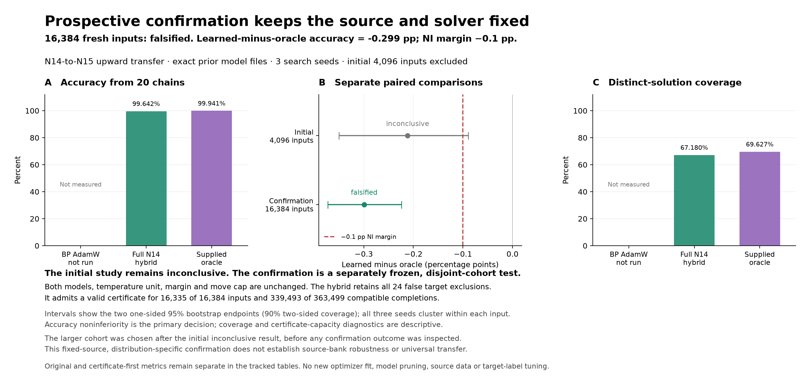

# H3p: prospective confirmation falsifies upward noninferiority

**The frozen 0.1-point accuracy noninferiority hypothesis is falsified on the prospective confirmation cohort.** The unchanged full-N14 hybrid reaches 99.641927% N20 accuracy on 16,384 fresh N15 inputs, versus 99.940999% for the supplied oracle. The paired difference is **−0.299072 percentage points**, with one-sided 95% bootstrap endpoints **[−0.372314, −0.223796]**. The upper endpoint lies below the −0.1-point margin. There are zero wrong stops. The earlier 4,096-input H3o study remains **inconclusive** and is reported separately.

| Method | Original N20 (%) | Certificate-first N20 (%) | Coverage (%) | Wrong stopped chains | Capped chains |
|---|---:|---:|---:|---:|---:|
| BP AdamW | Not run | Not run | Not run | — | — |
| Unchanged full-N14 hybrid | 99.641927 | 99.641927 | 67.179566 | 0 | 252,132 |
| Unchanged supplied N15 oracle | 99.940999 | 99.940999 | 69.626982 | 0 | 245,978 |

N20 means accuracy of the answer selected from 20 search chains; the board size is N15 and the move cap is 20,000 per chain. Accuracy and coverage average three search seeds; wrong stops and capped chains sum across seeds. BP AdamW was not trained on this task. Original and certificate-first scores remain separate and agree here. The oracle explicitly supplies target rules.

This is one prospectively frozen confirmation following H3o's inconclusive result. Its larger sample size was selected after seeing that initial study, but the new cohort, model files, settings, decision rule and budget were fixed before any confirmation outcome was inspected. The confirmation uses 16,384 uniformly sampled unique valid one-, two- and three-clue N15 inputs from 831,973 eligible cases, excluding every initial H3o input. The fixed seed is 2026112507. There are 3 one-clue, 377 two-clue and 16,004 three-clue cases, with **363,499** compatible input–completion pairs. Ground truth remains all **32,516** independently validated N15 superqueen solutions. No new enumeration was needed; H3o's complete source and target evidence is reused.

Both model files are copied **byte for byte** from H3o, with independently checked equality of every solver parameter. There is no new source fit, optimizer training, model pruning, source data, threshold tuning or temperature calibration. The full source still comprises all 5,180 N14 solutions. Its four source-global zero offsets create the same 24 false N15 pair exclusions and miss no true attack. The oracle graph is unchanged. This is a confirmation for a fixed source and input distribution, not evidence across independent source-bank draws.

The exact certificate census finds a valid certificate for **16,335 / 16,384** confirmation inputs under the hybrid, and **339,493 / 363,499** compatible completions. All **49** inputs without a valid hybrid certificate fail in every search seed; none is rescued by fallback selection. Additional hybrid failures despite available valid certificates are 5, 12 and 12 inputs across seeds 0/1/2. Oracle failures are 7, 10 and 12, all with valid certificates available. These additional failures total 29 for each arm, so the aggregate accuracy gap happens to equal 49/16,384. That numerical equality does not identify the same failed inputs or imply a general causal decomposition for other cohorts or decoders.

The descriptive coverage difference is **−2.447417 percentage points**, with one-sided 95% bootstrap endpoints [−2.566627, −2.331112]. Seventy-four unique inputs show a paired-seed accuracy regression; the exact one-sided upper regression probability is 0.547772%, above the support threshold. The primary decision follows the frozen bootstrap falsification rule. Bootstrap resampling uses 2,000 draws and seed 20261114, retaining all three search seeds within each input cluster. The plotted endpoints are the two one-sided 95% bounds, equivalent to a 90% two-sided interval. Initial and confirmation data are not pooled to change either decision.

All solver settings are inherited exactly: q = 15, J = 15×forbidden − 1, delta = 14, tau = −105, zero diagonal/unary terms, unit = 25.909505208333332, temperature multiplier 1, strict margin delta − 0.001, q-cardinality gate, 20 chains, cap 20,000 and seeds 0/1/2. The frozen backend keeps 65,536 chains per internal block; each larger job processes five blocks. That batch setting is unchanged. No target label steers inference.

Independent preflight verified source counts, the unchanged line and finite-offset decisions, all target coefficients, synthetic energies and single-cell costs, exact predecessor model-file identity, and the disjoint cohort selection. CPU/GPU backend checks passed. Six distinct searches generated **1,966,080 saved boards**, all audited against the exhaustive superqueen solution set and givens. The audit recomputed float64 energies, every stopped margin, both selectors, coverage, move caps, floating operations and cardinality additions. There were no numerical certificate deficits or wrong stops.

The experiment used **1,023.130 aggregate GPU-worker seconds (17.052 minutes)**, below its 25 GPU-minute envelope. The two Loki GPUs ran concurrently at observed 88–93% utilization and finished within a fraction of a second of each other. Search times were approximately 168–169 seconds per job; the larger cohort increased useful work without changing inference configuration. GPUs were idle only after the queue completed.

The result rejects the declared small accuracy-loss tolerance for this fixed upward-transfer procedure and sampling distribution. It does not say that the method has low absolute accuracy, that its stopped certificates are incorrect, or that every possible decoder must fail on the structurally unsupported inputs. Certificate existence, correctness and finite search success remain separate quantities.

[Frozen confirmation protocol](protocol.json), [fresh cohort reservation](prepare.py), [exact-copy model preparation and runner](driver.py), [independent preflight](preflight.py), [identity handling](reuse_identities.py), [output auditor](analyze.py), [figure renderer](plot_public.py), [initial H3o report](../h3o/REPORT.md), [tracked confirmation summary](../../../../results/research/loki/h3p/summary.json), [integer per-seed counts](../../../../results/research/loki/h3p/per_seed.csv), [unchanged extra source offsets](../../../../results/research/loki/h3p/extra_source_offsets.csv), [figure provenance](../../../../results/research/loki/h3p/plot-provenance.json).
