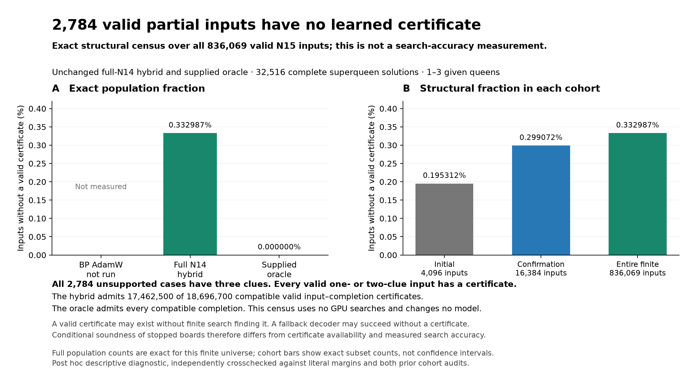

# H3q: exact population census of certificate availability

**Exactly 2,784 of the 836,069 valid one-, two- and three-clue N15 inputs have no valid certificate under the fixed full-N14 hybrid: 0.332986871%.** All 2,784 have three clues. Every valid one- and two-clue input has at least one certifiable completion. The supplied oracle admits every compatible completion for every input.

This is an exact, post hoc structural census, with scope frozen before computation. It is not a new search experiment or accuracy estimate. It follows the separate H3o inconclusive study and H3p prospective confirmation that falsified 0.1-point accuracy noninferiority. Those results and their decision rules are unchanged.

| Method | Inputs with a valid certificate | Inputs without one | Fraction without one (%) | Valid input–completion certificates |
|---|---:|---:|---:|---:|
| BP AdamW | Not measured | Not measured | Not measured | Not measured |
| Unchanged full-N14 hybrid | 833,285 / 836,069 | 2,784 | 0.332986871 | 17,462,500 / 18,696,700 |
| Supplied N15 oracle | 836,069 / 836,069 | 0 | 0 | 18,696,700 / 18,696,700 |

| Given queens | Valid unique inputs | Hybrid inputs without a certificate | Fraction without one (%) |
|---|---:|---:|---:|
| 1 | 225 | 0 | 0 |
| 2 | 19,292 | 0 | 0 |
| 3 | 816,552 | 2,784 | 0.340945831 |

No model is trained, changed or pruned. The model files, 32,516 complete target solutions and input universe are the frozen H3o artifacts. The hybrid contains every true N15 attack plus the same 24 false pair exclusions from the four source-global zero offsets. Target cardinality, coefficients, calibration and margins are unchanged. BP AdamW is absent because no comparable model was trained or evaluated on this superqueen task.

The census evaluates every complete solution's single-cell margins. A deficit at an empty cell can never be hidden by a positive given. An occupied deficit is excluded from the stop test exactly when that cell is clamped as a given. Therefore, for a valid solution with no empty deficits, a one-, two- or three-clue subset admits that solution as a certificate precisely when it contains every occupied deficit cell. The script enumerates every such subset and accumulates the compatible certificate counts by unique input key.

The fixed hybrid has **no empty-cell deficits** on any valid N15 solution. Of the 32,516 complete solutions, **30,316** have no occupied deficits and **2,200** have exactly two. Those affected solutions can still supply certificates when both problematic occupied cells are givens; simply discarding every affected full solution would undercount certificate availability. The oracle has no deficits on any valid solution. The public full-capacity archive retains the exact count for each of the 836,069 inputs.

This separates three statements. **Certificate correctness** asks whether a stopped board satisfies the task. For these fixed models, the supplied q, valid givens and a forbidden graph containing every true attack imply conditional soundness: a true conflict has at least one free occupied endpoint; removing it costs at most −1, below the 13.999 stopping threshold. Such a board cannot stop. The [derivation and arithmetic bounds](SOUNDNESS.md) state the assumptions explicitly. Missing true edges would invalidate this argument, as earlier line-only experiments demonstrated.

**Certificate existence** asks whether any compatible valid solution can meet that stopping rule. The exact census answers this question for the entire declared finite population. Its 0.332986871% unsupported-input fraction exceeds the separately stated 0.1% structural threshold. This is a direct finite count, with no sampling uncertainty or confidence interval; it does not substitute for the accuracy noninferiority test.

**Finite search success** asks whether the actual solver finds and selects a valid board under its move budget. A certificate may exist and still not be found. Conversely, a fallback decoder may return a valid uncertified board. Thus the fraction without certificates is not a universal bound on arbitrary decoder accuracy. In H3o and H3p, the observed unsupported inputs did fail in every seed, but that measured behavior is distinct from the structural census.

The census independently rebuilds all **18,696,700** valid input–completion pairs and matches the earlier exhaustive universe and completion counts exactly. A frozen sample of 512 inputs receives a separate validation: fields are recomputed as literal sums over occupied pair coefficients, and every compatible solution is directly checked on its unclamped cells. All counts match. It also exactly reproduces H3o's 8 unsupported inputs and 89,075 certified completions, and H3p's 49 unsupported inputs and 339,493 certified completions. The per-input archive and all 2,784 unsupported keys are publicly exported, not just aggregate totals.

The computation used **3.426 seconds on one CPU thread and zero GPU time**, below the 180-second CPU envelope. It required no additional source collection, optimization or stochastic search. The conclusion applies to this complete finite target universe, fixed models and one- to three-clue input definition. It is not a claim about independent source draws, arbitrary rule families or every target size.

[Frozen scope](protocol.json), [census and independent checks](census.py), [conditional soundness derivation](SOUNDNESS.md), [figure renderer](plot_public.py), [tracked summary](../../../../results/research/loki/h3q/summary.json), [counts by clue count](../../../../results/research/loki/h3q/by_clues.csv), [all unsupported input keys](../../../../results/research/loki/h3q/inputs_without_certificate.csv), [full per-input certificate counts](../../../../results/research/loki/h3q/per-input-capacity.npz), [export hashes](../../../../results/research/loki/h3q/export-provenance.json), [figure provenance](../../../../results/research/loki/h3q/plot-provenance.json).
