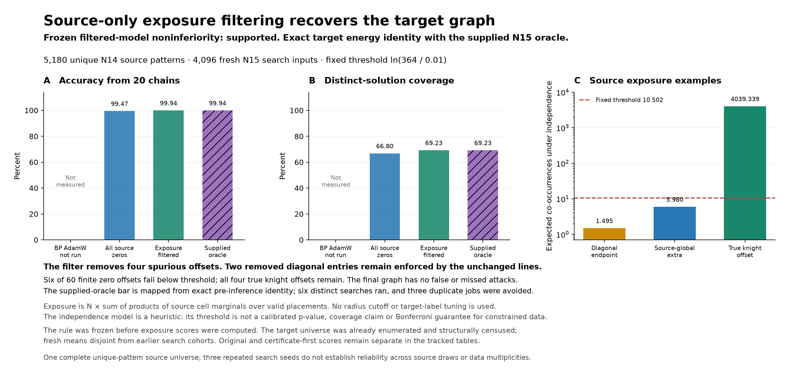

# H3r: a source-only exposure heuristic removes the observed transfer artifact

**The frozen filtered-model noninferiority hypothesis is supported.** The exposure-filtered hybrid has exactly the same solver parameters as the supplied N15 target-graph oracle. It reaches 99.943034% N20 accuracy and 69.228472% coverage, with zero wrong stops. Its oracle comparison is an explicitly mapped exact-identity result, not an independent replication. The unchanged all-zero-offset control reaches 99.471029% accuracy and 66.797054% coverage on the same fresh search cohort.

| Method | Original N20 (%) | Certificate-first N20 (%) | Coverage (%) | Wrong stopped chains |
|---|---:|---:|---:|---:|
| BP AdamW | Not run | Not run | Not run | — |
| Full-N14 hybrid retaining all zero offsets | 99.471029 | 99.471029 | 66.797054 | 0 |
| Exposure-filtered hybrid | 99.943034 | 99.943034 | 69.228472 | 0 |
| Supplied N15 oracle, mapped by exact identity | 99.943034 | 99.943034 | 69.228472 | 0 |

N20 denotes accuracy of the answer selected from 20 search chains; target board size is N15, with a 20,000-move cap per chain. Scores average three search seeds, and wrong stops sum across seeds. Original and certificate-first scores remain separate and agree here. BP AdamW was not trained on this superqueen task. The oracle supplies target rules explicitly.

The score and threshold were frozen **before any exposure score was computed**. Let N = 5,180 be the number of unique full-N14 source patterns, m_i the number occupying source cell i, and p_i = m_i/N. For each canonical source displacement o, define

\[
E_o = N\sum_{(i,j):\,j-i=o}p_i p_j
    = \frac{1}{N}\sum_{(i,j):\,j-i=o}m_i m_j,
\]

where the sum uses all valid placements within the source board, with displacement interpreted in row/column coordinates. The source domain has K = 364 canonical offsets. An observed-zero finite offset is retained exactly when **E_o ≥ ln(K/0.01) = 10.5023240536**. The four homogeneous lines are inferred by the unchanged original rule using unfiltered source counts, then unioned with the retained finite offsets. No geometric radius cutoff, target-dependent threshold or target-label exception is used.

This is an **independent-cell-occupancy exposure heuristic**. Complete constrained superqueen solutions do not obey that independence model. Neither the expected counts nor the threshold are presented as calibrated p-values, confidence coverage, or a valid Bonferroni procedure for the actual source data. The observed success establishes the declared construction's result on this fixed source and target; it does not validate the null model.

Six of 60 finite source-zero offsets fall below threshold. The four source-global extras, (12,±13) and (13,±12), each have exposure **5.9799227799** and are removed. They had created 24 false target pair exclusions. Two true diagonal endpoint offsets, (13,±13), have exposure **1.4949806950** and also lose their finite entries, but remain enforced by the unchanged diagonal lines. All four finite knight-attack offsets remain. The resulting filtered graph contains exactly **5,908** forbidden target pairs, with **zero false and zero missed attacks**. The unfiltered graph contains 5,932 pairs, retaining its 24 false exclusions. Every source offset and score is retained in the [364-row exposure export](../../../../results/research/loki/h3r/source_offset_exposures.csv); all six removals have a separate [diagnostic table](../../../../results/research/loki/h3r/removed_zero_offsets.csv).

The primary filtered-minus-oracle accuracy difference and bootstrap endpoints are zero by exact model identity. The declared exact one-sided upper regression probability is 0.073111%, below the 0.1% support threshold, and there are zero wrong stops. Filtered versus unfiltered accuracy improves by **0.472005 percentage points**, with descriptive one-sided 95% bootstrap endpoints [0.301107, 0.659587]. Coverage improves by **2.431417 points**, with endpoints [2.191659, 2.657788]. These descriptive comparisons do not modify the primary rule.

The 4,096 fresh N15 search inputs use seed 2026112509 and exclude every H3o/H3p search input, leaving 815,589 eligible cases. The new cohort contains 2 one-clue, 107 two-clue and 3,987 three-clue inputs, with **96,287** compatible completions. The full target universe had already been enumerated and structurally censused in H3q; “fresh” means disjoint search cohorts, not previously unseen target labels. The fitter reads only the separate N14 source archive. The rule was selected after earlier transfer failures, with that adaptive history declared before fitting.

The exact certificate census admits a valid certificate for 4,076 of 4,096 inputs and 89,813 compatible completions under the unfiltered model. The filtered model admits all 4,096 inputs and all 96,287 compatible completions. Finite search still misses a few inputs despite this full certificate availability. Certificate existence, correctness conditional on stopping and finite search accuracy remain distinct.

All source patterns are unique. There is one complete finite source bank, and the three seeds repeat search rather than source sampling. The model uses the same q = 15, J = 15×forbidden − 1, delta = 14, tau = −105, unit = 25.909505208333332, temperature multiplier 1, strict local margin delta − 0.001, cardinality gate, 20 chains and 20,000-move cap as H3o/H3p. No source fit changes the declared target q or calibrates temperature. The exposure rule's behavior under duplicated source records is a separate invariance question; this result does not establish that robustness.

Independent preflight rebuilt literal co-occurrences, cell marginals and exposure numerators by enumerating source placements, every line and filter decision, all target coefficients, synthetic energies and single-cell costs. It confirmed that the unfiltered and oracle controls exactly match H3o and that the exposure scores were computed after protocol freezing. CPU/GPU backend checks passed. Exact identity reduced nine logical model–seed jobs to **six distinct searches plus three oracle mappings**. The final audit checked **491,520 independently searched boards** and 245,760 mapped records, exhaustive superqueen membership and givens, float64 energies and stopped margins, selectors, coverage, move caps and operation counts. No wrong stop or numerical certificate deficit was found. The study used **264.200 aggregate GPU-worker seconds**, within the 20 GPU-minute envelope, with both Loki GPUs productively occupied through the queue.

[Frozen protocol](protocol.json), [cohort reservation](prepare.py), [source scoring and runner](driver.py), [independent preflight](preflight.py), [identity mapping](reuse_identities.py), [output auditor](analyze.py), [figure renderer](plot_public.py), [tracked summary](../../../../results/research/loki/h3r/summary.json), [per-seed counts](../../../../results/research/loki/h3r/per_seed.csv), [all exposure scores](../../../../results/research/loki/h3r/source_offset_exposures.csv), [removed offsets](../../../../results/research/loki/h3r/removed_zero_offsets.csv), [figure provenance](../../../../results/research/loki/h3r/plot-provenance.json).
