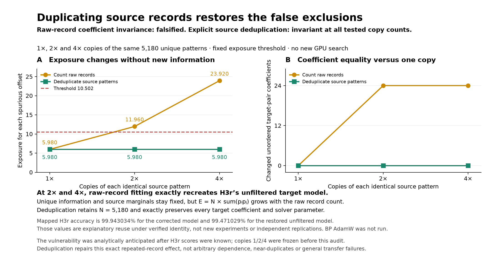

# H3s: exposure fitting is sensitive to duplicate source records

**Raw-record invariance is falsified.** Duplicating every source pattern twice or four times changes 24 unordered N15 pair coefficients, recreating H3r's unfiltered model. The unique source information is unchanged. The explicitly named **source-deduplicated derivative is invariant** at all three tested multiplicities and retains the corrected target graph.

This is a deterministic equality test, not a statistical experiment. The vulnerability was analytically anticipated after H3r's exposure scores were known. Copies 1/2/4, the invariance criterion, deduplicated derivative and mapping procedure were frozen before this replication audit. It does not alter H3r's successful result for 5,180 unique source patterns.

| Fitting variant | Copies per unique pattern | Records used for fitting | Distinct patterns | Changed target pairs versus 1× | Exact H3r model identity |
|---|---:|---:|---:|---:|---|
| BP AdamW | Not run | — | — | Not measured | — |
| Raw records | 1 | 5,180 | 5,180 | 0 | Exposure-filtered / oracle |
| Raw records | 2 | 10,360 | 5,180 | 24 | Unfiltered hybrid |
| Raw records | 4 | 20,720 | 5,180 | 24 | Unfiltered hybrid |
| Source-deduplicated | 1 | 5,180 | 5,180 | 0 | Exposure-filtered / oracle |
| Source-deduplicated | 2 | 5,180 | 5,180 | 0 | Exposure-filtered / oracle |
| Source-deduplicated | 4 | 5,180 | 5,180 | 0 | Exposure-filtered / oracle |

The score remains E_o = sum(m_i m_j)/N, equivalently N times the sum of products of source cell marginals. If each record is copied c times, then m_i becomes c m_i and N becomes cN, while every empirical marginal p_i remains unchanged. Therefore E_o becomes **c E_o**. Offset co-occurrence counts likewise multiply by c, leaving their zero/nonzero classification unchanged. The unchanged homogeneous-line rule therefore infers the same four lines at every multiplicity.

For each of the four source-global extra offsets, the raw-record exposure rises from **5.979922780** at one copy to **11.959845560** at two and **23.919691120** at four. The fixed threshold is **10.502324054**. The two-copy and four-copy fits thus restore all four spurious finite offsets, adding 24 false target exclusions. Two diagonal endpoint offsets remain below threshold for all declared multiplicities; the homogeneous lines continue to enforce them. The raw fits retain 54 finite zeros at one copy and 58 at two/four copies, producing 5,908 versus 5,932 forbidden target pairs.

The deduplicated derivative explicitly removes duplicate complete patterns **before** calculating both the marginals and N. It retains exactly 5,180 patterns at every input multiplicity. Its counts, exposure numerators, expected counts, line decisions, complete target coefficients and solver parameters are exactly invariant. This derivative repairs the declared exact-duplicate counting effect; it is not silently substituted for raw-record fitting and does not claim robustness to arbitrary dependence, near-duplicates or new source banks.

All six constructed models exactly match either H3r's exposure-filtered model or its unfiltered model in S, B, q, delta, tau and unit. No new GPU searches were run. On H3r's fixed 4,096-input cohort and seeds, exact identity permits the following explanatory mappings:

| Variant | Copies | Mapped original N20 (%) | Mapped certificate-first N20 (%) | Mapped coverage (%) | Independent new search? |
|---|---:|---:|---:|---:|---|
| BP AdamW | Not run | Not measured | Not measured | Not measured | No |
| Raw records | 1 | 99.943034 | 99.943034 | 69.228472 | No |
| Raw records | 2 | 99.471029 | 99.471029 | 66.797054 | No |
| Raw records | 4 | 99.471029 | 99.471029 | 66.797054 | No |
| Source-deduplicated | 1, 2, 4 | 99.943034 | 99.943034 | 69.228472 | No |

N20 denotes selection from 20 search chains. These are reused H3r outcomes after exact identity verification, not independent replications or fresh accuracy evidence. Repeated records are never described as independent observations. H3r's three search seeds do not become extra source-data replications in this audit.

The audit constructs the duplicated arrays, recomputes source counts, cell marginals and exposure scores, and aggregates over literal source placements independently of H3r's bincount implementation. It verifies the count/score scaling identities for every source-domain offset, re-infers unchanged lines, compares every target coefficient and all solver parameters, and writes an identity receipt before reading the H3r outcome summary. All source/protocol/model hashes and the mapped summary hash are retained. Runtime was **2.895 seconds on one CPU thread**, below the 180-second envelope, with **zero GPU time**.

The exposure score remains an independence-model heuristic without calibrated significance, confidence coverage or Bonferroni validity for constrained solutions. This control shows why its definition must specify whether N counts unique patterns or repeated records. It does not erase the useful unique-pattern result, nor does deduplication establish a universal transfer guarantee.

[Frozen invariance protocol](protocol.json), [replication audit](replication.py), [figure renderer](plot_public.py), [tracked summary and exact mappings](../../../../results/research/loki/h3s/summary.json), [model identities](../../../../results/research/loki/h3s/model_identity.csv), [offset exposures](../../../../results/research/loki/h3s/offset_exposure.csv), [mapped outcomes](../../../../results/research/loki/h3s/mapped_outcomes.csv), [H3r source study](../h3r/REPORT.md), [figure provenance](../../../../results/research/loki/h3s/plot-provenance.json).
