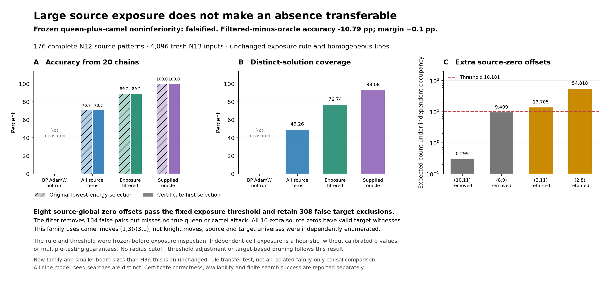

# H3t: the unchanged exposure filter fails on queen-plus-camel transfer

**The frozen noninferiority hypothesis is falsified.** Trained on all 176 unique N12 queen-plus-camel solutions, the exposure-filtered hybrid reaches **89.208984%** accuracy from 20 chains on 4,096 fresh N13 inputs. The supplied target-rule oracle reaches **100%**. The filtered-minus-oracle difference is **−10.791016 percentage points**, with paired-input bootstrap one-sided 95% endpoints **[−11.572266, −10.034180]**, far outside the declared −0.1-point margin. There are 442 regressing input clusters and zero wrong stopped chains.

| Method | Original N20 (%) | Certificate-first N20 (%) | Coverage (%) | Wrong stopped chains |
|---|---:|---:|---:|---:|
| BP AdamW | Not run | Not run | Not run | — |
| Full-N12 hybrid retaining all zero offsets | 70.654297 | 70.654297 | 49.261596 | 0 |
| Exposure-filtered hybrid | 89.208984 | 89.208984 | 76.736231 | 0 |
| Supplied N13 queen-plus-camel oracle | 100.000000 | 100.000000 | 93.062007 | 0 |

N20 denotes selection from 20 search chains, each capped at 20,000 moves; board size is N13. Scores average search seeds 0, 1 and 2; wrong stops sum over seeds. Original lowest-energy and certificate-first selection agree here but remain separately audited. BP AdamW was not measured for this task. The oracle explicitly supplies the target attack graph, rather than learning it from source examples.

The task forbids queen attacks and camel moves with absolute displacement (1,3) or (3,1). Knight moves are not included. An independent constraint-aware enumeration exactly matched filtering the complete ordinary-queen solution universes: **176 of 14,200** N12 boards and **1,932 of 73,712** N13 boards. Every resulting board was pairwise checked. Enumeration and input-universe feasibility took **3.350197 CPU seconds**, within its 120-second envelope, before source exposure inspection.

The source exposure rule is unchanged from H3r. For N = 176 unique source solutions, cell occupancy counts m_i and canonical displacement o,

\[
E_o=\frac{1}{N}\sum_{(i,j):\,j-i=o}m_i m_j.
\]

The sum covers all valid placements on the source board. An observed-zero finite displacement is retained exactly when **E_o ≥ ln(K/0.01)**, where **K = 264** and the threshold is **10.1811192891**. Homogeneous lines are inferred from the unfiltered source counts by the unchanged rule and unioned afterward. The rule, constant, source, cohort, controls and decision criterion were frozen before any exposure score was inspected. There is no radius cutoff or target-based tuning.

This expected count assumes independent cell occupancy, which the constrained source solutions do not satisfy. It is an **independence-model heuristic**, without calibrated p-values, multiple-testing validity or coverage guarantees. H3r's success did not establish validity of that model; the present result shows a concrete failure of transfer even for source absences with large heuristic exposure.

The complete source has **64 zero offsets**: 48 actual local-rule offsets and 16 extra absences. The filter retains 50 finite zeros and removes 14. Eight removed extras account for 104 false target exclusions; six removed true-rule offsets are restored by the unchanged queen lines. Eight extra absences survive the filter and cause **308 false target exclusions**. Both learned graphs include every true target attack; the unfiltered model has 412 false exclusions and the filtered model has 308. The oracle has 3,808 true forbidden pairs.

| Extra source-zero offsets | Exposure per offset | Filter decision | False target pairs per offset | Occupied target-pair occurrences per offset |
|---|---:|---|---:|---:|
| (2,±8), (8,±2) | 54.818182 | Retained | 55 | 52 |
| (2,±11), (11,±2) | 13.704545 | Retained | 22 | 80 |
| (8,±9), (9,±8) | 9.409091 | Removed | 20 | 120 |
| (10,±11), (11,±10) | 0.295455 | Removed | 6 | 116 |

Each row represents four canonical offsets. Every one of the 16 extra source-zero offsets occurs in at least one valid target solution. In particular, high independent-cell exposure does not distinguish a local forbidden relation from a global absence specific to the complete source solution universe. Every score and retention decision is available in the [264-row source export](../../../../results/research/loki/h3t/source_offset_exposures.csv); the [removal table](../../../../results/research/loki/h3t/removed_zero_offsets.csv) records all 14 removals.

The filter still improves on the unfiltered hybrid by **18.554688 accuracy points**, with descriptive one-sided 95% endpoints **[17.578125, 19.531250]**. Coverage improves by **27.474635 points**, with endpoints **[26.778746, 28.182508]**. These improvements do not rescue the primary noninferiority claim. All intervals use 2,000 paired bootstrap draws, RNG seed 20261114, retaining all three search seeds inside each unique-input cluster. They quantify variation over this input cohort, not independent source learning.

The exact compatible-completion census admits valid certificates for **2,894/4,096 inputs and 7,772/15,729 completions** under the unfiltered model, **3,654/4,096 inputs and 12,686/15,729 completions** under the filter, and all inputs and completions under the oracle. For these runs, certificate-existence counts exactly equal successful-input counts at every search seed: learned-model failures all occur on inputs lacking a valid certificate. This is an observed correspondence for the declared solver and cohort, not a universal accuracy bound for fallback decoders. Conditional certificate correctness, certificate availability and finite-search success remain distinct properties.

The fresh cohort uses seed **2026112510**, with **8 one-clue, 204 two-clue and 3,884 three-clue inputs**, uniformly sampled over unique valid partial inputs. From 190,993 possible inputs, excluding overlap with all 18,432 prior H3j/H3k/H3l/H3m/H3n N13 search keys removes 9,200 cases and leaves 181,793 eligible. The selected 4,096 keys are disjoint from those prior searches and have 15,729 compatible target completions. Source fitting reads only the separate complete N12 archive. This distribution differs from the original paper's partial-input multiplicities.

The model uses q = 13, J = 13×forbidden − 1, zero diagonal/unary terms, delta = 12, tau = −78, unit = 25.909505208333332, temperature multiplier 1, strict local margin delta − 0.001, and the q-cardinality stop gate. The unit is inherited, with no camel-family calibration. This is one complete finite source universe; the three seeds repeat search and are not independent source draws. Geometric displacement sharing, homogeneous-line candidates and target cardinality remain supplied inductive assumptions.

This experiment changes both the attack family **and board sizes** relative to H3r (N12→N13 here versus N14→N15 there). It tests the unchanged rule on a new setting; it does not isolate a family-only causal effect. No threshold adjustment follows this failure within H3t.

Independent preflight rebuilt source co-occurrences and marginal products, the exposure threshold decisions, inferred lines, all target coefficients, energies and single-cell costs. CPU and GPU backend checks passed. All nine model–seed jobs have distinct solver identities; no outcome mappings were used. The final audit checked **737,280 saved boards**, exhaustive family membership and givens, float64 energies, strict stopped margins, both selectors, coverage, move caps and operation counts. No wrong stop or numerical certificate deficit was found. Total measured GPU-worker time was **230.656675 seconds**, within the 20 GPU-minute budget. Live checks observed both Loki GPUs at 82–93% utilization during parallel work; the final single-job tail used one GPU. Both GPUs were idle after completion.

The frozen protocol's identity paragraph says “four logical arms”; this is a clerical carryover. Its explicit arm list contains the three arms shown here, and its declared budget is nine model–seed jobs. The frozen file is retained unchanged; there was no fourth arm or undisclosed selection.

[Frozen protocol](protocol.json), [independent enumeration](enumerate.py), [cohort reservation](prepare.py), [source fitter and runner](driver.py), [independent preflight](preflight.py), [identity check](reuse_identities.py), [output audit](analyze.py), [figure renderer](plot_public.py), [tracked summary](../../../../results/research/loki/h3t/summary.json), [per-seed counts](../../../../results/research/loki/h3t/per_seed.csv), [figure provenance](../../../../results/research/loki/h3t/plot-provenance.json).
