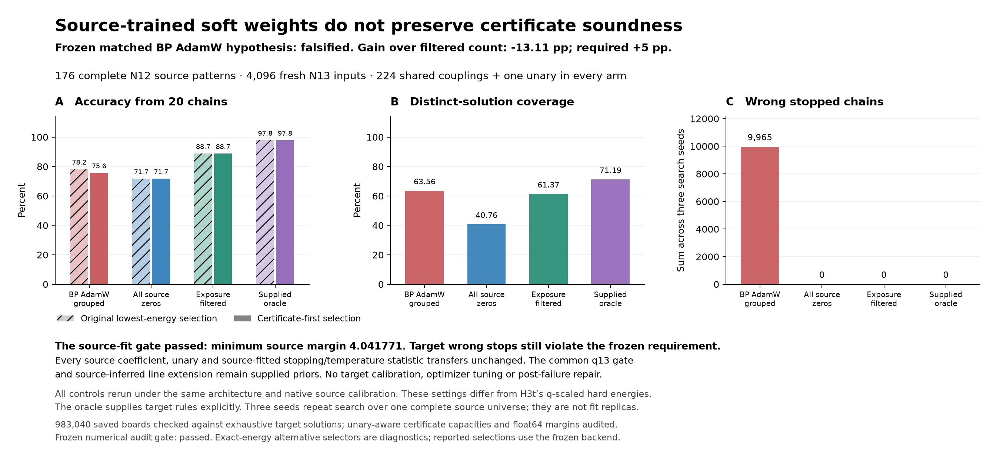

# H3u: source-trained soft weights fail the matched transfer hypothesis

**The frozen hypothesis is falsified.** Grouped BP AdamW reaches **75.634766% certificate-first N20 accuracy**, versus **88.745117%** for the matched exposure-filtered count control. The difference is **−13.110352 percentage points**, with paired-input bootstrap one-sided 95% endpoints **[−14.144287, −12.117513]**; the prespecified requirement was a gain of at least 5 points. The soft model also produces **9,965 wrong stopped chains**, violating the zero-wrong-stop requirement. Its source-fit eligibility gate passed, and independent float64 checks confirm that the wrong stops satisfy the learned margin.

| Method | Original N20 (%) | Certificate-first N20 (%) | Coverage (%) | Wrong stopped chains |
|---|---:|---:|---:|---:|
| BP AdamW, matched grouped architecture | 78.181966 | 75.634766 | 63.555762 | 9,965 |
| Full-source count hybrid | 71.671549 | 71.671549 | 40.755727 | 0 |
| Exposure-filtered count hybrid | 88.745117 | 88.745117 | 61.373485 | 0 |
| Supplied-rule oracle | 97.843424 | 97.843424 | 71.188202 | 0 |

N20 means selection from 20 chains on an N13 board; each chain has a 20,000-move cap. Scores average three search seeds, 0/1/2. Wrong stops sum across seeds. The oracle supplies the true queen-plus-camel rules explicitly. It uses the same energy scale, architecture and source-only calibration convention as the other arms. Its result is a privileged matched control, not learned rule recovery.

The experiment follows H3t's failure, with that adaptive history declared before fitting. Every arm uses **the same 224 couplings plus one shared unary**: the four homogeneous lines inferred from all 176 N12 source solutions each share one coefficient; the remaining 220 finite source offsets each have one coefficient. The four line groups are disjoint. This grouped BP AdamW is the matched optimizer control. The original paper's untied 264-offset-plus-unary model is outside this study.

BP AdamW fits exact pseudolikelihood over all 176 unique source solutions and every one-, two- or three-clue subset of each solution. Each source solution yields 298 rows. Sufficient statistics assign occupied cells a free-cell multiplicity of 231 and empty cells a multiplicity of 298, with the loss divided by the total number of free cells. The fit uses zero energy initialization, 4,000 updates, learning rate 0.3 with a 4,000-update cosine schedule, weight decay 0.01, betas (0.9, 0.999), epsilon 1e−8, float32, TF32 disabled, and no preconditioner. These settings were fixed before fitting; no target outcome chooses them.

The count controls use source coefficients J = 12×forbidden − 1 and zero unary. The full hybrid retains every source-zero offset. The filter retains finite source zeros only when the unchanged exposure score is at least ln(264/0.01), then unions the unchanged inferred lines. The oracle supplies true queen and camel attacks. Exposure remains an independence-model heuristic without calibrated p-values or coverage guarantees.

**Every coefficient and unary transfers unchanged from N12 to N13.** The inferred line coefficients extend to every target offset on their lines. Newly representable off-line offsets receive the common fixed background coefficient −1. Each model's delta is its minimum source-solution flip margin, tau its maximum source-solution energy, and unit its mean absolute source field, independently reconstructed in float64 from the stored float32 parameters. Those three scalars also transfer unchanged. The common q=13 cardinality gate is supplied. There is no target-based threshold, temperature or coefficient rescaling.

| Source-derived calibration | BP AdamW grouped | Count hybrid | Filtered count | Supplied oracle |
|---|---:|---:|---:|---:|
| Minimum source margin delta | 4.041771 | 11 | 11 | 11 |
| Maximum source energy tau | −31.830926 | −66 | −66 | −66 |
| Mean absolute field unit | 10.389139 | 34.541667 | 33.893939 | 31.015152 |

The protocol required finite parameters/calibration, positive unit and positive delta before optimizer-arm target inference. Failure would have falsified the primary as source-fit ineligibility, without retuning; the gate passed. The final source PL loss was 0.000321871. Search uses the local threshold delta−0.001, normalized temperature multiplier 1, and the q gate. Tau is retained for model provenance but does not determine the local stop predicate.

These source-native energies and calibrations **differ from H3t's symbolic J=13×forbidden−1, delta=12 and shared inherited unit**. All controls were rerun on the new cohort. H3u's 97.843424% oracle accuracy and H3t's 100% oracle accuracy describe different frozen inference conditions and must not be pooled. H3u tests a complete fixed soft-weight fitting and transfer recipe; it does not identify separate causal effects of unary fitting, coefficient learning and the resulting source calibration.

All **9,965 false stopped boards contain exactly 13 queens and exactly one queen in every row and column**. They contain 16,941 diagonal and 1,670 camel conflict-edge occurrences. No observed false conflict uses a newly representable endpoint line offset. Learned row/column coefficients are approximately 5.126153, diagonal coefficients 1.969299, camel coefficients 1.124206, and the shared unary is +0.403399. Source-global extras also remain positive: for example, (2,8) has weight 0.905711, (2,11) 1.459160 and (10,11) 2.425902. These values are post hoc diagnostics, not a threshold-selection rule.

Negative interactions with other occupied cells can outweigh a positive conflict penalty, leaving every free-cell flip cost above the learned source threshold. The [mechanism audit](../../../../results/research/loki/h3u/false-stop-mechanism.json) records a concrete false stop with two diagonal conflicts: its four conflict endpoints have removal costs 5.145405, 5.412044, 5.069000 and 4.841068, while the frozen required margin is 4.040771. All its free-cell margins exceed that threshold. Each false stopped board contains exactly two newly representable off-line occupied pairs, giving a constant total energy contribution of −2 within these states; incident local margins still include those terms. This decomposition does not identify a causal repair.

Certificate-first selection corrects 283 but regresses 596 input–seed cases compared with ordinary lowest-energy selection, reducing accuracy by 2.547201 points. The learned stopping flag is not a correctness oracle. Soft-weight coverage nevertheless exceeds filtered-count coverage by **2.182276 points**, with descriptive endpoints **[1.528553, 2.840588]**. Against the raw count hybrid, certificate-first accuracy improves by 3.963216 points, with endpoints [2.986247, 4.915365]. These secondary results do not rescue either primary requirement.

The independent unary-aware certificate census finds:

| Model | Inputs with any valid certificate | Compatible valid certificates |
|---|---:|---:|
| BP AdamW grouped | 2,735 / 4,096 | 7,028 / 15,639 |
| Count hybrid | 2,986 / 4,096 | 7,645 / 15,639 |
| Exposure-filtered count | 3,704 / 4,096 | 12,558 / 15,639 |
| Supplied oracle | 4,096 / 4,096 | 15,639 / 15,639 |

For BP AdamW, 704 of 1,932 valid complete target boards have at least one empty-cell margin below the source threshold. The smallest target valid-board margin is positive, 0.147195, but is well below the source-derived delta. Across the three seeds, valid fallback answers succeed on 411, 397 and 401 inputs that have no valid stopped certificate. This directly demonstrates why certificate-existence counts are not a universal accuracy bound for a fallback decoder. Conditional correctness, valid-certificate availability and finite-search accuracy remain separate.

The fresh cohort uses seed **2026112511** and contains **2 one-clue, 218 two-clue and 3,876 three-clue inputs**, with **15,639** compatible completions. It is sampled uniformly over unique valid inputs, excludes all 22,528 prior H3j/k/l/m/n/t N13 search keys, and comes from 177,697 eligible cases. The complete target universe was already known from H3t. Three seeds repeat search on one complete finite source universe and one zero-initialized optimizer trajectory. Bootstrap intervals use 2,000 paired input resamples, RNG 20261114, keeping all three seeds inside each input cluster; they do not estimate independent-source learning uncertainty.

Before fitting, a literal 894-row float64 fixture matched the aggregated objective exactly and matched gradients within 5.55e−16. Two AdamW updates matched independent moment equations. On the actual source data, CPU/GPU loss and gradient differences were 2.58e−8 and 8.87e−8. The exact compression from 52,448 expanded rows to 176 complete patterns measured a **7.607928× median forward/backward speedup** after warm-up; this is not an end-to-end training speedup. The fit completed in **1.839917 GPU seconds**, below its 120-second allowance.

An initial validation-only dtype error was caught before any fit or target search: the float64 fixture accidentally normalized float32 multiplicity weights. Its original frozen files are preserved, and the [prelaunch amendment](PRELAUNCH_AMENDMENT.md) documents the correction and re-freeze. No model implementation, data, hypothesis, threshold, tolerance or budget changed.

Independent preflight reconstructed every source group, target coefficient, unary, calibration scalar and cohort count, and checked synthetic literal energies and all one-cell changes. All four solver identities are distinct. CPU/GPU backend checks passed. The final audit checked **983,040 saved boards** for exact exhaustive family membership, givens, original/certificate-first selectors, coverage, move caps, operation counts, float64 energies and strict free-cell margins. **There are zero strict negative stopped-margin gaps**. The largest energy reconstruction discrepancy is **0.001348439**, below the frozen 0.1 diagnostic limit; the smallest soft stopped gap is **0.000153309**, above zero. The frozen numerical audit gate passes. Replacing saved running energies with independently recomputed exact energies changes many chain indices through duplicate/tied solutions, but leaves all three BP AdamW accuracy counts unchanged; the largest selected exact-energy regret is 1.565e−7.

The 12 searches used **399.267477 aggregate GPU-worker seconds**, within the 20 GPU-minute envelope. Live checks observed both Loki GPUs progressing through the shared queue at 71–72% and later 90–91% utilization. Both GPUs were idle after completion. No identities were mapped, no cap was shortened, and no failed stop was discarded.

[Frozen protocol](protocol.json), [cohort reservation](prepare.py), [fitting and search](driver.py), [independent preflight](preflight.py), [identity check](reuse_identities.py), [output audit](analyze.py), [mechanism audit](mechanism.py), [figure renderer](plot_public.py), [tracked summary](../../../../results/research/loki/h3u/summary.json), [per-seed counts](../../../../results/research/loki/h3u/per_seed.csv), [all source offset weights](../../../../results/research/loki/h3u/source_offset_weights.csv), [figure provenance](../../../../results/research/loki/h3u/plot-provenance.json).
