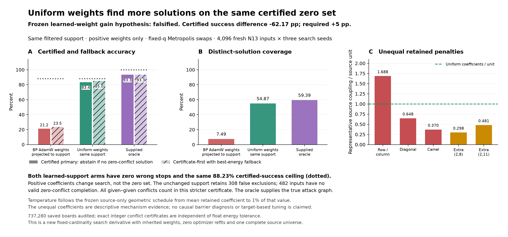

# H3v: uniform weights outperform learned positive weights on the same zero set

**The frozen learned-weight search-benefit hypothesis is falsified.** Positive inherited BP AdamW weights find a valid zero-conflict completion among 20 chains on **21.248372%** of fresh inputs, versus **83.414714%** with uniform weights on exactly the same support. The paired difference is **−62.166341 percentage points**, with one-sided 95% bootstrap endpoints **[−63.069661, −61.287435]**; the declared requirement was a gain of at least 5 points. Every arm has zero wrong stopped chains.

| Method | Certified primary (%) | Original lowest-energy accuracy (%) | Certificate-first fallback accuracy (%) | Coverage (%) | Wrong stopped chains |
|---|---:|---:|---:|---:|---:|
| BP AdamW weights, positive projection on filtered support | 21.248372 | 23.470052 | 23.470052 | 7.487144 | 0 |
| Uniform weights on identical filtered support | 83.414714 | 84.993490 | 84.993490 | 54.866872 | 0 |
| Supplied-rule oracle, uniform weights | 93.277995 | 93.277995 | 93.277995 | 59.392069 | 0 |

The primary returns a certified solution if any of the 20 chains finds one, and abstains otherwise. Its success counts require both an exact zero-conflict stopping flag and independent target-rule validity. The two fallback accuracies remain separate secondary metrics. All scores average search seeds 0/1/2; wrong stopped chains sum across seeds. No optimizer was refitted: the first row reuses H3u's frozen BP AdamW coefficients after the declared projection.

The learned-support arms share a single source-derived forbidden-edge set F. It uses the unchanged H3u exposure filter on finite source offsets, unioned with the unchanged homogeneous lines inferred from the 176 complete N12 source solutions. The source has 56 retained offsets after that union. All retained learned coefficients are strictly positive, with minimum **0.9057108164**. The weighted arm keeps those coefficients on F and sets all other pair coefficients and the unary to zero. The uniform arm assigns weight 1 to each edge of F. The privileged oracle supplies the true queen-plus-camel support with weight 1.

Independent reconstruction confirms that the two learned-support arms have **exactly the same F**, with 4,116 target pairs: all 3,808 true attacks plus 308 false exclusions. The oracle contains exactly the 3,808 true attacks. Target geometry is used only to diagnose those counts; it never changes either source-only producer. Positive projection removes the compensating negative interactions seen in H3u, but retains its source-global false exclusions. It discards nonuniform off-support learned couplings as well as the unary; it is not merely a constant energy shift of H3u's variable-cardinality model.

The new kernel preserves q=13 throughout. Initialization holds the givens and adds uniformly sampled nongiven cells until there are exactly 13 queens. Each proposal chooses uniformly one occupied nongiven cell i and one empty cell j, then moves that queen from i to j. With the current field g and symmetric zero-diagonal J,

\[
\Delta E = g_j-g_i-J_{ij}.
\]

The move is accepted with probability min(1, exp(−ΔE/T)). Candidate sets have fixed sizes q−number of clues and 169−q, making forward and reverse proposal probabilities equal. Nongiven occupied cells and empty cells are disjoint sets; the implementation uses independent maxima over their subsets of one vector of independent uniform scores. Givens cannot be removed. The kernel stops only when the **exact integer number of occupied F-edges is zero**, independent of floating energy tolerances. Weighted and uniform energies therefore have the same zero set.

The temperature schedule is fixed before target search:

\[
T(k)=u\,0.01^{k/19999},\qquad k=0,\ldots,19999.
\]

Here u is the arithmetic mean positive coefficient over unique retained canonical **source** offsets after line union, computed in float32 as in the source-only pilot. It is **3.0367188454** for the inherited weights and **1** for both uniform arms. There is no target-based temperature selection. Each chain has 20,000 proposed swaps, with 20 chains per input and three search seeds. Matching seed/initialization conventions do not imply identical post-initial random streams: completion-dependent compaction can change subsequent RNG consumption.

The exact zero-set census gives:

| Support | Valid complete target boards with zero conflicts | Inputs admitting a zero-conflict completion | Compatible zero-conflict completions |
|---|---:|---:|---:|
| Filtered F, both weighted and uniform | 1,548 / 1,932 | 3,614 / 4,096 | 12,312 / 15,446 |
| Supplied true support | 1,932 / 1,932 | 4,096 / 4,096 | 15,446 / 15,446 |

The common filtered-support ceiling for the abstaining primary is **88.232421875%**. Of the 482 unsupported inputs, 90 already contain an F-conflict between given cells. Unlike a local-margin certificate that ignores clamped-cell removal costs, this strict zero-conflict certificate counts given–given edges. H3u's certificate-capacity counts cannot be reused here. The [full per-input capacity export](../../../../results/research/loki/h3v/per-input-capacity.npz) preserves the exact counts and keys.

The large weighted/uniform search gap cannot be attributed to a different feasible zero set. Uniform search still leaves a finite-search gap of **4.817708 points** below that shared ceiling; that is already less than the experiment's 5-point desired gain. Even ideal search on this fixed F cannot match the observed oracle primary within 0.1 point: its ceiling is 5.045573 points below the oracle's measured 93.277995%. This is a cohort-specific capacity comparison, not a bound on general fallback accuracy.

The inherited weights assign unequal relative costs: row/column coefficients divided by the source temperature unit are approximately 1.688, diagonal coefficients 0.648, camel coefficients 0.370, and the extra source-zero offsets (2,8) and (2,11) approximately 0.298 and 0.481. This is descriptive evidence for investigating how the proposal interacts with unequal penalties. H3v does not isolate a causal barrier mechanism, compare alternative temperature schedules, or establish that uniform weighting is optimal outside this frozen setup. A source-trained pseudolikelihood coefficient is not automatically an effective search penalty.

The fresh cohort uses seed **2026112512**, excludes all **26,624** prior H3j/k/l/m/n/t/u N13 search keys, and samples from 173,601 eligible unique valid inputs. It contains **4 one-clue, 208 two-clue and 3,884 three-clue inputs**, with 15,446 compatible completions. The complete target universe was already known. Bootstrap statistics use 2,000 paired input resamples, RNG 20261114, keeping all three search seeds together within each input. They describe input variation for one complete source universe and one inherited fitted trajectory, not independent source-learning replication.

Before target search, CPU and GPU validation checked all **84** q=3 states on a nine-cell toy and **3,024** legal swaps across zero, one and two clamped clues. Literal full energies matched the swap delta; reverse proposals had identical probabilities; detailed balance was checked at fixed temperatures 0.1, 1 and 3. Every traced state preserved q and givens, and every field, energy and integer conflict count matched direct reconstruction. CPU/GPU random-number algorithms differ, so the gates independently audit each trace rather than claim bitwise equal trajectories. Native CRAM dense-energy parity passed on 32 source fixtures, including dense random boards.

The bounded source-only GPU pilot ran 5,107,011 proposals in **0.565766 seconds** on 128 N12 source inputs × 20 chains × 2,000 proposals. It established runtime feasibility and did not change the frozen scientific settings. Independent preflight then reconstructed all source support, weights, temperature units, target extensions and fresh input counts.

The final audit checked **737,280 saved boards**. Every board preserves q=13 and its givens. All saved integer conflict counts match independent reconstruction; every stopped state has exactly zero conflicts and exactly zero recomputed repulsive energy. No capped state is silently discarded. The maximum floating running-energy discrepancy is **0.000178576**, below the frozen 0.1 diagnostic gate. The audit accelerates exact integer-range conflict counting using float64 matrix multiplication: all operands/intermediate counts remain exact integers far below 2^53. A [separate validation](../../../../results/research/loki/h3v/audit-count-validation.json) matched literal int64 results and measured a **17.396066×** median microbenchmark speedup; every full target solution was also checked by literal occupied-pair counting.

The nine distinct searches used **242.106412 aggregate GPU-worker seconds**, within the 20 GPU-minute envelope and shared ten-minute wall-clock deadline. There were no optimizer refits or identity mappings. Live checks showed both GPUs active through the queue, including a 90%/70% utilization sample near its end; the final single-job tail used one GPU. Both GPUs were idle afterward. Proposed swaps, accepted swaps, runtime and all cap returns are retained; this new kernel's proposal budget is not an equal-FLOP comparison with the paper's single-cell solver.

[Frozen protocol](protocol.json), [fresh cohort](prepare.py), [producer and runner](driver.py), [swap kernel](backend.py), [exhaustive toy/source gates](validate_kernel.py), [independent preflight](preflight.py), [saved-state audit](analyze.py), [count-performance validation](validate_audit_counts.py), [figure renderer](plot_public.py), [tracked summary](../../../../results/research/loki/h3v/summary.json), [per-seed counts](../../../../results/research/loki/h3v/per_seed.csv), [figure provenance](../../../../results/research/loki/h3v/plot-provenance.json).
