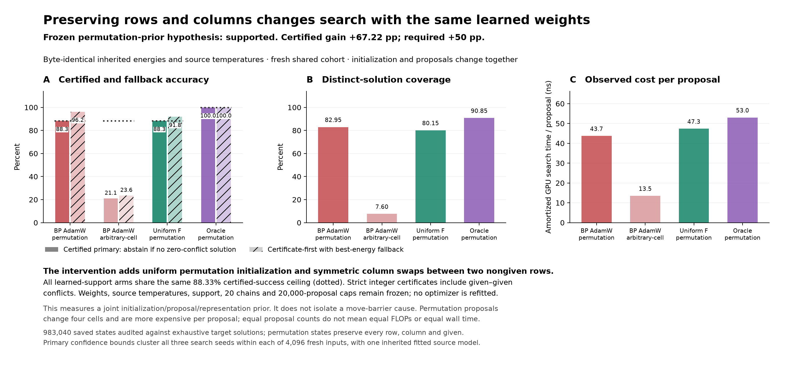

# H3w: a permutation prior restores search with unchanged learned weights

**The frozen ≥50-point gain hypothesis is supported.** With identical saved positive BP AdamW weights and source temperatures, permutation initialization and row-pair column swaps reach **88.305664% certified success**, versus **21.085612%** for the rerun arbitrary-cell initialization and swap kernel on the same fresh cohort. The paired gain is **67.220052 percentage points**, with one-sided 95% bootstrap endpoints **[66.292318, 68.155924]**. All four arms have zero wrong stopped chains.

| Method | Certified primary (%) | Original lowest-energy accuracy (%) | Certificate-first fallback accuracy (%) | Coverage (%) | Wrong stopped chains |
|---|---:|---:|---:|---:|---:|
| BP AdamW weights, permutation initialization/proposals | 88.305664 | 96.215820 | 96.215820 | 82.947957 | 0 |
| Same BP AdamW weights, arbitrary-cell initialization/proposals | 21.085612 | 23.600260 | 23.600260 | 7.600664 | 0 |
| Uniform filtered weights, permutation initialization/proposals | 88.313802 | 91.829427 | 91.829427 | 80.151422 | 0 |
| Supplied-rule oracle, permutation initialization/proposals | 100.000000 | 100.000000 | 100.000000 | 90.846463 | 0 |

The primary finds any independently valid zero-conflict stopped completion among 20 chains, and abstains if none is found. Fallback accuracy and coverage are secondary. Scores average search seeds 0/1/2; wrong stops sum across seeds. The first two arms have **byte-identical model files** and identical source temperature units. They use different initialization and transition rules, so no outcome identity or mapping is claimed. Every one of the 12 model–seed jobs is a fresh search.

H3v motivated this adaptive follow-up before its new cohort was reserved. The learned row/column coefficients were much larger than diagonal and camel coefficients. H3w tests whether explicitly preserving the source-inferred row/column prior improves the full search recipe. It changes **both initialization and proposals**, adding a stronger representation prior. The measured gain does not isolate a causal effect of move barriers alone.

The source-inferred primitive-line family was independently reconstructed from all 176 N12 source solutions and contains the two axis-aligned lines as well as both diagonals. Permutation initialization holds every given queen fixed and uniformly permutes unused columns among nongiven rows. Each resulting board contains one queen per row and one per column. A proposal chooses two distinct nongiven rows uniformly and exchanges their queen columns. Forward and reverse transpositions have the same proposal probability; Metropolis acceptance uses min(1, exp(−ΔE/T)). The four changed cells consist of two removals and two additions, preserving q=13, row uniqueness, column uniqueness and every given queen.

The arbitrary-cell control reruns the unchanged H3v kernel. It initializes the givens plus uniformly sampled additional cells to reach q=13, then proposes moving one occupied nongiven cell to an empty cell. It preserves q and givens but can violate row or column uniqueness. No H3v outcomes are reused on the new cohort.

All energies are copied byte-for-byte from H3v. The inherited learned model retains its positive BP AdamW coefficients only on the unchanged exposure-filtered source support F, with zero unary and zero off-support coefficients. The matched uniform control assigns weight 1 on the same F. The oracle explicitly supplies true queen-plus-camel support with weight 1. The filtered support contains 4,116 target pairs, including all 3,808 true attacks and 308 false exclusions. No source model is refitted, no support entry changes and no target-dependent coefficient is introduced.

Temperature also remains unchanged:

\[
T(k)=u\,0.01^{k/19999},\qquad k=0,\ldots,19999,
\]

with **u=3.0367188453674316** for both learned-weight arms and **u=1** for uniform and oracle. The source unit still includes the row/column coefficients, even though row/column conflict energies are zero on permutation states. There is no recalibration on the new representation or target data. Every arm uses 20 chains and a 20,000-proposal cap.

All arms stop only at an **exact integer count of zero occupied F-edges**, including given–given edges. The certificate is independent of floating energy tolerance. The complete-state support is unchanged, so all three learned-support arms share exactly the same census: **1,548/1,932** full target boards, **3,618/4,096** partial inputs and **12,253/15,250** compatible completions admit zero-conflict answers. The abstaining certified-primary ceiling is therefore **88.330078125%**. Of the 478 unsupported inputs, 94 contain a false F-conflict between their givens. All oracle inputs and completions are supported.

The learned permutation model misses just three supported input–seed cases, all under seed 1; the uniform permutation model misses two, both under seed 2. Their certified success differs by **−0.008138 points**, with descriptive endpoints **[−0.032552, 0.016276]**. Neither support recovery nor the source-global false-exclusion problem is repaired. The new representation makes search approach the existing support ceiling.

The secondary fallback comparison reveals a different effect. Learned permutation weights achieve **96.215820%** fallback accuracy versus **91.829427%** for uniform permutation weights: a descriptive gain of **4.386393 points**, with endpoints **[3.841146, 4.899089]**. Coverage improves by **2.796535 points**, with endpoints **[2.517877, 3.093185]**. For each of the three search seeds, the learned permutation model returns correct fallback answers on **324 inputs with no valid zero-conflict certificate**; uniform permutation weights do so on 144, 147 and 141 inputs. These answers are independently valid target solutions that violate extra source-derived exclusions. They remain uncertified under F. The certified-primary ceiling is not a bound on fallback accuracy, and these descriptive results do not establish correctness of arbitrary fallback outputs.

| Method | Proposed swaps, all seeds | Accepted swaps | Total measured search seconds | Amortized ns per proposed swap |
|---|---:|---:|---:|---:|
| BP AdamW weights, permutation | 2,305,398,455 | 379,027,584 | 100.736534 | 43.696 |
| Same BP AdamW weights, arbitrary-cell | 4,878,139,837 | 170,907,290 | 65.894480 | 13.508 |
| Uniform filtered weights, permutation | 1,800,444,388 | 133,483,201 | 85.247011 | 47.348 |
| Supplied-rule oracle, permutation | 1,630,011,086 | 179,057,141 | 86.391969 | 53.001 |

Permutation proposals change four cells and update more interaction terms. They cost more per proposed move in this implementation. The learned permutation recipe performs fewer moves because more chains stop, yet uses more measured search time than its arbitrary-cell control. These are amortized timings over batched GPU work, not serial proposal latency. Equal maximum proposal counts do **not** mean equal FLOPs or equal wall-clock compute. This study supports a quality gain for the declared recipes and budgets; it does not establish a speedup or an equal-compute advantage.

The fresh cohort uses seed **2026112513**, excludes all **30,720** prior H3j/k/l/m/n/t/u/v N13 search keys, and draws from 169,505 eligible unique valid inputs. It contains **2 one-clue, 239 two-clue and 3,855 three-clue inputs**, with **15,250** compatible completions. The complete target universe was previously enumerated. Bootstrap intervals use 2,000 paired input resamples, RNG 20261114, with the three search seeds retained inside each input cluster. There is one complete source universe and one inherited fitted trajectory; these are not independent training replicas.

Before target search, CPU and GPU gates covered all **24** four-row permutations and **240** transpositions with zero, one or two fixed prefix clues, verified uniform-initialization support sizes 24/6/2, and checked symmetric proposal probabilities and detailed balance at fixed temperatures 0.1, 1 and 3. Literal full energy and integer conflict differences matched every transition. Each recorded trace preserved q, rows, columns, givens, fields and conflict counts. Native dense CRAM energies matched 32 source fixtures. A source-only pilot also used random three-clue subsets of 128 N12 source patterns; its GPU run completed 3,259,803 proposals in **1.280710 seconds**. It established feasibility without altering the frozen scientific settings. Independent preflight verified source-inferred axes, all copied model hashes and the entire new cohort.

The final audit independently checked **983,040 saved boards** for exhaustive target membership, givens, q, integer conflicts, both output selectors, coverage, proposed/accepted counters and all cap returns. Every permutation-arm output has exactly one queen per row and column. Every stopped state has zero recomputed F-conflicts and zero exact repulsive energy. The largest running-energy discrepancy is **0.001916409**, below the frozen 0.1 diagnostic limit; the numerical gate passes. Recomputing selection with independent exact energies leaves every per-seed fallback accuracy count unchanged. Exact-range accelerated conflict counting reuses H3v's separately validated arithmetic and matching support.

All 12 searches completed in **340.836310 aggregate GPU-worker seconds**, within the shared ten-minute wall deadline and 20 GPU-minute envelope. Live checks verified progressing jobs on both Loki GPUs at 72% and 89% utilization. The last single-job tail finished about nine seconds after the other worker; both GPUs were idle after completion. No cap, model, temperature or outcome was changed during the campaign.

[Frozen protocol](protocol.json), [cohort reservation](prepare.py), [copy/runner](driver.py), [permutation kernel](backend.py), [toy/source validation](validate_kernel.py), [independent preflight](preflight.py), [saved-state audit](analyze.py), [descriptive fallback analysis](fallback_analysis.py), [figure renderer](plot_public.py), [tracked summary](../../../../results/research/loki/h3w/summary.json), [per-seed counts](../../../../results/research/loki/h3w/per_seed.csv), [exact per-input capacities](../../../../results/research/loki/h3w/per-input-capacity.npz), [fallback comparisons](../../../../results/research/loki/h3w/fallback-comparisons.json), [figure provenance](../../../../results/research/loki/h3w/plot-provenance.json).
