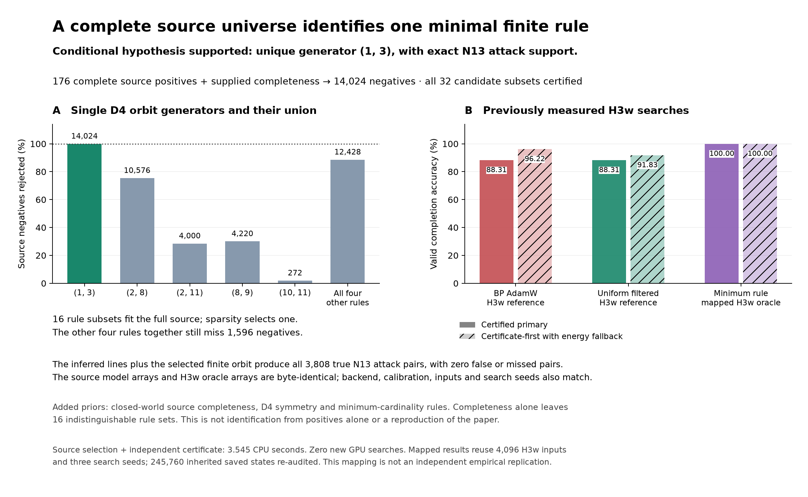

# H3x: complete source coverage identifies one minimum finite rule

**The frozen structural hypothesis is supported, conditional on supplied source completeness, D4 symmetry and a minimum-cardinality prior.** All 32 candidate rule subsets were exhaustively checked. The unique minimum consists of the single D4 generator **(1, 3)**. Together with the unchanged source-inferred row, column and diagonal lines, it gives exactly **3,808 N13 attack pairs**, with **zero false and zero missed pairs**. This removes the 308 false exclusions retained by H3w's exposure heuristic.

The new experiment is source-only symbolic rule selection and its exhaustive certificate. The finite support is selected without loading target data. Search outcomes below are inherited through an exact identity with the already measured H3w oracle; **there are zero fresh GPU searches and zero refits**. This does not constitute an independent search replication or a reproduction of the paper.

| Method | Certified primary (%) | Certificate-first fallback (%) | Coverage (%) | Wrong stopped chains | Evidence |
|---|---:|---:|---:|---:|---|
| BP AdamW weights, permutation | 88.305664 | 96.215820 | 82.947957 | 0 | H3w reference, same cohort |
| Uniform filtered weights, permutation | 88.313802 | 91.829427 | 80.151422 | 0 | H3w reference, same cohort |
| Minimum D4 rule, permutation | 100.000000 | 100.000000 | 90.846463 | 0 | Identity-derived H3w oracle outcomes |

H3w showed that the permutation search recipe nearly saturates the filtered support's certified ceiling. H3x therefore addresses the persistent support error. It adds a **closed-world completeness assumption**: the supplied 176 N12 source patterns contain every valid source placement. Only with that assumption do absent source placements become negative examples. The learning problem and information available differ from observing positive examples alone.

The line selector remains unchanged: canonical coprime normal vectors with coordinates in [−2, 2], at least three zero-count member offsets and no observed member offsets. It recovers normals **(0, 1), (1, −1), (1, 0), (1, 1)**. With q=12 and row exclusion, every compatible board has one object in each row. A row-recursive enumerator visits every placement satisfying those lines and returns **14,200 boards**. Exactly 176 match the supplied source bank; the remaining **14,024** are negative under completeness.

There are 64 zero-count source offsets. Removing those already represented by inferred lines leaves 20 offsets, grouped by sign changes and coordinate exchange into five D4 orbits. Every candidate orbit preserves all 176 positives. An orbit rejects a negative board if any occupied pair has a displacement belonging to that orbit.

| Finite D4 generator | Canonical offsets in orbit | Source negatives rejected |
|---|---|---:|
| **(1, 3), uniquely selected** | (1, ±3), (3, ±1) | **14,024 / 14,024** |
| (2, 8) | (2, ±8), (8, ±2) | 10,576 / 14,024 |
| (2, 11) | (2, ±11), (11, ±2) | 4,000 / 14,024 |
| (8, 9) | (8, ±9), (9, ±8) | 4,220 / 14,024 |
| (10, 11) | (10, ±11), (11, ±10) | 272 / 14,024 |

The objective minimizes the number of selected **orbit generators**, not individual edges. Every one of the 2⁵=32 subsets was evaluated. Exactly **16 source-indistinguishable rule sets** preserve every positive and reject every negative; all 16 contain (1, 3). **Completeness alone therefore does not identify one rule set.** The additional minimum-description prior selects the unique smallest set {(1, 3)}. The union of the other four orbits rejects only **12,428 negatives**, leaving **1,596** uncovered. One such negative has zero-based columns **[0, 2, 4, 7, 9, 11, 5, 10, 1, 6, 8, 3]** in rows 0–11. It satisfies every inferred line, violates none of the four extra orbits, and is absent from the complete positive bank. The tracked certificate retains a first uncovered negative for every non-cover, plus all board coordinates, membership flags and pair incidences.

An independent verifier re-enumerates the full source universe using precomputed attack masks and recursive bit-mask propagation, reconstructs every board's orbit incidence from literal row-pair sets, and checks all 32 subset coverages, witnesses and minima. Selection plus independent verification took **3.544691 wall seconds / 3.544631 CPU seconds on Loki**, within the shared frozen 60-second envelope. No target file is loaded by either source script. The source-result hash was sealed and sent to the coordinator before target diagnosis: **1ec9ed198c923c8f5570c51829e42d12b58e9946e02a2c66edbf82ad22eaf39b**.

After sealing, the selected finite offsets were transferred unchanged to N13 and the inferred lines were extended. The resulting support exactly matches the privileged target attack graph. All **1,932** target solutions, **4,096** H3w inputs and **15,250** compatible completions now have zero-conflict support. The corresponding filtered support had excluded 384 complete solutions, 478 inputs and 2,997 compatible completions on that same cohort. Target truth was used only for these post-selection diagnostics, with no tie choice or support adjustment.

The transferred energy uses uniform J=F, zero unary, q=13 and unit=1. The **dtype, shape and C-order bytes** of J, h, F, unit and q all exactly match H3w's oracle. The entire NPZ container also matches SHA **ac29a077b07629a74079c0b42dc1756b01af17c3c1e01680bba8414c1875ef7e**. The frozen permutation backend, uniform unused-column initialization, symmetric nongiven-row transpositions, exact integer zero-conflict certificate, temperature schedule, cohort and seeds also match. Consequently, the three existing H3w oracle outcomes map to this source-inferred minimum-rule model without additional search.

Those outcomes use **20 chains**, **20,000 proposals**, seeds **0/1/2**, and T(k)=0.01^(k/19999). The cohort was drawn in H3w with seed **2026112513** and contains **2 one-clue, 239 two-clue and 3,855 three-clue inputs**. It is reused here, not fresh. A new audit checked all **245,760 inherited saved states** against the reconstructed model, including target validity, givens, permutation structure, exact conflict counts, selectors and coverage. All checks passed; the reconstructed and running energies have zero discrepancy. The post-seal diagnostic and mapping took **0.780260 seconds**. Original oracle search time was 86.391969 seconds; that is inherited H3w compute, not newly incurred H3x training/search time.

This is uniqueness **within the declared source size and candidate family**, conditional on completeness, D4 symmetry, finite translation-invariant offsets, infinite-line extrapolation and a sparsity preference. It does not establish unrestricted identifiability, sufficiency of positive examples alone, or general transfer to other board sizes and rule families. The structural result is exhaustive for this finite source instance; the mapped search result supplies no independent empirical confirmation. There is one complete source universe and three inherited search seeds, not three independent learning draws.

[Frozen protocol](protocol.json), [source selector](solve_source.py), [independent certificate](verify_source.py), [post-seal identity audit](diagnose.py), [figure renderer](plot_public.py), [tracked summary](../../../../results/research/loki/h3x/summary.json), [source result](../../../../results/research/loki/h3x/source-result.json), [source certificate arrays](../../../../results/research/loki/h3x/source-certificate.npz), [all subset coverages and witnesses](../../../../results/research/loki/h3x/all_subsets.csv), [source verification](../../../../results/research/loki/h3x/source-verification.json), [source seal](../../../../results/research/loki/h3x/source-seal.json), [mapped per-seed results](../../../../results/research/loki/h3x/mapped_per_seed.csv), [figure provenance](../../../../results/research/loki/h3x/plot-provenance.json).
