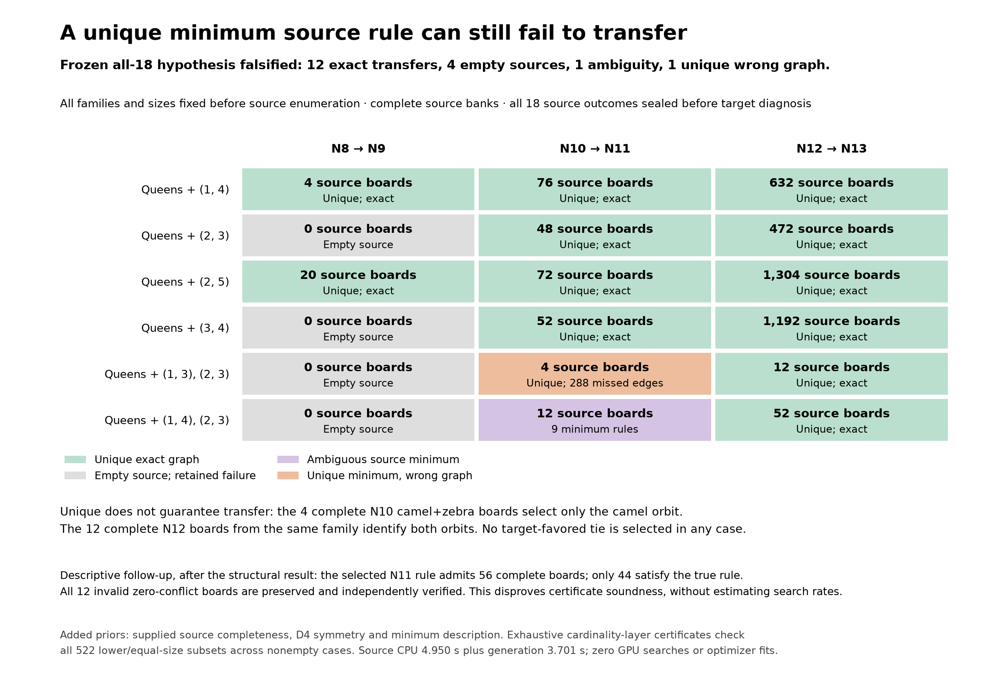

# H3y: a unique minimum source rule need not transfer

**The frozen universal hypothesis is falsified.** Of the 18 prespecified family/size cases, **12** have a unique minimum that transfers to the exact target graph, **four** have empty sources, **one** has nine source-minimum rules, and **one has a unique minimum that transfers incorrectly**. All cases completed; none was omitted, replaced or timed out.

The unique wrong case also fails at the complete-state level. A separate, explicitly descriptive N11 census finds **12 invalid complete boards with zero learned conflicts**. Source uniqueness plus a minimum-description prior does not guarantee a sound transferred certificate.

H3x recovered the camel rule at one source size, conditional on source completeness, D4 symmetry and a preference for fewer orbit generators. H3y froze six new single-orbit or two-orbit families, each added to ordinary queens, at source sizes N=8, 10 and 12. Each transfers to N+1. All families and sizes were fixed before any source enumeration. There is no selection of favorable families, source sizes or ties.

Each table entry gives **complete source-board count; outcome**. Empty sources remain failures of the universal recipe.

| Extra D4 leaper orbits | N8 → N9 | N10 → N11 | N12 → N13 |
|---|---|---|---|
| (1, 4) | 4; unique exact | 76; unique exact | 632; unique exact |
| (2, 3) | 0; empty | 48; unique exact | 472; unique exact |
| (2, 5) | 20; unique exact | 72; unique exact | 1,304; unique exact |
| (3, 4) | 0; empty | 52; unique exact | 1,192; unique exact |
| (1, 3) and (2, 3) | 0; empty | **4; unique wrong graph** | 12; unique exact |
| (1, 4) and (2, 3) | 0; empty | **12; nine minima** | 52; unique exact |

A D4 orbit includes sign changes and coordinate exchange. The source generator is a separate privileged process: it enumerates all ordinary queen solutions, filters them under each fixed family, and independently checks each resulting complete source set with a family-constrained recursion. Its ordinary universes contain 92 N8 boards, 724 N10 boards and 14,200 N12 boards. The learner uses source columns, size and an explicit completeness assumption. Family geometry is not used by the source selector.

The learner retains H3x's primitive-line criterion and D4 candidate class. Every nonempty case infers the same row, column and diagonal lines. The candidate rules are all finite D4 orbits whose off-line offsets have zero count across the complete source bank. Placements absent from that complete bank are labeled negative. **This relies on supplied closed-world completeness and is stronger than observing positive examples alone.** D4 symmetry, translation invariance, line extrapolation and minimum description are additional priors.

The minimum-rule search enumerates all subsets at cardinality zero, then one, and so on until the first successful cardinality. It completes that entire layer and preserves every minimum. It need not enumerate larger supersets to prove minimality and uniqueness. Across the 14 nonempty cases, it checks **522 lower/equal-cardinality subsets**, with no candidate-count truncation. Every non-cover retains an explicit uncovered negative witness. An independent verifier reconstructs source counts, lines, candidates and literal pair incidences; it verifies every checked subset and witness, and validates the separately generated complete line-compatible universe. The full data and certificates are tracked.

The sharpest counterexample is **queens + camel (1, 3) + zebra (2, 3), source N10**. Its four complete positives leave 23 candidate finite orbits. The unique one-orbit minimum is **{(1, 3)}**. Within the complete N10 source universe, camel alone and camel-plus-zebra define exactly the same valid boards; the zebra rule is redundant at that size. The minimum-description prior therefore selects the shorter rule. At N11, the selected graph has 2,300 attack pairs and omits **288 true zebra pairs**. It adds no false attack pair. The source minimum is unique and exhaustively certified, yet its extension is wrong. With N12 as source, 12 positives suffice for this same family to select both orbits uniquely and transfer exactly to N13.

The other nonempty failure is **queens + (1, 4) + (2, 3), source N10**. Twelve positives leave 18 candidate orbits and **nine different minimum two-orbit sets**:

| Source-minimum orbit set | N11 false attack pairs | N11 missed attack pairs |
|---|---:|---:|
| {(1, 4), (2, 3)} | 0 | 0 |
| {(1, 4), (4, 5)} | 168 | 288 |
| {(1, 4), (4, 7)} | 112 | 288 |
| {(2, 3), (2, 6)} | 180 | 280 |
| {(2, 5), (2, 6)} | 396 | 568 |
| {(2, 6), (4, 5)} | 348 | 568 |
| {(2, 6), (4, 7)} | 292 | 568 |
| {(2, 6), (6, 7)} | 260 | 568 |
| {(2, 6), (6, 8)} | 240 | 568 |

Exactly one of these transfers correctly, but target truth is not permitted to select it. The source result remains ambiguous. N12 provides 52 complete patterns for that family and identifies the true two-orbit minimum uniquely.

All 18 source results were sealed before target comparison, including empty sources and the ambiguous case. The source manifest SHA is **e3f834220ddde35cabd6e76e30812562462e2cbb194466bf0ec2bb18c8bebe33**. The post-seal diagnostic extends every minimum and compares every unordered target cell pair with the fixed family oracle. It does not enumerate target solutions or tune a source choice. The six families and three sizes are a fixed stress grid, not independent random draws from a rule population; the 12/18 result should not be interpreted as a population success-rate estimate.

Construction used a frozen 120-second generation envelope and a 60-second inference-plus-certificate envelope for each source case. Two CPU workers processed independent cases. The source universes were cached only by the exact (N, inferred-line tuple), with separate primary and independent arrays, constructor hashes and equality receipts. There were **three distinct caches and 11 reuses**. Generation took **3.701036 wall seconds / 3.700882 CPU seconds**; all source inference and certificates took **4.949722 aggregate CPU seconds**, with **4.490707 seconds of campaign wall time**. The largest case used 3.459097 wall seconds. Cache wait time is included in the case wall budgets. Structural target diagnosis took 0.062028 seconds. These timings measure this campaign; they are not a controlled speedup estimate. There are **zero GPU searches and zero optimizer fits**.

After the structural outcome, a separate descriptive protocol froze a complete N11 census for the unique-wrong N10 case. This check distinguishes an incorrect graph from an actually unsound q11 certificate and does not alter the original hypothesis or outcomes. A constrained recursion enumerates the complete learned-rule and true-rule sets. An independent implementation enumerates all **2,680 ordinary N11 queen boards** and filters every board by literal pair checks. Both implementations return identical complete sets:

| N11 complete-state census | Boards |
|---|---:|
| Zero-conflict under selected camel-only rule | 56 |
| Valid under true camel-plus-zebra rule | 44 |
| Selected zero-conflict but invalid under the true rule | **12** |
| True-valid but excluded by the selected rule | 0 |

All 12 invalid witnesses are saved, along with both complete sets and per-board conflict counts. One witness has zero-based columns **[1, 7, 5, 3, 9, 0, 10, 4, 6, 8, 2]** in rows 0–10. It has **zero selected-rule conflicts and five true-rule conflicts**. Thus the transferred exact zero-conflict certificate is unsound at q11. This proves existence; it does not estimate how often a search kernel finds or stops on an invalid board. The census took **0.721783 wall seconds / 0.721776 CPU seconds**, inside its separately frozen 30-second envelope, with no search.

[Frozen grid protocol](protocol.json), [source generator](generate.py), [bounded source campaign](run_source.py), [independent verifier](verify_source.py), [shared source helpers](common.py), [post-seal diagnostic](diagnose.py), [descriptive census protocol](census-protocol.json), [census code](target_census.py), [tracked structural summary](../../../../results/research/loki/h3y/summary.json), [all 18 per-case results](../../../../results/research/loki/h3y/per_case.csv), [source seals](../../../../results/research/loki/h3y/source-seals.json), [complete-state census](../../../../results/research/loki/h3y/q11-census.json), [all census boards and witnesses](../../../../results/research/loki/h3y/q11-census-boards.npz), [figure provenance](../../../../results/research/loki/h3y/plot-provenance.json).
