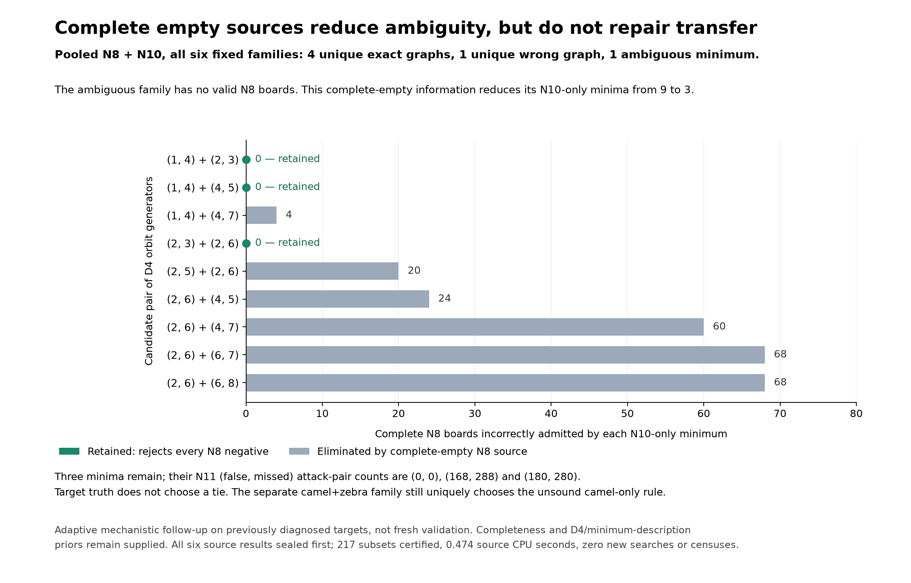

# H3z: complete empty sources reduce ambiguity without repairing transfer

**The frozen all-six recovery hypothesis is falsified.** Pooling complete N8 and N10 source banks gives **four unique exact N11 graphs, one unique wrong graph and one ambiguous minimum**. Complete-empty N8 information reduces the ambiguous family's minimum-rule set from **nine to three**, but does not identify one correct rule. The previously unsound camel-only minimum remains unchanged.

This is an **adaptive mechanistic follow-up on previously diagnosed N11 targets**, not fresh target validation. All six new pooled-source choices were sealed before reusing target diagnostics. H3y's original results and complete-state census remain unchanged.

| Extra D4 leaper orbits | Complete N8 / N10 source boards | N10-only minima | Pooled minima | Pooled N11 outcome |
|---|---:|---:|---:|---|
| (1, 4) | 4 / 76 | 1 | 1 | Unique exact |
| (2, 3) | 0 / 48 | 1 | 1 | Unique exact |
| (2, 5) | 20 / 72 | 1 | 1 | Unique exact |
| (3, 4) | 0 / 52 | 1 | 1 | Unique exact |
| (1, 3) and (2, 3) | 0 / 4 | 1 | 1 | Unique wrong; 288 missed pairs |
| (1, 4) and (2, 3) | 0 / 12 | 9 | 3 | Ambiguous; all three retained |

The source banks, fixed six families and N10-only references come from H3y. No new source generation occurs. Each bank is explicitly **complete at its own size**. Thus a complete-empty N8 bank supplies 92 negative ordinary-queen placements, even though it supplies no positive examples. This information is much stronger than failing to observe positives in an incomplete sample.

The learner pools occupied-pair counts over offsets representable in at least one source size. It retains the same primitive-line criterion and obtains the row, column and diagonal lines. An offset outside the N8 board's displacement range contributes neither positive occurrences nor negative-board incidences at N8; it is **not treated as evidence of source absence merely because it cannot occur there**. Such an offset may still be learned from N10, where it is representable. Candidate D4 orbits are wholly contained in the off-line pooled-zero offsets.

The rule objective now rejects every negative placement from **both** complete source universes and preserves every positive. It searches cardinality layers exhaustively, completes the first covering layer and preserves every minimum. Independent pooled counts, candidates and literal pair incidences verify every lower/equal-cardinality subset, every uncovered negative witness and all minima. Across the six cases, **217 subsets** were checked. Complete line-compatible universes are reused only through exact size/line keys, immutable constructor hashes and independently validated array identities. Every case completed without timeout or validation failure.

The ambiguous family, queens plus (1, 4) and (2, 3), has no valid N8 boards. The nine N10-only minima admit different numbers of N8 boards. Since every admitted N8 board contradicts the supplied complete-empty bank, six minima are eliminated:

| N10-only minimum orbit set | N8 boards incorrectly admitted | Survives pooled minimum |
|---|---:|---|
| {(1, 4), (2, 3)} | 0 | Yes |
| {(1, 4), (4, 5)} | 0 | Yes |
| {(1, 4), (4, 7)} | 4 | No |
| {(2, 3), (2, 6)} | 0 | Yes |
| {(2, 5), (2, 6)} | 20 | No |
| {(2, 6), (4, 5)} | 24 | No |
| {(2, 6), (4, 7)} | 60 | No |
| {(2, 6), (6, 7)} | 68 | No |
| {(2, 6), (6, 8)} | 68 | No |

The surviving three sets have N11 **(false, missed)** attack-pair counts **(0, 0), (168, 288) and (180, 280)**, respectively. Exactly one matches target truth, but no target-favored tie is selected. The new complete source information is useful: it rules out six alternatives. It does not resolve the remaining ambiguity.

For queens plus camel (1, 3) and zebra (2, 3), pooling still uniquely selects camel alone. The complete-empty N8 bank adds no discriminating condition because camel alone already admits no compatible N8 boards. The selected N11 graph remains identical, byte-for-byte over all unordered cell-pair indicators, to the previously diagnosed H3y graph. The q=11 constraint also matches. Therefore H3y's complete-state census is **identity-mapped**, not rerun: the selected rule admits **56 complete boards**, the true rule admits **44**, and **12 selected zero-conflict boards are invalid**. There is no new census, search or independent confirmation of those counts.

The pooled-source seal is **b8129cc1b3cd878c89c175f09e84d71c728b0a535d4631c6a1958e1abef248ec**. Each of the six cases was bounded by 60 CPU/wall seconds; two CPU processes ran independent cases. Total inference and verification used **0.474009 aggregate CPU seconds**, with **0.393653 seconds of campaign wall time**. No optimizer was fitted and no GPU search, source generation or target census was performed. The inherited counterexample and structural exactness checks do not measure search rates.

The result is limited to these six deterministic families and the declared finite D4 candidate class, source sizes and minimum-description prior. Supplied completeness, translation invariance and line extrapolation remain additional assumptions. The prior unique-wrong counterexample still shows that source uniqueness and sparse description do not guarantee transfer; the narrowed ambiguity shows how a second complete source size can provide useful constraints even when its positive bank is empty.

[Frozen protocol](protocol.json), [source inference and independent certificate](source.py), [post-seal comparison](diagnose.py), [tracked summary](../../../../results/research/loki/h3z/summary.json), [all source seals](../../../../results/research/loki/h3z/source-seals.json), [source case certificates](../../../../results/research/loki/h3z/cases), [inherited H3y complete-state census](../../../../results/research/loki/h3y/q11-census.json), [inherited invalid witness boards](../../../../results/research/loki/h3y/q11-census-boards.npz), [figure provenance](../../../../results/research/loki/h3z/plot-provenance.json).
