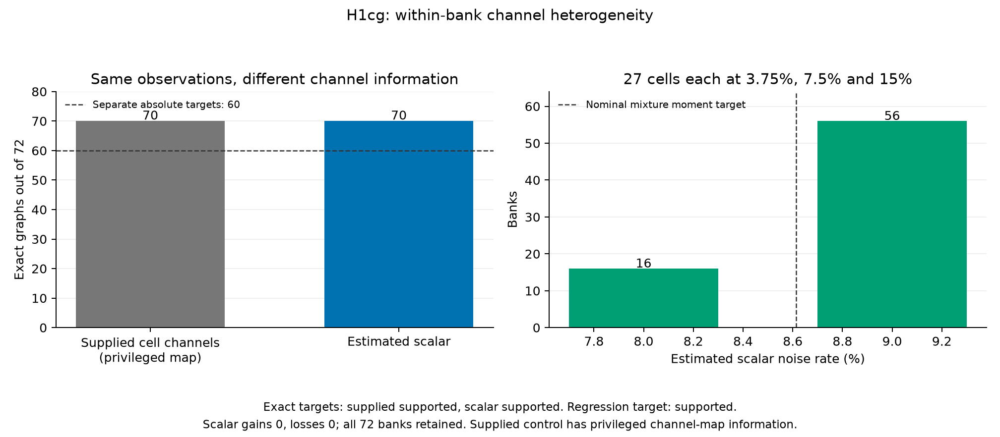

# H1cg: scalar inference under cell-dependent noise

The fixed scalar estimator and the explicitly privileged supplied-per-cell-channel control each recovered **70/72 exact graphs**, with no paired gains or regressions. All three frozen endpoints are supported separately: at least 60/72 recoveries for each arm and at most two scalar regressions. The selected literal primals matched in all 72 paired banks, despite every one of the 3,240 integer edge costs changing between methods in every bank.

| Method | Exact / 72 | Integral wrong | Selected fractional | Unresolved | Information available |
|---|---:|---:|---:|---:|---|
| BP AdamW | Not run | — | — | — | Outside this structural inference experiment |
| Supplied per-cell channel | 70 | 2 | 0 | 0 | Shared observations and the complete nominal channel map |
| Estimated scalar channel | 70 | 2 | 0 | 0 | Shared observations and mask only |

This tests a scalar model under specified within-bank heterogeneity. The supplied control has a deliberate parameter-information advantage; this is not an equal-information algorithm ranking or an isolated estimate of the effect of channel estimation. It does not establish universal channel robustness, a general invariance theorem, or CRAM neural training reproduction.



## Fixed experiment

The [proposal](cell-channel-proposal.json), [mixed-channel mathematical gate](cell-channel-math-check.json), [full synthetic gate](cell-channel-preflight.json), and [seed audit](cell-channel-seed-audit.json) preceded new cohort activity. Root and a separate mathematical reviewer approved the source and gates before the [protocol](protocol-cell-channel.json) was frozen. Its SHA256 is `c544951a3ec49ff97058a2ce2233ef9c6d6fb0e36472bab2a2559483f7eaeebf`.

All 72 new banks contain 90 official source instances, sampled without replacement within each bank. Cross-bank repeats remain. Freshness is relative to the declared combined Ripper/H4ak ledger through H1cf, not every use in the repository. Each bank has a fresh random permutation assigning 27 cells each to nominal rates 3/80, 3/40 and 3/20. The assignment is constant across all rows and three repeated queries. Independent source, mask, channel-map and query seeds are fixed in the protocol; distinct seeds are not a proof of statistical PRNG independence.

The affine-line-complement mask observes 72 cells per row, 80 rows per cell and 71 coqueries per pair. All IDs, masks and cell-channel maps were sealed before selected CSV labels were materialized. All acquired triple-label records were independently reconstructed and globally sealed before scoring. Both arm grids finish before a bank's truth diagnostics. No pilot, outcome filtering, parameter tuning, retry or budget extension occurred.

A query stream draws a 90×81 binary64 uniform array followed by int8 offsets in 1..8. Corruption at cell c occurs when its uniform is below the binary64 conversion of the nominal rate assigned to c, then the offset is added modulo 9. Exact threshold hexadecimal values and finite-generator probabilities `ceil(threshold*2^53)/2^53` are recorded. The supplied control receives the nominal rational channel map, not latent corruption indicators, clean labels or graph truth.

For a cell with nominal rate a/b, the supplied control's exact digit likelihood is the product of three factors: `8*(b-a)` for a matching observed label and `a` otherwise. Normalize these nine likelihoods. For a coobserved pair, posterior equality is the dot product of its two cell posterior vectors, which may use different channels. The edge objective sums `-log(1-equality)` and quantizes at 1e6 with half-even rounding. This is a pair composite likelihood, not full graph maximum likelihood.

The scalar arm calls immutable H1ce code using only observed labels and mask. It estimates a single channel from 19,440 pairwise comparisons among repeated labels, inverts `f(p)=2p-9p²/8` with exact integer comparisons, and rounds to the fixed 1..88% grid. The same data estimate the channel and score pairs; no independence or unbiasedness claim is made.

Each arm fits degrees 1..40 with an analytic zero witness. Exact curvature over degrees 1..39 and lower-degree tie breaking select the model. True degree 20 and edge count 810 are withheld from selection. Required uncertified costs or grid points would remain unresolved; literal selected fractional solutions would be resolved failures. All 144 arm outcomes remain in the denominator.

## Results and exact checks

The separate absolute bounds are [70,70] against 60 for both methods. The conservative paired-regression bound is [0,0] against two, accounting for unresolved states in either arm. All 144 selections chose degree 20. Fixed-degree20 recovery is therefore also 70/72 per arm; the diagnostic unconstrained top810 rule recovered 2/72 under the supplied map and 1/72 under the scalar channel. Those diagnostics do not alter the primary method.

Both methods failed on banks 56 and 67. Their exact twice-objective truth gaps are:

| Bank | Supplied per-cell gap | Estimated scalar gap |
|---:|---:|---:|
| 56 | 13,702 | 5,084 |
| 67 | 92,656 | 72,074 |

Each strictly positive gap excludes the true graph as an optimum of that arm's selected integer objective. Exact certificates prove optimality of the retained solutions, not uniqueness. Gap sizes under different channel objectives are not directly comparable effect sizes.

All 5,760 new LP certificates passed independent integer primal/dual checks; 17,280 targeted proof mutations were rejected and 144 analytic zero witnesses checked. There were 3,845 intermediate fractional LPs, with no selected fractional, LP-unresolved, numerical-unresolved or estimator-unresolved outcomes. All 466,560 costs were certified at 80 digits without 160-digit fallback; the largest recorded interval width was 7e-71. The independent reference uses 200-digit, 240-term rational logarithm bounds.

The mathematical gate independently checked 2,214 exact single-cell pattern likelihoods, 4,783,698 ordered query-pattern/channel-pair combinations and all 168 unique q=1/3 table values. Same-channel equivalence to immutable H1cd scores, pair/cell swaps, digit permutation, full-shape mixed reference parity, 160-digit fallback and uncertified placeholder rejection passed. Python-integer bounds precede int64 products; the largest packed-key bound is 2,513,291,658,681,221,173, below 2^63−1. Full lifecycle gates also rejected altered masks, channel maps, raw noise and observed records. The scalar arm rejected supplied-map arguments; invalid estimates never called a scorer, and uncertified numerical cases never called a solver.

## Mixture calibration and accounting

The scalar estimate was 8% on 16 banks and 9% on 56, with no clipping. Disagreement counts ranged from 3,058 to 3,368 out of 19,440. For the nominal channel mixture, the arithmetic mean rate is 7/80=8.75%, while the mean disagreement moment is 8393/51200, different from `f(7/80)=8519/51200`. The scalar inversion therefore targets an effective mixture rate of approximately 8.613634%, not exactly the arithmetic mean. This diagnostic does not retune the estimator or replace the protocol's exact binary64 event law.

Each nominal rate contributes exactly 466,560 acquired queries. Observed corrupted-label counts were 17,642 at nominal 3.75%, 35,066 at 7.5%, and 70,148 at 15%. All methods reuse the same **1,399,680 physical noisy queries**. Each standalone method would consume that many; the paired experiment does not double the charge.

The [source audit](../../../results/research/ripper/cell_channel/source-audit.json) verified 6,465 unique official IDs across 6,480 source instances, retaining 15 repeated instances across banks and zero within-bank repeats or declared-exclusion overlap. Clean materialization comprises 524,880 cell instances and 523,665 unique oracle cells. Updated ledgers contain 2,207,969 Ripper IDs and 2,444,394 combined IDs. The cumulative official noisy-label sequence increases from 18,160,599 to 19,560,279.

## Runtime and replay

The charged run took **35.086467931 wall seconds and 211.304497 aggregate CPU seconds**, below the frozen 180/900 ceilings. Eight persistent single-thread workers reused data-independent mixed-channel type tables. All 14 commands completed successfully. Solver calls used 11.718304687 CPU seconds, 5.546% of the full charge; source, acquisition, exact numerical certification, hashing, audits and export remain charged. The unrelated synthetic full-shape gate measured 0.0524 seconds for the producer and 0.8617 seconds for the independent scorer. This identifies numerical validation overhead without claiming a cross-study speedup or weakening certification.

Eight workers were present in 247 of 346 monitor samples, from 9.724 to 34.694 seconds. An external sample at 12.151 seconds showed each at 100% CPU, 320 completed LPs and zero bank audits while second arm grids were still pending. Final counters were 5,760 LPs, 72 audits and no active owned workers. Ripper's four GPUs had no eligible work in this exact LP/rational pipeline, and unrelated processes were preserved. [Execution samples](../../../results/research/ripper/cell_channel/execution/samples.jsonl) · [Solver accounting](../../../results/research/ripper/cell_channel/solver-timing-accounting.json) · [Numerical accounting](../../../results/research/ripper/cell_channel/numeric-accounting.json).

The [public summary](../../../results/research/ripper/cell_channel/summary.json) is byte-identical to the charged raw audit, SHA256 `5d0bc90540209d9181fc994d5415136fb3d76888600d7ee37bb83cedf1529eff`. With NumPy 2.3.4 and highspy 1.12.0, run:

```bash
OPENBLAS_NUM_THREADS=1 OMP_NUM_THREADS=1 MKL_NUM_THREADS=1 \
  python research/20261114/ripper/verify_cell_channel_public.py
```

The [manifest](../../../results/research/ripper/cell_channel_public_manifest.json) binds the package. Public replay reconstructs source-ID selection, masks, channel maps, observed labels, estimates, interval costs, degree grids, proofs, endpoints and charges. CSV/latent-noise correspondence is explicitly inherited from the charged raw audit when raw archives are absent. The separate [read-only raw replay](replay_cell_channel_raw.py) rechecks CSV answers and every noise archive plus all costs/proofs without fitting or modifying evidence. Gates and postrun replays are outside the charged scientific runtime. The [figure script](../../../scripts/plot_cell_channel.py) exports deterministic PNG/SVG and provenance.

The result supports fixed scalar inference under this prespecified moderate channel mixture. It does not test asymmetric wrong-digit distributions, correlated repeats, unknown per-cell estimation, arbitrary corruptions or universal noise robustness.
