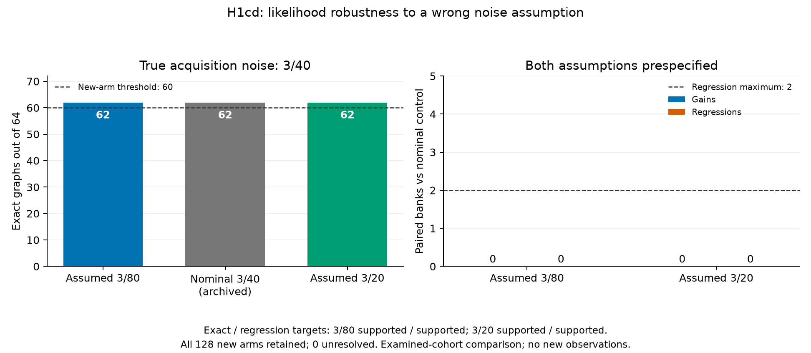

# H1cd: pair-likelihood robustness to an incorrect noise assumption

Both prespecified wrong channel assumptions recovered **62/64 exact graphs**, matching the archived nominal-channel likelihood estimator. Each produced **zero regressions** among its 62 successes. All four frozen targets—at least 60/64 exact and at most two regressions for each assumption—were **supported**. Every selected primal vector was identical to its nominal counterpart, although all 3,240 integer pair costs changed in every new arm.

| Method | Exact graphs | Integral nonexact | Selected fractional | Unresolved |
|---|---:|---:|---:|---:|
| BP AdamW | Outside structural graph-inference scope; not run | — | — | — |
| H1ca hard triple90, inherited reference | 51/64 | 12 | 1 | 0 |
| H1ca posterior triple90, inherited reference | 61/64 | 3 | 0 | 0 |
| H1cc nominal 3/40 likelihood, archived paired control | 62/64 | 2 | 0 | 0 |
| Likelihood assuming 3/80 | 62/64 | 2 | 0 | 0 |
| Likelihood assuming 3/20 | 62/64 | 2 | 0 | 0 |



This is a paired comparison on all 64 examined H1ca triple90 query bundles, acquired under nominal error rate 3/40. It tests two fixed assumed rates, half and twice the acquisition rate, with the likelihood transform and inference procedure unchanged. It establishes neither a continuous interval of robust rates nor fresh-cohort generalization. No better arm was selected after seeing results; both assumptions and all four decisions are retained.

The [proposal](channel-misspecification-proposal.json), [numerical gate](channel-misspecification-math-check.json), [study gate](channel-misspecification-preflight.json), and [seed audit](channel-misspecification-seed-audit.json) preceded the [frozen protocol](protocol-channel-misspecification.json). Protocol SHA256 is `0438aab1adf16a9331cb56c31952778bf30037bedcb3b639b8d3b251492277cb`. Raw audit and public [summary](../../../results/research/ripper/channel_misspecification/summary.json) are byte-identical, SHA256 `1f7a359192fa8a39df459f8ecdc86e42be17b47a1ff8795c4b1190afa7725c29`.

## Separate targets and residual failures

| Assumed channel | Target | Observed bound | Decision |
|---|---|---:|---|
| 3/80 | Exact graphs ≥60/64 | [62,62] | Supported |
| 3/80 | Regressions among 62 nominal successes ≤2 | [0,0] | Supported |
| 3/20 | Exact graphs ≥60/64 | [62,62] | Supported |
| 3/20 | Regressions among 62 nominal successes ≤2 | [0,0] | Supported |

Both arms retained the same integral nonexact failures, banks 7 and 57. Their exact twice truth-minus-optimum gaps were respectively 72,540 and 2,392,542 under assumed 3/80, and 319,738 and 2,255,420 under assumed 3/20. Thus the true graph remains strictly suboptimal at these failures under each new integer objective. The changed gap magnitudes are not directly comparable across differently scaled objectives.

All 128 new arms selected degree 20, making their fixed-degree-20 diagnostics equal to their selected outcomes. Top810 recovered 12/64 for each assumption; neither the true degree nor edge count was supplied to the degree selector. There were no selected fractional or unresolved outputs. All 5,120 positive-degree LPs were independently certified, together with 128 analytic zero witnesses and 64 archived nominal selected controls. Proof mutations yielded 15,552 rejections. The audit retained 3,413 intermediate fractional LPs as valid objective evidence. Certificates prove optimality, not uniqueness.

## Fixed estimator and exact arithmetic

The only scientific intervention was the assumed channel. For an assumed error probability a/b, a query receives integer likelihood weight `8*(b-a)` if its observed label matches a candidate clean digit and `a` otherwise. The low-rate arm therefore uses matching/nonmatching weights 616/3, the nominal control 296/3, and the high-rate arm 136/3. Each cell's three query likelihoods are multiplied exactly and normalized under the same independent uniform latent-digit prior.

For rational posterior equality probability e, the unchanged integer objective is `round_half_even(1e6 * sum[-ln(1-e)])` over the 71 coqueries of each pair. There is no smoothing or exposure normalization. Under a uniform prior over distinct latent digits, an edge's pair likelihood ratio is `(1-e)/(8/9)`. The omitted pair-independent constant is defined as in H1cc. This is a pairwise composite likelihood; it does not model all structured-board dependencies or claim whole-graph maximum likelihood. Changing the channel changes evidence inside the fixed transform, so this experiment does not separate every aspect of calibration and likelihood shape.

Positive assumed rates give positive likelihood to every observation pattern. Integer bounds are checked before matrix products, including the larger low-rate three-query denominator products. The immutable H1cc numerical routines enclose logarithms with directed Decimal arithmetic at 80 digits, with a fixed 160-digit fallback only if the rounding interval is unresolved. The independent path multiplies literal exact pair likelihoods and uses outward integer fixed-point logarithm bounds at 200 digits with 240 atanh-series terms and an explicit tail bound. Ordinary high-precision agreement is not treated as proof.

All **414,720 new integer costs** were certified at 80 digits. No fallback or numerical failure occurred. The maximum producer interval width was 6×10⁻⁷¹, and every independent exact-product interval lay inside its producer interval and rounded to the same integer. [Numerical accounting](../../../results/research/ripper/channel_misspecification/numeric-accounting.json) records these checks. Failure of either certification path would skip the entire arm's grid, retain an unresolved outcome, and prevent zero placeholders from reaching the solver.

The prefreeze numerical gate enumerated all possible Q1/Q3 pair types—two and 21 respectively—at all three rates. It checked literal likelihood products, all-rate Q1 affine identities, exact nominal full-array parity with immutable H1cc scoring, digit/query permutations, missingness, and unrelated full-81-cell producer/reference parity. The original immutable half-even boundary and forced 80→160 fallback evidence remains bound. No new Q1 cohort fits were run because they do not test repeated-query channel robustness. The study gate checked 18 endpoint cases independently across arms, identical query selection, channel/proposal bindings, all missing-cost skip modes, nine runner commands, and two synthetic LP certificates with six mutations.

## Execution and observation accounting

The charged study took **28.887953173 wall seconds and 228.090908 aggregate CPU seconds**, below the frozen 180-wall/900-CPU limits. Eight persistent bank workers handled independent banks. Each arm attempted degrees 1..40 with fresh single-thread HiGHS, parallel mode off, dual simplex 1, presolve off, one-second LP limits and 1e-9 feasibility tolerances. Exact curvature over degrees 1..39 selected the degree, with lower-degree ties. Literal half-integral solutions were preserved without snapping. Truth diagnostics and archived nominal control checks occurred after both new arms were fitted for a bank.

The [persistent monitor](../../../results/research/ripper/channel_misspecification/execution/samples.jsonl) retained 286 samples, 281 with eight active workers. Independent [external snapshots](../../../results/research/ripper/channel_misspecification/execution/external-live.jsonl) showed 3,840 completed LPs and 40 audited banks at 20.865s, then 4,480 LPs and 56 audited banks at 25.925s. Worker CPU utilization over that interval was 99.70–100.09%. The final snapshot retained 5,120 LPs, 64 audited banks and no active children. Ripper's four GPUs were idle because this exact LP and rational-certificate pipeline has no GPU implementation; unrelated services were preserved.

Finite-type tables reuse exact logarithm intervals. On unrelated full-shape triple90 inputs, producer scoring took 0.0427s and 0.0422s at the low and high assumed rates; independent product checks took 0.8615s and 0.8533s. These are synthetic implementation measurements, not whole-study speedup claims. [Solver accounting](../../../results/research/ripper/channel_misspecification/solver-timing-accounting.json) attributes 10.810124 CPU seconds, 4.74% of charged CPU, to solve calls. Numerical certification, nominal control verification and other work account for the remainder; solver utilization alone does not describe this workload.

No new sources, labels, masks, noise draws or noisy queries were acquired. Parent physical noisy-query union remains 2,073,600; cumulative official noisy labels remain 16,760,919. The combined source ledger remains 2,431,463 IDs and Ripper's ledger 2,195,038. The 5,120 new solver seeds were checked against explicit historical fields and expanded H1bv/bw/by/bz/ca/cc grids. Other historical formulas were not exhaustively expanded, and distinct seeds do not prove random-stream independence.

## Public replay

```bash
OPENBLAS_NUM_THREADS=1 OMP_NUM_THREADS=1 MKL_NUM_THREADS=1 \
  artifacts/research/20261114/ripper/compression-venv/bin/python \
  research/20261114/ripper/verify_channel_misspecification_public.py
```

The [public manifest](../../../results/research/ripper/channel_misspecification_public_manifest.json) binds the package. Replay needs public H1ca query records, 64 archived H1cc nominal selected controls and bound source files; it requires no raw artifacts or registry aliases. It recomputes the assumed-channel costs and independent intervals, every new degree grid, nominal selected certificates and their costs, all mutations and four decisions, plus runtime and acquisition accounting. Original noisy-query generation and CSV correspondence remain inherited from H1ca's charged source audit. The supported result concerns these two fixed assumptions on this examined cohort.
