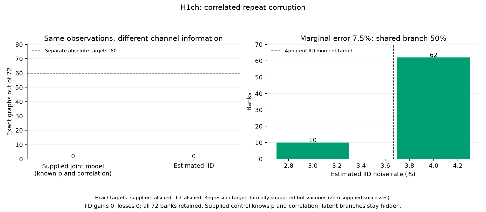

# H1ch: correlated repeats falsify both absolute recovery targets

Both the supplied joint-channel model and the unchanged estimated-IID method recovered **0/72 exact graphs** under the prespecified correlated-repeat process. Their separate targets of at least 60 recoveries are falsified. The paired-regression endpoint is formally supported at [0,0], but is **uninformative here because the supplied control solved no bank**. It does not establish useful robustness or equivalence between the methods.

| Method | Exact / 72 | Integral wrong | Selected fractional | Unresolved | Information available |
|---|---:|---:|---:|---:|---|
| BP AdamW | Not run | — | — | — | Outside this structural inference experiment |
| Supplied correlated model | 0 | 54 | 18 | 0 | Shared responses, mask, nominal marginal error and correlation |
| Estimated IID model | 0 | 54 | 18 | 0 | Shared responses and mask only |

This is a completed negative experiment, not a resource failure. All 5,760 LPs have independently verified optimality certificates. A separate read-only replay checked the original CSV correspondence, all noise archives, both cost constructions and every grid/proof. The result concerns this pair-composite objective and LP inference procedure; it does not prove that exact recovery is information-theoretically impossible or that other estimators would fail.



## Fixed experiment and information boundary

The [proposal](correlated-repeat-proposal.json), [mathematical gate](correlated-repeat-math-check.json), [full synthetic gate](correlated-repeat-preflight.json) and [seed audit](correlated-repeat-seed-audit.json) preceded fresh cohort activity. Root independently reviewed all scientific sources and reran the mathematical gate in an isolated copy. A registry refresh incorporated concurrent frozen protocols without changing the scientific code; earlier receipts remain in `correlated-repeat-prefreeze-registry-v1`. The [frozen protocol](protocol-correlated-repeat.json) SHA256 is `8d28fa7cfd8c25fcceb52141adb67879985ef9a0c80a731b8b1ccd9d3bae5ffd`.

There are 72 fresh banks of 90 official source instances. Each bank samples without replacement; all cross-bank repeats remain. Freshness is relative to the declared combined Ripper/H4ak ledger through H1cg, not every dataset use in the repository. IDs and complete masks were sealed before selected CSV labels. Each affine-line-complement mask queries 72 cells per row, observes each cell on 80 rows and each pair on 71 rows. All three responses use the same mask. Both methods receive the identical observed triple record; all records were independently reconstructed and globally sealed before scoring.

The marginal corruption probability is nominally p=3/40. At every source-instance/cell position, an independent latent branch has nominal probability rho=1/2. On its shared branch, all three responses use the first stream's noisy label. Otherwise the three responses use their independent corruption streams. Each stream draws a 90×81 binary64 uniform array and then int8 offsets in 1..8, corrupting by addition modulo 9 when its uniform is below float(3/40). The separate branch stream is independent of these streams by construction. Distinct seeds do not prove PRNG independence.

The branch threshold is exactly binary64 0.5. The p threshold is `0x1.3333333333333p-4`; its exact finite-generator event probability is retained in the protocol as `ceil(float(3/40)*2^53)/2^53`. The supplied model uses nominal rational p and rho, with this tiny generator/model distinction explicit.

Neither method receives the realized branch, raw uniforms, offsets, unused potential labels, clean labels or graph truth. The supplied control knows the two nominal parameters; the unchanged H1ce IID estimator receives only observed responses and mask. This parameter-information advantage is explicit. Branch diagnostics are computed after both bank grids, never used to fit or filter banks.

## Joint likelihood and inference

For candidate clean digit d, let K=8b and let u_q(d)=8(b−a) for an observed match and a otherwise, with p=a/b. With rho=r/s, the supplied model uses exact integer joint weights

`W(d) = r * I[y1=y2=y3] * u1(d) * K^2 + (s-r) * product_q u_q(d)`.

It normalizes the nine weights, marginalizing the unobserved branch. A nonunanimous triple cannot come from the shared branch. Posterior equality for a coobserved pair is the dot product of its two cell distributions. Both methods sum `-log(1-equality)` and half-even quantize at 1e6. This is a pair composite objective, not full graph maximum likelihood.

The unchanged IID method estimates its channel from all 19,440 repeated-response pair comparisons per bank. It inverts `f(p)=2p−9p²/8` by exact comparisons and uses its fixed 1..88% grid. The same responses estimate and score; no independence or unbiasedness claim is made. Correlation changes the nominal disagreement expectation to `(1-rho)*f(p)=1839/25600`.

Each method fits degrees 1..40 and uses an analytic zero witness. Exact curvature over degrees 1..39 selects the model, with lower-degree ties. True degree 20 and edge count 810 are withheld from selection. Selected fractional solutions count as resolved failures; required uncertified costs or grid points would be unresolved. No retry, extension, bank replacement, strength sweep or outcome-driven tuning occurred.

## Outcomes and numerical evidence

All 72 supplied-model selections chose degree 20. The IID arm chose degree 20 on 68 banks and degree 21 on banks 1, 7, 37 and 43. Fixed-degree20 and top810 diagnostics each recovered zero exact graphs in both arms. Equal aggregate classification counts hide different outcomes: only two banks were fractional in both methods, 16 were fractional only under each method, and 38 were integral wrong under both. No paired selected primal was identical, and all 3,240 integer edge costs differed between methods in every bank.

Among the 54 integral supplied solutions, 3–24 true edges were missing, with an equal number of extras. Among the 54 integral IID solutions, 10–28 were missing. These descriptive ranges do not convert fractional solutions into discrete graphs or replace the exact-recovery endpoint.

The true graph has a strictly positive twice-objective gap on every degree20 selection: 3,725,082–74,196,500 for the supplied arm and 62,183,140–576,867,550 for the 68 eligible IID selections. It is therefore not an optimum of those selected integer-cost LPs. The remaining four IID selections have the wrong degree, so the true graph is infeasible and no comparable truth gap is asserted. Certificates prove optimality of the retained solutions, not uniqueness; different objective scales do not give comparable gap effect sizes.

All 5,760 LP certificates, 17,280 targeted proof mutations and 144 analytic zero witnesses passed. There were 3,949 intermediate fractional LPs. All 466,560 costs were certified at 80 digits without fallback; the maximum recorded interval width was 7e-71. No estimator, numerical or grid outcome was unresolved. The independent reference uses 200-digit, 240-term rational logarithm bounds.

The mathematical gate checked 19,683 exact Fraction mixture probabilities, 1,062,963 ordered pattern pairs and 44 unique rational-log table values across the prespecified rho=0, 1/2 and 1 synthetic checks. It verified IID equivalence at rho=0, single-response equivalence on unanimous data at rho=1, explicit rejection of impossible nonunanimous rho=1 observations, digit/cell permutation invariance, full-shape independent parity and 160-digit/uncertified branches. Python-integer overflow checks precede int64 products; the largest recorded packed-key bound was 23,840,163,103,022,158, below 2^63−1. Full lifecycle gates covered all 72 synthetic banks and rejected altered observations, masks, branch streams and even unused repeat potentials. Invalid estimates never reached scorers; uncertified costs never reached a solver.

## Calibration and acquisition accounting

The IID estimator selected 3% on 10 banks and 4% on 62, without clipping. Disagreements ranged from 1,244 to 1,514 out of 19,440. Under the nominal correlated model, the apparent IID moment target is approximately **3.667454%**, although every individual response has marginal corruption 7.5%. This diagnostic was specified before the run and does not retune the method.

Across all 466,560 queried positions, 233,477 used the shared branch and 233,083 the independent branch. There were 418,208 unanimous triples and 99,875 pair disagreements out of 1,399,680 comparisons. Observed corrupted-label counts were 34,745, 34,637 and 34,985 for first/repeat1/repeat2, respectively. These are post-fit diagnostics, not model features or subgroup endpoints.

The physical noisy-query union is **1,399,680**, shared in full by both methods. Each standalone deployment would consume that many responses. The shared branch accounts for 700,431 acquired responses: three physical query identities remain three responses even when their values agree. Unused potential variates are provenance records, not additional observed labels.

The [source audit](../../../results/research/ripper/correlated_repeat/source-audit.json) verified 6,464 unique official IDs across 6,480 instances, retaining 16 repeated instances across banks and zero within-bank repeats or declared overlap. Clean materialization comprises 524,880 cell instances and 523,584 unique oracle cells. Updated ledgers contain 2,214,433 Ripper IDs and 2,450,858 combined IDs. The cumulative official noisy-label sequence increases from 19,560,279 to 20,959,959.

## Runtime and replay

The charged run used **34.562061407 wall seconds and 209.611866 aggregate CPU seconds**, within the frozen 180/900 ceilings. All 14 commands completed. Eight persistent single-thread workers reused only data-independent type tables and each bank's already certified independent reference. Solver calls consumed 13.046599037 CPU seconds, 6.224% of the full charge; source materialization, acquisition, exact scoring, audit and export remain charged. Independent rational scoring dominated the unrelated full-shape synthetic gate at roughly 0.9 seconds per method, identifying the practical bottleneck without weakening checks or claiming a cross-study speedup.

Eight workers were active in 246 of 341 monitor samples, from 9.324 to 34.186 seconds. An external sample at 31.345 seconds showed all eight at 100% CPU, 5,120 completed LPs and 56 audited banks. Final counters were 5,760 LPs, 72 audits and no owned active workers. Ripper's four GPUs were idle because this exact LP/rational pipeline has no eligible GPU implementation. Unrelated workloads were preserved. [Execution samples](../../../results/research/ripper/correlated_repeat/execution/samples.jsonl) · [Solver accounting](../../../results/research/ripper/correlated_repeat/solver-timing-accounting.json) · [Numerical accounting](../../../results/research/ripper/correlated_repeat/numeric-accounting.json).

The [public summary](../../../results/research/ripper/correlated_repeat/summary.json) is byte-identical to the charged raw audit, SHA256 `c86b5c620b19adcba03890f4a42e2a227026b321f076e78809cf46119df24f39`. With NumPy 2.3.4 and highspy 1.12.0:

```bash
OPENBLAS_NUM_THREADS=1 OMP_NUM_THREADS=1 MKL_NUM_THREADS=1 \
  python research/20261114/ripper/verify_correlated_repeat_public.py
```

The [manifest](../../../results/research/ripper/correlated_repeat_public_manifest.json) binds the package. Public replay reconstructs IDs, masks, observed response interpretation, estimates, joint likelihoods, costs, degree grids, certificates, endpoints and charges. It inherits raw CSV/noise correspondence from the charged acquisition audit. The separate [read-only raw replay](replay_correlated_repeat_raw.py) passed in 24.273 seconds, checking CSV answers and all raw noise arrays without new fits or writes. Gates and postrun replays are separately timed. The [figure script](../../../scripts/plot_correlated_repeat.py) generates deterministic PNG/SVG with provenance.

The experiment locates a failure boundary for both tested methods under a specified repeat-dependence model. Knowing its nominal joint likelihood did not restore exact recovery at 90 source rows. This motivates testing acquisition diversity or a different inference objective; the present results do not identify either as a proven remedy, establish causal comparisons with historical banks, or reproduce CRAM neural training results.
