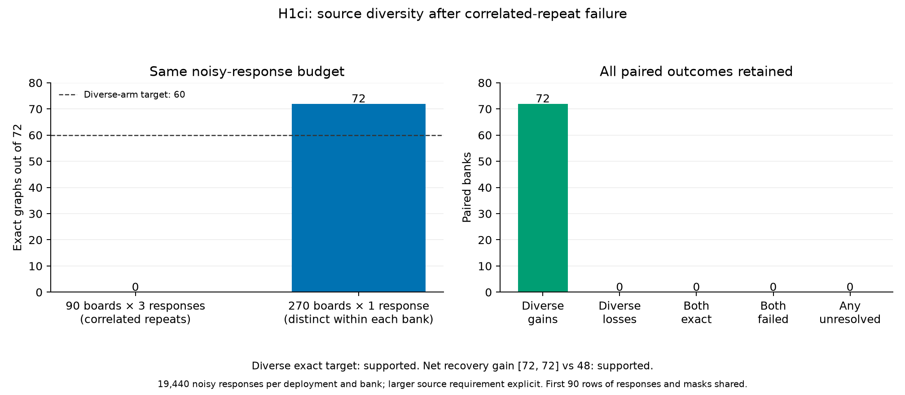

# H1ci: source diversity restores recovery after correlated-repeat failure

At the same standalone noisy-response budget, **270 distinct source instances with one response recovered 72/72 exact graphs**, versus **0/72 for 90 sources with three correlated responses**. The prespecified diverse-arm target of at least 60 recoveries and net-gain target of at least 48 are both supported; the observed net gain is [72,72], with no unresolved banks. This comparison changes the acquisition policy and triples the source requirement. It does not isolate a correlation-only causal effect.

**Execution limitation:** the monitoring thread failed on a process-exit race near completion. All scientific commands and independent replays completed; the final synchronous measurement, taken after all children were reaped, was 39.278874 wall seconds and 237.985004 aggregate CPU seconds, below the frozen 180/900 limits. We classify this as **completed science with a monitoring deviation**. The original runtime record remains unchanged, and its `validated` field must not be read as evidence of uninterrupted supervision. The [deviation receipt](../../../results/research/ripper/diversity_after_correlation/monitor-deviation.json), [full traceback](../../../results/research/ripper/diversity_after_correlation/execution/runner-full.log) and all monitor samples are preserved. No rerun or frozen-code correction occurred.

| Method | Exact / 72 | Integral wrong | Selected fractional | Unresolved | Sources / bank | Responses / bank |
|---|---:|---:|---:|---:|---:|---:|
| BP AdamW | Not run | — | — | — | — | Outside this structural inference study |
| Supplied correlated model, 90 × 3 | 0 | 54 | 18 | 0 | 90 | 19,440 |
| Supplied single-response model, 270 × 1 | 72 | 0 | 0 | 0 | 270 | 19,440 |



## Fixed design and information boundary

The [proposal](diversity-after-correlation-proposal.json), [math gate](diversity-after-correlation-math-check.json), [full synthetic gate](diversity-after-correlation-preflight.json) and [seed audit](diversity-after-correlation-seed-audit.json) preceded fresh cohort activity. Root independently reviewed the scientific sources and reran the full gate in an isolated copy, verifying all 84 scientific-source bindings and identical non-timing fields. The [frozen protocol](protocol-diversity-after-correlation.json) SHA256 is `8c4152073a6eda1b832a60be8ffb5a46593f4fe9e3e5f27b26680f0562657e50`.

There are 72 fresh paired banks, each with 270 distinct official source instances sampled without replacement. All source IDs and all three 90-row mask cycles were sealed before materializing selected labels. Each affine-line-complement cycle queries 72 of 81 cells per row, observes every cell 80 times and every pair 71 times. The correlated arm uses the first cycle and three responses per queried cell; the diverse arm concatenates all three cycles and uses one response per cell, providing 213 pair coobservations. Their first 90 noisy-response rows and first mask are literally shared.

Each response has nominal marginal corruption probability p=3/40. For the correlated arm, at each first-cycle source/cell position a hidden nominal rho=1/2 branch reuses the first noisy value across all three queries; otherwise independent streams provide the repeats. The diverse arm uses the shared first response and separately generated single responses on the additional 180 sources. The physical identity of a query is retained even when its label repeats. The generator uses binary64 uniforms and modular nonzero offsets; the exact finite-generator event probabilities and nominal rational likelihood parameters are separately recorded.

Both arms know their nominal channel parameters. The correlated arm uses the immutable H1ch joint likelihood, marginalizing its hidden branch; the diverse arm uses the immutable H1cd single-response likelihood. Neither scorer receives branch assignments, raw variates, clean labels, graph truth or the other arm's extra observations. Both arm grids finish before truth diagnostics. No estimated-channel arm or new scorer was introduced.

The full gate exercised all 72 synthetic 270-row acquisition lifecycles, literal shared-prefix correspondence, counterpart-data mutation independence, wrong shape/dtype/range and extra-metadata rejection, raw-stream mutations, all 16 paired uncertainty states, numerical solver-forbidden branches and runner failure cleanup. The math gate independently certified all 6,480 full-shape costs, q1 count additivity across three blocks, digit permutation and row-order invariance. Earlier failed synthetic-gate attempts are retained: an int8 overflow in the expected-value fixture and a receipt-path variable shadowing error were corrected before freeze, without official cohort draws.

## Inference and outcomes

Both likelihoods form posterior clean-digit distributions, compute the posterior equality probability for each coobserved cell pair, sum `-log(1-equality)` and half-even quantize at 1e6. This pair-composite objective is not full graph maximum likelihood. Fresh single-thread HiGHS instances solve every degree 1..40 with prespecified settings; degree zero has an analytic witness. Exact curvature over degrees 1..39 selects the model, with lower-degree ties. True degree 20 and 810 edges are unavailable to selection.

All 72 paired changes are gains for the diverse arm. All diverse selections chose degree 20 and exactly recovered the truth. The correlated arm selected degree 20 on 71 banks and degree 21 on bank 59. Its 54 integral wrong selections missed 2–23 true edges; the 18 fractional selections remain resolved failures, without rounding. Among its 71 degree20 selections, the true graph's twice-objective gap is strictly positive, 822,416–80,398,988, so truth is not an optimum of those integer-cost LPs. The wrong-degree case has no comparable feasible truth gap. Certificates establish optimality, not uniqueness.

The prespecified fixed-degree20 diagnostic recovered 0/72 correlated and 72/72 diverse graphs. The top810 diagnostic recovered 0/72 and 7/72, respectively; these diagnostics do not replace the primary selector. Every paired selected primal differs, and all 3,240 edge costs differ in every bank. Objective scales differ, so their raw gaps are not comparable effect sizes.

All 5,760 LP optimality certificates, 17,280 proof mutations and 144 analytic zero witnesses passed. There were 3,933 intermediate fractional LPs. All 466,560 costs were certified at 80 digits with no fallback, maximum interval width 4e-71; the independent reference uses 200-digit, 240-term rational logarithm bounds. No cost or required grid was unresolved.

## Acquisition and source accounting

Each standalone deployment consumes **1,399,680 noisy responses** across 72 banks. They share 466,560 responses, so the physical union is **2,332,800**. The correlated policy uses 6,480 source instances; the diverse policy uses 19,440. This is a threefold source increase at equal noisy-response budget, not equal clean-oracle or source cost.

The [source audit](../../../results/research/ripper/diversity_after_correlation/source-audit.json) verified 19,293 unique official IDs across 19,440 instances, retaining 147 cross-bank repeats and zero within-bank repeats. No ID overlaps the declared combined Ripper/H4ak exclusion ledger through H1ch; this is not a claim of universal repository untouchedness. Clean materialization contains 1,574,640 cell instances and 1,562,733 unique oracle cells. Updated exclusion unions are 2,233,726 Ripper IDs and 2,470,151 combined IDs. The official noisy-label sequence rises from 20,959,959 to 23,292,759.

Post-fit diagnostics count 232,771 shared-branch and 233,789 independent-branch queried positions. There are 698,313 physical responses on the shared branch, 418,083 unanimous triples and 100,193 pair disagreements out of 1,399,680 comparisons. Queried corruption counts are 35,026 first responses, 35,095 repeat1, 34,976 repeat2, 34,622 diversity1 and 35,012 diversity2. These diagnostics were never score inputs or selection criteria.

## Runtime, supervision fault and replay

All 14 commands completed with return code zero, retaining every bank. The frozen monitor recorded 385 valid samples. Eight workers were active in 279 samples, from 10.744 to 38.931 seconds; an external observation at 30.605 seconds showed all eight at 99.9–100% CPU, 3,840 completed LPs and 48 audited banks. The last monitor sample at 38.931014 seconds recorded 5,760 LPs and 64 bank audits. It then raised `ProcessLookupError` reading `/proc/<pid>/stat` while a worker exited; only `FileNotFoundError` was caught. This exception did not propagate to the main runner.

After all workers and the summary child were waited on, the main runner measured 39.278873544 wall seconds and 237.985004 aggregate CPU seconds using process and reaped-child usage. The interval from the last successful monitor sample to that terminal measurement is 0.347859 seconds. Final counters are 5,760 LPs, 72 audits and no owned active workers. The final totals establish this attempt's budget compliance, but the failed monitor cannot establish continued enforcement during that interval or for hypothetical longer failures.

Solver calls consumed 14.494574 CPU seconds, 6.091% of the full charge. Source preparation, acquisition, exact scoring, auditing, hashing and export remain charged. Synthetic reference scoring took approximately 0.88 seconds for q3/90 and 1.16 seconds for q1/270, versus 0.062 and 0.036 seconds for the producers; independent rational scoring remains the practical bottleneck. Eight persistent workers reused only permitted data-independent tables and already-certified bank references. Ripper's four GPUs were idle because this exact-LP pipeline has no eligible GPU implementation; no filler jobs or unrelated workload changes occurred. [Execution samples](../../../results/research/ripper/diversity_after_correlation/execution/samples.jsonl) · [Solver accounting](../../../results/research/ripper/diversity_after_correlation/solver-timing-accounting.json) · [Numerical accounting](../../../results/research/ripper/diversity_after_correlation/numeric-accounting.json).

The [public summary](../../../results/research/ripper/diversity_after_correlation/summary.json) is byte-identical to the charged raw audit, SHA256 `43b1d126d2c7e6d9176ad4a690951870f6cfc8da8e3c0a6a48fee8603720d7f5`. With NumPy 2.3.4 and highspy 1.12.0:

```bash
OPENBLAS_NUM_THREADS=1 OMP_NUM_THREADS=1 MKL_NUM_THREADS=1 \
  python research/20261114/ripper/verify_diversity_after_correlation_public.py
```

The [manifest](../../../results/research/ripper/diversity_after_correlation_public_manifest.json) binds the package. Public replay reconstructs IDs, masks, observed-query interpretation, both likelihoods, costs, grids, proofs, endpoints, charges and the monitor deviation. It inherits original CSV/noise correspondence from the acquisition audit. The separate [read-only raw replay](replay_diversity_after_correlation_raw.py) passed in 27.944 seconds, checking the CSV and every raw noise archive without new fits or writes. Gates and postrun replays are outside the charged scientific execution and separately timed. The [figure script](../../../scripts/plot_diversity_after_correlation.py) produces deterministic PNG/SVG with provenance.

This result supports the tested diverse-source acquisition policy as a remedy for this specific correlated-repeat failure at the stated response budget. It does not establish universal diversity dominance, distinguish every underlying mechanism, or reproduce CRAM neural training results. Research stops after packaging this already-started final round, as requested.
