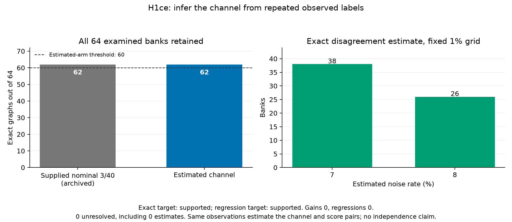

# H1ce: estimate the channel from repeated observed labels

The observation-only channel estimator recovered **62/64 exact graphs**, with **zero regressions** among the nominal-channel likelihood estimator's 62 successes. Both frozen targets—at least 60 exact graphs and at most two regressions—were **supported**. Every selected primal vector matched its nominal counterpart. The estimated grid rate was **7% for 38 banks and 8% for 26 banks**.

| Method | Exact graphs | Integral nonexact | Selected fractional | Unresolved |
|---|---:|---:|---:|---:|
| BP AdamW | Outside structural graph-inference scope; not run | — | — | — |
| H1cc supplied nominal 3/40 likelihood, archived paired control | 62/64 | 2 | 0 | 0 |
| H1cd supplied 3/80, prior-audited reference | 62/64 | 2 | 0 | 0 |
| H1cd supplied 3/20, prior-audited reference | 62/64 | 2 | 0 | 0 |
| Estimated positive-grid channel | 62/64 | 2 | 0 | 0 |



All 64 examined H1ca triple90 query bundles were retained. The acquisition rate 3/40 was withheld from the production estimator and used only for post-fit diagnostics and the explicitly archived comparator. The same observations estimate the channel and score graph edges, so this is neither an independent calibration sample nor fresh-cohort evidence. H1cd tested two supplied rates; the present experiment tests a fixed observation-only estimator. It does not test heterogeneous true channels.

The [corrected proposal](estimated-channel-proposal.json), [numerical gate](estimated-channel-math-check.json), [study gate](estimated-channel-preflight.json), and [seed audit](estimated-channel-seed-audit.json) preceded the [frozen protocol](protocol-estimated-channel.json). Protocol SHA256 is `f53565060e8a41cb188c49eff9daed83ea06f46056096014b946ddf2ae1e460a`. Raw audit and public [summary](../../../results/research/ripper/estimated_channel/summary.json) are byte-identical, SHA256 `4333e438e97b3c036d5a1f4474aed339446fc50a45c3adde49e17b7dc513badd`.

## Separate decisions and retained failures

| Target | Observed bound | Decision |
|---|---:|---|
| Exact graphs ≥60/64 | [62,62] | Supported |
| Regressions among 62 nominal successes ≤2 | [0,0] | Supported |

Banks 7 and 57 remained integral nonexact failures, with exact twice truth-minus-optimum gaps 139,186 and 2,355,612. Their true graph is strictly suboptimal under the estimated-channel integer objective. Every bank selected degree 20; fixed-degree-20 outcomes therefore match selected outcomes. Top810 recovered 12/64, but neither true degree nor edge count was supplied to the actual selector.

There were no estimator, numerical, or LP unresolved cases, no selected fractional outputs, and no clipping events. All 2,560 positive-degree LPs were independently certified, together with 64 analytic zero witnesses and 64 archived nominal selected controls. Deliberate proof mutations produced 7,872 rejections. The audit retained 1,709 intermediate fractional LPs as valid objective evidence. A selected fractional graph would be a resolved failure; an invalid estimate, uncertified cost, or uncertified required grid would remain unresolved. Certificates establish optimality, not uniqueness.

## Exact observation-only estimate

Each bank has 90 rows with 72 observed cells per row, equivalently 81 cells observed in 80 rows each: **6,480 observed cell-board positions**. For three acquired labels per position, there are three unordered query-pair comparisons, giving **T=19,440**. D counts unequal observed labels across these comparisons. D ranged from 2,618 to 2,919 in the study.

Under independent symmetric noise that changes a digit to one of its eight alternatives, the disagreement moment is

`E[D/T] = f(p) = 2p - 9p²/8`.

The model class restricts p to [0,8/9], where f is increasing and accuracy is at least random guessing. An empirical D/T greater than 8/9 would have no admissible inverse and would make the bank estimator-unresolved, with no cost construction or LP calls. The three pair indicators from one cell are dependent. The study makes no independent-binomial confidence claim and does not claim that inverse-moment estimation is unbiased.

The estimated inverse is quantized to the nearest k/100 for k in 1..88, with half-even integer-k ties and endpoint clipping. No floating-point square root is used. The producer compares D/T exactly to `f((2k+1)/200)` using integer cross-products; these are midpoints in p-space mapped through monotone f. An independent implementation checks all candidate intervals using exact fractions. The fixed positive floor of 1% regularizes zero disagreement and avoids impossible likelihood patterns. It is part of the estimator, rather than an outcome-dependent fallback. The grid spans positive informative channels and was not centered around the true acquisition rate.

Selected rates 7% and 8% are each 0.5 percentage points from the known 7.5% acquisition rate. This is a labeled post-fit diagnostic; the known rate did not select either bin. The original design draft incorrectly stated 7,200 positions and 21,600 comparisons. Independent design review caught the error before approval, implementation, or cohort disagreement counts. An unrelated balanced-mask fixture verified 81×80=90×72=6,480 and T=19,440. The original proposal and [correction receipt](../../../results/research/ripper/estimated_channel/prefreeze-review-v1/correction.json) are preserved. The frozen protocol and every executed estimator use 19,440.

## Fixed likelihood and certified numerics

For the selected k/100, a query has matching/nonmatching latent-digit likelihood weights `8*(100-k)` and `k`. The three likelihoods are multiplied exactly and normalized under the unchanged independent uniform latent-digit prior. The graph objective remains half-even rounding of `1e6 * sum[-ln(1-e)]`, where e is exact rational posterior equality probability, over 71 coqueries per pair. There is no smoothing or exposure normalization. This remains a pairwise composite likelihood, not whole-graph maximum likelihood; structured dependencies and the supplied model class remain limitations.

All **207,360 integer costs** were certified at 80 digits. No 160-digit fallback occurred. The maximum producer interval width was 7×10⁻⁷¹. The immutable H1cc directed Decimal logarithm bounds and independent exact-product, outward fixed-point logarithm bounds at 200 digits with 240 atanh-series terms remain unchanged. Every independent interval lay inside its producer interval and certified the same rounded cost. [Numerical accounting](../../../results/research/ripper/estimated_channel/numeric-accounting.json) records these quantities. Ordinary high-precision agreement is not treated as proof.

The numerical gate verified the exact moment at all 88 allowed grid rates, all 87 midpoint ties and their immediate rational neighbors (261 cases), clipping and invalid-domain boundaries, literal/vector disagreement-count parity, mask cardinality, and digit/query invariance. It enumerated every finite Q1/Q3 pair type at all grid rates and the nominal control: two and 21 types respectively. Independent log bounds were checked throughout; full-81-cell producer/reference parity was checked at 1%, 7%, 8%, 20%, 88% and nominal 3/40. The nominal score arrays matched immutable H1cc exactly. The study gate checked ten endpoint/missing-estimate cases, invalid-estimate avoidance of score and solver calls, valid estimated-channel data flow, all numerical skip modes, nine runner commands, and a synthetic LP certificate with three mutations.

## Execution and accounting

The charged study took **18.223015757 wall seconds and 144.077620 aggregate CPU seconds**, below the frozen 120-wall/450-CPU caps. Eight persistent workers handled independent banks. Each arm fit degrees 1..40 with fresh single-thread HiGHS, parallel mode off, dual simplex 1, presolve off, one-second LP limits and 1e-9 feasibility tolerances. Analytic degree zero and exact maximum curvature over degrees 1..39 selected the degree, with lower-degree ties. Literal half-integral solutions were preserved without snapping. Archived control checks and truth diagnostics followed the new fit for each bank.

The [persistent monitor](../../../results/research/ripper/estimated_channel/execution/samples.jsonl) retained 180 samples, 177 with eight workers. Independent [external snapshots](../../../results/research/ripper/estimated_channel/execution/external-live.jsonl) showed initial numerical preparation at 0.662s, 640 completed LPs and 16 audits at 4.702s, and 2,240 LPs with 56 audits at 16.643s. Per-worker CPU utilization stayed approximately 100% between these snapshots. The final snapshot recorded 2,560 LPs, 64 audits and no active children. Four Ripper GPUs remained idle because the exact LP and rational-certificate pipeline has no GPU implementation; unrelated workloads were preserved.

Finite-type interval tables are reused per chosen bin. On unrelated triple90 inputs, 7%/8% producer scoring took 0.0431s/0.0417s, while independent product certification took 0.8921s/0.8669s. These are synthetic implementation timings, not whole-study speedup claims. [Solver accounting](../../../results/research/ripper/estimated_channel/solver-timing-accounting.json) attributes 5.484023 CPU seconds, 3.81% of charged CPU, to solve calls. Numerical certification, nominal control verification, estimation and other work account for the remainder.

No new IDs, labels, masks, queries or noise draws were acquired. Parent physical noisy-query union remains 2,073,600; cumulative official noisy labels remain 16,760,919. The combined source ledger remains 2,431,463 IDs and Ripper's ledger 2,195,038. The 2,560 new solver seeds were checked against explicit historical fields and expanded H1bv/bw/by/bz/ca/cc/cd grids; other historical formulas were not exhaustively expanded, and distinct seeds do not prove random-stream independence.

## Public replay

```bash
OPENBLAS_NUM_THREADS=1 OMP_NUM_THREADS=1 MKL_NUM_THREADS=1 \
  artifacts/research/20261114/ripper/compression-venv/bin/python \
  research/20261114/ripper/verify_estimated_channel_public.py
```

The [public manifest](../../../results/research/ripper/estimated_channel_public_manifest.json) binds the package. Public H1ca query records, archived H1cc selected controls and bound sources suffice; no raw artifacts or registry aliases are required. Replay recomputes exact disagreements and quantized estimates, both likelihood-certification paths, every new degree grid, archived nominal costs and selected proofs, mutations, endpoints and accounting. Original noisy-query generation and CSV correspondence remain inherited from H1ca's charged source audit. This supported examined-cohort test is a prerequisite for a separate fresh heterogeneous-channel experiment, not a replacement for one.
