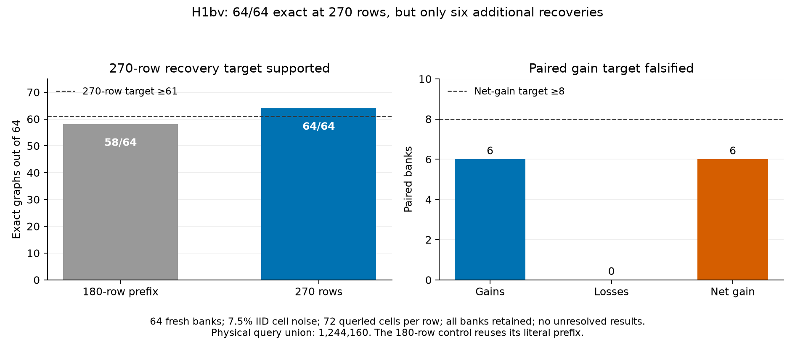

# H1bv: fresh confirmation of fixed 270-row inference

Fixed 270-row inference recovered the exact graph in **64/64 fresh banks**, supporting the preregistered recovery target of at least 61/64. Its literal 180-row control recovered 58/64. The **net paired gain of six** therefore **falsified** the separate target of at least eight gains. No bank was dropped, no unresolved output occurred, and there were no regressions.



| Method | Exact graphs | Integral nonexact | Selected fractional | Unresolved | Deployment queries across 64 banks |
|---|---:|---:|---:|---:|---:|
| BP AdamW | Outside scope | — | — | — | Not rerun in this structural-inference study |
| Literal 180-row prefix | 58/64 | 4 | 2 | 0 | 829,440 |
| Fixed 270 rows | **64/64** | 0 | 0 | 0 | **1,244,160** |

The 270-row operating point was selected from the earlier H1bu study, then tested prospectively on this new cohort. The earlier 32/32 result is motivation and is not pooled into the present 64-bank denominator. This is a finite-cohort structural-inference result, not a calibrated probability of correctness or a Sudoku puzzle-solving result.

## Frozen procedure and targets

Each bank sampled 270 source rows without replacement from the 1,452,089 eligible official rows outside the declared combined Ripper/H4ak exclusion ledger through H1bu. Across-bank repeats were retained. All source IDs and all 64 full masks were sealed before selected CSV answers were materialized. Freshness refers to that declared ledger, not to untouchedness throughout the repository.

The balanced mask queried 72 of 81 cells per row through exactly three independently permuted 90-row cycles of complements of GF(9) affine lines. Every cell receives 160 queries at 180 rows and 240 at 270 rows; every distinct pair receives 142 and 213 coqueries respectively. The 180-row dataset is a literal prefix of the same sources, masks, and latent noise arrays used at 270 rows.

Noise remained IID at the exact binary64 threshold `0x1.3333333333333p-4` (7.5%). A corrupted cell receives a uniform nonzero offset modulo nine. Each bank draws the full 270×81 uniform array followed by its offset array. The estimator receives neither a noise parameter, Sudoku geometry, degree 20, nor the 810-edge count.

Both prefixes use unchanged Laplace-smoothed equality rates with exact round-half-even integer costs; fresh single-thread HiGHS LPs at degrees 1 through 40; the analytic degree-zero witness; and exact curvature selection over degrees 1 through 39, choosing the lower degree on a tie. Literal half-integral primals are retained without snapping. Certified intermediate fractional LPs are valid objective evidence; a selected fractional primal is a resolved graph failure. An uncertified required grid is unresolved. Certificates establish optimality, not uniqueness.

The preregistered endpoints were assessed separately:

- **270-row exact recovery ≥61/64:** observed 64, supported.
- **270-row net paired gain over 180 rows ≥8:** observed 6, falsified.

Unresolved outputs widen conservative bounds: exact recovery lies in `[S270, S270+U270]`, and net gain lies in `[S270−S180−U180, S270+U270−S180]`. Here both intervals collapsed to exact counts. There was no extension, retry, bank removal, or outcome-based method change.

## Paired diagnostics

The 270-row wins were zero-based banks **0, 5, 22, 33, 36, and 57**. The other 58 banks were exact at both prefixes. There were no 180-row wins, shared failures, or unresolved pairs. All 128 grids selected degree 20. The labeled fixed-degree-20 diagnostic recovered 58/64 and 64/64; the top-810 diagnostic recovered 0/64 and 12/64. These controls did not enter selection or change either target.

All **5,120 exact primal/dual certificates**, **15,360 altered-proof rejections**, **128 analytic zero witnesses**, and **128 complete label-substitution gates** passed the charged audit. The 3,459 intermediate fractional LPs were retained. The raw audit independently checked official CSV answers, Sudoku validity, source selection and exclusions, all masks and exposure counts, noise generation, literal prefixes, exact scores, proofs, graph outcomes, paired endpoints, and query accounting.

Public replay checks source-ID selections and exclusions, masks, all scores and proofs, endpoints, and physical query accounting. When raw CSV/label/noise artifacts are absent, their correspondence and complete label-substitution gates remain evidence from the charged raw audit. The portable adapter redirects exactly two registry paths to byte-identical public copies.

## Query and source accounting

| Quantity | H1bv charge |
|---|---:|
| New source row instances | 17,280 |
| New unique official source IDs | 17,188 |
| Across-bank repeated instances | 92 |
| Full physical noisy query union | **1,244,160** |
| 180-row deployment queries | 829,440 |
| Additional 90-row queries | 414,720 |
| Clean materialized cell instances | 1,399,680 |
| Unique clean-oracle cells | **1,392,228** |
| Updated Ripper source ledger | 2,160,668 |
| Updated combined exclusion ledger | 2,397,093 |
| Official noisy-label sequence | **12,613,719** |

The experiment physically acquired exactly 270 rows per bank. The 180-row control shares those observations, so the physical union is the 270-row charge rather than the sum of two deployments. Repeated source IDs across banks share clean-oracle access but retain distinct noisy bank instances.

## Runtime, optimization, and reproducibility

The run completed once in **13.947346 wall seconds / 54.378399 aggregate CPU seconds**, within the frozen 180-wall/900-CPU caps. All 13 pipeline commands succeeded: source selection, one batched mask predraw, materialization, source audit, eight persistent bank workers, and summary. Every worker processed its fixed bank partition `worker, worker+8, …`; all 128 grids were computed.

A pre-freeze synthetic startup benchmark compared identical unrelated masks/count bundles over three repetitions. Batching 64 mask predraws reduced median wall time from 0.475447 to 0.068294 seconds (**6.96×**). Eight persistent count workers reduced it from 0.656784 to 0.246098 seconds (**2.67×**). Every output hash agreed. These are preparation-only measurements; no full-study speedup is inferred from cross-study timings.

Eight external live samples recorded productive workers. From elapsed 8.321 to 12.723 seconds, completed LPs advanced from 320 to 4,240 and audited banks from zero to 48; all eight bank workers were active. Process samples showed approximately one CPU core per worker. Live cumulative CPU totals are estimates and can race concurrent child reaping; the final no-child aggregate above is authoritative. The final persistent counter recorded 5,120 LPs, 64 audited banks, all 13 commands complete, and no active workers.

Recorded HiGHS calls used **13.202860 CPU seconds (24.28%)** of the charged total. The remaining 41.175539 CPU seconds include construction, source work, audits, startup, compression, and export, without a further component-level profile. All four Ripper GPUs showed 0% utilization and 2 MiB allocated in the first live sample. This CPU LP workload did not have an eligible GPU implementation; no GPU utilization claim is made.

```bash
OPENBLAS_NUM_THREADS=1 OMP_NUM_THREADS=1 MKL_NUM_THREADS=1 \
  python research/20261114/ripper/verify_fixed_270_confirm_public.py
```

Use NumPy 2.3.4 and HiGHS 1.12.0. Replay audits retained proofs without solving new LPs. Raw/public summary SHA-256:

`5cd36a1fe7b4de295d306a5d04b209965d1a7011eda0bc375a8670ee87eb987d`

Frozen protocol SHA-256:

`0fd4290f8b4ee77382c6feb1ea3690e4111e99f352993b78e87413706b4d7026`
