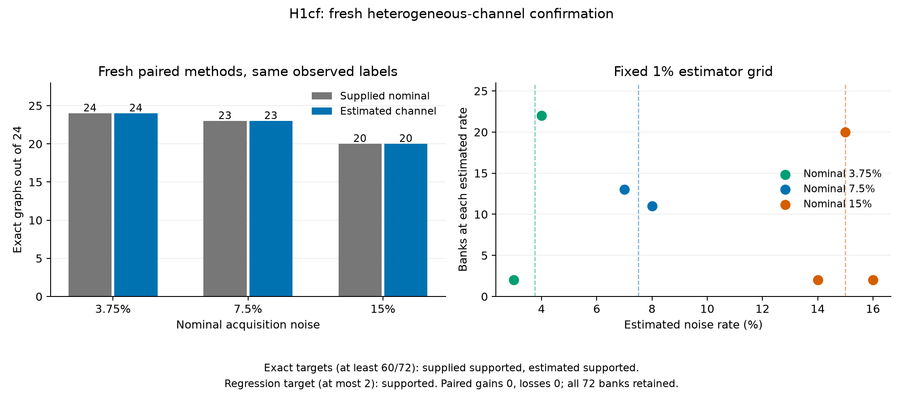

# H1cf: fresh heterogeneous-channel confirmation

The unchanged supplied-nominal and estimated-channel methods each recovered **67/72 exact graphs**, with no paired gains or regressions. Both preregistered absolute targets of at least 60/72 and the separate target of at most 2 regressions are supported. All 72 fresh banks and 144 method outcomes remain in the denominator. This is a new structural graph-inference experiment, not a new neural CRAM training reproduction.

| Method | Exact graphs | Integral wrong | Selected fractional | Unresolved | Scope |
|---|---:|---:|---:|---:|---|
| BP AdamW | Not run | — | — | — | Outside this structural graph-inference experiment |
| Supplied nominal channel | 67/72 | 5 | 0 | 0 | Fresh paired control; rational acquisition rate supplied |
| Estimated channel | 67/72 | 5 | 0 | 0 | Fresh test; acquisition-rate metadata withheld |

The selected literal primals were identical between methods on all 72 banks. Integer costs changed in 52 banks: all 3,240 entries changed in 51 banks and 3,239 entries changed in one. The remaining20 banks estimated exactly the supplied15% rate. Equal selected solutions on this cohort do not prove general invariance to the assumed channel.



## Falsifiable protocol and acquisition

The [prospective proposal](heterogeneous-channel-proposal.json), [synthetic gates](heterogeneous-channel-preflight.json), [seed audit](heterogeneous-channel-seed-audit.json), and independently reviewed [frozen protocol](protocol-heterogeneous-channel.json) preceded every new cohort ID, mask, noise realization, estimate, score and LP. Protocol SHA256: `feade75366e2c5242bc48c865394d758edba4a12c8e8bd2f5c666385ee061003`.

The 72 banks each contain90 source instances. Bank index modulo 3 assigns24 banks each to nominal corruption rates 3/80, 3/40, 3/20. IDs are sampled without replacement within a bank from 1,400,531 eligible official CSV rows; cross-bank repeats are retained. Freshness is relative to the declared combined Ripper/H4ak exclusion ledger through H1ca, not every use anywhere in the repository. All IDs and affine-line-complement masks were sealed before selected CSV labels were materialized. Each mask observes72 cells per row,80 rows per cell, and 71 joint observations per cell pair.

Each observed cell has three independently seeded query streams. A stream draws a90×81 binary64 uniform array followed by a90×81 int8 offset array in 1..8; corruption occurs when the uniform is below the binary64 conversion of the nominal rational rate. The protocol records each threshold's hexadecimal value and exact finite-generator event probability `ceil(threshold*2^53)/2^53`. The supplied arm receives the nominal rational rate. Distinct seeds are not a proof of statistical PRNG independence.

Both methods reuse the same acquired triple records. All 72 records were independently reconstructed and sealed before any estimate or score. The estimated arm uses immutable H1ce code: exact moment inversion from 19,440 pairwise comparisons among repeated labels, then nearest1% rounding on the fixed1..88% grid with half-even ties and explicit endpoint clipping. It receives no nominal-channel argument. The same observations estimate the channel and score graph pairs; no independence or unbiasedness claim is made.

Both arms use the immutable pair composite likelihood and 1e6 half-even integer quantization. This is not a full graph maximum-likelihood claim. Directed80/160-digit producer intervals are checked against independent200-digit,240-term rational bounds. A numerical failure would skip the entire arm and remain unresolved. Each arm fits degrees 1..40 with an analytic degree-zero witness; exact curvature selects among 1..39 with lower-degree tie breaking. True degree 20 and edge count810 are not supplied to this selection. Literal selected fractional solutions are resolved failures. Any required uncertified grid point makes the selection unresolved. There were no extensions, retries or omitted banks.

## Results and diagnostics

| Nominal acquisition rate | Supplied exact | Estimated exact | Estimated rates across 24 banks | Mean absolute rate error |
|---|---:|---:|---|---:|
| 3.75% | 24/24 | 24/24 | 3%:2;4%:22 | 0.291667 percentage points |
| 7.5% | 23/24 | 23/24 | 7%:13;8%:11 | 0.5 percentage points |
| 15% | 20/24 | 20/24 | 14%:2;15%:20;16%:2 | 0.166667 percentage points |

These are prespecified descriptive strata; the three primary targets use the full72-bank cohort. The pooled absolute endpoints each have lower = upper = 67 against a threshold 60. The conservative paired-regression endpoint has lower = upper = 0 against a maximum 2; its uncertainty rule accounts for unresolved states in either method. None occurred.

All 144 selections chose degree 20. Fixed-degree 20 recovery is therefore also67/72 per arm; the diagnostic unconstrained top810 rule recovered13/72 per arm. Neither diagnostic changes the primary method. The five paired failures are banks5, 8, 37, 53, 59. Their exact twice-objective truth gaps are:

| Bank | Supplied nominal gap | Estimated-channel gap |
|---:|---:|---:|
| 5 | 10,224,434 | 10,224,434 |
| 8 | 2,392,514 | 2,392,514 |
| 37 | 24,550 | 26,136 |
| 53 | 11,795,542 | 11,474,252 |
| 59 | 541,916 | 541,916 |

Each positive gap excludes the true graph as an optimum of that arm's selected degree 20 integer objective. Certificates prove optimality of the retained solutions, not uniqueness. Gaps under different assumed-channel objectives are not directly comparable effect sizes.

All 5,760 new LP certificates passed independent integer primal/dual checks;17,280 targeted proof mutations were rejected and 144 analytic zero witnesses checked. There were3,869 intermediate fractional LPs, no selected fractional results, and no LP, numerical or estimator unresolved arms. All 466,560 costs were certified at 80 digits without160-digit fallback; the maximum recorded interval width was7e-71. No estimate required clipping.

## Source and query accounting

The [source audit](../../../results/research/ripper/heterogeneous_channel/source-audit.json) verified6,466 unique official CSV answers across 6,480 source instances, including 14 repeated instances across banks, zero within-bank repeats and zero overlap with the declared exclusions. The updated Ripper ledger contains 2,201,504 IDs and the combined ledger2,437,929.

Physical acquisition is **1,399,680 noisy cell queries**, equal to 72×90×72×3. Each standalone method would use the same1,399,680 queries; the paired experiment reuses one physical acquisition and does not double this charge. Clean source materialization comprises524,880 cell instances and 523,746 unique oracle cells. The cumulative official noisy-label sequence increases from 16,760,919 to 18,160,599. The actual corrupted queried labels are17,434/466,560,35,155/466,560 and 69,849/466,560 in the three respective strata.

## Runtime, validation and replay

The charged run took **34.364190459 wall seconds and 208.132226 aggregate CPU seconds**, below the frozen180/900 ceilings, on Ripper with eight persistent single-thread workers. All 14 commands completed successfully. The solver calls consumed12.421180250 CPU seconds,5.968% of the full charge; source preparation, exact numerical certification, hashing, audits and export remain charged. This measured breakdown identifies non-solver work as the main cost. Eight live workers were recorded in 244 of 340 samples; an external sample at 12.36 seconds showed each worker at 100% CPU,640 completed LPs and 8 bank audits. Final counters were5,760 LPs,72 audits and no active owned worker. All four authorized Ripper GPUs were idle because this exact LP/rational-certification pipeline has no eligible GPU implementation; unrelated processes were preserved. No cross-study speedup is claimed.

The [public summary](../../../results/research/ripper/heterogeneous_channel/summary.json) is byte-identical to the charged raw audit, SHA256 `0118eb0243aecd8046dfda255ec699606d1d4b7958f20ad3597ea737e11a69ef`. [Execution samples](../../../results/research/ripper/heterogeneous_channel/execution/samples.jsonl), [numeric accounting](../../../results/research/ripper/heterogeneous_channel/numeric-accounting.json), and [solver timing](../../../results/research/ripper/heterogeneous_channel/solver-timing-accounting.json) retain the detailed evidence.

Run the portable verifier with NumPy2.3.4 and highspy1.12.0:

```bash
OPENBLAS_NUM_THREADS=1 OMP_NUM_THREADS=1 MKL_NUM_THREADS=1 \
  python research/20261114/ripper/verify_heterogeneous_channel_public.py
```

The [public manifest](../../../results/research/ripper/heterogeneous_channel_public_manifest.json) binds the package. Public replay reconstructs source-ID selection, masks, observed records, channel estimates, numerical intervals, degree grids, certificates, endpoints and charges. It explicitly inherits selected-CSV and latent-noise correspondence from the charged raw audit, since raw CSV/noise archives are not required in a public checkout. Registration inputs map directly to their public copies. The [figure script](../../../scripts/plot_heterogeneous_channel.py) generates deterministic PNG/SVG and provenance.

The fresh heterogeneous cohort supports the fixed estimator within this structured official-board source and symmetric incorrect-digit channel family. Recovery still degrades at the highest tested corruption rate, and matching the supplied-channel control does not establish universal channel robustness or successful CRAM neural training.
