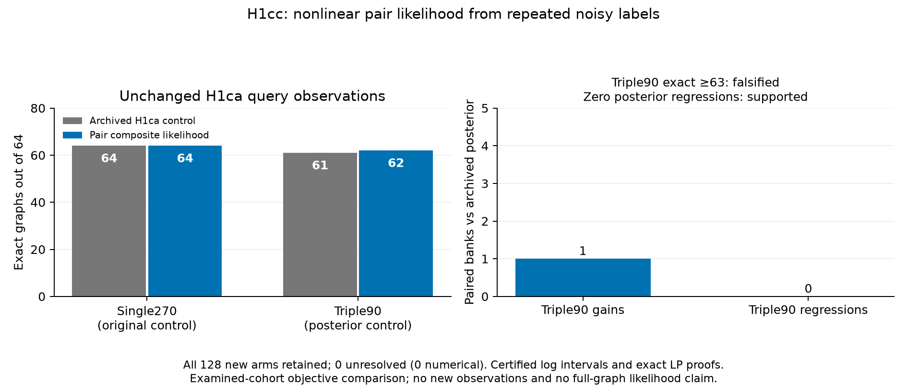

# H1cc: pairwise composite likelihood from repeated noisy labels

Pairwise composite likelihood recovered **62/64 triple90 graphs**, compared with the archived fixed-posterior estimator's 61/64. It recovered bank 6 and lost no previously recovered graph. The frozen target of at least 63/64 was **falsified**; the separate zero-regression target was **supported**. All 128 new arms remain in the denominator, with no numerical or LP unresolved outputs.

| Method | Exact graphs | Integral nonexact | Selected fractional | Unresolved |
|---|---:|---:|---:|---:|
| BP AdamW | Outside structural graph-inference scope; not run | — | — | — |
| H1ca original single270, archived | 64/64 | 0 | 0 | 0 |
| New single270 pair likelihood | 64/64 | 0 | 0 | 0 |
| H1ca hard triple90, archived reference | 51/64 | 12 | 1 | 0 |
| H1ca posterior triple90, archived paired control | 61/64 | 3 | 0 | 0 |
| New triple90 pair likelihood | 62/64 | 2 | 0 | 0 |



This is an objective comparison on the examined H1ca cohort after H1cb showed that all three posterior residual failures strictly excluded truth. It uses the same acquired observations and does not test fresh generalization. The single270 likelihood arm is a prespecified diagnostic; the hard-decoder row is explicitly an inherited reference. No new masks, sources, labels or noise draws were used.

The [proposal](pair-likelihood-proposal.json), [numerical gate](pair-likelihood-math-check.json), [study gate](pair-likelihood-preflight.json), and [seed audit](pair-likelihood-seed-audit.json) preceded the [frozen protocol](protocol-pair-likelihood.json). Protocol SHA256 is `ecbc86bead899627ddd77d5e1578b3a90efb9825fd7d0e71b4e5ce672e79d542`. The raw audit and public [summary](../../../results/research/ripper/pair_likelihood/summary.json) are byte-identical, SHA256 `a256b3bee4f664f491c85e595cf6f76d6d4eb7675ff9ae7be4d8f55e60ab7d33`.

## Separate decisions and retained failures

| Frozen target | Observed bound | Decision |
|---|---:|---|
| Triple90 exact graphs ≥63/64 | [62,62] | Falsified |
| Regressions among 61 archived posterior successes =0 | [0,0] | Supported |

The sole triple90 gain was bank 6. Banks 7 and 57 remained integral nonexact failures, with exact twice truth-minus-optimum gaps 149,766 and 2,349,752 respectively. Their true graph therefore remains strictly suboptimal under the new integer objective. All 128 arms selected degree 20, so fixed-degree 20 diagnostics equal their selected outcomes. Top810 recovered 11/64 single270 and 12/64 triple90 graphs; this diagnostic supplied neither the degree nor the edge count to the actual degree selector.

Every required positive-degree LP was independently certified: 5,120 new certificates, 128 analytic zero witnesses, and 128 archived selected-control certificates. Deliberate proof mutations produced 15,744 rejections. The audit retained 3,439 intermediate fractional LPs as valid objective evidence. Selected fractional outputs would have been resolved failures; an uncertified required grid or numerical cost would have remained unresolved in the primary bounds. No case was removed, rerun with another seed, or selected for favorable tie behavior. Certificates establish optimality, not uniqueness.

## Model and certified arithmetic

For each queried cell, the model retains the exact H1bz/H1ca posterior under the known nominal 3/40 symmetric channel and an independent uniform latent-digit prior. If e is the rational posterior probability that a cell pair's clean digits are equal, then an edge prior uniform over distinct clean-digit pairs has likelihood ratio

`likelihood(edge) / likelihood(unrestricted pair) = (1-e)/(8/9)`.

The new cost is exact half-even rounding of `1e6 * sum[-ln(1-e)]` over coqueries. The pair-independent coquery constant is omitted by definition. There are no Laplace pseudo-observations or exposure normalization. Balanced masks give exactly 213 pair coqueries for single270 and 71 for triple90. At Q1, the two exact equality-posterior numerators are 1,839 (different observed labels) and 87,688 (same observed label), both over 102,400. Thus the pre-round single270 objective is affine in the ordinary equality count; the numerical gate verifies this identity. The positive affine scale and degree-linear constant do not alter exact curvature before quantization, while integer rounding can change tied solutions.

This is a **pairwise composite likelihood**, not a whole-board or whole-graph likelihood. Cell-pair and row dependencies in structured boards are not modeled as independent physical facts. The uniform prior and known nominal noise assumption remain supplied and potentially misspecified. The result does not isolate the nonlinear transform from every other objective or rounding change.

The producer encloses rational division, logarithm endpoints, multiplication and sums with directed Decimal arithmetic. Python documents `Decimal.ln` as correctly rounded using `ROUND_HALF_EVEN`; a full last-place unit encloses each logarithm call. A cost is accepted only if the complete interval rounds to one integer. Working precision is frozen at 80 digits, with 160 digits used only if 80 cannot certify that rounding interval.

The independent auditor constructs each pair's exact rational likelihood product from literal cell likelihoods. It range-reduces its logarithm by powers of 2 and computes outward integer fixed-point bounds at 200 digits using 240 terms of the atanh series. For z in [0,1/3], the omitted positive logarithm tail is bounded by `2*z^(2M+1)/((2M+1)*(1-z²))`. All arithmetic operations in this independent bound are exact integer operations with outward rounding. Ordinary high-precision floating-point agreement is not used as a proof of the logarithm value.

All **414,720 integer costs** were certified at 80 digits; there were no 160-digit study fallbacks or numerical failures. The maximum producer cost-interval width was exactly 7×10⁻⁷¹. Each independent exact-product interval lay within the corresponding producer interval and rounded to the same integer. [Numerical accounting](../../../results/research/ripper/pair_likelihood/numeric-accounting.json) retains these totals. Any producer or independent interval failure would skip that arm's entire degree grid; stored zero placeholders cannot enter a solver. The synthetic gate explicitly instruments and verifies all such skip modes.

The numerical gate exhaustively enumerates the possible query-pair types: 2 at Q1 and 21 at Q3. It checks exact likelihood-ratio algebra, constant pair exposure, the Q1 affine relation, full 81-cell producer/reference parity, digit/query permutation invariance, missing observations, half-even boundaries, and two deliberately constructed 80→160 fallback cases. These checks used unrelated synthetic inputs, without inspecting cohort likelihood scores.

## Execution and accounting

The charged study used **26.339249695 wall seconds and 208.637682 aggregate CPU seconds**, below the frozen 180-wall/900-CPU limits. Eight persistent bank workers handled independent pairs of arms. Every arm fit degrees 1..40, used an analytic degree-zero witness, and selected exact maximum curvature over degrees 1..39 with lower-degree ties. HiGHS used one thread, parallel mode off, dual simplex 1, presolve off, 1-second LP limits and 1e-9 feasibility tolerances. Literal half-integral solutions were retained without snapping. True graph geometry was evaluated only after fitting each bank's two arms.

The [persistent monitor](../../../results/research/ripper/pair_likelihood/execution/samples.jsonl) captured 260 samples, 256 with eight active workers. The separate [external snapshots](../../../results/research/ripper/pair_likelihood/execution/external-live.jsonl) captured eight workers at approximately 100% CPU from initial numerical preparation through 2,880 completed LPs and 32 audited banks at 14.808s. The final snapshot reports 5,120 LPs, 64 audited banks and no active children. The four Ripper GPUs were idle because this exact LP and rational-audit pipeline has no GPU implementation; unrelated services were preserved.

Finite posterior-type tables avoid repeating logarithm work. On one unrelated full-shape gate input, production costs took 0.0365s for single270 and 0.0419s for triple90; the independent exact-product checks took 1.140s and 0.857s. A separate three-repetition 12×9 toy measured median 0.000418s for finite-type intervals and 0.007485s for independent product bounds. These are implementation timings on different algorithmic roles, not a full-study speedup claim. [Solver-call accounting](../../../results/research/ripper/pair_likelihood/solver-timing-accounting.json) attributes 12.247793 CPU seconds, 5.87% of total charged CPU, to solve calls. Numerical validation, inherited-control checks and other work dominate the remaining CPU; a launched LP process alone was not treated as evidence of progress.

No additional observation charge is incurred. H1ca's physical noisy-query union remains 2,073,600, and cumulative official noisy labels remain 16,760,919. The combined source ledger remains 2,431,463 IDs and Ripper's ledger 2,195,038. Each standalone H1ca arm originally used 1,244,160 noisy queries. The newly reserved 5,120 solver seeds were checked against explicit historical seed fields and expanded H1bv/bw/by/bz/ca grids; other historical formulas are not exhaustively expanded and distinct seeds do not prove random-stream independence.

## Public replay

```bash
OPENBLAS_NUM_THREADS=1 OMP_NUM_THREADS=1 MKL_NUM_THREADS=1 \
  artifacts/research/20261114/ripper/compression-venv/bin/python \
  research/20261114/ripper/verify_pair_likelihood_public.py
```

The [public manifest](../../../results/research/ripper/pair_likelihood_public_manifest.json) binds the package. Replay needs only public H1ca query records, archived selected controls and bound source files; it needs no raw artifacts or registration aliases. It recomputes all certified interval costs and independent exact-product bounds, every new degree grid, all archived selected certificates, mutations, endpoints, runtime and query accounting. Original noisy-query generation and CSV correspondence remain inherited from H1ca's charged source audit. The small observed improvement does not satisfy the prespecified absolute target and does not support an untested fresh-cohort claim.
