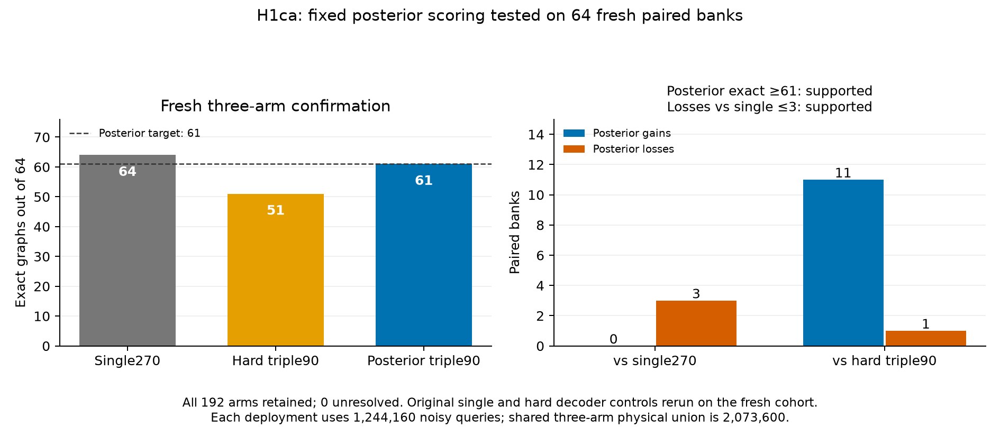

# H1ca: fresh confirmation of posterior repeated-query inference

The fixed posterior estimator recovered **61/64 fresh graphs**, compared with **64/64** for original single270 inference and **51/64** for the hard-decoded triple90 control. Both separately frozen targets were supported exactly at their boundaries: at least 61 posterior successes and at most 3 paired losses against single270. All 192 fitted arms remain in the denominator. No outcome was unresolved.

| Method | Exact graphs | Integral nonexact | Selected fractional | Unresolved |
|---|---:|---:|---:|---:|
| BP AdamW | Outside structural graph-inference scope; not run | — | — | — |
| Original single270 | 64/64 | 0 | 0 | 0 |
| Hard-decoded triple90 | 51/64 | 12 | 1 | 0 |
| Fixed posterior triple90 | 61/64 | 3 | 0 | 0 |



This is a prospective fresh-cohort confirmation after inspecting H1bz's 63/64 posterior result. The original single-observation control and hard-decoder control were both rerun on the fresh cohort. H1bz observations and fitted graphs are excluded from the new success denominator. Passing these 64-bank thresholds does not establish a universal 95% success probability, statistical noninferiority, or puzzle-solving performance.

The [proposal](posterior-fresh-confirm-proposal.json), [synthetic gate](posterior-fresh-confirm-preflight.json), and [seed audit](posterior-fresh-confirm-seed-audit.json) preceded the [frozen protocol](protocol-posterior-fresh-confirm.json). Protocol SHA256 is `700a78cb22b97357fb749da23068e0064ca5301d37d74f98022d015fbff44c0a`. The raw audit and public [summary](../../../results/research/ripper/posterior_fresh_confirm/summary.json) are byte-identical, SHA256 `27bd7e4ebafd26562fe22abba8f7a19de505bcdda9a97dc4037d50d880c747d4`.

## Prespecified decisions and paired changes

| Separate primary target | Observed bound | Decision |
|---|---:|---|
| Posterior exact graphs ≥61/64 | [61,61] | Supported |
| Posterior losses versus original single270 ≤3/64 | [3,3] | Supported |

Posterior failed on banks 6, 7, 57, all with integral nonexact selected graphs. Single270 succeeded on every bank, so these are exactly its 3 paired losses. The fixed hard-decoder comparison is a prespecified diagnostic: posterior gained 11 banks (3,12,16,24,39,40,45,49,50,60,61) and lost 1 (7), for a net gain of 10. Banks 6 and 57 failed under both triple methods. The hard decoder's selected fractional result was bank 49; posterior recovered that graph exactly. No regression was excluded.

All 192 arms selected degree 20 by the common degree-selection rule. Fixed-degree 20 diagnostic outcomes therefore equal the selected outcomes. The top810 diagnostic recovered 11/64 single270, 0/64 hard triple90, and 1/64 posterior triple90 graphs. These diagnostics supplied neither degree 20 nor the 810-edge count to the actual selector.

Unresolved outputs would have remained in both primary denominators. The success test uses lower known successes and upper successes plus unresolved; the paired-loss test uses all logically possible single-success/posterior-failure completions. The synthetic gate exhausts 64 three-arm classification combinations, including integral failure, fractional failure and unresolved states.

## Frozen acquisition and estimator

Each bank contains 270 official rows, sampled without replacement within the bank from 1,417,724 eligible IDs. The declared combined Ripper/H4ak exclusion ledger through H1bw had 2,414,270 IDs; later H1bx/by/bz added no IDs. All 64 source-ID arrays and all 64 full 270-row masks were sealed before selected CSV labels were materialized. The masks are three independently permuted 90-row GF(9) affine-line-complement cycles, retaining 72 cells per row. Triple90 uses the literal first 90 rows of the single270 arm. Cross-bank repeats remain in the analysis.

The first noisy query is shared. Two additional independent seeded noise streams supply repeated observations on the first 90 rows. Corruption retains the original binary64 threshold `0x1.3333333333333p-4` and uniformly selected nonzero digit offsets. This is nominal 7.5% noise; its exact 53-bit uniform-event probability is distinguished from nominal 3/40 in the inherited channel record. Source/mask/noise/repeat stream seeds are base plus bank 0..63; all five complete ranges were checked against explicit historical fields and expanded H1bv/H1bw 64-bank streams. Solver seeds were checked against expanded H1bv/H1bw/H1by/H1bz 5120-seed grids. Other historical formulas are not exhaustively expanded, and distinct seed integers do not prove statistical independence.

The original method uses unchanged Laplace-smoothed observed-equality rates. The hard decoder uses majority when any label appears twice, and the first query when all three differ. Posterior scoring receives the same three raw query records as the hard decoder and uses the unchanged H1bz exact scorer, SHA256 `e9dc113e5403b07884dd7c35dceb9d1efacd4f3d0a5781db65ea975e8da1f059`. At known nominal noise3/40 and an independent uniform prior per cell, the unnormalized posterior weight for candidate digit d is `296^n_d * 3^(3-n_d)`. Pair-equality probabilities are exact normalized dot products; these rational values are summed over coqueries and converted to integer costs by exact half-even rounding of `1e6*(sum+1)/(joint+2)`. There is no intermediate floating-point posterior calculation or tuned parameter. The independent per-cell prior may be misspecified for structured boards.

All 64 newly acquired query bundles were independently checked and sealed before model scoring. Workers fit only masked noisy records. Every arm received 40 fresh positive-degree LPs, the analytic degree-zero witness, and exact-curvature selection over degrees 1..39 with lower-degree tie breaking. True geometry was used only in post-fit graph scoring. HiGHS ran single-threaded with parallel mode off, dual simplex 1, presolve off, 1-second per-LP limit, and 1e-9 feasibility tolerances. Literal half-integral optima were retained without snapping.

## Accounting and validation

The raw preparation audit checked 17,193 unique selected official CSV rows; 87 of the17,280 source instances were cross-bank repetitions. There were no within-bank repeats or overlaps with the declared exclusions. The updated Ripper ledger has 2,195,038 IDs; the combined ledger has 2,431,463. Freshness is relative to that declared ledger, not every dataset anywhere in the repository.

Each standalone arm uses 1,244,160 noisy cell queries. Both triple methods share every one of their 1,244,160 query records, and share 414,720 first-query records with single270. The physical union across all three arms is therefore **2,073,600**, not three standalone charges. Clean labels were materialized for 1,399,680 cell instances, corresponding to 1,392,633 unique clean-oracle cell queries. The cumulative official noisy-label sequence advances from 14,687,319 to 16,760,919.

[Noise accounting](../../../results/research/ripper/posterior_fresh_confirm/noise-accounting.json) records first-query error 93,312/1,244,160=7.5%, repeat1 error 30,845/414,720≈7.43755%, repeat2 error 30,722/414,720≈7.40789%, and hard-decoded error 4,813/414,720≈1.16054%. Across queried triple cells, 328,794 records had three agreeing labels, 80,094 had exactly two agreeing, and 5,832 had all distinct labels. These are descriptive observations, not tuning inputs.

The charged independent audit validated 7,680 positive-degree LP certificates and 192 analytic zero witnesses, and rejected 23,040 deliberately altered proofs. It retained 5,186 intermediate fractional LPs as valid objective evidence. Certificate optimality does not assert optimizer uniqueness. All 192 complete-label substitution gates passed; masks stayed fixed and every queried label changed. Synthetic tests also checked exact source-ledger bindings, masks, all three score calculations, shared physical-query identities, fresh hard-decoder parity, and literal posterior arithmetic.

## Runtime and replay

The complete charged run used **22.183896249 wall seconds and 87.347582 aggregate CPU seconds**, below the frozen 180-wall/900-CPU limits. Eight persistent workers evaluated independent banks. The 14 commands were ID selection, all-mask sealing, selected-label materialization, independent source audit, query preparation, eight workers, and summary. The run used no GPU computation; the four Ripper GPUs were idle because this exact HiGHS/independent-rational-audit workload has no GPU implementation. Unrelated services were preserved.

The [persistent monitor](../../../results/research/ripper/posterior_fresh_confirm/execution/samples.jsonl) retained 219 samples, including 91 with eight active worker PIDs. It observed 0 completed LPs at 12.789s and 7,680 LPs/57 audited banks at 21.939s while all eight worker process-CPU counters advanced. The separate [external sample](../../../results/research/ripper/posterior_fresh_confirm/execution/external-live.jsonl) caught query preparation at 38/64 banks, 10.869s and 100% process CPU; its second sample was after completion. Final counters report 7,680 LPs, 64 audited banks and no active children. External sampling did not independently catch the short eight-worker phase.

The bounded optimization reused balanced masks, exact binned posterior arithmetic, raw query records shared across arms, and eight persistent bank workers. [Solver-call accounting](../../../results/research/ripper/posterior_fresh_confirm/solver-timing-accounting.json) attributes 20.671114 CPU seconds, 23.67% of the charged CPU total, to LP solve calls; other CPU includes imports, acquisition, score construction, audits, and export. This is not evidence that LP solving dominated runtime or a cross-study speedup measurement.

Run the portable verifier from the repository root:

```bash
OPENBLAS_NUM_THREADS=1 OMP_NUM_THREADS=1 MKL_NUM_THREADS=1 \
  artifacts/research/20261114/ripper/compression-venv/bin/python \
  research/20261114/ripper/verify_posterior_fresh_confirm_public.py
```

The [public manifest](../../../results/research/ripper/posterior_fresh_confirm_public_manifest.json) binds the package. Public replay checks all fresh IDs/masks, published query records, independent exact costs, every proof grid, endpoints, resource bounds and query accounting. It maps exactly two registration paths to byte-identical published files. Original CSV/latent-noise correspondence relies on the charged raw preparation audit; public replay does not need raw artifacts. No study rerun, resource extension, outcome-dependent reseed, or post-outcome estimator change occurred. The first post-run packaging verifier had a transcription error in its clean-cell total (1,499,680 instead of 1,399,680); its scientific replay passed before that assertion failed. The packaging-only constant was corrected to the frozen protocol and raw-audit value, with the [failed version and receipt](../../../results/research/ripper/posterior_fresh_confirm/packaging-review/failure-v1.json) preserved. Frozen science and outcomes were unchanged.
