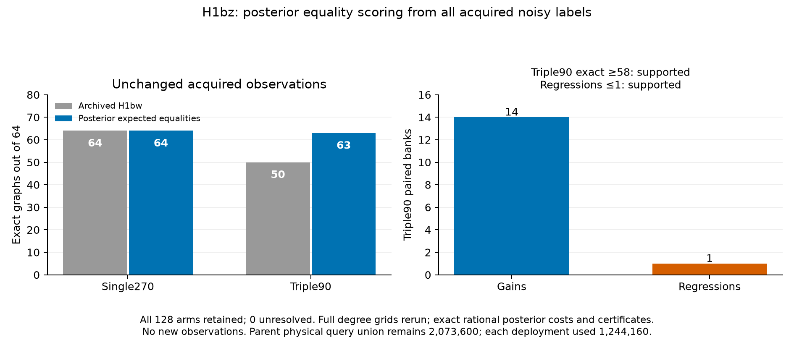

# H1bz: preserve repeated-label uncertainty in pair scoring

Posterior equality scoring recovered **63/64 triple90 graphs**, up from the archived hard-decoding result of 50/64. It recovered all 14 prior failures and regressed on one previously exact bank. Both preregistered targets were **supported**: at least 58 exact graphs, and at most one regression. The single270 control remained **64/64 exact**.



| Method | Single270 exact | Triple90 exact | Triple90 integral nonexact | Selected fractional | Unresolved |
|---|---:|---:|---:|---:|---:|
| BP AdamW | Outside scope | Outside scope | — | — | Not rerun in this structural-scoring intervention |
| Archived H1bw hard decoding | 64/64 | 50/64 | 14 | 0 | 0 |
| Posterior expected pair equalities | **64/64** | **63/64** | 1 | 0 | 0 |

All 128 arms and all their full degree grids were retained. This is a result on the already examined H1bw cohort, with a specified known noise model. It is not a fresh-cohort reliability estimate or a causal isolation of disagreement information: scoring, model assumptions, and optimal-solution tie effects changed together.

## Frozen scoring model

The scorer receives each acquired noisy query label rather than only its majority-decoded value. It assumes a known nominal symmetric nine-class channel with corruption probability **3/40**, giving probability **37/40** to the correct label and **3/320** to each incorrect label. Each cell has a uniform digit prior, and posterior pair probabilities use the product of independent cell marginals. Those independence assumptions can be misspecified for structured Sudoku boards; no graph or Sudoku geometry enters the scorer.

For `Q` acquired labels at a cell, let `n_d` be the number equal to digit `d`. The exact integer posterior weights are

`w_d = 296^n_d × 3^(Q−n_d)`, normalized by `sum_d w_d`.

Single270 uses `Q=1`; triple90 uses `Q=3`. For a coqueried pair, the scorer computes `dot(w_i,w_j)/(sum(w_i) × sum(w_j))`. It sums these exact rational equality probabilities across the original coqueried boards, then applies the same Laplace smoothing and rounding convention as H1bw:

`cost = round_half_even(1,000,000 × (expected_equalities + 1)/(joint_count + 2))`.

There is no intermediate floating-point posterior calculation or rounding. Joint exposure remains 213 for single270 and 71 for triple90. All disagreements contribute to the score; no hard-majority or tie-selection rule appears in this scoring step.

The fixed likelihood uses nominal probability 3/40. Original observations were generated with the binary64 threshold `0x1.3333333333333p-4`, whose ideal 53-bit-uniform event probability differs slightly from 3/40. This distinction is retained; the model was not adjusted to measured errors or fitted outcomes.

Inference otherwise follows the frozen procedure: fresh single-thread LPs at degrees 1 through 40, analytic degree-zero witness, exact curvature selection with lower-degree ties, and literal half-integral primal certificates without snapping. True degree 20 and the 810-edge count are not fitting inputs. Certified intermediate fractional LPs are valid objective evidence, selected fractional outputs are resolved failures, and an uncertified required grid is unresolved.

## Acquired-record preparation and independent audit

H1bw retained the first-pass and hard-decoded observations, plus the clean completion and latent arrays that deterministically generated its extra noisy queries. The extra raw passes were implicit in those arrays rather than stored as separate label records. A trusted preparation stage reconstructed those **already-acquired** masked noisy labels, bound them to the original H1bw raw-audit hashes, and independently checked them using rational corruption thresholds and a scalar decoder. It also checked the original first-pass and decoded observation files.

All 64 query-record bundles were validated and sealed before any scoring worker started. Scoring workers received only the masked acquired query records and masks, without clean values, corruption flags, or actual offsets. The first 90 first-pass rows are physically shared between the two arms. Public replay uses the published query records and recomputes every rational score; its correspondence to latent arrays and clean sources remains evidence from the charged preparation audit. Original CSV provenance is inherited from the parent study and is not recollected here.

The producer accumulates integer posterior numerators in denominator classes. Three-query observations have only three possible normalizers—8,154; 265,701; and 25,934,552—giving six unordered pair-denominator classes. The independent scorer instead builds each cell likelihood through a product over its labels, accumulates per-pair row contributions in Python-integer dictionaries, and combines them with exact fractions. Complete rational totals and final rounded costs must match before every new proof grid is accepted.

## Endpoints and paired outcomes

The two frozen targets were evaluated separately:

- **Triple90 exact recovery ≥58/64:** observed 63/64, supported.
- **At most one regression among the 50 archived triple90 successes:** observed one, supported.

Unresolved outputs would widen recovery bounds to `[S, S+U]`; regression bounds would add unresolved outputs among the 50 archived successes to the known-loss count. No uncertainty or failure removes a bank from the denominator. All outputs resolved in this run.

The 14 gains were zero-based banks **8, 10, 26, 30, 31, 35, 40, 41, 44, 50, 52, 54, 56, and 57**. The sole regression was **bank 37**, which returned an integral nonexact graph. There were 49 shared exact outputs, no shared failures, and a net gain of 13. Every single270 output remained exact.

All 128 grids selected degree 20. The diagnostic fixed-degree-20 outputs therefore recovered 64/64 and 63/64; top-810 recovered 8/64 and 0/64. Those controls did not change either target. The result motivates a separate fresh-cohort confirmation; the present denominator must not be relabeled as such a confirmation.

## Evidence, cost, and runtime

The charged run verified **5,120 new exact primal/dual certificates**, **128 archived selected certificates**, **15,744 altered-proof rejections**, and **128 analytic zero witnesses**. All **3,460 intermediate fractional LPs** were retained. The independent synthetic gate checked 6,561 exact Bayes likelihood cases, query-order and digit-permutation identities, 81 single-query pair identities, one-hot equality-count limits, missing records, exact half-even boundaries, trusted preparation correspondence, full 270/90-row rational scoring parity, and primary boundary/unresolved cases.

There were **zero new noisy queries, source draws, or clean-source oracle queries**. Reconstruction reused already charged sources and latent records. The parent physical query union remains **2,073,600**, each standalone deployment remains **1,244,160**, and their shared first-query prefix remains **414,720**. The cumulative official noisy-label sequence is **14,687,319**, with the combined declared source ledger unchanged at **2,414,270**.

The single bounded run completed in **14.342255 wall seconds / 93.701831 aggregate CPU seconds**, below the frozen 180-wall/900-CPU limits. All ten commands succeeded: preparation, eight persistent workers, and summary. Live samples showed preparation reaching 19/38/58 banks at 0.853/1.759/2.564 seconds. After all 64 bundles were sealed, eight workers advanced from 640 completed LPs at 3.374 seconds to 5,120 LPs and 56 completed bank audits at 13.199 seconds. The final counter recorded all 64 audits and no active workers. Per-PID CPU and external process samples were retained; transient totals can race reaping, so final aggregate CPU is authoritative.

On an unrelated 90×81 synthetic fixture with three repetitions, exact binned scoring took a median **0.026533 seconds**, independent dictionary scoring **0.184341 seconds**, and literal fraction-per-row scoring **0.359784 seconds**. The binned producer was about 13.56× faster than the literal implementation on that fixture, with identical costs. These measurements cover scoring only, not full-study speed. The worst declared integer-bin accumulation bound is 181,602,266,608,990,080, safely below signed-int64 capacity.

Recorded HiGHS calls used **13.999932 CPU seconds (14.94%)**. The remaining 79.701899 seconds include preparation, exact rational scores and audits, construction, startup, compression, and export; those components were not separately profiled. The initial live GPU inventory showed all four Ripper GPUs at 0% utilization and 2 MiB allocation. This CPU LP and rational-audit pipeline has no eligible GPU implementation.

```bash
OPENBLAS_NUM_THREADS=1 OMP_NUM_THREADS=1 MKL_NUM_THREADS=1 \
  python research/20261114/ripper/verify_posterior_query_labels_public.py
```

Use NumPy 2.3.4 and HiGHS 1.12.0. Public replay needs no raw CSV, latent noise, or clean completion files and performs no new LP solves. Raw/public summary SHA-256:

`64c3352f05345d9a04fd21a64a4b93cb3e62f9d5c44ee27a685deb1144d66f8a`

Frozen protocol SHA-256:

`cff0182350771a35dee77451571d430d30ff1edc5b34bef857d0e089a774b991`
