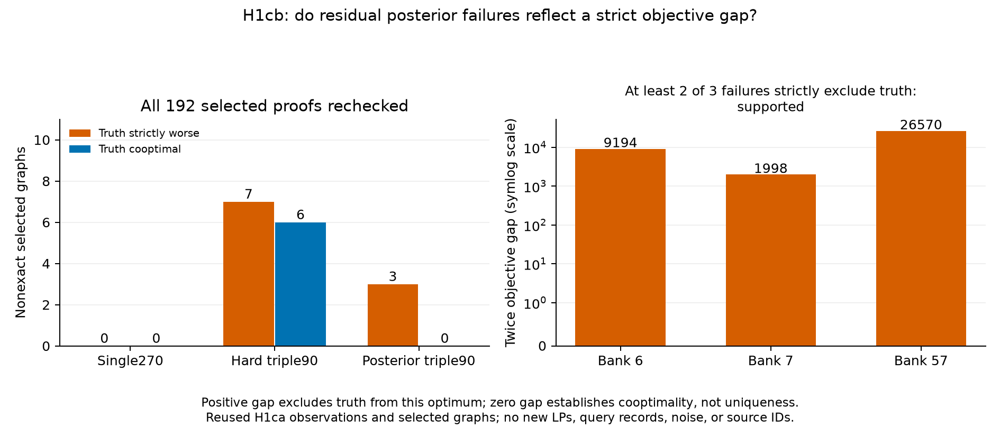

# H1cb: exact gaps of the residual posterior failures

All **3 of 3** posterior failures in H1ca have a strictly positive certified truth-objective gap, supporting the frozen target of at least 2. The exact twice-gaps are 9,194 (bank 6), 1,998 (bank 7), and 26,570 (bank 57). Thus the true graph is not an optimizer of the frozen integer posterior objective on any of these three banks. Changing selection among equally optimal graphs cannot recover truth under that objective.

| Method | Exact graphs | Truth strictly worse | Truth cooptimal but selected graph nonexact | Selected fractional |
|---|---:|---:|---:|---:|
| BP AdamW | Outside structural graph-inference scope; not run | — | — | — |
| H1ca original single270 | 64/64 | 0 | 0 | 0 |
| H1ca hard triple90 | 51/64 | 7 | 6 | 1 |
| H1ca fixed posterior triple90 | 61/64 | 3 | 0 | 0 |



This is a diagnostic on already examined H1ca outputs. H1ca success labels and the three posterior failure IDs were known when the hypothesis was proposed; their true-graph objective gaps were not inspected until after source review and protocol freeze. No observations, sources, labels, noise streams, degree grids or solver calls were added. H1ca's 64/64 versus51/64 versus61/64 outcomes remain unchanged.

The [proposal](posterior-residual-gap-proposal.json), [synthetic gate](posterior-residual-gap-preflight.json), and [protocol](protocol-posterior-residual-gap.json) bind the hypothesis and method. Protocol SHA256 is `6d1dd873a9425fa833f961c756c14c02b709698014f78aae6c1fa72f80fa20d7`. The raw audit and public [summary](../../../results/research/ripper/posterior_residual_gap/summary.json) are byte-identical, SHA256 `2a2e0191506adc7506e0cb2009748a97374ead967eecf1543defa0970a1ccfe0`.

## Frozen test and exact witnesses

The primary test retained all three known posterior failures (banks 6, 7, 57) and required at least 2 to strictly exclude truth. The result is 3/3, so the target is supported. All 192 selected-arm outputs were independently audited; none was dropped. No alternative solver seed, optimizer search, graph selection or score tuning was used.

| Posterior failure bank | Twice truth-minus-optimum gap | Ordinary objective gap | Truth status |
|---|---:|---:|---|
| 6 | 9,194 | 4,597 | Strictly suboptimal |
| 7 | 1,998 | 999 | Strictly suboptimal |
| 57 | 26,570 | 13,285 | Strictly suboptimal |

The audit reconstructs every arm's integer costs from H1ca's published noisy query records. Original single270 and hard triple90 use independently recomputed equality counts and exact Laplace-rate rounding. Posterior triple90 uses independent literal likelihood products and rational expected-equality sums. Each selected primal/dual certificate is rechecked using a separate exact integer certificate implementation, with the original unrounded primal values bound to the literal half-integral proof. A separate clique-based construction reconstructs the true graph. All selected degree 20 constraints are verified; truth has 810 edges and is feasible for the same LP.

For integer cost vector c, selected primal scaled by 2 as x₂, and true binary graph t, the diagnostic is the exact integer `2*c·t - c·x₂`. Nonnegativity follows from the checked optimum certificate and truth feasibility. Positive gap excludes truth from all optima of this cost. Zero gap establishes truth cooptimality but does not prove optimizer uniqueness or a particular solver tie-breaking cause. All 192 selected certificates and 576 altered-proof rejections passed.

The hard-decoder diagnostic finds strict twice-gaps 27,396 (bank 3),27,398 (6),4 (12),2 (24),2 (39),2 (45), and27,396 (57). Banks 16,40,49,50,60,61 are cooptimal nonexact hard-decoder failures; bank 49 is fractional, the other five integral. All 64 single270 graphs are exact and have zero gap. These diagnostic labels are reported without causal attribution to a particular rounding or noise mechanism.

## Post-run mathematical consequence about rounding

This deduction is separate from the registered hypothesis. Before integer rounding, each posterior cost is the exact rational `1e6*(sum of product-marginal posterior equalities +1)/(joint_count+2)`, with joint count 71 and the unchanged known nominal 3/40 channel and independent uniform per-cell prior. Half-even rounding changes each cost by at most 0.5. Every feasible degree 20 graph has total edge weight 810, so its objective changes by at most 405; the difference between two feasible objectives changes by at most 810.

The three ordinary rounded gaps are 4,597, 999 and 13,285. Subtracting the worst-case 810 perturbation gives strictly positive lower bounds of **3,787 (bank6), 189 (bank7) and 12,475 (bank57)**, respectively. Thus the same selected feasible witnesses remain cheaper than truth under the exact unrounded posterior costs. This does not assert that those witnesses remain optimal after removing rounding. Integer rounding alone cannot explain these three residual failures. The [corollary record](../../../results/research/ripper/posterior_residual_gap/rounding-corollary.json) and portable verifier retain the bound and check the feasible edge weights.

## Runtime and provenance

The complete charged run used **2.368708301 wall seconds and 17.744373 aggregate CPU seconds**, within frozen 90-wall/120-CPU limits. Eight persistent workers reconstructed each bank's three cost vectors, checked selected certificates, and ran the independent auditor. The nine commands were eight workers and summary. The run allocated no GPU work: this task uses CPU rational arithmetic and certificate checks, with no new fitting. Existing unrelated workloads were preserved.

The [persistent monitor](../../../results/research/ripper/posterior_residual_gap/execution/samples.jsonl) retained 23 progress samples. A separate [external live sample](../../../results/research/ripper/posterior_residual_gap/execution/external-live.jsonl) observed eight workers at approximately 100% CPU each, 39 selected-arm rows and 8 independently audited banks at 0.457s. The completion sample reports 192 selected arms, 64 audited banks and no active children. CPU totals include the parent and all reaped workers.

Selected NPZ members are loaded without decoding unrelated degree-grid arrays. On an unrelated synthetic archive, the preflight measured median 0.000391s for selected-member loading versus 0.005328s for a full archive, three repetitions each, with identical selected values. This does not establish a full-study speedup. The synthetic gate also checked strict/cooptimal integral fixtures, a fractional feasible proof, 12 altered-proof rejections, all four primary threshold cases, independent truth construction, all three noisy-query score paths, and the complete worker partition.

Root review caught an interface error before freeze: the first runner referenced a nonexistent `posterior_residual_gap_study.py` instead of `posterior_residual_gap.py`. The exact import/command path was fixed and an explicit runner import plus all nine command-construction checks were added. The [initial source, gate and correction receipt](../../../results/research/ripper/posterior_residual_gap/prefreeze-review-v1/review-correction.json) are retained. The corrected gate passed before freezing. No study execution or truth-gap inspection occurred under the initial runner; no frozen science was changed.

No additional query or source charge is incurred. H1ca's physical noisy-query union remains 2,073,600; cumulative official noisy labels remain 16,760,919. The combined source ledger remains 2,431,463 IDs and Ripper's ledger 2,195,038. Each H1ca standalone arm originally used 1,244,160 noisy queries; these records are reused here.

## Replay

From the repository root:

```bash
OPENBLAS_NUM_THREADS=1 OMP_NUM_THREADS=1 MKL_NUM_THREADS=1 \
  artifacts/research/20261114/ripper/compression-venv/bin/python \
  research/20261114/ripper/verify_posterior_residual_gap_public.py
```

The [public manifest](../../../results/research/ripper/posterior_residual_gap_public_manifest.json) binds the package. Portable replay needs only public H1ca query records, selected model members, receipts, and bound source files; it needs no raw artifacts or registration aliases. It verifies exact costs, selected proofs, integer gaps, the frozen 3-bank endpoint, every 192-arm result, unchanged query accounting, and runtime bounds. Original noisy-query generation and CSV correspondence remain inherited from H1ca's charged audit. A strict gap identifies a limitation of this frozen objective on these examined banks, without isolating sample scarcity, the posterior prior, noise assumptions, or other mechanisms.
