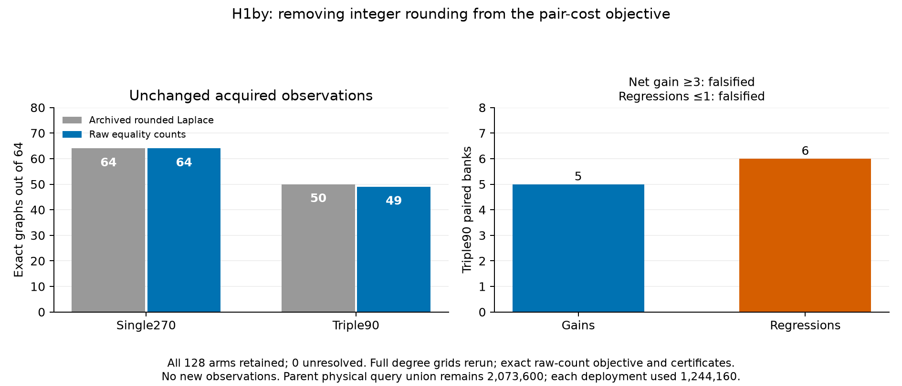

# H1by: raw equality counts versus rounded Laplace costs

Raw equality-count inference recovered **49/64 triple90 graphs**, versus the archived rounded-Laplace result of 50/64. Five banks improved and six regressed, giving a **net change of −1**. Both preregistered targets were **falsified**: net gain fell below three, and six regressions exceeded the allowed one. Single270 remained exact in all 64 banks.



| Method | Single270 exact | Triple90 exact | Triple90 integral nonexact | Triple90 selected fractional | Unresolved |
|---|---:|---:|---:|---:|---:|
| BP AdamW | Outside scope | Outside scope | — | — | Not rerun in this archived structural-cost intervention |
| Archived H1bw rounded Laplace | 64/64 | 50/64 | 14 | 0 | 0 |
| Raw equality counts | **64/64** | **49/64** | 14 | 1 | 0 |

All 128 arms and every full degree grid were retained. This intervention changed only the pair costs and reran the frozen inference procedure on existing acquired data. It did not add observations, repeat acquisition, or establish fresh-cohort accuracy. Changed optimal-solution tie choices are part of the measured result; individual output changes are not attributed solely to rounding.

## Why raw counts represent the unrounded objective

Within each arm, every pair has the same number of coqueries: 213 for single270 and 71 for triple90. Let that common exposure be `m`, pair equality count be `c_e`, and feasible degree be `d`. The unrounded Laplace objective satisfies

`sum_e [(c_e + 1)/(m + 2)] x_e = [sum_e c_e x_e + 81d/2]/(m + 2)`.

The added term is constant within a degree, and the remaining scaling is positive. Thus raw counts and exact unrounded Laplace rates have identical within-degree minimizers. Across degrees, the added term is linear and cancels from the exact second difference, so their curvature selectors and lower-degree ties agree. This algebra does not guarantee agreement with finite rounded costs or with a particular selected optimal graph.

The new estimator uses raw integer equality counts without rounding, smoothing, imputation, or extra penalties. It computes fresh single-thread HiGHS LPs at degrees 1 through 40, retains the analytic degree-zero witness, and selects exact curvature over degrees 1 through 39 with the established lower-degree tie rule. Neither degree 20, the edge count, geometry, clean labels, nor a noise parameter enters fitting. Certified intermediate fractional LPs remain valid objective evidence; a selected fractional primal is a resolved failure, and an uncertified required grid is unresolved.

All source/protocol/parent model hashes and the separate endpoints were frozen before computing new raw-count objectives or LP outcomes:

- **Net triple90 gain ≥3:** observed `49−50 = −1`, falsified.
- **At most one regression among the 50 archived triple90 successes:** observed six, falsified.

If any new output had been unresolved, the net-gain interval would have been `[S−50, S+U−50]`. Regression bounds would count known losses at the lower end and add unresolved outputs among archived successes at the upper end. No such output was omitted or silently treated as success; this run had none.

## Paired changes and objective diagnostics

The triple90 gains were zero-based banks **10, 30, 40, 41, and 56**. Regressions were **9, 37, 47, 49, 59, and 63**. Bank 47 returned a literally fractional selected primal and remains a resolved graph-recovery failure. There were 44 shared exact outcomes and nine shared resolved failures. All single270 graphs remained exact.

All 128 new grids selected degree 20. The fixed-degree-20 diagnostic therefore also recovered 64/64 and 49/64; top-810 recovered 8/64 and 0/64. These controls did not alter either primary target.

The truth-objective diagnostic was evaluated only after fitting, at selected degree 20. Raw-count truth was strictly suboptimal in **four triple90 banks** and cooptimal in the other 60. Since only 49 outputs were exact, **11 nonexact outputs were cooptimal with truth**, including the fractional failure. All 64 single270 outputs had zero true-minus-optimal gap.

The earlier rounded-cost diagnostic found nine strict triple90 exclusions, five with doubled integer gaps of two. The reduction to four strict exclusions under raw costs is evidence about objective membership on this examined cohort. It did not translate into higher recovery: optimal-solution selection among tied graphs still produced errors and regressions. Cooptimality does not identify an observable successful tie rule or establish uniqueness.

## Validation, accounting, and runtime

The charged audit verified **5,120 new exact primal/dual certificates**, **128 archived selected certificates**, **15,744 altered-proof rejections**, and **128 analytic zero witnesses**. All **3,474 intermediate fractional LPs** were retained. It independently reconstructed archived rounded costs, checked their selected proofs and outcomes, verified each raw-count score against the frozen equalities and uniform exposures, replayed every new grid, and recomputed outcomes and conservative paired endpoints. Full parent count/label correspondence and old full-grid selection remain inherited from H1bw's hash-bound audits.

Before study calculations, synthetic checks verified the exact affine objective identity on feasible integral and fractional graphs, curvature scaling and tied maxima, a constructed raw-count tie broken by rounded costs, malformed count rejection, proof mutations, and primary endpoint boundaries including unresolved cases. The synthetic count-validation loop took 0.007123 seconds for 1,000 calls on 3,240-pair arrays. It is a bounded preparation measurement, not a full scientific speedup comparison.

This intervention made **zero new noisy queries, clean-oracle queries, or source draws**. It retains H1bw's physical noisy-query union of **2,073,600**, equal standalone deployment costs of **1,244,160 per arm**, and shared first-query prefix of **414,720**. The official noisy-label sequence remains **14,687,319**, and the combined declared source ledger remains **2,414,270**.

The single run completed in **4.722324 wall seconds / 36.353381 aggregate CPU seconds**, below the frozen 180-wall/900-CPU limits. Eight persistent workers computed and audited all bank partitions, followed by summary export; all nine commands succeeded. External live process samples captured all eight worker PIDs and increasing CPU/LP counters: 640 LPs at 0.548 seconds, 2,560 LPs and 24 audited banks at 2.164 seconds, and 4,800 LPs and 56 audited banks at 4.292 seconds. The final counter recorded 5,120 LPs, all 64 bank audits, and no active workers. Transient CPU totals are estimates that can race child reaping; the final reaped aggregate above is authoritative.

Recorded HiGHS calls used **12.589394 CPU seconds (34.63%)**. The remaining 23.763987 seconds cover validation, LP construction, proof audits, startup, compression, and export without a further component profile. The first external GPU inventory showed all four Ripper GPUs at 0% utilization and 2 MiB allocation. This CPU LP study has no eligible GPU implementation; no GPU work is claimed.

```bash
OPENBLAS_NUM_THREADS=1 OMP_NUM_THREADS=1 MKL_NUM_THREADS=1 \
  python research/20261114/ripper/verify_raw_count_quantization_public.py
```

Use NumPy 2.3.4 and HiGHS 1.12.0. Public replay requires no raw source CSV or latent noise and performs no new LP solves. Raw/public summary SHA-256:

`78727839408f1a991d2ef349236480c70c1d610c09d074135dccaff006ae01b5`

Frozen protocol SHA-256:

`77c7b11c1166f2f1f0f5c2430584ddf4661263c38884451b74148e0602d7f8a1`
