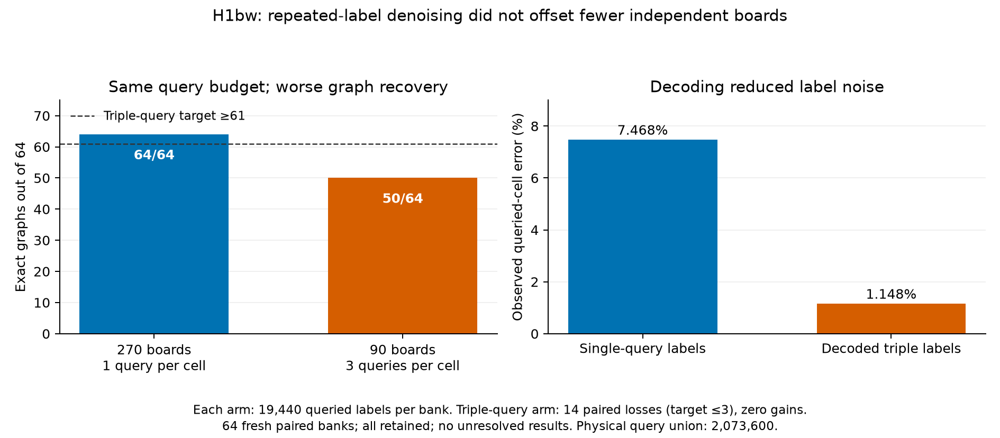

# H1bw: repeated labels versus more boards at equal query cost

Querying 90 boards three times recovered **50/64 exact graphs**, versus **64/64** for querying 270 boards once. Each arm spent exactly 19,440 noisy cell queries per bank. The triple-query arm reduced observed label error to **1.148%**, but this did not offset the loss of independent boards under the frozen estimator. Both preregistered targets were **falsified**: 50 exact graphs fell below 61, and 14 paired losses exceeded three.



| Method | Exact graphs | Integral nonexact | Selected fractional | Unresolved | Noisy queries per bank |
|---|---:|---:|---:|---:|---:|
| BP AdamW | Outside scope | — | — | — | Not rerun in this structural-inference study |
| Single query on 270 boards | **64/64** | 0 | 0 | 0 | 19,440 |
| Three queries on 90 boards, decoded | **50/64** | 14 | 0 | 0 | 19,440 |

All 64 paired banks were retained. There were 14 single-query wins, 50 shared successes, zero triple-query wins, and no unresolved outputs. This finite-cohort comparison does not establish a universal acquisition optimum or population error probability.

## Frozen comparison

The study drew 64 new 270-row official banks outside the declared combined Ripper/H4ak exclusion ledger through H1bv. Each bank sampled without replacement from 1,434,901 eligible IDs. Across-bank repeats remained in the experiment. All source IDs and full balanced masks were sealed before selected clean CSV answers were materialized; no outcome-based bank selection or retry occurred.

Both arms queried 72 cells per row. The 270-row masks consist of three independently permuted 90-row cycles of GF(9) affine-line complements. The triple-query arm uses exactly the first 90 source rows and masks. Its first noisy pass is the literal prefix of the single-query arm; two additional noisy passes use separately seeded uniform/offset streams. Every raw query follows the unchanged nominal 7.5% IID corruption channel with exact binary64 threshold `0x1.3333333333333p-4`, adding a uniform nonzero offset modulo nine on corruption.

The fixed decoder returns the majority label when a label appears at least twice. If all three labels differ, it returns the first query. This rule gives the first query temporal precedence on ties and remains equivariant under every permutation of digit labels. No clean value, geometry, observed noise outcome, or fitted graph affects the decoder or acquisition rule.

Each single-query cell has 240 observations across distinct boards; each triple-query cell has 80 distinct-board observations, each queried three times. Distinct-pair coqueries supplied to inference are 213 for single270 and 71 for decoded triple90. Repeated measurements are decoded into one observation per board/cell and are not incorrectly counted as independent boards.

Both arms use the same Laplace-smoothed equality-rate costs with exact round-half-even integer conversion, fresh degree-1-through-40 LPs, analytic degree-zero witness, and exact curvature selection with lower-degree ties. Neither degree 20, the 810-edge count, Sudoku geometry, nor a noise parameter is supplied to inference. Literal fractional primals remain unsnapped; certified intermediate fractional LPs are valid objective evidence, selected fractional outputs are resolved failures, and an uncertified required grid is unresolved. Exact certificates establish optimality, not uniqueness.

The separate finite endpoints were:

- **Triple90 exact recovery ≥61/64:** 50/64, falsified.
- **At most three paired losses to single270:** 14, falsified.

Unresolved outputs would widen exact-recovery bounds to `[S, S+U]`. The paired-loss lower bound counts known single270 successes with resolved triple90 failures; its upper bound also includes every unresolved pair that could be a single270 success and triple90 failure. Neither uncertainty nor failure removes a pair from the denominator. Here both endpoint intervals collapsed to their observed counts.

## Channel and observed-noise checks

Before study draws, exact rational enumeration covered every true digit and every ordered triple of observed labels, at both nominal probability 3/40 and the actual ideal 53-bit uniform threshold probability. For nominal independent channel draws, decoded error is exactly **5877/512000 = 1.1478515625%**, with equal probability for all eight wrong labels. The all-distinct event has probability **28539/2048000 = 1.393505859375%**. These channel identities do not imply graph recovery.

NumPy float64 uniform draws have support `k/2^53`. Under a uniform distribution over that support, the strict threshold accepts 675,539,944,105,575 values, giving probability `675539944105575/9007199254740992`. The second channel enumeration uses that exact rational probability. This calculation is a marginal channel model, not proof of independence of deterministic PRNG streams. No estimated error probability enters the graph estimator.

| Observations | Queried errors | Queried labels | Observed error |
|---|---:|---:|---:|
| First pass, all 270 rows | 92,911 | 1,244,160 | 7.4678% |
| Extra pass 1, first 90 rows | 31,031 | 414,720 | 7.4824% |
| Extra pass 2, first 90 rows | 31,484 | 414,720 | 7.5916% |
| Decoded labels, first 90 rows | **4,761** | **414,720** | **1.1480%** |

There were 5,802 all-distinct ties among queried triple-label cells. Raw-query errors and decoded-output errors have different denominators and are reported separately. The channel rule remained fixed after these counts became available.

## Graph outcomes and evidence

The single270 wins were zero-based banks **8, 10, 26, 30, 31, 35, 40, 41, 44, 50, 52, 54, 56, and 57**. All 128 arm grids selected degree 20. The diagnostic fixed-degree-20 control recovered 64/64 and 50/64; top-810 recovered 8/64 and 0/64. These diagnostics do not change the declared estimator or endpoints.

The charged audit verified **5,120 exact primal/dual certificates**, **15,360 altered-proof rejections**, **128 analytic zero witnesses**, and **128 complete source/decoded-label substitution gates**. All 3,520 intermediate fractional LPs were retained. The independent audit reconstructed official CSV answers and source exclusions, masks, each noise stream, scalar vote decoding, counts, exact costs, proof grids, outcomes, paired endpoints, and query unions. Public replay rechecks IDs, masks, costs/proofs, endpoints, and accounting. CSV/noise/decoder correspondence and complete substitution gates remain charged raw-audit evidence when the raw inputs are absent.

The initial pre-freeze synthetic gate caught a NumPy advanced-indexing error in the new independent row-wise equality-count auditor. Explicitly extracting a one-dimensional label vector before forming its outer equality matrix corrected the issue. The gate was rerun successfully before protocol freeze and before any study source, mask, noise, or LP outcomes. The failed synthetic trace is retained; the scientific run executed once with the frozen corrected source.

## Resource and query accounting

| Quantity | H1bw charge |
|---|---:|
| Each standalone deployment across 64 banks | 1,244,160 noisy queries |
| Shared first-query 90-row prefix | 414,720 |
| Extra repeat queries | 829,440 |
| Full physical noisy query union | **2,073,600** |
| New source row instances | 17,280 |
| New unique official source IDs | 17,177 |
| Across-bank repeated instances | 103 |
| Clean materialized cell instances | 1,399,680 |
| Unique clean-oracle cells | **1,391,337** |
| Updated Ripper source ledger | 2,177,845 |
| Updated combined exclusion ledger | 2,414,270 |
| Official noisy-label sequence | **14,687,319** |

Repeated queries are distinct noisy measurement records even on the same board and cell. The physical union is the sum of the two deployment costs minus their shared first-query prefix. Clean-oracle access is shared across passes and across repeated source IDs. Freshness refers to the declared ledger only.

The run completed in **13.656649 wall seconds / 52.150008 aggregate CPU seconds**, within 180-wall/900-CPU caps. All 13 commands succeeded, including eight persistent workers covering all 128 grids. The retained in-run monitor contains **54 samples with all eight worker PIDs**, cumulative CPU from `/proc`, and advancing LP/audit counters: at 9.336 seconds, 1,280 LPs and eight bank audits; at 11.974 seconds, 3,840 LPs and 40 audits; at 13.295 seconds, 5,120 LPs and 56 audits. Per-PID CPU growth is consistent with approximately one occupied CPU core per worker. Transient cumulative totals can race child reaping; final CPU accounting above is authoritative.

The external manual snapshot arrived after completion and therefore documents only the final no-worker state. It is not presented as an active-worker sample. The final counter recorded all 5,120 LPs, 64 audited banks, and 13 completed commands. Ripper's four GPUs showed 0% utilization and 2 MiB allocation in that snapshot; this CPU LP workload had no eligible GPU implementation.

The vectorized decoder matched its independent scalar counterpart on all 729 possible triples and on unrelated synthetic arrays. On a 64×81 toy over three repetitions, median time was 0.002986 seconds for the scalar version versus 0.000023645 seconds vectorized (about **126×**). This measures only decoding, not full scientific execution. Retained HiGHS calls used 13.920189 CPU seconds (**26.69%**) of the charged total; the remaining 38.229819 seconds include source work, construction, audits, startup, compression, and export without finer profiling.

```bash
OPENBLAS_NUM_THREADS=1 OMP_NUM_THREADS=1 MKL_NUM_THREADS=1 \
  python research/20261114/ripper/verify_repeat_query_tradeoff_public.py
```

Use NumPy 2.3.4 and HiGHS 1.12.0. Replay verifies retained proofs without new solves. Raw/public summary SHA-256:

`49975c6c5d9ceff971d6dbd60115073e88c056f9df8e836f369bc4a778d4b8f0`

Frozen protocol SHA-256:

`90fe934d0a22c0c1190e7549366b6178f042532d6ca12f5af75e185d591b4e09`
