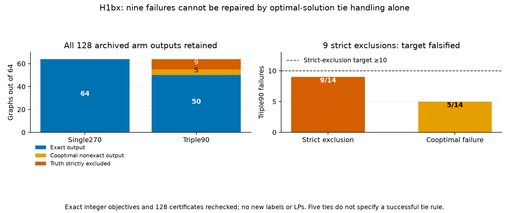

# H1bx: strict objective exclusions versus cooptimal failures

The frozen H1bw objective strictly excluded the true graph in **9 of 14 triple90 failures**. The other **five failures were cooptimal** with truth. The preregistered target of at least ten strict exclusions was therefore **falsified**. All 128 archived arm outputs were retained, including the 64 exact single270 outputs and 50 exact triple90 outputs.



| Method or diagnostic | Exact outputs | Cooptimal nonexact outputs | Truth strictly excluded | Unresolved |
|---|---:|---:|---:|---:|
| BP AdamW | Outside scope | — | — | Not rerun in this archived structural-objective diagnostic |
| H1bw single270 | 64/64 | 0 | 0 | 0 |
| H1bw triple90 | 50/64 | 5 | 9 | 0 |

For the nine strict cases, changing only the choice among optimal solutions cannot return truth under the unchanged objective. A zero-gap failure only says truth is an optimum; it does not establish an observable tie rule that will select it, nor that the optimum is unique. These are exact conditional statements about saved costs and proofs, not confidence estimates or fresh recovery measurements.

## Frozen diagnostic

The 14-failure cohort and all 128 parent outputs were fixed from H1bw before inspecting their true-graph objective gaps. This study used no new labels, noise draws, source IDs, fitting, or LP solves. The sole finite target was **at least 10/14 strict exclusions**. Any provenance or certificate inconsistency would make the diagnostic incomplete rather than remove a case from its denominator.

For every output, the producer rechecked the archived selected-degree-20 primal/dual certificate and calculated

`gap_twice = 2 × sum(cost on true edges) − certified_optimum_twice`.

The independent auditor rebuilt the Sudoku graph through row, column, and box cliques, checked its 810 edges and degree 20, reconstructed Laplace costs with exact rational rounding, rechecked the selected proof and receipt, independently computed the integer objective difference, and rejected three altered proofs. Geometry entered only this post-fitting diagnostic; H1bw acquisition, decoding, and graph fitting remained unchanged. Full-grid selection and raw label provenance remain inherited from H1bw's complete hash-bound audits; this diagnostic rechecks the 128 selected proofs.

All gaps were nonnegative. Every exact output had zero gap. Every nonexact selected output was integral, including both the strict and cooptimal failures. Certificates establish optimality, not uniqueness.

## Retained failure-level evidence

| Zero-based bank | Twice the true-minus-optimal objective gap | Status |
|---:|---:|---|
| 8 | 27,400 | Strict exclusion |
| 10 | 2 | Strict exclusion |
| 26 | 2 | Strict exclusion |
| 30 | 2 | Strict exclusion |
| 31 | 0 | Cooptimal nonexact output |
| 35 | 54,796 | Strict exclusion |
| 40 | 0 | Cooptimal nonexact output |
| 41 | 0 | Cooptimal nonexact output |
| 44 | 2 | Strict exclusion |
| 50 | 2 | Strict exclusion |
| 52 | 27,398 | Strict exclusion |
| 54 | 0 | Cooptimal nonexact output |
| 56 | 0 | Cooptimal nonexact output |
| 57 | 27,396 | Strict exclusion |

Five strict gaps equal two in the doubled integer objective, corresponding to one unit of the stored integer cost objective. They are still strictly positive; no tolerance reclassifies them as ties. Their small size does not by itself establish a quantization artifact or identify a successful alternative estimator. Any such comparison requires its own frozen analysis.

The parent comparison remains **64/64 versus 50/64** at equal standalone deployment costs of **1,244,160 queries per arm**. Both H1bw targets remain failed. This diagnostic adds **zero queries**; it does not erase the parent physical union of **2,073,600**, its 414,720 shared first-query prefix, or the cumulative official noisy-label sequence of **14,687,319**.

## Validation and runtime

All **128 selected exact primal/dual certificates** and **384 altered-proof rejections** passed. Synthetic gates covered exact success, a distinct cooptimal integral graph, a strict integral failure, a strict fractional optimum, independent truth reconstruction, and the 9-versus-10 endpoint boundary. No study gaps were read before the protocol was frozen.

The charged run, including its first independent auditor, completed once in **0.879269 wall seconds / 0.895034 aggregate CPU seconds**, well below the 90-wall/60-aggregate-CPU acceptance limits. The operating-system CPU limit applies per process; aggregate CPU was separately checked after the child auditor was reaped. A failed aggregate check would produce an incomplete failure receipt without extension. The wall timer was active through execution and audit.

The implementation loads only selected members from each compressed archive rather than decompressing all 40 degrees. On unrelated synthetic arrays, median loading time over three repetitions was 0.000388 seconds for selected members versus 0.005472 seconds for the full archive (**14.10×**). This benchmark covers loading only; it is not a measured full-study speedup. The study used one persistent producer followed by one independent auditor and no GPUs.

The manual process snapshot arrived after this subsecond run and retained the final 128/128 progress counter with no active owned worker. No active-worker utilization sample is claimed. An earlier synthetic-preflight invocation found a missing auditor dependency on Ripper and exited before synthetic calculations or study reads; after that source file was copied, the unchanged preflight passed. Both traces are retained.

```bash
OPENBLAS_NUM_THREADS=1 OMP_NUM_THREADS=1 MKL_NUM_THREADS=1 \
  python research/20261114/ripper/verify_repeated_objective_gap_public.py
```

Public replay requires no raw CSV or latent-noise artifacts and solves no LPs. Summary SHA-256:

`317d1c97a818a83dc0d5b8e5aa2dee355721511207e85af4ee72c66a4315d521`

Frozen protocol SHA-256:

`19aca81c64d2afcf3790904f5e51761e64ba63343b21ca3a60eb26f9fa55539d`
