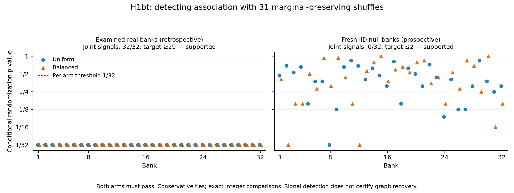

# H1bt: conditional-randomization signal detection

The frozen rule signaled on **32/32 examined real banks** and **0/32 fresh IID null banks**, satisfying the separate targets of at least 29 real detections and at most two null detections. All 64 bank cases and both mask arms were retained, with no unresolved tests. This detects association under a stated null model; it does **not** certify graph recovery. All **13 nonexact real arm outputs also signaled**.

The real banks had already been examined in H1bq, H1br, and H1bs and helped motivate the statistic. Their detection rate and randomization p-values describe retrospective sensitivity, not calibrated post-selection inference or fresh-source confirmation. The null cases were generated after the H1bt protocol and source review were frozen.



| Method or cohort | Uniform arm signals | Balanced arm signals | Both-arm signals | Reference graph exactness |
|---|---:|---:|---:|---|
| BP AdamW | Outside scope | Outside scope | Outside scope | Not rerun in this structural-inference test |
| Examined real H1bq banks | 32/32 | 32/32 | **32/32** | Uniform 25/32; balanced 26/32 |
| Fresh IID-uniform null banks | 1/32 | 2/32 | **0/32** | 0/32 in both arms |

The null uniform-arm positive was bank 7; balanced-arm positives were banks 1 and 11 (zero-based bank IDs). These are retained false positives, with no overlapping bank. The joint 0/32 count is a finite-sample result, not proof that population false-positive probability is zero. The 7 uniform and 6 balanced real graph failures all passed the signal test.

## Frozen hypotheses and procedure

- **Retrospective real sensitivity:** at least 29/32 banks signal jointly. Observed 32/32; supported.
- **Prospective null control:** at most 2/32 fresh IID null banks signal jointly. Observed 0/32; supported.
- These are separate finite targets; the study makes no familywise claim across the ongoing research sequence.

Every case uses the two archived H1bq mask arms, uniform 72 and GF(9)-balanced 72, on 180 rows. The real cohort reuses all 32 examined H1bq banks with 7.5% IID cell noise. Each fresh null bank draws one common 180×81 board of independent uniform digits from 0 through 8; both masks observe that same board. The common board makes the two arms dependent.

For each arm, the statistic is computed from exact doubled LP objectives `F(0), …, F(40)`:

```text
kappa(d) = F(d+1) + F(d-1) - 2*F(d),  d = 1,…,39
R = max(kappa) / sum(kappa)
```

Zero total curvature maps to `R = 0/1`. A zero-degree analytic witness and all 40 positive-degree certificates are required. Certified fractional intermediate primals are valid objective evidence. No truth graph, degree 20, or edge count 810 is supplied to the statistic or signal rule.

Each arm receives **31 independent-stream conditional shuffles**. For every cell, its observed digits are sorted into a canonical multiset and uniformly permuted over that cell's observed rows. Each shuffle preserves the exact mask and all 81 empirical digit histograms; it randomizes cross-cell row associations. There is no common shuffled board across arms. Within-column finite-population dependence remains, and row-level digit counts are not preserved.

```text
p = (1 + number of shuffled R >= observed R) / 32
arm signal iff p <= 1/32
bank signal iff both arms signal
```

Thus an arm signals only when its observed ratio is strictly greater than all 31 shuffle ratios. Ties count conservatively against a signal. Comparisons use exact integer cross-products and an independent `Fraction` implementation. Every real arm attained `p = 1/32`.

An uncertified required grid makes its arm unresolved. A bank is a resolved nonsignal if either arm fails, a signal if both pass, and otherwise unresolved. Endpoint lower bounds count signals; upper bounds add unresolved cases. The real target requires lower ≥29; the null target requires upper ≤2. There was no retry, filtering, threshold change, or optional stopping.

## What is calibrated

The conditional null states that, given fixed masks and each cell's observed digit histogram, each cell's observed sequence is uniform over its multiset arrangements, independently across cells. Each arrangement has the same factorial number of index permutations. Consequently, under that null, the original arrangement and 31 independent uniform shuffles are exchangeable. Applying the same mathematically defined LP-optimum statistic preserves exchangeability. Conservative upper ranks therefore satisfy `P(p <= k/32) <= k/32`, including ties.

For the prospectively fixed rule on a fresh null case, each arm has type-I probability at most 1/32 under this model. The both-arm event is a subset of each individual rejection event, so its probability is also at most 1/32 **without assuming arm independence**. The probability is not squared. Numerical noncertification causes abstention and cannot enlarge the event of a certified ideal-test rejection.

This argument concerns the ideal conditional randomization law. Distinct finite PRNG seeds are reproducibility identifiers, not a mathematical proof of independent streams. The guarantee does not cover arbitrary row-dependent or cross-cell-dependent nulls. It also does not retrospectively correct the selection of the statistic using the already examined real banks. A small p-value is evidence against this association null, not a probability that the estimated graph is correct.

## Verification and provenance

The charged run fitted **161,280 new LPs**: 79,360 real-cohort shuffle LPs and 81,920 null-cohort observed-plus-shuffle LPs. It also rechecked 2,560 archived real LPs. The complete audit verified:

- **163,840 exact primal/dual certificates**, with **491,520 altered-proof rejections**;
- **4,096 analytic zero witnesses**, covering every required grid;
- **111,216 certified fractional intermediate LPs**, retained as valid objective evidence;
- all **3,968 shuffles**, their exact masks, histogram preservation, counts, rates, objectives, and p-values;
- 128 complete queried-label substitution gates;
- 64 independent raw real-observation count and histogram-provenance checks.

The frozen protocol pins all 64 original real-observation hashes before fresh null or shuffle draws. Source/noise origin remains inherited from H1bq's complete audits. The charged H1bt audit independently reconstructs the original observed counts and histograms. Public replay regenerates every fresh IID board and every shuffle, independently reconstructs counts and rates, and rechecks all proofs and endpoints. Without the raw H1bq observations, public replay explicitly **inherits** the original-label-to-histogram correspondence from the charged raw audit.

The preflight used synthetic labels, toy score multisets, conservative-rank tests, large-integer comparisons, altered endpoint cases, and seed exclusions. No H1bt study outcomes or pilot LPs were read before freezing. The seed audit compares against explicit seed-valued integers in 299 frozen protocol snapshots; it does not claim coverage of undocumented streams or all implied historical formula expansions.

## Resources and accounting

Execution on Ripper used eight CPU workers and completed in **182.304655 wall seconds / 1,445.047223 aggregate CPU seconds**, within the frozen 600-wall/3,600-CPU ceilings. All 65 commands succeeded. Live evidence at 8.05 seconds showed eight workers at approximately 100% CPU and 11,200 completed LPs; later counters reached all 161,280 new LPs and 64 audited cases. Aggregate CPU divided by wall time was 7.93 cores, consistent with sustained useful work.

All four Ripper GPUs were at 0% utilization and 2 MiB allocation. The eligible workload was CPU LP solving and exact proof checking; no GPU work or filler jobs were used. A synthetic count-construction benchmark measured about 8.20 ms for the producer and 1.11 ms for the independent reference. The synthetic count timing did not justify a change to the frozen mathematical protocol. Post-run accounting of retained HiGHS timers totals **557.327813 CPU seconds**, or **38.57%** of charged CPU. The remaining CPU includes LP construction, certification/auditing, counts, process startup, hashing, compression, and export; these components were not separately profiled. The [timing receipt](../../../results/research/ripper/signal_detection/solver-timing-accounting.json) records the calculation. Preparation and publication work overlapped the independent case queue.

| Quantity | H1bt charge |
|---|---:|
| New official source rows | 0 |
| New official observed-cell queries | 0 |
| New clean-oracle cells | 0 |
| Fresh IID generated cells | 466,560 |
| Fresh IID observed physical union | 460,721 |
| Fresh IID queries per deployment arm | 414,720 |
| Fresh IID shared deployment queries | 368,719 |
| Synthetic shuffled entry assignments | **51,425,280** |
| Historical real physical union reused | 460,721 |

The 3,968 shuffled arm datasets each assign 12,960 entries; these synthetic assignments are not deduplicated across arms or draws. Generated IID cells, synthetic shuffle assignments, official acquisitions, and historical reuse are separate accounting categories. H1bt leaves the frozen official noisy-label sequence at **10,540,119** and adds nothing to the frozen Ripper/combined source ledgers of **2,132,001 / 2,368,426**.

## Replay

```bash
OPENBLAS_NUM_THREADS=1 OMP_NUM_THREADS=1 MKL_NUM_THREADS=1 \
  python research/20261114/ripper/verify_signal_detection_public.py
```

Use NumPy 2.3.4 and HiGHS 1.12.0 (imported by the shared inference module). Public replay does not solve new LPs. The full scientific public outputs retain every certificate and receipt; the raw archive additionally retains every solver log. Raw/public summary SHA-256:

`546584902cfe8e6f0526d9fb967174f2954054cbfd345d5899eec12f87c1daea`

Frozen protocol SHA-256:

`49c6b5fe11c84ba99b5cd0524b5ddd6030482033adf87091f8a79b4411d22b19`
