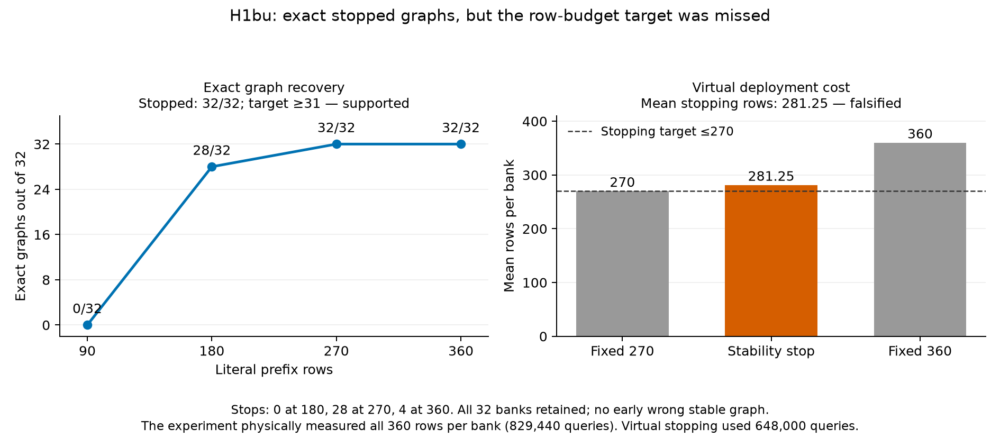

# H1bu: graph-stability stopping on fresh noisy observations

The frozen stopping rule returned the exact graph in **32/32 fresh banks**, supporting the accuracy target of at least 31/32. Its mean virtual stopping time was **281.25 rows**, which **falsified** the separate target of at most 270 rows. All 32 banks and all four prefix fits were retained.

Twenty-eight banks stopped at 270 rows and four at 360; none stopped at 180. No early stable wrong graph occurred. Fixed 270-row inference also recovered 32/32 graphs in this cohort, with fewer deployment queries than the stopping rule. That comparison is retained as a paired diagnostic, not used to change the frozen rule.



| Method or prefix | Exact graphs | Integral nonexact | Selected fractional | Unresolved | Deployment queries across 32 banks |
|---|---:|---:|---:|---:|---:|
| BP AdamW | Outside scope | — | — | — | Not rerun in this structural-inference study |
| Fixed 90 rows | 0/32 | 15 | 17 | 0 | 207,360 |
| Fixed 180 rows | 28/32 | 4 | 0 | 0 | 414,720 |
| Fixed 270 rows | 32/32 | 0 | 0 | 0 | 622,080 |
| Fixed 360 rows | 32/32 | 0 | 0 | 0 | 829,440 |
| Stability stopping | **32/32** | 0 | 0 | 0 | **648,000 virtual** |

The experiment physically acquired **829,440 noisy cell observations**, corresponding to all 360 rows in every bank. Virtual stopping used 648,000 queries: 181,440 fewer than fixed 360 (21.875%), but 25,920 more than fixed 270. The physical experiment did not realize the virtual saving because the fixed-360 paired control required all observations.

## Frozen procedure and hypotheses

The new cohort comprised 32 banks of 360 official clean-source rows. Within each bank, source IDs were sampled without replacement from the 1,463,568 eligible IDs outside the declared combined Ripper/H4ak ledger through H1bq. Across-bank repeats were retained. The experiment drew 11,520 row instances containing **11,479 unique source IDs** and 41 repeated instances, with no exclusion overlap. Freshness is relative to this declared ledger, not a claim of untouchedness across the entire repository.

Each bank received one fresh balanced mask stream with 72 observed cells per row and one common latent IID 7.5% cell-noise realization. Corruption adds a uniform nonzero offset modulo nine when a uniform draw falls below the exact binary64 threshold `0x1.3333333333333p-4`. The 90/180/270/360 datasets are literal prefixes of the same mask, source, uniform, and offset arrays. IDs and all full mask streams were sealed before selected CSV labels were materialized.

The mask stream extends the frozen GF(9) affine-line-complement construction from two to four 90-row cycles. Each cycle independently permutes all cell identities and line positions, without source, label, or noise feedback. The first 180 rows exactly match the original two-cycle implementation at the same seed. Each cycle gives 80 queries per cell and 71 coqueries per pair; the four prefixes therefore give:

| Prefix rows | Queries per cell | Coqueries per distinct pair |
|---:|---:|---:|
| 90 | 80 | 71 |
| 180 | 160 | 142 |
| 270 | 240 | 213 |
| 360 | 320 | 284 |

Every prefix uses the unchanged Laplace-smoothed pair rates, exact half-even integer costs, fresh degree-1-through-40 LPs, analytic degree-zero witness, and exact curvature selector with lower-degree ties. Neither the true degree 20, the 810-edge count, Sudoku geometry, nor a noise parameter enters this estimator. Fixed-degree-20 and top-810 outputs remain labeled diagnostic controls.

A prefix graph is available for stopping only when all 40 LP objectives are certified and its selected primal is literally integral. The operational rule is:

1. At 180 rows, stop if the available 90- and 180-row labeled edge supports are identical.
2. Otherwise, at 270 rows, stop if the available 180- and 270-row supports are identical.
3. Otherwise return the 360-row result, whether or not the last two graphs agree.

An unavailable early graph blocks that comparison and causes continuation. A later certified graph can still yield a resolved output. At the selected stop, an integral nonexact or fractional graph is a resolved failure, while an uncertified grid is unresolved. Earlier unavailability is preserved diagnostically. There is no possible 90-row stop, retry, outcome-based threshold change, or dropped bank.

The two preregistered targets were assessed separately:

- **Exact stopped graph in at least 31/32 banks:** observed 32/32, supported.
- **Mean virtual rows at most 270:** observed total 9,000 rows rather than at most 8,640; mean 281.25, falsified.

For exactness, unresolved outputs widen the upper bound rather than disappear from the denominator. All virtual row counts remain defined, including a 360-row charge for an unresolved final output. The row target is compared using exact integer totals. It is equivalent to having at least as many 180-row stops as 360-row stops; this run had zero versus four.

## Retained diagnostics

The 360-row stops were zero-based banks **1, 13, 21, and 30**, exactly the four nonexact 180-row graphs. All four became exact at 270, but their changed graph prevented stopping at that point. All 28 exact 180-row graphs were unchanged and exact at 270, allowing those banks to stop. There were no regressions in exactness across successive prefixes in this cohort.

The **17 unavailable prefixes** were the selected fractional 90-row outputs. They were resolved graph-procedure failures, not uncertified LPs. The other 15 nonexact 90-row outputs were integral but did not produce an early identical pair. All final stopping outputs and all fixed-360 outputs were exact, with no paired gains or losses.

Correct degree 20 was selected in 16/32 banks at 90 rows and all 32 banks at each later prefix. Fixed-degree-20 exact recovery was 0/28/32/32 across the four prefixes; top-810 recovery was 0/0/6/23. These controls do not alter the stopped estimator or its targets.

The result supports this finite-cohort accuracy endpoint. It does not establish a calibrated probability of correctness, a universally safe stopping rule, or optimal acquisition. The failed cost target remains failed despite all stopped graphs being correct. Fixed 270 is a useful candidate for a separate prospective confirmation; selecting it after this result would not turn this cohort into that confirmation.

## Evidence and accounting

The charged run verified **5,120 new exact primal/dual LP certificates**, **15,360 altered-proof rejections**, **128 zero witnesses**, and **128 complete source/queried-label substitution gates**. All **3,489 intermediate fractional LPs** were retained as valid objective evidence. It independently checked official CSV answers and Sudoku validity, regenerated source selections and noise, checked all four mask/exposure prefixes, reconstructed pair counts and exact rates, and independently replayed stopping decisions and query sets.

Public replay verifies source-ID exclusions and draws, all sealed masks, every score/proof, stopping choices, and both cost accounts. Raw CSV/latent-noise/label correspondence and full label-substitution evidence are inherited from the charged raw audit when those raw inputs are absent. The public adapter redirects only two registry paths to their byte-identical published copies; scientific files remain unchanged.

| Quantity | H1bu charge |
|---|---:|
| New source row instances | 11,520 |
| New unique official source IDs | 11,479 |
| Across-bank repeated instances | 41 |
| Full physical noisy observations | **829,440** |
| Virtual stopped observations | **648,000** |
| Clean materialized cell instances | 933,120 |
| Unique clean-oracle cells | **929,799** |
| Updated Ripper source ledger | 2,143,480 |
| Updated combined exclusion ledger | 2,379,905 |
| Official noisy-label sequence | **11,369,559** |

Nested prefixes share earlier observations. The physical union is the 360-row budget, not the sum of four standalone deployments. Across-bank noisy instances remain distinct even when they reuse a clean source ID. Unique clean-oracle access is charged once per new unique clean source row.

## Runtime and reproducibility

Execution completed in **14.052612 wall seconds / 57.806726 aggregate CPU seconds**, within the frozen 180-wall/900-CPU caps, using the eight-worker queue. All 68 pipeline commands succeeded. All 128 grids were physically computed, including later prefixes beyond a virtual stop; no virtual computational saving is claimed.

Recorded HiGHS calls totalled **13.679369 CPU seconds**. The remaining charged CPU includes source work, process startup, LP construction, exact proof audits, count construction, compression, and export; these components were not separately profiled. The synthetic four-cycle mask construction took about 0.189 ms. The final live counter confirmed all 68 commands complete with no owned workers. The run finished before the first process snapshot, so no active-worker utilization sample is claimed. All four GPUs were at 0% utilization and 2 MiB allocation in that final sample; this was CPU inference and validation work.

An initial orchestration invocation reached the wrapper before asynchronous protocol freezing had finished. It exited on the missing protocol **before** creating an output/execution directory or drawing source IDs. The trace is retained as `initial-preprotocol-launch.log`. After freeze completion and verified directory absence, the unchanged frozen scientific run executed once. No scientific outcomes, observations, seeds, or frozen methods were retried or replaced.

```bash
OPENBLAS_NUM_THREADS=1 OMP_NUM_THREADS=1 MKL_NUM_THREADS=1 \
  python research/20261114/ripper/verify_stability_stopping_public.py
```

Use NumPy 2.3.4 and HiGHS 1.12.0. Replay does not solve new LPs. Raw/public summary SHA-256:

`ba40ab2512a240f4801e9031a09d8ac36e5e98db4db7e654abde8320138793cf`

Frozen protocol SHA-256:

`9d0e1bc17f3b5c7d7742139b33fb4eab0ecf17ac3476624da282df298477a19c`
