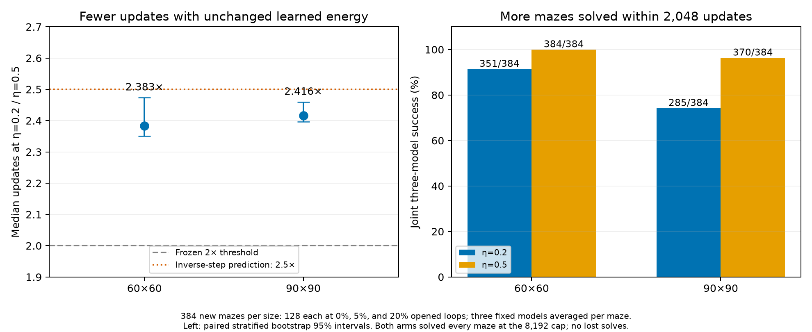

The frozen Maze-Hard energy transfers to larger generated mazes when its answer rollout has enough time. The failure at the paper's 2,048-update budget is concentrated in long tree branches. Changing the latent mass did not improve it. A controlled comb experiment supports branch-pruning depth as the cause of the additional rollout time. A subsequent frozen test increased only the answer step from 0.2 to 0.5: it reduced median answer updates by 2.38–2.42× on new 60×60 and 90×90 cohorts, with no observed accuracy loss.

These are new research experiments on a declared randomized DFS-tree distribution, with optional opened loops. They are not new official Maze-Hard benchmark results. All experiments reuse the three fresh 29-parameter models from the completed reproduction, preserve learned weights, and run on Work's two RTX PRO 6000 Blackwell GPUs. Generated labels and graph algorithms are correctness oracles and offline diagnostics; they never enter model inference.

| Model / control | Role |
|---|---|
| BP AdamW | Outside this frozen-model inference intervention; no new baseline training |
| Frozen CRAM+z, original mass | Matched primary control |
| Frozen CRAM+z, mass×(30/L)² | Training-free intervention, no answer-energy changes |
| Frozen CRAM+z, 8,192 answer updates | Budget intervention, original mass and identical update rule |
| Frozen CRAM+z, answer step η = 0.5 | Matched step-size intervention against η = 0.2, both capped at 8,192 |
| BFS / independent Dijkstra | Label and shortest-path oracles, not learned competitors |

The native PyTorch hidden solver keeps its 4,000-update limit, tolerance 1e-6 and checks every 8 updates. Answer relaxation uses step 0.2, initial logit 3, fixed-point checks every 16 updates, and the declared 2,048 or 8,192 cap. Both stopped correctness and independently valid shortest paths are required. Hidden failures, answer timeouts, and wrong fixed points remain failures. Saved final boards permit independent validity checks.

**Size-transfer hypotheses.** H2 predicted at least 99% of 60×60 generated mazes would be solved by all three models under the original 2,048 cap. H2b predicted at least 5 percentage points improvement from mass scaling. Each cohort contains 128 independently generated mazes at each of three loop-opening rates; training-model repeats are not counted as additional independent mazes.

| Cohort and topology | Unique mazes | Original solved, each model | Mass-scaled solved, each model |
|---|---:|---:|---:|
| Discovery, 30×30, all three loop rates |384|384|Alias of original: scaling factor 1 |
| Discovery, 60×60, tree |128|92|92|
| Discovery, 60×60, 5% loops |128|128|128|
| Discovery, 60×60, 20% loops |128|128|128|
| Reserved confirmation, 30×30, all rates |384|384|Alias of original |
| Reserved confirmation, 60×60, tree |128|96|96|
| Reserved confirmation, 60×60, 5% loops |128|128|128|
| Reserved confirmation, 60×60, 20% loops |128|128|128|

H2 is falsified: discovery joint success was 348/384=90.625% with one-sided 95% upper bound 92.9613%; independent confirmation was 352/384=91.6667%, upper bound 93.8703%. All failed cases exhausted the answer budget. There were no wrong stops or hidden failures. H2b is also falsified: paired gain was 0 percentage points in both cohorts, with no discordant solve outcome. The exact one-sided 95% upper bound on the unseen discordant fraction is 0.7771 percentage points per cohort, also below the 5-point target. These conclusions concern the specified distribution, masses and budget.

**Longer rollout.** The next protocol used a new 256-tree 60×60 cohort. Raising only the answer cap from 2,048 to 8,192 improved every model from 203/256 to 256/256. Paired gain was 20.7031 points, with 95% paired-maze bootstrap interval 16.0156–25.7813. The required 5-point gain is supported. The absolute 99% population claim remained inconclusive at that sample count: even 256/256 gives a one-sided 95% lower bound 98.8366%.

A separate, frozen 384-tree 60×60 confirmation then solved 384/384 with every model. Its one-sided 95% lower bound 99.2229% supports the 99% joint-success hypothesis. All three models also solved 128/128 new 90×90 trees at the same 8,192 cap, with no budget increase; this smaller 90×90 cohort supports perfect observed success but not a 99% population lower bound (97.6868%). The maximum 90×90 mean stopping time across the three models was 7,072 updates.

**Mechanism and causal control.** On the earlier 256-tree cohort, the preregistered exploratory association of stopping time with maximum distance from any open node to the unique S–G path had Spearman ρ = 0.99914. Association with tree diameter was 0.00851, and with S–G path length was −0.84633. The latter correlations alone do not identify a cause.

The linear predictor fitted only on that 256-tree cohort was frozen as `updates=4.352984700053693×branch_depth+11.720719172409504`. On the new 128-tree 90×90 cohort it predicted all 128 mean stopping times within 10% relative error (mean 1.20%, maximum 4.31%). The one-sided 95% lower bound for within 10% coverage is 97.6868%, supporting the preregistered 95% coverage target. Computing branch depth requires an oracle S–G path: this is an offline mechanistic explanation, not a practical model-only budget selector.

The causal intervention used 90×90 comb mazes with eight nonadjacent branches and 64 paired translation/rotation/reflection layouts. All layouts and conditions retained the same three trained models. Graph connectivity, acyclicity, exact spine length, eight branch junctions, and branch depth were independently verified. All 1,344 model–maze evaluations produced valid shortest paths.

| S–G spine length | Branch depth | Mean answer updates | Range across layout means |
|---:|---:|---:|---:|
|64|0|16.000|16–16|
|64|8|32.000|32–32|
|64|16|80.000|80–80|
|64|32|147.000|144–160|
|64|64|296.917|288–304|
|16|16|80.000|80–80|
|32|16|80.000|80–80|

Increasing branch depth from 0 to 64 at fixed spine 64 added 280.917 updates (95% paired-layout bootstrap 279.25–282.58), exceeding the frozen 200-update target. Increasing spine length 16 to 64 at fixed branch depth 16 changed stopping time by exactly 0 updates, satisfying the frozen ±32-update equivalence margin. All eight orientations solved correctly; orientation-specific counts and timings remain in the audit, rather than being hidden by the mean.

[PDF](../../../results/research/work/pruning-mechanism.pdf) and [SVG](../../../results/research/work/pruning-mechanism.svg) are standalone scientific figures.

**Evidence and commands.** Protocols were frozen before the outcomes of their respective cohorts: [initial](protocol.json), [unchanged confirmation](confirmation-protocol.json), [budget intervention](budget_extension-protocol.json), [independent horizon and size transfer](horizon_transfer-protocol.json), and [causal combs](causal_comb-protocol.json). The initial dense linear solve and independent reference checks at 4, 8, 30 and 60 grids agreed to less than 9e-15 in double precision. No dimension-specific energy change was required.

**Step-size intervention.** H2g predicted at least a 2× reduction in median answer updates for η = 0.5 versus 0.2 at each size, with no lost joint three-model solves and a one-sided 95% upper bound on loss probability below 1 percentage point. The [frozen eta protocol](eta-protocol.json) used 768 new mazes: 384 per size, equally divided across tree, 5% loop, and 20% loop strata, with the same three trained models. Both arms retained the 8,192 cap, identical hidden states and learned energy. Model stopping steps were averaged within each maze before computing medians; 10,000 paired bootstrap samples preserved loop strata and all model repeats.

| Size | Median updates, η = 0.2 | Median updates, η = 0.5 | Ratio and paired 95% CI | Joint success, each arm | Joint success by 2,048, η = 0.2 → 0.5 |
|---|---:|---:|---:|---:|---:|
| 60×60 | 762.667 | 320.000 | 2.3833× [2.3500, 2.4737] | 384/384 | 351/384 → 384/384 |
| 90×90 | 1,192.000 | 493.333 | 2.4162× [2.3958, 2.4598] | 384/384 | 285/384 → 370/384 |

Both per-size hypotheses are supported. The exact one-sided 95% upper bound on an unseen lost-solve probability is 0.7771 percentage points at each size. This is a bound for the specified generator mixture and three fixed models, not for arbitrary mazes or training seeds. All 4,608 saved model–maze–arm boards passed independent shortest-path audit; there were no wrong stops, hidden failures or censored rollouts. These are per-size intervals without a multiplicity-adjusted combined claim.

Matched native answer times after warmup gave 2.4466× and 2.4382× speed ratios at 60 and 90; including identical shared hidden preparation gave 2.0897× and 2.2058×. Both arms ran on the same GPU per job, with alternating arm order and CUDA synchronization. Diagnostic replay was excluded from timing. On the prespecified first eight seed-0 mazes in each of six size/topology cells, both arms exactly matched native outcomes, showed no sampled energy increases every 16 updates, and triggered no two-cycle flags. This finite diagnostic does not prove global stability. Continuous-logit residuals remained nonzero at some discrete flip-stable stopping points, as the solver's stopping criterion permits. A separate 2,048-cap preflight verified that first-stop steps correctly recover the prefix success counts above.

Public [eta summary](../../../results/research/work/eta-summary.json), [per-model runs](../../../results/research/work/eta-runs.csv), [paired per-maze values](../../../results/research/work/eta-per-maze.csv), [PDF](../../../results/research/work/eta-acceleration.pdf), and [SVG](../../../results/research/work/eta-acceleration.svg) retain exact outcomes and figure data. Recheck the full local evidence using `upstream/.venv/bin/python research/20261114/work/audit_eta.py`; regenerate the figure with `artifacts/plotting-venv/bin/python research/20261114/work/plot_eta.py`.

**Independent causal test of acceleration.** H2h predicted that the ratio of branch-depth slopes at η = 0.2 and 0.5 would lie within [2, 3], a ±20% equivalence band around the inverse-step prediction 2.5. The [new frozen protocol](eta_comb-protocol.json) used 64 fresh paired translation/orientation layouts on 160×160 grids, branch depths 32, 64 and 128 at fixed spine 64, and separate spine 16/128 controls at depth 64. The larger grid accommodates these deliberately long branches. Three fixed models and both eta arms evaluated every condition. OLS slopes were fitted across the three declared depths within each layout, then averaged; the bootstrap preserved all paired conditions and model repeats.

The measured slopes were 4.670201 and 1.860491 updates per branch-depth unit for η = 0.2 and 0.5. Their ratio was 2.510198, with paired-layout 95% bootstrap interval [2.495415, 2.524831], supporting the frozen equivalence hypothesis. Changing spine 16 to 128 at depth 64 changed the mean by exactly zero updates in both arms; each paired interval was [0, 0], inside the separate ±32-update equivalence margins. All 1,920 model–maze–arm boards were valid shortest paths. Independent topology checks confirmed connectivity, acyclicity, eight branch junctions and exact spine/depth for all 320 condition/layout graphs. Diagnostic replays matched native outputs and showed no sampled energy increases or two-cycle flags. This supports the branch-pruning-rate explanation for these models and constructed mazes; it does not establish a universal step-size stability theorem.

Public [comb eta summary](../../../results/research/work/eta-comb-summary.json), [per-model runs](../../../results/research/work/eta-comb-runs.csv), [paired layout data](../../../results/research/work/eta-comb-per-layout.csv), [PDF](../../../results/research/work/eta-pruning-rate.pdf), and [SVG](../../../results/research/work/eta-pruning-rate.svg) retain the exact results. Recheck with `upstream/.venv/bin/python research/20261114/work/audit_eta_comb.py`; plot using `artifacts/plotting-venv/bin/python research/20261114/work/plot_eta_comb.py`.

Independent saved-board audits, exact binomial bounds, paired bootstrap statistics and hashes are retained for [discovery](../../../artifacts/research/20261114/work/audit.json), [confirmation](../../../artifacts/research/20261114/work/confirmation/audit.json), [budget intervention](../../../artifacts/research/20261114/work/budget_extension/audit.json), [horizon transfer](../../../artifacts/research/20261114/work/horizon_transfer/audit.json), and [combs](../../../artifacts/research/20261114/work/causal_comb/audit.json). Recompute these without inference using `upstream/.venv/bin/python research/20261114/work/audit.py --campaign discovery`, the same command with `confirmation` or `budget_extension`, and `audit_followups.py --campaign horizon_transfer`or`causal_comb`. Plot regeneration is `artifacts/plotting-venv/bin/python research/20261114/work/plot_results.py`.

The generator, worker source, protocol hashes, immutable model copies, launch receipts, worker logs, per-batch counters, and all predicted boards are retained. The 120 jobs cover 17,856 model–maze–arm evaluations, including 33 paired eta jobs, and completed without modifying the original reproduction. Timing reflects PyTorch inference and CPU launch overhead on Blackwell; these experiments establish no H200 speedup or new baseline-training comparison. Further research is separate from these completed totals.
