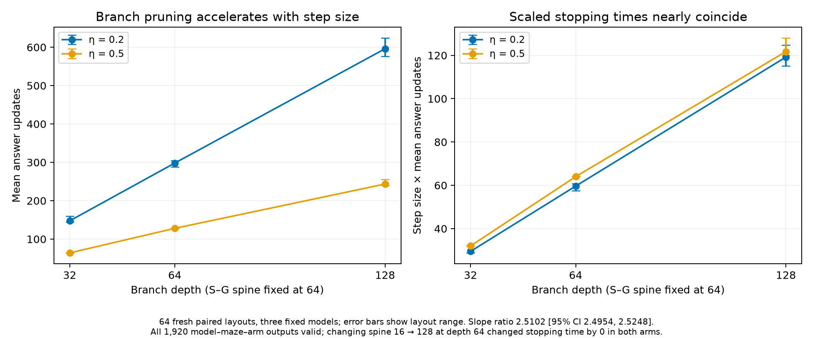
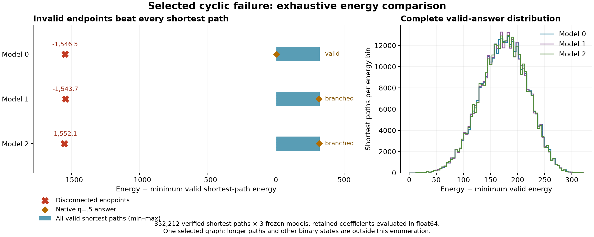
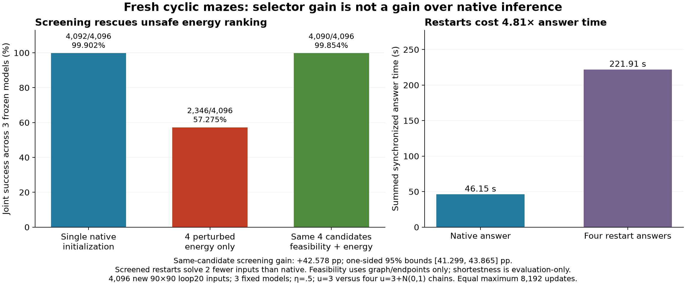
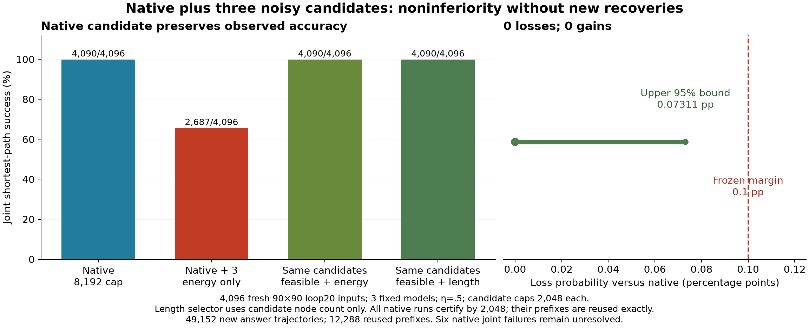
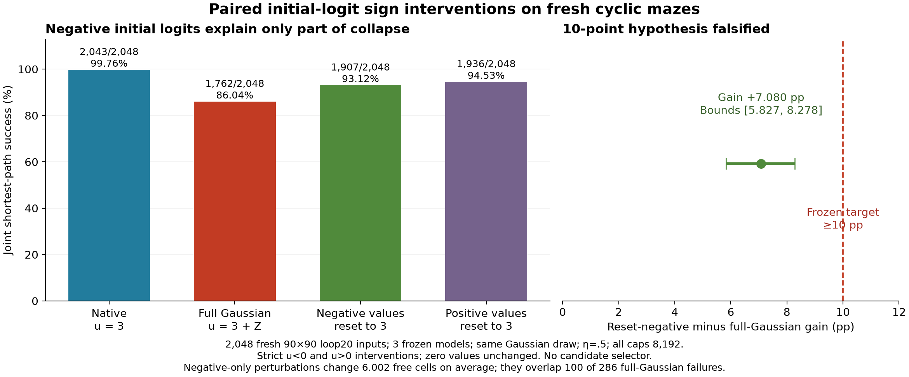
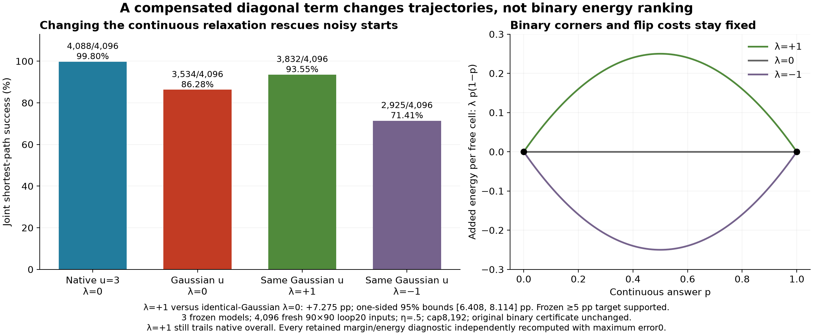
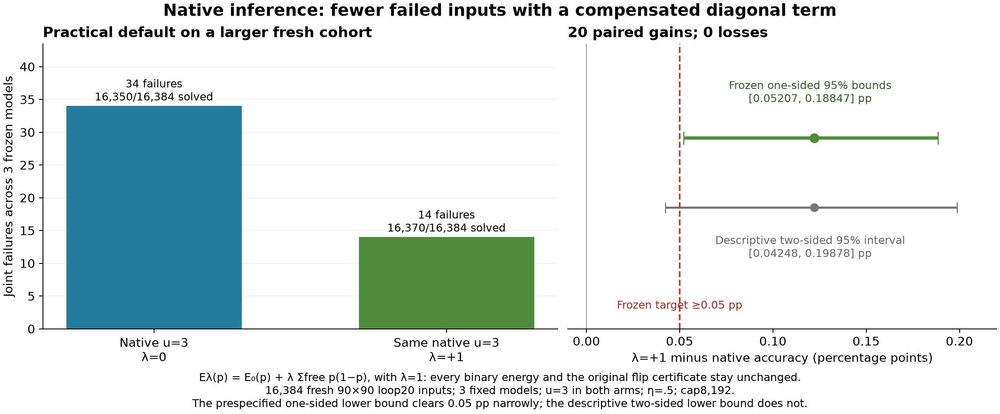

The frozen Maze-Hard energy transfers to larger generated mazes when its answer rollout has enough time. The failure at the paper's 2,048-update budget is concentrated in long tree branches. Changing the latent mass did not improve it. A controlled comb experiment supports branch-pruning depth as the cause of the additional rollout time. A subsequent frozen test increased only the answer step from 0.2 to 0.5: it reduced median answer updates by 2.38–2.42× on new 60×60 and 90×90 cohorts, with no observed accuracy loss.

A larger independent stability test also found a rare absolute-reliability failure: the same cyclic maze defeated two models at every tested step size. At η = 0.2/0.5/0.8 they certified invalid answers; at η = 1 they entered a period-two oscillation. The predictions, model weights, graph, energies and full local states are retained. The tested relative instability hypothesis was falsified, because η = 1 lost no additional joint solves compared with η = 0.5. This does not establish universal stability or correctness.

These are new research experiments on a declared randomized DFS-tree distribution, with optional opened loops. They are not new official Maze-Hard benchmark results. All experiments reuse the three fresh 29-parameter models from the completed reproduction, preserve learned weights, and run on Work's two RTX PRO 6000 Blackwell GPUs. Generated labels and graph algorithms are correctness oracles and offline diagnostics; they never enter model inference.

| Model / control | Role |
|---|---|
| BP AdamW | Outside this frozen-model inference intervention; no new baseline training |
| Frozen CRAM+z, original mass | Matched primary control |
| Frozen CRAM+z, mass×(30/L)² | Training-free intervention, no answer-energy changes |
| Frozen CRAM+z, 8,192 answer updates | Budget intervention, original mass and identical update rule |
| Frozen CRAM+z, answer step η = 0.5 | Matched step-size intervention against η = 0.2, both capped at 8,192 |
| BFS / independent Dijkstra | Label and shortest-path oracles, not learned competitors |

The native PyTorch hidden solver keeps its 4,000-update limit, tolerance 1e-6 and checks every 8 updates. Answer relaxation uses step 0.2, initial logit 3, fixed-point checks every 16 updates, and the declared 2,048 or 8,192 cap. Both stopped correctness and independently valid shortest paths are required. Hidden failures, answer timeouts, and wrong fixed points remain failures. Saved final boards permit independent validity checks.

**Size-transfer hypotheses.** H2 predicted at least 99% of 60×60 generated mazes would be solved by all three models under the original 2,048 cap. H2b predicted at least 5 percentage points improvement from mass scaling. Each cohort contains 128 independently generated mazes at each of three loop-opening rates; training-model repeats are not counted as additional independent mazes.

| Cohort and topology | Unique mazes | Original solved, each model | Mass-scaled solved, each model |
|---|---:|---:|---:|
| Discovery, 30×30, all three loop rates |384|384|Alias of original: scaling factor 1 |
| Discovery, 60×60, tree |128|92|92|
| Discovery, 60×60, 5% loops |128|128|128|
| Discovery, 60×60, 20% loops |128|128|128|
| Reserved confirmation, 30×30, all rates |384|384|Alias of original |
| Reserved confirmation, 60×60, tree |128|96|96|
| Reserved confirmation, 60×60, 5% loops |128|128|128|
| Reserved confirmation, 60×60, 20% loops |128|128|128|

H2 is falsified: discovery joint success was 348/384=90.625% with one-sided 95% upper bound 92.9613%; independent confirmation was 352/384=91.6667%, upper bound 93.8703%. All failed cases exhausted the answer budget. There were no wrong stops or hidden failures. H2b is also falsified: paired gain was 0 percentage points in both cohorts, with no discordant solve outcome. The exact one-sided 95% upper bound on the unseen discordant fraction is 0.7771 percentage points per cohort, also below the 5-point target. These conclusions concern the specified distribution, masses and budget.

**Longer rollout.** The next protocol used a new 256-tree 60×60 cohort. Raising only the answer cap from 2,048 to 8,192 improved every model from 203/256 to 256/256. Paired gain was 20.7031 points, with 95% paired-maze bootstrap interval 16.0156–25.7813. The required 5-point gain is supported. The absolute 99% population claim remained inconclusive at that sample count: even 256/256 gives a one-sided 95% lower bound 98.8366%.

A separate, frozen 384-tree 60×60 confirmation then solved 384/384 with every model. Its one-sided 95% lower bound 99.2229% supports the 99% joint-success hypothesis. All three models also solved 128/128 new 90×90 trees at the same 8,192 cap, with no budget increase; this smaller 90×90 cohort supports perfect observed success but not a 99% population lower bound (97.6868%). The maximum 90×90 mean stopping time across the three models was 7,072 updates.

**Mechanism and causal control.** On the earlier 256-tree cohort, the preregistered exploratory association of stopping time with maximum distance from any open node to the unique S–G path had Spearman ρ = 0.99914. Association with tree diameter was 0.00851, and with S–G path length was −0.84633. The latter correlations alone do not identify a cause.

The linear predictor fitted only on that 256-tree cohort was frozen as `updates=4.352984700053693×branch_depth+11.720719172409504`. On the new 128-tree 90×90 cohort it predicted all 128 mean stopping times within 10% relative error (mean 1.20%, maximum 4.31%). The one-sided 95% lower bound for within 10% coverage is 97.6868%, supporting the preregistered 95% coverage target. Computing branch depth requires an oracle S–G path: this is an offline mechanistic explanation, not a practical model-only budget selector.

The causal intervention used 90×90 comb mazes with eight nonadjacent branches and 64 paired translation/rotation/reflection layouts. All layouts and conditions retained the same three trained models. Graph connectivity, acyclicity, exact spine length, eight branch junctions, and branch depth were independently verified. All 1,344 model–maze evaluations produced valid shortest paths.

| S–G spine length | Branch depth | Mean answer updates | Range across layout means |
|---:|---:|---:|---:|
|64|0|16.000|16–16|
|64|8|32.000|32–32|
|64|16|80.000|80–80|
|64|32|147.000|144–160|
|64|64|296.917|288–304|
|16|16|80.000|80–80|
|32|16|80.000|80–80|

Increasing branch depth from 0 to 64 at fixed spine 64 added 280.917 updates (95% paired-layout bootstrap 279.25–282.58), exceeding the frozen 200-update target. Increasing spine length 16 to 64 at fixed branch depth 16 changed stopping time by exactly 0 updates, satisfying the frozen ±32-update equivalence margin. All eight orientations solved correctly; orientation-specific counts and timings remain in the audit, rather than being hidden by the mean.

[PDF](../../../results/research/work/pruning-mechanism.pdf) and [SVG](../../../results/research/work/pruning-mechanism.svg) are standalone scientific figures.

**Evidence and commands.** Protocols were frozen before the outcomes of their respective cohorts: [initial](protocol.json), [unchanged confirmation](confirmation-protocol.json), [budget intervention](budget_extension-protocol.json), [independent horizon and size transfer](horizon_transfer-protocol.json), and [causal combs](causal_comb-protocol.json). The initial dense linear solve and independent reference checks at 4, 8, 30 and 60 grids agreed to less than 9e-15 in double precision. No dimension-specific energy change was required.

**Step-size intervention.** H2g predicted at least a 2× reduction in median answer updates for η = 0.5 versus 0.2 at each size, with no lost joint three-model solves and a one-sided 95% upper bound on loss probability below 1 percentage point. The [frozen eta protocol](eta-protocol.json) used 768 new mazes: 384 per size, equally divided across tree, 5% loop, and 20% loop strata, with the same three trained models. Both arms retained the 8,192 cap, identical hidden states and learned energy. Model stopping steps were averaged within each maze before computing medians; 10,000 paired bootstrap samples preserved loop strata and all model repeats.

| Size | Median updates, η = 0.2 | Median updates, η = 0.5 | Ratio and paired 95% CI | Joint success, each arm | Joint success by 2,048, η = 0.2 → 0.5 |
|---|---:|---:|---:|---:|---:|
| 60×60 | 762.667 | 320.000 | 2.3833× [2.3500, 2.4737] | 384/384 | 351/384 → 384/384 |
| 90×90 | 1,192.000 | 493.333 | 2.4162× [2.3958, 2.4598] | 384/384 | 285/384 → 370/384 |

Both per-size hypotheses are supported. The exact one-sided 95% upper bound on an unseen lost-solve probability is 0.7771 percentage points at each size. This is a bound for the specified generator mixture and three fixed models, not for arbitrary mazes or training seeds. All 4,608 saved model–maze–arm boards passed independent shortest-path audit; there were no wrong stops, hidden failures or censored rollouts. These are per-size intervals without a multiplicity-adjusted combined claim.

Matched native answer times after warmup gave 2.4466× and 2.4382× speed ratios at 60 and 90; including identical shared hidden preparation gave 2.0897× and 2.2058×. Both arms ran on the same GPU per job, with alternating arm order and CUDA synchronization. Diagnostic replay was excluded from timing. On the prespecified first eight seed-0 mazes in each of six size/topology cells, both arms exactly matched native outcomes, showed no sampled energy increases every 16 updates, and triggered no two-cycle flags. This finite diagnostic does not prove global stability. Continuous-logit residuals remained nonzero at some discrete flip-stable stopping points, as the solver's stopping criterion permits. A separate 2,048-cap preflight verified that first-stop steps correctly recover the prefix success counts above.

Public [eta summary](../../../results/research/work/eta-summary.json), [per-model runs](../../../results/research/work/eta-runs.csv), [paired per-maze values](../../../results/research/work/eta-per-maze.csv), [PDF](../../../results/research/work/eta-acceleration.pdf), and [SVG](../../../results/research/work/eta-acceleration.svg) retain exact outcomes and figure data. Recheck the full local evidence using `upstream/.venv/bin/python research/20261114/work/audit_eta.py`; regenerate the figure with `artifacts/plotting-venv/bin/python research/20261114/work/plot_eta.py`.

**Independent causal test of acceleration.** H2h predicted that the ratio of branch-depth slopes at η = 0.2 and 0.5 would lie within [2, 3], a ±20% equivalence band around the inverse-step prediction 2.5. The [new frozen protocol](eta_comb-protocol.json) used 64 fresh paired translation/orientation layouts on 160×160 grids, branch depths 32, 64 and 128 at fixed spine 64, and separate spine 16/128 controls at depth 64. The larger grid accommodates these deliberately long branches. Three fixed models and both eta arms evaluated every condition. OLS slopes were fitted across the three declared depths within each layout, then averaged; the bootstrap preserved all paired conditions and model repeats.

The measured slopes were 4.670201 and 1.860491 updates per branch-depth unit for η = 0.2 and 0.5. Their ratio was 2.510198, with paired-layout 95% bootstrap interval [2.495415, 2.524831], supporting the frozen equivalence hypothesis. Changing spine 16 to 128 at depth 64 changed the mean by exactly zero updates in both arms; each paired interval was [0, 0], inside the separate ±32-update equivalence margins. All 1,920 model–maze–arm boards were valid shortest paths. Independent topology checks confirmed connectivity, acyclicity, eight branch junctions and exact spine/depth for all 320 condition/layout graphs. Diagnostic replays matched native outputs and showed no sampled energy increases or two-cycle flags. This supports the branch-pruning-rate explanation for these models and constructed mazes; it does not establish a universal step-size stability theorem.

Public [comb eta summary](../../../results/research/work/eta-comb-summary.json), [per-model runs](../../../results/research/work/eta-comb-runs.csv), [paired layout data](../../../results/research/work/eta-comb-per-layout.csv), [PDF](../../../results/research/work/eta-pruning-rate.pdf), and [SVG](../../../results/research/work/eta-pruning-rate.svg) retain the exact results. Recheck with `upstream/.venv/bin/python research/20261114/work/audit_eta_comb.py`; plot using `artifacts/plotting-venv/bin/python research/20261114/work/plot_eta_comb.py`.

Independent saved-board audits, exact binomial bounds, paired bootstrap statistics and hashes are retained for [discovery](../../../results/research/work/discovery-audit.json), [confirmation](../../../results/research/work/confirmation-audit.json), [budget intervention](../../../results/research/work/budget_extension-audit.json), [horizon transfer](../../../results/research/work/horizon_transfer-audit.json), and [combs](../../../results/research/work/causal_comb-audit.json). Recompute these without inference using `upstream/.venv/bin/python research/20261114/work/audit.py --campaign discovery`, the same command with `confirmation` or `budget_extension`, and `audit_followups.py --campaign horizon_transfer`or`causal_comb`. Plot regeneration is `artifacts/plotting-venv/bin/python research/20261114/work/plot_results.py`.

**Stability boundary and a retained exception.** The [frozen four-arm protocol](eta_boundary-protocol.json) tested η = 0.2, 0.5, 0.8 and 1 on 1,536 new inputs: 512 trees, 512 mazes with 20% opened loops, and 512 combs. All three fixed models evaluated every input. The cap remained 8,192; no failed run received a rescue. H2i predicted that η = 1 would lose at least 1 percentage point of joint solves that η = 0.5 achieved. There were zero such losses or gains. The conservative one-sided 95% upper bound was 0.79649 percentage points, formed from equal-weight stratum bounds with Bonferroni correction, so H2i is falsified. A zero-width empirical bootstrap interval is also retained but is not used as a population guarantee.

| Answer step η | Joint solved / unique inputs | Median updates, including caps | Wrong certified stops / model-inputs | Budget failures / model-inputs | Checked answer seconds |
|---|---:|---:|---:|---:|---:|
| 0.2 | 1,535 / 1,536 | 752 | 2 / 4,608 | 0 / 4,608 | 112.666 |
| 0.5 | 1,535 / 1,536 | 304 | 2 / 4,608 | 0 / 4,608 | 46.171 |
| 0.8 | 1,535 / 1,536 | 176 | 2 / 4,608 | 0 / 4,608 | 25.993 |
| 1.0 | 1,535 / 1,536 | 176 | 0 / 4,608 | 2 / 4,608 | 30.727 |

All arms had zero hidden or nonfinite failures. The same loop-maze input 38 caused both model-seed failures. These timings use identical finite-logit checks in every arm and matched GPU execution; they are separate from the earlier native-timing results. No new eta was selected from these exploratory comparisons.

Independent forensic replay matched the original 32-input batch predictions, stopping steps and flags exactly for all three models and four eta values. The selected graph has 352,212 shortest paths of 204 edges, whose union contains 654 cells. Model 0 solves it under every eta. Models 1 and 2 at η = 0.2/0.5 retain a connected 246-cell subgraph with two branching junctions; at η = 0.8 they retain only the two disconnected endpoints. All selected cells lie within the union of shortest paths. At η = 1 the failed models exhibit a measured period-two cycle and exhaust the cap.

The invalid certified answers have strictly positive single-flip margins: 0.9260/1.1330 for the two branched answers, and 4.3480/4.3858 for the endpoint-only answers. Tightening the −1e-6 certificate tolerance cannot reject these states. The hidden solver reaches exactly zero measured residual after 208 updates. For model 2, the endpoint-only discrete energy is −62,991.921875, lower than the valid oracle-path energy −61,435.00390625; the branched answer's energy is −61,121.47265625. Thus this exception includes a learned-energy connectivity failure, not just insufficient rollout time. These are selected, post-outcome diagnostics; they do not replace the frozen trial or establish that shortest-path multiplicity is the cause.

Public [boundary summary](../../../results/research/work/eta-boundary-summary.json), [per-model results](../../../results/research/work/eta-boundary-runs.csv), [paired maze data](../../../results/research/work/eta-boundary-per-maze.csv), [failure classification and energies](../../../results/research/work/cyclic-failure-classification.json), and [exact failure graph, predictions and three model state dictionaries](../../../results/research/work/cyclic-failure-case.json) support independent examination. Full logits, continuous states, couplings, hidden states, flip deltas and energy trajectories remain in the local `artifacts/research/20261114/work/eta_boundary/failure-forensics/` archive. Recheck the trial with `audit_eta_boundary.py`; reproduce the selected-case graph classification with `classify_boundary_failure.py`. Exact-board caching verified 18,432 outputs through 1,539 unique input/prediction graph checks in 6.91 seconds, reusing only byte-identical boards on the same input.

**Independent tests of the tie explanation.** Two new frozen studies tested whether equal shortest routes alone explain the retained failure. The [serial-cycle protocol](tie_controls-protocol.json) paired equal routes against two unequal-route controls on graphs with 1, 4, 8 or 12 cycles. There were 64 fresh layout/geometry clusters and three fixed models. The paired conditions match node count, edge count, degree histogram and cycle sizes; moving ports by ±2 cells changes the number of shortest paths from 2, 16, 256 or 4,096 to one. The unequal path is 4 edges shorter per cycle, an explicit remaining difference. Every one of the 2,304 model-input evaluations solved correctly at η = 0.5. The predicted 10-point joint-success loss on tied graphs is falsified: observed difference 0, no discordant cluster, and an exact one-sided 95% upper bound of 4.573 points on unseen discordant clusters. The paired bootstrap [0, 0] is retained but is not treated as a population guarantee.

The failed graph contains two 42-edge routes around one retained 84-edge cycle, longer than each individual route in the first control study. A [distinct extension](long_ties-protocol.json) therefore froze isolated cycle route lengths 28, 42 and 64, with 128 new paired layout/width clusters. Again, tied and ±2 port-shift controls match graph topology, node/edge counts and degrees; their shortest path lengths differ by 4. All 3,456 model-input evaluations solved. The primary 10-point loss hypothesis, averaged over route lengths 42 and 64, is also falsified: zero difference and a 2.313-point upper bound on unseen discordant clusters. Route 28 also had zero difference. These controls show that neither many ties nor long isolated ties are sufficient to produce the selected random-maze failure in these families. They do not explain away that failure or test all combinations of heterogeneous cycles and branches.

Public exact values are in the [serial-cycle summary](../../../results/research/work/tie_controls-summary.json), [serial-cycle runs](../../../results/research/work/tie_controls-runs.csv), [paired serial-cycle data](../../../results/research/work/tie_controls-per-layout.csv), [long-cycle summary](../../../results/research/work/long_ties-summary.json), [long-cycle runs](../../../results/research/work/long_ties-runs.csv), and [paired long-cycle data](../../../results/research/work/long_ties-per-layout.csv). Recheck with `audit_tie_controls.py` and `audit_long_ties.py`. Independent audits verify every graph's connectivity, shortest distance, exact number of shortest paths, cycle count, and matched structural counts.

**Selected-graph interventions are descriptive.** A separate [edit protocol](forensic_edits-protocol.json) chose one central interior node from each retained 42-edge branch, and 32 seeded matched noncritical nodes outside the union of all shortest paths. The choices were fixed before observing the edited outcomes. Every edit removes one degree-2 node and two edges with the same neighborhood degrees, preserves connectivity and shortest distance 204, and produces matching node/edge counts and degree histograms.

Deleting either targeted branch node restored all three models at unchanged η = 0.5. Both failing models still gave wrong certified stops after every one of the 32 matched noncritical deletions; model 0 solved all edits. The targeted graphs still contain 299,328 and 334,932 shortest paths, while controls retain 352,212. The effect is specific to the retained branch, despite abundant remaining degeneracy. These 102 model-input evaluations concern one selected graph and support no population recovery claim. All original failures remain in the earlier trial. The [edit audit](../../../results/research/work/forensic-edits-summary.json) and [per-model edit results](../../../results/research/work/forensic-edits-cases.csv) retain each outcome, energy and margin.

The [separate energy decomposition](../../../results/research/work/cyclic-failure-energy-decomposition.json) evaluates the saved coefficients in float64 and matches the repository energy within 1e-8. For model 2:

| State | Latent-gated links | Maze-Unique pair term | Maze-Unique bias term | Total energy |
|---|---:|---:|---:|---:|
| Valid oracle path | −2,950.772 | −32,024.525 | −26,459.681 | −61,434.979 |
| Branched η = 0.5 answer | −3,553.938 | −31,646.483 | −25,921.028 | −61,121.450 |
| Endpoint-only η = 0.8 answer | 0.905 | −33,866.126 | −29,126.670 | −62,991.892 |

The endpoint-only state's pair and bias terms improve by 4,508.590 energy units, outweighing its lost 2,951.677 units of latent-link reward. This explains its lower energy for these frozen coefficients. It does not identify which graph feature causes the coefficients to admit the invalid state. Entropy is negligible for these discrete answers; small differences from the earlier float32 totals are rounding. Full per-cell energy terms and latent log conductance, diagonal and source maps are retained alongside the full states.

**Readout versus geometry on the selected graph.** The [corrected reciprocal-swap protocol](coupling_swap_corrected-protocol.json) transferred the latent attention readout between the original graph and each of the two successful branch deletions, plus the first previously fixed noncritical deletion. Learned parameters and η = 0.5 remain fixed. Transfer uses the intersection of donor and recipient open-cell supports, with valid self coefficients preserved and deleted-node incident coefficients zeroed. There is no renormalization. Every source graph and model passed exact identity-transfer agreement with native full logits, stopping steps, stop flags and final boards before the counterfactual runs.

Transferring either targeted edit's readout onto the unchanged original geometry restores all three models. Keeping the original readout on the targeted edited geometry does not restore models 1 or 2; for branch B that reciprocal condition also fails model 0. The matched noncritical readout swaps leave models 1 and 2 failing. Thus changed readout is sufficient on the original geometry in this selected case, while physical node removal with original readout and incident-link masking is insufficient. This does not yet isolate which nonincident coefficients matter or establish population robustness. The corrected 30-arm study includes 12 matched baseline arms and 18 swaps.

The [corrected audit](../../../results/research/work/coupling-swap-corrected-summary.json), [per-arm outcomes and energy terms](../../../results/research/work/coupling-swap-corrected-arms.csv), and [identity-transfer receipt](../../../results/research/work/coupling-swap-identity-preflight.json) retain the full evidence. Active-coefficient change statistics exclude irrelevant wall-query attention entries. For model 2, the targeted readouts change nonincident coefficients by L1 totals 3.4635 and 31.2139; reciprocal original-readout arms change none away from the deleted node. These magnitudes are descriptive, not a fitted recovery criterion.

An earlier 30-arm swap attempt was excluded because its mask incorrectly assumed zero self coefficients and did not fully mask donor wall-query outgoing coefficients. Native solver parity did not detect that error: both solver implementations received the same incorrectly transformed tensor. The corrected identity-transfer gate checks the intervention itself against each graph's unmodified native trajectory. The [excluded-attempt receipt](../../../results/research/work/coupling-swap-excluded-v1.json), flawed source, protocol and all raw outputs are preserved separately, with no causal conclusion taken from that attempt.

**Independent free-fork angle control.** The [next frozen protocol](fork_angle-protocol.json) tested whether right-angle alternatives at free degree-3 junctions cause a 10-point joint-success loss relative to opposite alternatives. Both conditions use one cycle with two equal routes of length 28, 42 or 64, plus two 16-edge tails ending at S and G. Within each of 128 new paired layout/width clusters, the conditions match node and edge counts, degree histogram, cycle perimeter, tail lengths, S–G distance and exactly two shortest paths. Independent checks verify that alternative neighboring cells interact through a diagonal pair term only in the corner condition.

All three models solved all 768 inputs at fixed η = 0.5: 2,304 valid outputs. H2l is falsified, with 0 points difference at every route length, no discordant cluster, and a 2.313-point upper bound on unseen discordant clusters. Mean updates were 51.17 versus 54.54 at route 28 and exactly 80 and 128 for both conditions at routes 42 and 64. The positive diagonal interaction coefficients range from 1.6100 to 1.6278 across the three models. The [summary and actual pair tables](../../../results/research/work/fork-angle-summary.json), [per-model runs](../../../results/research/work/fork-angle-runs.csv), [paired layout results](../../../results/research/work/fork-angle-per-layout.csv), and [all fork attention/readout measurements](../../../results/research/work/fork-angle-readouts.csv) are public. This negative result rules out the proposed large loss in this matched family; it does not isolate the readout feature responsible for the selected random-maze failure.

**Exhaustive shortest-answer energy comparison.** The [enumeration protocol](path_landscape-v2-protocol.json) closes the gap between comparing one canonical path and comparing every shortest path on the selected graph. All 352,212 shortest paths were enumerated once and checked for endpoints, open cells, orthogonal adjacency and monotone distance. An independent forward-counting and exact full-row uniqueness audit confirmed exhaustive coverage. Each path was evaluated under each frozen model's retained readout, giving 1,056,636 energy evaluations and no new neural rollouts.

| Frozen model | Minimum valid shortest energy | Maximum valid shortest energy | Disconnected endpoint energy | Endpoint − minimum valid |
|---|---:|---:|---:|---:|
| 0 | −61,423.816 | −61,102.326 | −62,970.329 | −1,546.513 |
| 1 | −61,234.872 | −60,913.976 | −62,778.547 | −1,543.675 |
| 2 | −61,439.780 | −61,118.941 | −62,991.892 | −1,552.111 |

For every model, the disconnected endpoints have lower energy than **every valid shortest-path answer**. Thus global learned-energy ranking alone need not prefer a correct shortest answer, even when a valid answer is a stable local state. This is one selected graph; the enumeration excludes longer simple paths and other binary states, and does not identify the global binary minimum. The native η = 0.5 answer for model 0 is valid but 4.445 energy units above its best shortest path; models 1 and 2 retain branched answers 316.574 and 318.331 units above their respective minima.

The exact sparse binary expansion was checked against full-grid repository energy on 256 prespecified paths and all extrema, with maximum error below 5.1e−11. Independent CPU float64 full-grid evaluation verified the minima, maxima, endpoints and native answers. Full-grid versus sparse evaluation of the same 256 paths after warmup measured 41.23–49.63× acceleration; this is an energy-enumeration optimization, not a solver speedup. Enumeration took 4.01 seconds and each full energy vector took 0.033–0.059 seconds on Work. A float64 coefficient materialization issue was corrected before any energy outputs; original source/protocol are preserved, and the executed v2 amendment is explicit.

Public [audited summary](../../../results/research/work/shortest-path-energy-summary.json), [exact ranges and timings](../../../results/research/work/shortest-path-energy-ranges.csv), [complete-distribution histogram](../../../results/research/work/shortest-path-energy-histogram.csv), [extremal paths](../../../results/research/work/shortest-path-energy-extrema.json), [PDF](../../../results/research/work/shortest-path-energy-landscape.pdf) and [SVG](../../../results/research/work/shortest-path-energy-landscape.svg) retain the result. Full path and energy arrays remain in `artifacts/research/20261114/work/path_landscape/`; regenerate and audit with `enumerate_landscape_v2.py` and `audit_landscape.py`. The canonical valid path has strictly positive free-cell flip margins for all three models, independently confirmed in the audit.

**Fresh cyclic data: screening rescues restart selection, but does not beat native inference.** The [frozen restart protocol](restart-protocol.json) evaluated 4,096 new 90×90 loop20 mazes with all three models. The reference uses native `u=3` initialization and at most 8,192 updates. Four alternative chains each use `u=3+N(0,1)` and at most 2,048 updates, so both methods have the same maximum answer-update budget. Perturbation amplitude and RNG source were frozen without tuning on the selected graph. Two selectors see the identical four candidates: lowest learned energy, or a simple S–G-path feasibility screen followed by lowest learned energy. Both require finite states and native certification. The screen uses only the supplied graph, endpoints and candidate board; shortest distance and labels are strictly evaluation-only.

| Method | Joint shortest success / 4,096 inputs | Joint losses versus native | Joint gains versus native |
|---|---:|---:|---:|
| BP AdamW training | Outside this frozen-model inference study | — | — |
| Native single initialization | 4,092 | — | — |
| Four perturbed candidates, lowest energy | 2,346 | 1,746 | 0 |
| Same candidates, feasibility then lowest energy | 4,090 | 2 | 0 |

H2m predicted that feasibility screening would improve joint success by at least 0.1 percentage point over energy-only selection of the same candidates. The measured gain is 42.578125 points: 1,744 recovered inputs, zero losses, with exact one-sided 95% bounds [41.299320, 43.864766] points. H2m is supported. This is strong fresh-data evidence against unqualified learned-energy ranking as a restart selector. It is **not** an accuracy improvement over native inference: screened restarts solve two fewer inputs, with a descriptive net-difference interval [−0.198149, 0.102846] points. Fixed-model repeats are paired measurements on each input, not additional independent trials.

All 61,440 candidate/reference outputs passed independent audit; all 4,096 token graphs are unique. There were no hidden failures, nonfinite outputs or timeouts, but 6,433 wrong certified candidate/reference outputs. Every one of those 6,433 wrong outputs contains only the disconnected endpoints; energy-only selection returns this invalid state on 5,177 model-inputs. The [complete error classification](../../../results/research/work/restart-all-error-types.json) checks all saved boards. Energy-only selection always had an eligible candidate; screened selection explicitly returned failure on 15 model-inputs with no feasible candidate. Exact-board caching reduced independent graph checks to 5,843, plus 4,096 independent shortest-distance checks; audit time was 26.20 seconds.

The native joint failures are inputs 2729, 2857, 3546 and 3820. Screened restarts fail on these same four plus 1268 and 1373. Every failed retained board among these six cases contains only the two disconnected endpoints; there are no valid longer-path explanations. Their minimum free-cell flip margin is at least 5.4843, so these are strict wrong certificates. At input 1268 all 12 noisy candidates collapse to endpoints while all three native initializations solve. All six screened failures are no-feasible outcomes, with no oracle fallback or omitted case. Full diagnostic energies, margins and graph classifications are retained in the [failure diagnostics](../../../results/research/work/restart-failure-diagnostics.json). Canonical labels are used there only to evaluate reference-path energies after outcomes.

Native answer time summed across jobs was 46.145 seconds; the four noisy answers took 221.905 seconds, or 4.809× as much. Identical shared hidden preparation took 8.054 seconds and CPU selector checks took 9.829 seconds. Mean native updates were 313.895 versus 1,276.211 summed noisy-chain updates. Equal caps therefore do not imply equal consumed compute. The two workers completed in 145.87 and 149.58 seconds, 4.92 summed GPU-minutes within the frozen 40-minute envelope. The [summary](../../../results/research/work/restart-summary.json), [per-job runs](../../../results/research/work/restart-runs.csv), [all candidate results](../../../results/research/work/restart-candidates.csv), [paired model-input outcomes](../../../results/research/work/restart-per-model-input.csv), [joint input outcomes](../../../results/research/work/restart-per-input.csv), [PDF](../../../results/research/work/restart-selection.pdf) and [SVG](../../../results/research/work/restart-selection.svg) retain the evidence. Recheck with `audit_restart.py`; regenerate public files with `export_restart.py` and `plot_restart.py`.

**Keeping the native candidate preserves accuracy without new recoveries.** The [next frozen protocol](native_restart-protocol.json) used another 4,096 fresh loop20 inputs. The four candidates now include native `u=3` and three `u=3+N(0,1)` draws, each capped at 2,048 updates; native 8,192 remains the reference. Three selectors operate on identical candidates: lowest learned energy, feasibility then energy, and feasibility then candidate node count with energy and index tie breaks. Candidate node count is observable from the returned board and does not use true shortest distance. No feasible candidate produces an explicit failure.

| Method | Joint shortest success / 4,096 inputs | Joint losses / gains versus native |
|---|---:|---:|
| BP AdamW training | Outside this frozen-model inference study | — |
| Native single initialization, 8,192 cap | 4,090 | — |
| Native + three noisy candidates, energy only | 2,687 | 1,403 / 0 |
| Same candidates, feasibility then energy | 4,090 | 0 / 0 |
| Same candidates, feasibility then node count | 4,090 | 0 / 0 |

H2n required the feasible minimum-node-count selector to lose at most 0.1 percentage point of native joint solves. Zero losses give a one-sided 95% upper bound of 0.073111 points, supporting the prespecified noninferiority criterion. There are also zero gains: all six native joint failures remain unresolved. Both feasibility selectors return no feasible answer on the same 14 model-inputs. This establishes preservation for the frozen distribution and cap; it does not establish an accuracy improvement from random restarts. Structurally, a shortest native candidate cannot be displaced by a longer path under minimum-node-count selection, provided native certifies within the candidate cap.

Every native reference certified within 2,048 updates, so its candidate prefix could be reused exactly after passing a reserved-data parity gate. There are 61,440 logical candidate/reference outcomes but only 49,152 new answer trajectories; 12,288 identical native prefixes are not counted as new evaluations. The two workers took 119.92 and 123.23 seconds, within the frozen 20 GPU-minute envelope. Equivalent candidate time, explicitly accounting for the shared native prefix, was 216.175 seconds versus 45.835 seconds for native alone; this is not a separately timed duplicate native rollout. Full independent output/selector audit took 27.60 seconds.

Public [summary](../../../results/research/work/native-restart-summary.json), [per-job runs](../../../results/research/work/native-restart-runs.csv), [logical candidate outcomes](../../../results/research/work/native-restart-candidates.csv), [model-input data](../../../results/research/work/native-restart-per-model-input.csv), [joint outcomes](../../../results/research/work/native-restart-per-input.csv), [PDF](../../../results/research/work/native-restart-selection.pdf) and [SVG](../../../results/research/work/native-restart-selection.svg) retain all comparisons and reuse accounting. Recheck with `audit_native_restarts.py`; regenerate exports with `export_native_restarts.py` and `plot_native_restarts.py`.

**Negative initial logits explain only part of the collapse.** The [paired sign-intervention protocol](sign_intervention-protocol.json) evaluated 2,048 fresh loop20 inputs with four single-output arms, each capped at 8,192 updates and η = 0.5. One fixed Gaussian draw per input is shared across all models and interventions. The arms are native `u=3`, full `u=3+N(0,1)`, the same draw with strictly negative values reset to 3, and the same draw with strictly positive values reset to 3. Exactly zero values remain unchanged in both sign interventions. Normal wall/endpoint clamping remains part of the model. There is no candidate selector.

| Initial-logit arm | Joint shortest success / 2,048 inputs | Mean changed free cells | Joint losses / gains versus native |
|---|---:|---:|---:|
| BP AdamW training | Outside this frozen-model inference study | — | — |
| Native `u=3` | 2,043 | 0 | — |
| Full Gaussian `u=3+Z` | 1,762 | 4,433.999 | 281 / 0 |
| Negative values reset to 3 | 1,907 | 4,427.997 | 136 / 0 |
| Positive values reset to 3 | 1,936 | 6.002 | 107 / 0 |

H2o predicted at least a 10-point joint-success gain from resetting negative values, relative to the full Gaussian. The measured gain is 7.080078 points: 145 gains, zero losses, with conservative one-sided 95% net-gain bounds [5.826917, 8.277996] points. The frozen 10-point hypothesis is **falsified**, while the result still shows a smaller causal rescue from removing initially negative logits. Perturbing only positive-valued logits still loses 136 native solves, so initially negative cells do not explain all failures. Conversely, changing only about six free cells per maze to their negative sampled values loses 107 native solves.

The negative-only arm fails on 112 inputs, overlapping 100 of the full Gaussian's 286 failures; 12 of its failures do not occur under full Gaussian perturbation. Thus the two components do not produce a simple nested failure set. These overlap comparisons are descriptive. All 1,591 wrong certified model-input outputs across the four arms are endpoint-only; there are no hidden failures, nonfinite outputs or timeouts. No perturbed arm recovers a native joint failure.

All 2,048 exact float32 initial Gaussian arrays and all 24,576 final-logit arrays are retained. Independent audit reconstructs the strict-sign interventions, checks every initial changed/negative/zero count, verifies prediction rounding from final logits, and checks graph validity and shortestness. The native solver matched the original implementation on 64 reserved inputs before execution. A separate reserved-input measurement selected batch 64 over 32: median answer time for the same 64 inputs fell from 0.233341 to 0.121898 seconds, a 1.914× throughput improvement, with exact board, step and stop-flag parity. This is a local batching measurement, not a cross-hardware claim. The two primary workers finished in 38.11 and 38.92 seconds; the audit took 16.96 seconds.

Public [summary and bounds](../../../results/research/work/sign-intervention-summary.json), [per-model runs](../../../results/research/work/sign-intervention-runs.csv), [per-model input outcomes and cell counts](../../../results/research/work/sign-intervention-per-model-input.csv), [paired joint outcomes](../../../results/research/work/sign-intervention-per-input.csv), [PDF](../../../results/research/work/sign-intervention.pdf) and [SVG](../../../results/research/work/sign-intervention.svg) retain the result. Recheck with `audit_sign_intervention.py`; regenerate with `export_sign_intervention.py` and `plot_sign_intervention.py`.

**Downward spatial variation matters beyond its expected mean.** The [six-arm margin protocol](margin_intervention-protocol.json) used 4,096 new inputs, all three models, η = 0.5 and 8,192 updates per arm. The same saved `3+Z` array produces upward-only `max(3,3+Z)` and downward-only `min(3,3+Z)` initial states. Native and full Gaussian arms remain controls. Two further constant controls use `3±1/√(2π)`, matching the population expected means of the rectified Gaussian arms. Their float32 stored values and realized per-input means are retained explicitly; the controls do not exactly match each finite input's realized mean.

| Initial-logit arm | Joint shortest success / 4,096 inputs | Mean free-cell initial logit | Joint losses / gains versus native |
|---|---:|---:|---:|
| BP AdamW training | Outside this frozen-model inference study | — | — |
| Native | 4,089 | 3.000000 | — |
| Full Gaussian | 3,559 | 3.000347 | 530 / 0 |
| Upward-only spatial perturbation | 4,089 | 3.399174 | 0 / 0 |
| Constant expected upward mean | 4,089 | 3.398942 | 0 / 0 |
| Downward-only spatial perturbation | 3,402 | 2.601173 | 687 / 0 |
| Constant expected downward mean | 4,089 | 2.601058 | 0 / 0 |

H2p required upward-only initialization to be noninferior within 0.1 percentage point of native joint success. Zero losses give a one-sided 95% upper loss bound of 0.073111 points, so the prespecified criterion is supported; there are also zero gains. The downward-only arm loses 687 inputs while its expected-mean constant control loses none. For these fixed perturbations, spatially varying downward changes have an effect that the corresponding uniform mean shift does not reproduce. This descriptive contrast does not establish a universal invariance to positive perturbations or identify the exact vulnerable cells.

Upward-only and both constant controls produce exactly the native binary board on every one of the 12,288 model-inputs, although their first-stop update differs on 122, 141 and 205 model-inputs respectively. Full and downward-only perturbations change 1,565 and 2,027 boards. The [exact saved-output comparison](../../../results/research/work/margin-output-parity.json) retains these checks. All 3,694 wrong outputs across the six arms contain only the endpoints and are certified; there are no hidden failures, nonfinite outputs or timeouts. None of the tested initializations repairs a native joint failure.

The 73,728 final-logit arrays and 4,096 initial Gaussian arrays are retained and independently audited. The two GPU workers finished in 108.38 and 110.92 seconds. The initial audit took 49.67 seconds; caching each decompressed NPZ array once per job reduced a second complete audit to 28.26 seconds. All scientific JSON values were exactly equal after excluding timestamps, source hash and measured audit duration; the old audit source and receipt are preserved. These are one-run wall-time observations on the shared local host, not a controlled throughput benchmark. The [cache verification receipt](../../../results/research/work/margin-audit-cache-validation.json) records the comparison.

Public [summary](../../../results/research/work/margin-intervention-summary.json), [per-model runs](../../../results/research/work/margin-intervention-runs.csv), [model-input outcomes and realized means](../../../results/research/work/margin-intervention-per-model-input.csv), [joint outcomes](../../../results/research/work/margin-intervention-per-input.csv), [PDF](../../../results/research/work/margin-intervention.pdf) and [SVG](../../../results/research/work/margin-intervention.svg) retain the evidence. Recheck with `audit_margin_intervention.py`; regenerate with `export_margin_intervention.py` and `plot_margin_intervention.py`.

**Changing the continuous relaxation while preserving every binary energy.** The [source-specific derivation](binary-preserving-derivation.md) adds `λ Σ_free p(1−p)` to the continuous answer energy. The added term is zero on every binary board, so every binary energy, their ordering and every true bit-flip cost remain unchanged. Its field contribution is `λ(2p−1)` on free cells. The trained model, hidden readout and clamped fields stay fixed, and the original `flip_delta` remains the stopping certificate. The linear compensation is essential: an uncompensated diagonal term would change binary energies.

Before the scientific trial, exhaustive small-graph tests checked 2,880 binary energies and 19,200 directed flips across all three frozen models and five validation strengths. Binary energies and true flip costs were bitwise unchanged; continuous central finite differences agreed within 7.22e−9. The [validation receipt](../../../results/research/work/binary-preserving-validation.json) retains the full gate. This algebraic invariance cannot repair the binary energy ordering that favors disconnected endpoints; it permits a clean test of continuous trajectory behavior.

The [frozen trial](binary_relaxation-protocol.json) used another 4,096 fresh inputs. Three arms share the exact same full Gaussian initialization and use λ = 0, +1 or −1; the reference is native `u=3`, λ = 0. All arms use η = 0.5 and an 8,192 cap. λ is measured in native energy units and was fixed before outcomes.

| Arm | Joint shortest success / 4,096 inputs | Joint losses / gains versus native | Wrong certified model-inputs |
|---|---:|---:|---:|
| BP AdamW training | Outside this frozen-model inference study | — | — |
| Native `u=3`, λ = 0 | 4,088 | — | 22 |
| Full Gaussian, λ = 0 | 3,534 | 554 / 0 | 1,669 |
| Same Gaussian, λ = +1 | 3,832 | 259 / 3 | 772 |
| Same Gaussian, λ = −1 | 2,925 | 1,163 / 0 | 3,458 |

H2q predicted at least a 5-point gain for λ = +1 over λ = 0 with identical noisy starts. It is supported: 298 gains, zero losses, net +7.275391 points, with one-sided 95% bounds [6.408440, 8.113898] points. λ = −1 loses another 609 joint solves relative to Gaussian λ = 0. The result separates continuous-relaxation behavior from binary-energy ranking: the former improves while the latter is algebraically unchanged. λ = +1 still trails native initialization overall. Its three recoveries of native failures are descriptive, alongside 259 native solves it loses.

All wrong stops have strictly positive **original** bit-flip margins. λ = +1 has 769 endpoint-only wrong outputs and three connected branched wrong outputs, whose minimum margins are 0.466536, 0.662355 and 0.607079. The branched outputs occur at input 2302/model 0 and input 3782/models 0 and 1, each with two branch junctions. The other arms' wrong outputs are all endpoint-only, with minimum wrong margin at least 4.300137. There are no nonfinite outputs, hidden failures or timeouts. The [selected-case archive](../../../results/research/work/binary-relaxation-selected-cases.json) retains those two graphs and the three recovered native-failure inputs 541, 1902 and 1955, with all model/arm predictions and original energies. These cases were selected after the primary trial for explanation.

Every original margin, binary energy, continuous energy and modified-field residual was independently recomputed from the immutable model and original 64-input hidden-readout batches for all 49,152 outputs. Maximum discrepancy was exactly zero. The [recheck receipts](../../../results/research/work/binary-relaxation-diagnostic-recheck.json) record 4.68 and 4.74 seconds per GPU and zero new answer trajectories. Native solver parity, λ = 0 full-logit parity with the previous implementation, and traced/untraced parity passed before execution. The two primary workers took 80.34 and 82.61 seconds; the independent graph and trajectory audit took 25.50 seconds. Prespecified [continuous trajectories](../../../results/research/work/binary-relaxation-trajectories.json) retain both original and modified energies, original certificate margins and residuals.

Public [summary](../../../results/research/work/binary-relaxation-summary.json), [per-model runs](../../../results/research/work/binary-relaxation-runs.csv), [model-input diagnostics](../../../results/research/work/binary-relaxation-per-model-input.csv), [paired joint outcomes](../../../results/research/work/binary-relaxation-per-input.csv), [PDF](../../../results/research/work/binary-relaxation.pdf) and [SVG](../../../results/research/work/binary-relaxation.svg) retain the result. Recheck with `audit_binary_relaxation.py` and `recheck_binary_diagnostics.py`; regenerate with `export_binary_relaxation.py` and `plot_binary_relaxation.py`.

**The compensated relaxation also improves ordinary native initialization.** The [larger frozen trial](native_relaxation-protocol.json) used 16,384 fresh 90×90 loop20 inputs with `u=3` in both arms, comparing λ = 0 with the already fixed λ = +1. All three immutable models, η = 0.5, the 8,192 cap, original binary certificate and binary-energy invariance are retained. There is no Gaussian arm or lambda sweep. H2r specified a joint-success gain of at least 0.05 percentage point with paired one-sided uncertainty.

| Method | Joint shortest success / 16,384 inputs | Joint failures | Wrong certified model-inputs | Answer seconds |
|---|---:|---:|---:|---:|
| BP AdamW training | Outside this frozen-model inference study | — | — | — |
| Native `u=3`, λ = 0 | 16,350 (99.79248%) | 34 | 89 | 94.706 |
| Same native initialization, λ = +1 | 16,370 (99.91455%) | 14 | 36 | 112.278 |

There are **20 paired gains and zero losses**, a +0.122070 percentage-point gain. The prespecified one-sided 95% lower net-gain bound is 0.052067 points, narrowly above the 0.05-point target; its separately constructed one-sided upper bound is 0.188465. H2r is supported under the frozen decision rule. The number of failed inputs falls from 34 to 14 for this distribution and these fixed models. The binary energy ordering itself remains unchanged, so this is an inference improvement rather than a repair of the learned binary objective.

The [independent SciPy verification](../../../results/research/work/native-relaxation-statistics-verification.json) reproduces the custom binomial bounds within 1.02e−13 percentage points and audits the tail allocation. Each frozen one-sided net bound combines two marginal Clopper–Pearson bounds at α = 0.025, giving 95% one-sided coverage by the union bound without requiring gain and loss independence. **The two endpoints must not be called a conventional two-sided 95% confidence interval.** A separately reported conservative two-sided 95% interval allocates α = 0.0125 to each of four tails and gives [0.042477, 0.198781] points. It is wholly positive, but its lower end does not establish the 0.05-point target. The figure shows both constructions and uses only the public JSON summaries.

Native has 87 endpoint-only and two branched wrong model-input outputs; λ = +1 has 29 endpoint-only and seven branched wrong outputs. All are graph-infeasible, certified, and have strictly positive original margins: minima 0.582808 and 0.289343. There are no valid longer-path errors, timeouts, nonfinite states or hidden failures. The [complete failure classification](../../../results/research/work/native-relaxation-failure-classification.json) includes every wrong output and all paired gain/loss input indices. Mean updates increase from 313.952 to 348.871, and measured answer time rises by about 18.6%; the accuracy gain has a real compute cost.

The 98,304 final-logit arrays and outputs passed independent graph, trace and certificate audits. All retained original/modified energy and margin diagnostics were recomputed with maximum error zero; [rechecks](../../../results/research/work/native-relaxation-diagnostic-recheck.json) required 12.04 and 12.34 seconds per GPU and no new answer trajectories. Input verification ran on eight CPU processes during inference, checking all 16,384 graphs in 10.84 seconds; the subsequent result audit took 11.84 seconds. Primary workers completed in 147.06 and 150.49 seconds, within the frozen 20 GPU-minute envelope.

Public [summary](../../../results/research/work/native-relaxation-summary.json), [per-model runs](../../../results/research/work/native-relaxation-runs.csv), [model-input diagnostics](../../../results/research/work/native-relaxation-per-model-input.csv), [paired joint outcomes](../../../results/research/work/native-relaxation-per-input.csv), [PDF](../../../results/research/work/native-relaxation.pdf) and [SVG](../../../results/research/work/native-relaxation.svg) retain the evidence. Recheck using `audit_native_relaxation_inputs.py`, `audit_native_relaxation.py`, `recheck_native_diagnostics.py` and `verify_native_relaxation_statistics.py`; regenerate the public-data-only figure with `plot_native_relaxation.py`.

H2r protocol erratum: the inherited prose in `cohort.generator` says indices `0..4095`; the frozen `n_unique`, 64 × 256 job layout, executed generator, retained inputs and independent audit all use **0..16383**. This is a description typo, not a sample-size change. The original frozen protocol is preserved.

**Confirmation on larger mazes.** H2s changed only the grid size to 120×120 and used 16,384 fresh loop20 inputs, with the same three frozen models, native `u=3`, fixed λ = 0 versus +1, η = 0.5 and cap 8,192. The [protocol](larger_relaxation-protocol.json) froze the same ≥0.05-point primary target before generating data; this cohort is not pooled with H2r.

| Method | Joint shortest success / 16,384 inputs | Joint failures | Wrong certified model-inputs | Answer seconds |
|---|---:|---:|---:|---:|
| BP AdamW training | Outside this frozen-model inference study | — | — | — |
| Native `u=3`, λ = 0 | 16,324 | 60 | 160 | 123.591 |
| Same native initialization, λ = +1 | 16,350 | 34 | 87 | 146.216 |

The larger-size confirmation supports H2s: **27 gains and one loss**, net +0.158691 percentage points. The frozen one-sided 95% lower net-gain bound is 0.074626 points, above 0.05; its separately constructed upper bound is 0.239524. The descriptive conservative **two-sided 95% interval is [0.063100, 0.251124] points**, and also clears the target. [Independent SciPy verification](../../../results/research/work/larger-relaxation-statistics-verification.json) matches the primary calculation within 1.74e−13 points. These are fixed-model, distribution-specific results, not a universal monotonicity claim.

The one regression, input 13642, is informative: all three native outputs solve it, whereas all three λ = +1 outputs stop at the same connected 436-node board with two branch junctions. Their strictly positive original flip margins are 0.233856, 0.184259 and 0.112516. The [complete regression-case graph and paired outputs](../../../results/research/work/larger-relaxation-regression-cases.json) retain it for inspection. Native has 145 endpoint-only and 15 branched wrong outputs; λ = +1 has 64 endpoint-only and 23 branched wrong outputs. All 247 wrong outputs are graph-infeasible and strictly certified; there are no valid longer-path errors, timeouts, nonfinite states or hidden failures. The [classification](../../../results/research/work/larger-relaxation-failure-classification.json) retains every wrong board.

Mean answer updates rise from 414.866 to 461.119; measured answer time rises by 18.31%. Both workers finish in 201.79 and 205.29 seconds, totaling 6.78 GPU-minutes within the frozen 20-minute envelope. A reserved-data 120-grid batch32/64 benchmark measured 1.893× throughput improvement for batch64, with exact boards, steps, flags and logits; batch64 was fixed before the benchmark. Five retained live samples show GPU utilization 54–79% and 49–76% with advancing counters. The independent input audit overlaps inference and takes 19.81 seconds; the output audit takes 17.82 seconds. Every retained final diagnostic is [recomputed](../../../results/research/work/larger-relaxation-diagnostic-recheck.json) with maximum discrepancy zero in 15.94 and 16.22 seconds per GPU, with no new answer trajectories. An initial CPU audit import failed because one dependency was absent on Work; it was copied, the failed log preserved, and the successful audit rerun without affecting inference.

Public [summary](../../../results/research/work/larger-relaxation-summary.json), [per-model runs](../../../results/research/work/larger-relaxation-runs.csv), [model-input diagnostics](../../../results/research/work/larger-relaxation-per-model-input.csv), [paired joint outcomes](../../../results/research/work/larger-relaxation-per-input.csv), [PDF](../../../results/research/work/larger-relaxation.pdf) and [SVG](../../../results/research/work/larger-relaxation.svg) retain the evidence. Recheck using `audit_larger_relaxation_inputs.py`, `audit_larger_relaxation.py`, `recheck_larger_diagnostics.py` and `verify_larger_relaxation_statistics.py`; regenerate with `export_larger_relaxation.py` and `plot_larger_relaxation.py`.

The generator, worker source, protocol hashes, immutable model copies, launch receipts, worker logs, per-batch counters, and all predicted boards are retained. There are 810 planned jobs with 499,008 new model–maze–arm evaluations, plus 6 descriptive selected-graph jobs with 132 arms: 816 included jobs and 499,140 new evaluations in total. The latter include 12 explicit matched baseline arms. The 12,288 exact native-prefix reuses, 1,056,636 exhaustive energy evaluations, mathematical validation checks, diagnostic replays and excluded 30-arm attempt are separate. The original reproduction remains unchanged. Timing reflects PyTorch inference and CPU launch overhead on Blackwell; these experiments establish no H200 speedup or new baseline-training comparison. Further work is separate from these completed totals.
