The frozen Maze-Hard energy transfers to larger generated mazes when its answer rollout has enough time. The failure at the paper's 2,048-update budget is concentrated in long tree branches. Changing the latent mass did not improve it. A controlled comb experiment supports branch-pruning depth as the cause of the additional rollout time. A subsequent frozen test increased only the answer step from 0.2 to 0.5: it reduced median answer updates by 2.38–2.42× on new 60×60 and 90×90 cohorts, with no observed accuracy loss.

A larger independent stability test also found a rare absolute-reliability failure: the same cyclic maze defeated two models at every tested step size. At η = 0.2/0.5/0.8 they certified invalid answers; at η = 1 they entered a period-two oscillation. The predictions, model weights, graph, energies and full local states are retained. The tested relative instability hypothesis was falsified, because η = 1 lost no additional joint solves compared with η = 0.5. This does not establish universal stability or correctness.

These are new research experiments on a declared randomized DFS-tree distribution, with optional opened loops. They are not new official Maze-Hard benchmark results. The inference interventions through H2u reuse the three fresh 29-parameter models from the completed reproduction and preserve learned weights. H2v below separately fine-tunes copies of their 23 answer parameters, preserving the original models and frozen hidden layer. GPU experiments run on Work's two RTX PRO 6000 Blackwell GPUs. Generated labels are offline correctness oracles; H2v explicitly uses the original training labels in its new training objective. No evaluation labels enter model inference.

| Model / control | Role |
|---|---|
| BP AdamW | Outside this frozen-model inference intervention; no new baseline training |
| Frozen CRAM+z, original mass | Matched primary control |
| Frozen CRAM+z, mass×(30/L)² | Training-free intervention, no answer-energy changes |
| Frozen CRAM+z, 8,192 answer updates | Budget intervention, original mass and identical update rule |
| Frozen CRAM+z, answer step η = 0.5 | Matched step-size intervention against η = 0.2, both capped at 8,192 |
| BFS / independent Dijkstra | Label and shortest-path oracles, not learned competitors |

The native PyTorch hidden solver keeps its 4,000-update limit, tolerance 1e-6 and checks every 8 updates. Answer relaxation uses step 0.2, initial logit 3, fixed-point checks every 16 updates, and the declared 2,048 or 8,192 cap. Both stopped correctness and independently valid shortest paths are required. Hidden failures, answer timeouts, and wrong fixed points remain failures. Saved final boards permit independent validity checks.

**Size-transfer hypotheses.** H2 predicted at least 99% of 60×60 generated mazes would be solved by all three models under the original 2,048 cap. H2b predicted at least 5 percentage points improvement from mass scaling. Each cohort contains 128 independently generated mazes at each of three loop-opening rates; training-model repeats are not counted as additional independent mazes.

| Cohort and topology | Unique mazes | Original solved, each model | Mass-scaled solved, each model |
|---|---:|---:|---:|
| Discovery, 30×30, all three loop rates |384|384|Alias of original: scaling factor 1 |
| Discovery, 60×60, tree |128|92|92|
| Discovery, 60×60, 5% loops |128|128|128|
| Discovery, 60×60, 20% loops |128|128|128|
| Reserved confirmation, 30×30, all rates |384|384|Alias of original |
| Reserved confirmation, 60×60, tree |128|96|96|
| Reserved confirmation, 60×60, 5% loops |128|128|128|
| Reserved confirmation, 60×60, 20% loops |128|128|128|

H2 is falsified: discovery joint success was 348/384=90.625% with one-sided 95% upper bound 92.9613%; independent confirmation was 352/384=91.6667%, upper bound 93.8703%. All failed cases exhausted the answer budget. There were no wrong stops or hidden failures. H2b is also falsified: paired gain was 0 percentage points in both cohorts, with no discordant solve outcome. The exact one-sided 95% upper bound on the unseen discordant fraction is 0.7771 percentage points per cohort, also below the 5-point target. These conclusions concern the specified distribution, masses and budget.

**Longer rollout.** The next protocol used a new 256-tree 60×60 cohort. Raising only the answer cap from 2,048 to 8,192 improved every model from 203/256 to 256/256. Paired gain was 20.7031 points, with 95% paired-maze bootstrap interval 16.0156–25.7813. The required 5-point gain is supported. The absolute 99% population claim remained inconclusive at that sample count: even 256/256 gives a one-sided 95% lower bound 98.8366%.

A separate, frozen 384-tree 60×60 confirmation then solved 384/384 with every model. Its one-sided 95% lower bound 99.2229% supports the 99% joint-success hypothesis. All three models also solved 128/128 new 90×90 trees at the same 8,192 cap, with no budget increase; this smaller 90×90 cohort supports perfect observed success but not a 99% population lower bound (97.6868%). The maximum 90×90 mean stopping time across the three models was 7,072 updates.

**Mechanism and causal control.** On the earlier 256-tree cohort, the preregistered exploratory association of stopping time with maximum distance from any open node to the unique S–G path had Spearman ρ = 0.99914. Association with tree diameter was 0.00851, and with S–G path length was −0.84633. The latter correlations alone do not identify a cause.

The linear predictor fitted only on that 256-tree cohort was frozen as `updates=4.352984700053693×branch_depth+11.720719172409504`. On the new 128-tree 90×90 cohort it predicted all 128 mean stopping times within 10% relative error (mean 1.20%, maximum 4.31%). The one-sided 95% lower bound for within 10% coverage is 97.6868%, supporting the preregistered 95% coverage target. Computing branch depth requires an oracle S–G path: this is an offline mechanistic explanation, not a practical model-only budget selector.

The causal intervention used 90×90 comb mazes with eight nonadjacent branches and 64 paired translation/rotation/reflection layouts. All layouts and conditions retained the same three trained models. Graph connectivity, acyclicity, exact spine length, eight branch junctions, and branch depth were independently verified. All 1,344 model–maze evaluations produced valid shortest paths.

| S–G spine length | Branch depth | Mean answer updates | Range across layout means |
|---:|---:|---:|---:|
|64|0|16.000|16–16|
|64|8|32.000|32–32|
|64|16|80.000|80–80|
|64|32|147.000|144–160|
|64|64|296.917|288–304|
|16|16|80.000|80–80|
|32|16|80.000|80–80|

Increasing branch depth from 0 to 64 at fixed spine 64 added 280.917 updates (95% paired-layout bootstrap 279.25–282.58), exceeding the frozen 200-update target. Increasing spine length 16 to 64 at fixed branch depth 16 changed stopping time by exactly 0 updates, satisfying the frozen ±32-update equivalence margin. All eight orientations solved correctly; orientation-specific counts and timings remain in the audit, rather than being hidden by the mean.


[PDF](../../../results/research/work/pruning-mechanism.pdf) and [SVG](../../../results/research/work/pruning-mechanism.svg) are standalone scientific figures.

**Evidence and commands.** Protocols were frozen before the outcomes of their respective cohorts: [initial](protocol.json), [unchanged confirmation](confirmation-protocol.json), [budget intervention](budget_extension-protocol.json), [independent horizon and size transfer](horizon_transfer-protocol.json), and [causal combs](causal_comb-protocol.json). The initial dense linear solve and independent reference checks at 4, 8, 30 and 60 grids agreed to less than 9e-15 in double precision. No dimension-specific energy change was required.

**Step-size intervention.** H2g predicted at least a 2× reduction in median answer updates for η = 0.5 versus 0.2 at each size, with no lost joint three-model solves and a one-sided 95% upper bound on loss probability below 1 percentage point. The [frozen eta protocol](eta-protocol.json) used 768 new mazes: 384 per size, equally divided across tree, 5% loop, and 20% loop strata, with the same three trained models. Both arms retained the 8,192 cap, identical hidden states and learned energy. Model stopping steps were averaged within each maze before computing medians; 10,000 paired bootstrap samples preserved loop strata and all model repeats.

| Size | Median updates, η = 0.2 | Median updates, η = 0.5 | Ratio and paired 95% CI | Joint success, each arm | Joint success by 2,048, η = 0.2 → 0.5 |
|---|---:|---:|---:|---:|---:|
| 60×60 | 762.667 | 320.000 | 2.3833× [2.3500, 2.4737] | 384/384 | 351/384 → 384/384 |
| 90×90 | 1,192.000 | 493.333 | 2.4162× [2.3958, 2.4598] | 384/384 | 285/384 → 370/384 |

Both per-size hypotheses are supported. The exact one-sided 95% upper bound on an unseen lost-solve probability is 0.7771 percentage points at each size. This is a bound for the specified generator mixture and three fixed models, not for arbitrary mazes or training seeds. All 4,608 saved model–maze–arm boards passed independent shortest-path audit; there were no wrong stops, hidden failures or censored rollouts. These are per-size intervals without a multiplicity-adjusted combined claim.

Matched native answer times after warmup gave 2.4466× and 2.4382× speed ratios at 60 and 90; including identical shared hidden preparation gave 2.0897× and 2.2058×. Both arms ran on the same GPU per job, with alternating arm order and CUDA synchronization. Diagnostic replay was excluded from timing. On the prespecified first eight seed-0 mazes in each of six size/topology cells, both arms exactly matched native outcomes, showed no sampled energy increases every 16 updates, and triggered no two-cycle flags. This finite diagnostic does not prove global stability. Continuous-logit residuals remained nonzero at some discrete flip-stable stopping points, as the solver's stopping criterion permits. A separate 2,048-cap preflight verified that first-stop steps correctly recover the prefix success counts above.


Public [eta summary](../../../results/research/work/eta-summary.json), [per-model runs](../../../results/research/work/eta-runs.csv), [paired per-maze values](../../../results/research/work/eta-per-maze.csv), [PDF](../../../results/research/work/eta-acceleration.pdf), and [SVG](../../../results/research/work/eta-acceleration.svg) retain exact outcomes and figure data. Recheck the full local evidence using `upstream/.venv/bin/python research/20261114/work/audit_eta.py`; regenerate the figure with `artifacts/plotting-venv/bin/python research/20261114/work/plot_eta.py`.

**Independent causal test of acceleration.** H2h predicted that the ratio of branch-depth slopes at η = 0.2 and 0.5 would lie within [2, 3], a ±20% equivalence band around the inverse-step prediction 2.5. The [new frozen protocol](eta_comb-protocol.json) used 64 fresh paired translation/orientation layouts on 160×160 grids, branch depths 32, 64 and 128 at fixed spine 64, and separate spine 16/128 controls at depth 64. The larger grid accommodates these deliberately long branches. Three fixed models and both eta arms evaluated every condition. OLS slopes were fitted across the three declared depths within each layout, then averaged; the bootstrap preserved all paired conditions and model repeats.

The measured slopes were 4.670201 and 1.860491 updates per branch-depth unit for η = 0.2 and 0.5. Their ratio was 2.510198, with paired-layout 95% bootstrap interval [2.495415, 2.524831], supporting the frozen equivalence hypothesis. Changing spine 16 to 128 at depth 64 changed the mean by exactly zero updates in both arms; each paired interval was [0, 0], inside the separate ±32-update equivalence margins. All 1,920 model–maze–arm boards were valid shortest paths. Independent topology checks confirmed connectivity, acyclicity, eight branch junctions and exact spine/depth for all 320 condition/layout graphs. Diagnostic replays matched native outputs and showed no sampled energy increases or two-cycle flags. This supports the branch-pruning-rate explanation for these models and constructed mazes; it does not establish a universal step-size stability theorem.


Public [comb eta summary](../../../results/research/work/eta-comb-summary.json), [per-model runs](../../../results/research/work/eta-comb-runs.csv), [paired layout data](../../../results/research/work/eta-comb-per-layout.csv), [PDF](../../../results/research/work/eta-pruning-rate.pdf), and [SVG](../../../results/research/work/eta-pruning-rate.svg) retain the exact results. Recheck with `upstream/.venv/bin/python research/20261114/work/audit_eta_comb.py`; plot using `artifacts/plotting-venv/bin/python research/20261114/work/plot_eta_comb.py`.

Independent saved-board audits, exact binomial bounds, paired bootstrap statistics and hashes are retained for [discovery](../../../results/research/work/discovery-audit.json), [confirmation](../../../results/research/work/confirmation-audit.json), [budget intervention](../../../results/research/work/budget_extension-audit.json), [horizon transfer](../../../results/research/work/horizon_transfer-audit.json), and [combs](../../../results/research/work/causal_comb-audit.json). Recompute these without inference using `upstream/.venv/bin/python research/20261114/work/audit.py --campaign discovery`, the same command with `confirmation` or `budget_extension`, and `audit_followups.py --campaign horizon_transfer`or`causal_comb`. Plot regeneration is `artifacts/plotting-venv/bin/python research/20261114/work/plot_results.py`.

**Stability boundary and a retained exception.** The [frozen four-arm protocol](eta_boundary-protocol.json) tested η = 0.2, 0.5, 0.8 and 1 on 1,536 new inputs: 512 trees, 512 mazes with 20% opened loops, and 512 combs. All three fixed models evaluated every input. The cap remained 8,192; no failed run received a rescue. H2i predicted that η = 1 would lose at least 1 percentage point of joint solves that η = 0.5 achieved. There were zero such losses or gains. The conservative one-sided 95% upper bound was 0.79649 percentage points, formed from equal-weight stratum bounds with Bonferroni correction, so H2i is falsified. A zero-width empirical bootstrap interval is also retained but is not used as a population guarantee.

| Answer step η | Joint solved / unique inputs | Median updates, including caps | Wrong certified stops / model-inputs | Budget failures / model-inputs | Checked answer seconds |
|---|---:|---:|---:|---:|---:|
| 0.2 | 1,535 / 1,536 | 752 | 2 / 4,608 | 0 / 4,608 | 112.666 |
| 0.5 | 1,535 / 1,536 | 304 | 2 / 4,608 | 0 / 4,608 | 46.171 |
| 0.8 | 1,535 / 1,536 | 176 | 2 / 4,608 | 0 / 4,608 | 25.993 |
| 1.0 | 1,535 / 1,536 | 176 | 0 / 4,608 | 2 / 4,608 | 30.727 |

All arms had zero hidden or nonfinite failures. The same loop-maze input 38 caused both model-seed failures. These timings use identical finite-logit checks in every arm and matched GPU execution; they are separate from the earlier native-timing results. No new eta was selected from these exploratory comparisons.


Independent forensic replay matched the original 32-input batch predictions, stopping steps and flags exactly for all three models and four eta values. The selected graph has 352,212 shortest paths of 204 edges, whose union contains 654 cells. Model 0 solves it under every eta. Models 1 and 2 at η = 0.2/0.5 retain a connected 246-cell subgraph with two branching junctions; at η = 0.8 they retain only the two disconnected endpoints. All selected cells lie within the union of shortest paths. At η = 1 the failed models exhibit a measured period-two cycle and exhaust the cap.

The invalid certified answers have strictly positive single-flip margins: 0.9260/1.1330 for the two branched answers, and 4.3480/4.3858 for the endpoint-only answers. Tightening the −1e-6 certificate tolerance cannot reject these states. The hidden solver reaches exactly zero measured residual after 208 updates. For model 2, the endpoint-only discrete energy is −62,991.921875, lower than the valid oracle-path energy −61,435.00390625; the branched answer's energy is −61,121.47265625. Thus this exception includes a learned-energy connectivity failure, not just insufficient rollout time. These are selected, post-outcome diagnostics; they do not replace the frozen trial or establish that shortest-path multiplicity is the cause.

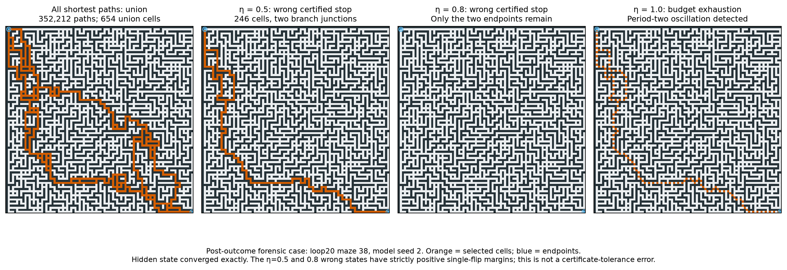

Public [boundary summary](../../../results/research/work/eta-boundary-summary.json), [per-model results](../../../results/research/work/eta-boundary-runs.csv), [paired maze data](../../../results/research/work/eta-boundary-per-maze.csv), [failure classification and energies](../../../results/research/work/cyclic-failure-classification.json), and [exact failure graph, predictions and three model state dictionaries](../../../results/research/work/cyclic-failure-case.json) support independent examination. Full logits, continuous states, couplings, hidden states, flip deltas and energy trajectories remain in the local `artifacts/research/20261114/work/eta_boundary/failure-forensics/` archive. Recheck the trial with `audit_eta_boundary.py`; reproduce the selected-case graph classification with `classify_boundary_failure.py`. Exact-board caching verified 18,432 outputs through 1,539 unique input/prediction graph checks in 6.91 seconds, reusing only byte-identical boards on the same input.

**Independent tests of the tie explanation.** Two new frozen studies tested whether equal shortest routes alone explain the retained failure. The [serial-cycle protocol](tie_controls-protocol.json) paired equal routes against two unequal-route controls on graphs with 1, 4, 8 or 12 cycles. There were 64 fresh layout/geometry clusters and three fixed models. The paired conditions match node count, edge count, degree histogram and cycle sizes; moving ports by ±2 cells changes the number of shortest paths from 2, 16, 256 or 4,096 to one. The unequal path is 4 edges shorter per cycle, an explicit remaining difference. Every one of the 2,304 model-input evaluations solved correctly at η = 0.5. The predicted 10-point joint-success loss on tied graphs is falsified: observed difference 0, no discordant cluster, and an exact one-sided 95% upper bound of 4.573 points on unseen discordant clusters. The paired bootstrap [0, 0] is retained but is not treated as a population guarantee.

The failed graph contains two 42-edge routes around one retained 84-edge cycle, longer than each individual route in the first control study. A [distinct extension](long_ties-protocol.json) therefore froze isolated cycle route lengths 28, 42 and 64, with 128 new paired layout/width clusters. Again, tied and ±2 port-shift controls match graph topology, node/edge counts and degrees; their shortest path lengths differ by 4. All 3,456 model-input evaluations solved. The primary 10-point loss hypothesis, averaged over route lengths 42 and 64, is also falsified: zero difference and a 2.313-point upper bound on unseen discordant clusters. Route 28 also had zero difference. These controls show that neither many ties nor long isolated ties are sufficient to produce the selected random-maze failure in these families. They do not explain away that failure or test all combinations of heterogeneous cycles and branches.

Public exact values are in the [serial-cycle summary](../../../results/research/work/tie_controls-summary.json), [serial-cycle runs](../../../results/research/work/tie_controls-runs.csv), [paired serial-cycle data](../../../results/research/work/tie_controls-per-layout.csv), [long-cycle summary](../../../results/research/work/long_ties-summary.json), [long-cycle runs](../../../results/research/work/long_ties-runs.csv), and [paired long-cycle data](../../../results/research/work/long_ties-per-layout.csv). Recheck with `audit_tie_controls.py` and `audit_long_ties.py`. Independent audits verify every graph's connectivity, shortest distance, exact number of shortest paths, cycle count, and matched structural counts.

**Selected-graph interventions are descriptive.** A separate [edit protocol](forensic_edits-protocol.json) chose one central interior node from each retained 42-edge branch, and 32 seeded matched noncritical nodes outside the union of all shortest paths. The choices were fixed before observing the edited outcomes. Every edit removes one degree-2 node and two edges with the same neighborhood degrees, preserves connectivity and shortest distance 204, and produces matching node/edge counts and degree histograms.

Deleting either targeted branch node restored all three models at unchanged η = 0.5. Both failing models still gave wrong certified stops after every one of the 32 matched noncritical deletions; model 0 solved all edits. The targeted graphs still contain 299,328 and 334,932 shortest paths, while controls retain 352,212. The effect is specific to the retained branch, despite abundant remaining degeneracy. These 102 model-input evaluations concern one selected graph and support no population recovery claim. All original failures remain in the earlier trial. The [edit audit](../../../results/research/work/forensic-edits-summary.json) and [per-model edit results](../../../results/research/work/forensic-edits-cases.csv) retain each outcome, energy and margin.

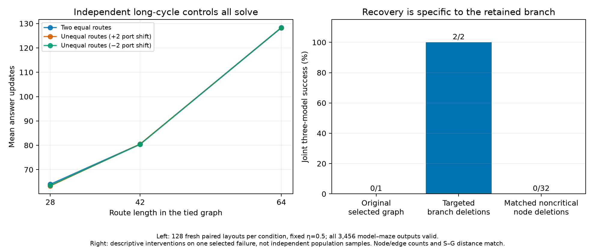

The [separate energy decomposition](../../../results/research/work/cyclic-failure-energy-decomposition.json) evaluates the saved coefficients in float64 and matches the repository energy within 1e-8. For model 2:

| State | Latent-gated links | Maze-Unique pair term | Maze-Unique bias term | Total energy |
|---|---:|---:|---:|---:|
| Valid oracle path | −2,950.772 | −32,024.525 | −26,459.681 | −61,434.979 |
| Branched η = 0.5 answer | −3,553.938 | −31,646.483 | −25,921.028 | −61,121.450 |
| Endpoint-only η = 0.8 answer | 0.905 | −33,866.126 | −29,126.670 | −62,991.892 |

The endpoint-only state's pair and bias terms improve by 4,508.590 energy units, outweighing its lost 2,951.677 units of latent-link reward. This explains its lower energy for these frozen coefficients. It does not identify which graph feature causes the coefficients to admit the invalid state. Entropy is negligible for these discrete answers; small differences from the earlier float32 totals are rounding. Full per-cell energy terms and latent log conductance, diagonal and source maps are retained alongside the full states.

**Readout versus geometry on the selected graph.** The [corrected reciprocal-swap protocol](coupling_swap_corrected-protocol.json) transferred the latent attention readout between the original graph and each of the two successful branch deletions, plus the first previously fixed noncritical deletion. Learned parameters and η = 0.5 remain fixed. Transfer uses the intersection of donor and recipient open-cell supports, with valid self coefficients preserved and deleted-node incident coefficients zeroed. There is no renormalization. Every source graph and model passed exact identity-transfer agreement with native full logits, stopping steps, stop flags and final boards before the counterfactual runs.

Transferring either targeted edit's readout onto the unchanged original geometry restores all three models. Keeping the original readout on the targeted edited geometry does not restore models 1 or 2; for branch B that reciprocal condition also fails model 0. The matched noncritical readout swaps leave models 1 and 2 failing. Thus changed readout is sufficient on the original geometry in this selected case, while physical node removal with original readout and incident-link masking is insufficient. This does not yet isolate which nonincident coefficients matter or establish population robustness. The corrected 30-arm study includes 12 matched baseline arms and 18 swaps.

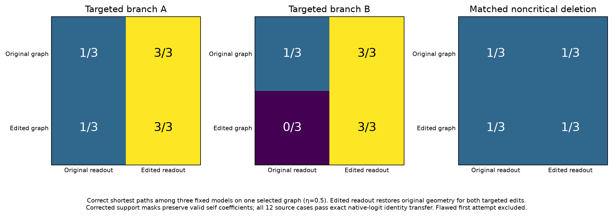

The [corrected audit](../../../results/research/work/coupling-swap-corrected-summary.json), [per-arm outcomes and energy terms](../../../results/research/work/coupling-swap-corrected-arms.csv), and [identity-transfer receipt](../../../results/research/work/coupling-swap-identity-preflight.json) retain the full evidence. Active-coefficient change statistics exclude irrelevant wall-query attention entries. For model 2, the targeted readouts change nonincident coefficients by L1 totals 3.4635 and 31.2139; reciprocal original-readout arms change none away from the deleted node. These magnitudes are descriptive, not a fitted recovery criterion.

An earlier 30-arm swap attempt was excluded because its mask incorrectly assumed zero self coefficients and did not fully mask donor wall-query outgoing coefficients. Native solver parity did not detect that error: both solver implementations received the same incorrectly transformed tensor. The corrected identity-transfer gate checks the intervention itself against each graph's unmodified native trajectory. The [excluded-attempt receipt](../../../results/research/work/coupling-swap-excluded-v1.json), flawed source, protocol and all raw outputs are preserved separately, with no causal conclusion taken from that attempt.

**Independent free-fork angle control.** The [next frozen protocol](fork_angle-protocol.json) tested whether right-angle alternatives at free degree-3 junctions cause a 10-point joint-success loss relative to opposite alternatives. Both conditions use one cycle with two equal routes of length 28, 42 or 64, plus two 16-edge tails ending at S and G. Within each of 128 new paired layout/width clusters, the conditions match node and edge counts, degree histogram, cycle perimeter, tail lengths, S–G distance and exactly two shortest paths. Independent checks verify that alternative neighboring cells interact through a diagonal pair term only in the corner condition.

All three models solved all 768 inputs at fixed η = 0.5: 2,304 valid outputs. H2l is falsified, with 0 points difference at every route length, no discordant cluster, and a 2.313-point upper bound on unseen discordant clusters. Mean updates were 51.17 versus 54.54 at route 28 and exactly 80 and 128 for both conditions at routes 42 and 64. The positive diagonal interaction coefficients range from 1.6100 to 1.6278 across the three models. The [summary and actual pair tables](../../../results/research/work/fork-angle-summary.json), [per-model runs](../../../results/research/work/fork-angle-runs.csv), [paired layout results](../../../results/research/work/fork-angle-per-layout.csv), and [all fork attention/readout measurements](../../../results/research/work/fork-angle-readouts.csv) are public. This negative result rules out the proposed large loss in this matched family; it does not isolate the readout feature responsible for the selected random-maze failure.

**Exhaustive shortest-answer energy comparison.** The [enumeration protocol](path_landscape-v2-protocol.json) closes the gap between comparing one canonical path and comparing every shortest path on the selected graph. All 352,212 shortest paths were enumerated once and checked for endpoints, open cells, orthogonal adjacency and monotone distance. An independent forward-counting and exact full-row uniqueness audit confirmed exhaustive coverage. Each path was evaluated under each frozen model's retained readout, giving 1,056,636 energy evaluations and no new neural rollouts.

| Frozen model | Minimum valid shortest energy | Maximum valid shortest energy | Disconnected endpoint energy | Endpoint − minimum valid |
|---|---:|---:|---:|---:|
| 0 | −61,423.816 | −61,102.326 | −62,970.329 | −1,546.513 |
| 1 | −61,234.872 | −60,913.976 | −62,778.547 | −1,543.675 |
| 2 | −61,439.780 | −61,118.941 | −62,991.892 | −1,552.111 |

For every model, the disconnected endpoints have lower energy than **every valid shortest-path answer**. Thus global learned-energy ranking alone need not prefer a correct shortest answer, even when a valid answer is a stable local state. This is one selected graph; the enumeration excludes longer simple paths and other binary states, and does not identify the global binary minimum. The native η = 0.5 answer for model 0 is valid but 4.445 energy units above its best shortest path; models 1 and 2 retain branched answers 316.574 and 318.331 units above their respective minima.


The exact sparse binary expansion was checked against full-grid repository energy on 256 prespecified paths and all extrema, with maximum error below 5.1e−11. Independent CPU float64 full-grid evaluation verified the minima, maxima, endpoints and native answers. Full-grid versus sparse evaluation of the same 256 paths after warmup measured 41.23–49.63× acceleration; this is an energy-enumeration optimization, not a solver speedup. Enumeration took 4.01 seconds and each full energy vector took 0.033–0.059 seconds on Work. A float64 coefficient materialization issue was corrected before any energy outputs; original source/protocol are preserved, and the executed v2 amendment is explicit.

Public [audited summary](../../../results/research/work/shortest-path-energy-summary.json), [exact ranges and timings](../../../results/research/work/shortest-path-energy-ranges.csv), [complete-distribution histogram](../../../results/research/work/shortest-path-energy-histogram.csv), [extremal paths](../../../results/research/work/shortest-path-energy-extrema.json), [PDF](../../../results/research/work/shortest-path-energy-landscape.pdf) and [SVG](../../../results/research/work/shortest-path-energy-landscape.svg) retain the result. Full path and energy arrays remain in `artifacts/research/20261114/work/path_landscape/`; regenerate and audit with `enumerate_landscape_v2.py` and `audit_landscape.py`. The canonical valid path has strictly positive free-cell flip margins for all three models, independently confirmed in the audit.

**Fresh cyclic data: screening rescues restart selection, but does not beat native inference.** The [frozen restart protocol](restart-protocol.json) evaluated 4,096 new 90×90 loop20 mazes with all three models. The reference uses native `u=3` initialization and at most 8,192 updates. Four alternative chains each use `u=3+N(0,1)` and at most 2,048 updates, so both methods have the same maximum answer-update budget. Perturbation amplitude and RNG source were frozen without tuning on the selected graph. Two selectors see the identical four candidates: lowest learned energy, or a simple S–G-path feasibility screen followed by lowest learned energy. Both require finite states and native certification. The screen uses only the supplied graph, endpoints and candidate board; shortest distance and labels are strictly evaluation-only.

| Method | Joint shortest success / 4,096 inputs | Joint losses versus native | Joint gains versus native |
|---|---:|---:|---:|
| BP AdamW training | Outside this frozen-model inference study | — | — |
| Native single initialization | 4,092 | — | — |
| Four perturbed candidates, lowest energy | 2,346 | 1,746 | 0 |
| Same candidates, feasibility then lowest energy | 4,090 | 2 | 0 |

H2m predicted that feasibility screening would improve joint success by at least 0.1 percentage point over energy-only selection of the same candidates. The measured gain is 42.578125 points: 1,744 recovered inputs, zero losses, with exact one-sided 95% bounds [41.299320, 43.864766] points. H2m is supported. This is strong fresh-data evidence against unqualified learned-energy ranking as a restart selector. It is **not** an accuracy improvement over native inference: screened restarts solve two fewer inputs, with a descriptive net-difference interval [−0.198149, 0.102846] points. Fixed-model repeats are paired measurements on each input, not additional independent trials.


All 61,440 candidate/reference outputs passed independent audit; all 4,096 token graphs are unique. There were no hidden failures, nonfinite outputs or timeouts, but 6,433 wrong certified candidate/reference outputs. Every one of those 6,433 wrong outputs contains only the disconnected endpoints; energy-only selection returns this invalid state on 5,177 model-inputs. The [complete error classification](../../../results/research/work/restart-all-error-types.json) checks all saved boards. Energy-only selection always had an eligible candidate; screened selection explicitly returned failure on 15 model-inputs with no feasible candidate. Exact-board caching reduced independent graph checks to 5,843, plus 4,096 independent shortest-distance checks; audit time was 26.20 seconds.

The native joint failures are inputs 2729, 2857, 3546 and 3820. Screened restarts fail on these same four plus 1268 and 1373. Every failed retained board among these six cases contains only the two disconnected endpoints; there are no valid longer-path explanations. Their minimum free-cell flip margin is at least 5.4843, so these are strict wrong certificates. At input 1268 all 12 noisy candidates collapse to endpoints while all three native initializations solve. All six screened failures are no-feasible outcomes, with no oracle fallback or omitted case. Full diagnostic energies, margins and graph classifications are retained in the [failure diagnostics](../../../results/research/work/restart-failure-diagnostics.json). Canonical labels are used there only to evaluate reference-path energies after outcomes.

Native answer time summed across jobs was 46.145 seconds; the four noisy answers took 221.905 seconds, or 4.809× as much. Identical shared hidden preparation took 8.054 seconds and CPU selector checks took 9.829 seconds. Mean native updates were 313.895 versus 1,276.211 summed noisy-chain updates. Equal caps therefore do not imply equal consumed compute. The two workers completed in 145.87 and 149.58 seconds, 4.92 summed GPU-minutes within the frozen 40-minute envelope. The [summary](../../../results/research/work/restart-summary.json), [per-job runs](../../../results/research/work/restart-runs.csv), [all candidate results](../../../results/research/work/restart-candidates.csv), [paired model-input outcomes](../../../results/research/work/restart-per-model-input.csv), [joint input outcomes](../../../results/research/work/restart-per-input.csv), [PDF](../../../results/research/work/restart-selection.pdf) and [SVG](../../../results/research/work/restart-selection.svg) retain the evidence. Recheck with `audit_restart.py`; regenerate public files with `export_restart.py` and `plot_restart.py`.

**Keeping the native candidate preserves accuracy without new recoveries.** The [next frozen protocol](native_restart-protocol.json) used another 4,096 fresh loop20 inputs. The four candidates now include native `u=3` and three `u=3+N(0,1)` draws, each capped at 2,048 updates; native 8,192 remains the reference. Three selectors operate on identical candidates: lowest learned energy, feasibility then energy, and feasibility then candidate node count with energy and index tie breaks. Candidate node count is observable from the returned board and does not use true shortest distance. No feasible candidate produces an explicit failure.

| Method | Joint shortest success / 4,096 inputs | Joint losses / gains versus native |
|---|---:|---:|
| BP AdamW training | Outside this frozen-model inference study | — |
| Native single initialization, 8,192 cap | 4,090 | — |
| Native + three noisy candidates, energy only | 2,687 | 1,403 / 0 |
| Same candidates, feasibility then energy | 4,090 | 0 / 0 |
| Same candidates, feasibility then node count | 4,090 | 0 / 0 |

H2n required the feasible minimum-node-count selector to lose at most 0.1 percentage point of native joint solves. Zero losses give a one-sided 95% upper bound of 0.073111 points, supporting the prespecified noninferiority criterion. There are also zero gains: all six native joint failures remain unresolved. Both feasibility selectors return no feasible answer on the same 14 model-inputs. This establishes preservation for the frozen distribution and cap; it does not establish an accuracy improvement from random restarts. Structurally, a shortest native candidate cannot be displaced by a longer path under minimum-node-count selection, provided native certifies within the candidate cap.


Every native reference certified within 2,048 updates, so its candidate prefix could be reused exactly after passing a reserved-data parity gate. There are 61,440 logical candidate/reference outcomes but only 49,152 new answer trajectories; 12,288 identical native prefixes are not counted as new evaluations. The two workers took 119.92 and 123.23 seconds, within the frozen 20 GPU-minute envelope. Equivalent candidate time, explicitly accounting for the shared native prefix, was 216.175 seconds versus 45.835 seconds for native alone; this is not a separately timed duplicate native rollout. Full independent output/selector audit took 27.60 seconds.

Public [summary](../../../results/research/work/native-restart-summary.json), [per-job runs](../../../results/research/work/native-restart-runs.csv), [logical candidate outcomes](../../../results/research/work/native-restart-candidates.csv), [model-input data](../../../results/research/work/native-restart-per-model-input.csv), [joint outcomes](../../../results/research/work/native-restart-per-input.csv), [PDF](../../../results/research/work/native-restart-selection.pdf) and [SVG](../../../results/research/work/native-restart-selection.svg) retain all comparisons and reuse accounting. Recheck with `audit_native_restarts.py`; regenerate exports with `export_native_restarts.py` and `plot_native_restarts.py`.

**Negative initial logits explain only part of the collapse.** The [paired sign-intervention protocol](sign_intervention-protocol.json) evaluated 2,048 fresh loop20 inputs with four single-output arms, each capped at 8,192 updates and η = 0.5. One fixed Gaussian draw per input is shared across all models and interventions. The arms are native `u=3`, full `u=3+N(0,1)`, the same draw with strictly negative values reset to 3, and the same draw with strictly positive values reset to 3. Exactly zero values remain unchanged in both sign interventions. Normal wall/endpoint clamping remains part of the model. There is no candidate selector.

| Initial-logit arm | Joint shortest success / 2,048 inputs | Mean changed free cells | Joint losses / gains versus native |
|---|---:|---:|---:|
| BP AdamW training | Outside this frozen-model inference study | — | — |
| Native `u=3` | 2,043 | 0 | — |
| Full Gaussian `u=3+Z` | 1,762 | 4,433.999 | 281 / 0 |
| Negative values reset to 3 | 1,907 | 4,427.997 | 136 / 0 |
| Positive values reset to 3 | 1,936 | 6.002 | 107 / 0 |

H2o predicted at least a 10-point joint-success gain from resetting negative values, relative to the full Gaussian. The measured gain is 7.080078 points: 145 gains, zero losses, with conservative one-sided 95% net-gain bounds [5.826917, 8.277996] points. The frozen 10-point hypothesis is **falsified**, while the result still shows a smaller causal rescue from removing initially negative logits. Perturbing only positive-valued logits still loses 136 native solves, so initially negative cells do not explain all failures. Conversely, changing only about six free cells per maze to their negative sampled values loses 107 native solves.


The negative-only arm fails on 112 inputs, overlapping 100 of the full Gaussian's 286 failures; 12 of its failures do not occur under full Gaussian perturbation. Thus the two components do not produce a simple nested failure set. These overlap comparisons are descriptive. All 1,591 wrong certified model-input outputs across the four arms are endpoint-only; there are no hidden failures, nonfinite outputs or timeouts. No perturbed arm recovers a native joint failure.

All 2,048 exact float32 initial Gaussian arrays and all 24,576 final-logit arrays are retained. Independent audit reconstructs the strict-sign interventions, checks every initial changed/negative/zero count, verifies prediction rounding from final logits, and checks graph validity and shortestness. The native solver matched the original implementation on 64 reserved inputs before execution. A separate reserved-input measurement selected batch 64 over 32: median answer time for the same 64 inputs fell from 0.233341 to 0.121898 seconds, a 1.914× throughput improvement, with exact board, step and stop-flag parity. This is a local batching measurement, not a cross-hardware claim. The two primary workers finished in 38.11 and 38.92 seconds; the audit took 16.96 seconds.

Public [summary and bounds](../../../results/research/work/sign-intervention-summary.json), [per-model runs](../../../results/research/work/sign-intervention-runs.csv), [per-model input outcomes and cell counts](../../../results/research/work/sign-intervention-per-model-input.csv), [paired joint outcomes](../../../results/research/work/sign-intervention-per-input.csv), [PDF](../../../results/research/work/sign-intervention.pdf) and [SVG](../../../results/research/work/sign-intervention.svg) retain the result. Recheck with `audit_sign_intervention.py`; regenerate with `export_sign_intervention.py` and `plot_sign_intervention.py`.

**Downward spatial variation matters beyond its expected mean.** The [six-arm margin protocol](margin_intervention-protocol.json) used 4,096 new inputs, all three models, η = 0.5 and 8,192 updates per arm. The same saved `3+Z` array produces upward-only `max(3,3+Z)` and downward-only `min(3,3+Z)` initial states. Native and full Gaussian arms remain controls. Two further constant controls use `3±1/√(2π)`, matching the population expected means of the rectified Gaussian arms. Their float32 stored values and realized per-input means are retained explicitly; the controls do not exactly match each finite input's realized mean.

| Initial-logit arm | Joint shortest success / 4,096 inputs | Mean free-cell initial logit | Joint losses / gains versus native |
|---|---:|---:|---:|
| BP AdamW training | Outside this frozen-model inference study | — | — |
| Native | 4,089 | 3.000000 | — |
| Full Gaussian | 3,559 | 3.000347 | 530 / 0 |
| Upward-only spatial perturbation | 4,089 | 3.399174 | 0 / 0 |
| Constant expected upward mean | 4,089 | 3.398942 | 0 / 0 |
| Downward-only spatial perturbation | 3,402 | 2.601173 | 687 / 0 |
| Constant expected downward mean | 4,089 | 2.601058 | 0 / 0 |

H2p required upward-only initialization to be noninferior within 0.1 percentage point of native joint success. Zero losses give a one-sided 95% upper loss bound of 0.073111 points, so the prespecified criterion is supported; there are also zero gains. The downward-only arm loses 687 inputs while its expected-mean constant control loses none. For these fixed perturbations, spatially varying downward changes have an effect that the corresponding uniform mean shift does not reproduce. This descriptive contrast does not establish a universal invariance to positive perturbations or identify the exact vulnerable cells.

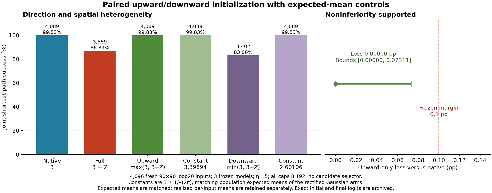

Upward-only and both constant controls produce exactly the native binary board on every one of the 12,288 model-inputs, although their first-stop update differs on 122, 141 and 205 model-inputs respectively. Full and downward-only perturbations change 1,565 and 2,027 boards. The [exact saved-output comparison](../../../results/research/work/margin-output-parity.json) retains these checks. All 3,694 wrong outputs across the six arms contain only the endpoints and are certified; there are no hidden failures, nonfinite outputs or timeouts. None of the tested initializations repairs a native joint failure.

The 73,728 final-logit arrays and 4,096 initial Gaussian arrays are retained and independently audited. The two GPU workers finished in 108.38 and 110.92 seconds. The initial audit took 49.67 seconds; caching each decompressed NPZ array once per job reduced a second complete audit to 28.26 seconds. All scientific JSON values were exactly equal after excluding timestamps, source hash and measured audit duration; the old audit source and receipt are preserved. These are one-run wall-time observations on the shared local host, not a controlled throughput benchmark. The [cache verification receipt](../../../results/research/work/margin-audit-cache-validation.json) records the comparison.

Public [summary](../../../results/research/work/margin-intervention-summary.json), [per-model runs](../../../results/research/work/margin-intervention-runs.csv), [model-input outcomes and realized means](../../../results/research/work/margin-intervention-per-model-input.csv), [joint outcomes](../../../results/research/work/margin-intervention-per-input.csv), [PDF](../../../results/research/work/margin-intervention.pdf) and [SVG](../../../results/research/work/margin-intervention.svg) retain the evidence. Recheck with `audit_margin_intervention.py`; regenerate with `export_margin_intervention.py` and `plot_margin_intervention.py`.

**Changing the continuous relaxation while preserving every binary energy.** The [source-specific derivation](binary-preserving-derivation.md) adds `λ Σ_free p(1−p)` to the continuous answer energy. The added term is zero on every binary board, so every binary energy, their ordering and every true bit-flip cost remain unchanged. Its field contribution is `λ(2p−1)` on free cells. The trained model, hidden readout and clamped fields stay fixed, and the original `flip_delta` remains the stopping certificate. The linear compensation is essential: an uncompensated diagonal term would change binary energies.

Before the scientific trial, exhaustive small-graph tests checked 2,880 binary energies and 19,200 directed flips across all three frozen models and five validation strengths. Binary energies and true flip costs were bitwise unchanged; continuous central finite differences agreed within 7.22e−9. The [validation receipt](../../../results/research/work/binary-preserving-validation.json) retains the full gate. This algebraic invariance cannot repair the binary energy ordering that favors disconnected endpoints; it permits a clean test of continuous trajectory behavior.

The [frozen trial](binary_relaxation-protocol.json) used another 4,096 fresh inputs. Three arms share the exact same full Gaussian initialization and use λ = 0, +1 or −1; the reference is native `u=3`, λ = 0. All arms use η = 0.5 and an 8,192 cap. λ is measured in native energy units and was fixed before outcomes.

| Arm | Joint shortest success / 4,096 inputs | Joint losses / gains versus native | Wrong certified model-inputs |
|---|---:|---:|---:|
| BP AdamW training | Outside this frozen-model inference study | — | — |
| Native `u=3`, λ = 0 | 4,088 | — | 22 |
| Full Gaussian, λ = 0 | 3,534 | 554 / 0 | 1,669 |
| Same Gaussian, λ = +1 | 3,832 | 259 / 3 | 772 |
| Same Gaussian, λ = −1 | 2,925 | 1,163 / 0 | 3,458 |

H2q predicted at least a 5-point gain for λ = +1 over λ = 0 with identical noisy starts. It is supported: 298 gains, zero losses, net +7.275391 points, with one-sided 95% bounds [6.408440, 8.113898] points. λ = −1 loses another 609 joint solves relative to Gaussian λ = 0. The result separates continuous-relaxation behavior from binary-energy ranking: the former improves while the latter is algebraically unchanged. λ = +1 still trails native initialization overall. Its three recoveries of native failures are descriptive, alongside 259 native solves it loses.


All wrong stops have strictly positive **original** bit-flip margins. λ = +1 has 769 endpoint-only wrong outputs and three connected branched wrong outputs, whose minimum margins are 0.466536, 0.662355 and 0.607079. The branched outputs occur at input 2302/model 0 and input 3782/models 0 and 1, each with two branch junctions. The other arms' wrong outputs are all endpoint-only, with minimum wrong margin at least 4.300137. There are no nonfinite outputs, hidden failures or timeouts. The [selected-case archive](../../../results/research/work/binary-relaxation-selected-cases.json) retains those two graphs and the three recovered native-failure inputs 541, 1902 and 1955, with all model/arm predictions and original energies. These cases were selected after the primary trial for explanation.

Every original margin, binary energy, continuous energy and modified-field residual was independently recomputed from the immutable model and original 64-input hidden-readout batches for all 49,152 outputs. Maximum discrepancy was exactly zero. The [recheck receipts](../../../results/research/work/binary-relaxation-diagnostic-recheck.json) record 4.68 and 4.74 seconds per GPU and zero new answer trajectories. Native solver parity, λ = 0 full-logit parity with the previous implementation, and traced/untraced parity passed before execution. The two primary workers took 80.34 and 82.61 seconds; the independent graph and trajectory audit took 25.50 seconds. Prespecified [continuous trajectories](../../../results/research/work/binary-relaxation-trajectories.json) retain both original and modified energies, original certificate margins and residuals.

Public [summary](../../../results/research/work/binary-relaxation-summary.json), [per-model runs](../../../results/research/work/binary-relaxation-runs.csv), [model-input diagnostics](../../../results/research/work/binary-relaxation-per-model-input.csv), [paired joint outcomes](../../../results/research/work/binary-relaxation-per-input.csv), [PDF](../../../results/research/work/binary-relaxation.pdf) and [SVG](../../../results/research/work/binary-relaxation.svg) retain the result. Recheck with `audit_binary_relaxation.py` and `recheck_binary_diagnostics.py`; regenerate with `export_binary_relaxation.py` and `plot_binary_relaxation.py`.

**The compensated relaxation also improves ordinary native initialization.** The [larger frozen trial](native_relaxation-protocol.json) used 16,384 fresh 90×90 loop20 inputs with `u=3` in both arms, comparing λ = 0 with the already fixed λ = +1. All three immutable models, η = 0.5, the 8,192 cap, original binary certificate and binary-energy invariance are retained. There is no Gaussian arm or lambda sweep. H2r specified a joint-success gain of at least 0.05 percentage point with paired one-sided uncertainty.

| Method | Joint shortest success / 16,384 inputs | Joint failures | Wrong certified model-inputs | Answer seconds |
|---|---:|---:|---:|---:|
| BP AdamW training | Outside this frozen-model inference study | — | — | — |
| Native `u=3`, λ = 0 | 16,350 (99.79248%) | 34 | 89 | 94.706 |
| Same native initialization, λ = +1 | 16,370 (99.91455%) | 14 | 36 | 112.278 |

There are **20 paired gains and zero losses**, a +0.122070 percentage-point gain. The prespecified one-sided 95% lower net-gain bound is 0.052067 points, narrowly above the 0.05-point target; its separately constructed one-sided upper bound is 0.188465. H2r is supported under the frozen decision rule. The number of failed inputs falls from 34 to 14 for this distribution and these fixed models. The binary energy ordering itself remains unchanged, so this is an inference improvement rather than a repair of the learned binary objective.


The [independent SciPy verification](../../../results/research/work/native-relaxation-statistics-verification.json) reproduces the custom binomial bounds within 1.02e−13 percentage points and audits the tail allocation. Each frozen one-sided net bound combines two marginal Clopper–Pearson bounds at α = 0.025, giving 95% one-sided coverage by the union bound without requiring gain and loss independence. **The two endpoints must not be called a conventional two-sided 95% confidence interval.** A separately reported conservative two-sided 95% interval allocates α = 0.0125 to each of four tails and gives [0.042477, 0.198781] points. It is wholly positive, but its lower end does not establish the 0.05-point target. The figure shows both constructions and uses only the public JSON summaries.

Native has 87 endpoint-only and two branched wrong model-input outputs; λ = +1 has 29 endpoint-only and seven branched wrong outputs. All are graph-infeasible, certified, and have strictly positive original margins: minima 0.582808 and 0.289343. There are no valid longer-path errors, timeouts, nonfinite states or hidden failures. The [complete failure classification](../../../results/research/work/native-relaxation-failure-classification.json) includes every wrong output and all paired gain/loss input indices. Mean updates increase from 313.952 to 348.871, and measured answer time rises by about 18.6%; the accuracy gain has a real compute cost.

The 98,304 final-logit arrays and outputs passed independent graph, trace and certificate audits. All retained original/modified energy and margin diagnostics were recomputed with maximum error zero; [rechecks](../../../results/research/work/native-relaxation-diagnostic-recheck.json) required 12.04 and 12.34 seconds per GPU and no new answer trajectories. Input verification ran on eight CPU processes during inference, checking all 16,384 graphs in 10.84 seconds; the subsequent result audit took 11.84 seconds. Primary workers completed in 147.06 and 150.49 seconds, within the frozen 20 GPU-minute envelope.

Public [summary](../../../results/research/work/native-relaxation-summary.json), [per-model runs](../../../results/research/work/native-relaxation-runs.csv), [model-input diagnostics](../../../results/research/work/native-relaxation-per-model-input.csv), [paired joint outcomes](../../../results/research/work/native-relaxation-per-input.csv), [PDF](../../../results/research/work/native-relaxation.pdf) and [SVG](../../../results/research/work/native-relaxation.svg) retain the evidence. Recheck using `audit_native_relaxation_inputs.py`, `audit_native_relaxation.py`, `recheck_native_diagnostics.py` and `verify_native_relaxation_statistics.py`; regenerate the public-data-only figure with `plot_native_relaxation.py`.

H2r protocol erratum: the inherited prose in `cohort.generator` says indices `0..4095`; the frozen `n_unique`, 64 × 256 job layout, executed generator, retained inputs and independent audit all use **0..16383**. This is a description typo, not a sample-size change. The original frozen protocol is preserved.

**Confirmation on larger mazes.** H2s changed only the grid size to 120×120 and used 16,384 fresh loop20 inputs, with the same three frozen models, native `u=3`, fixed λ = 0 versus +1, η = 0.5 and cap 8,192. The [protocol](larger_relaxation-protocol.json) froze the same ≥0.05-point primary target before generating data; this cohort is not pooled with H2r.

| Method | Joint shortest success / 16,384 inputs | Joint failures | Wrong certified model-inputs | Answer seconds |
|---|---:|---:|---:|---:|
| BP AdamW training | Outside this frozen-model inference study | — | — | — |
| Native `u=3`, λ = 0 | 16,324 | 60 | 160 | 123.591 |
| Same native initialization, λ = +1 | 16,350 | 34 | 87 | 146.216 |

The larger-size confirmation supports H2s: **27 gains and one loss**, net +0.158691 percentage points. The frozen one-sided 95% lower net-gain bound is 0.074626 points, above 0.05; its separately constructed upper bound is 0.239524. The descriptive conservative **two-sided 95% interval is [0.063100, 0.251124] points**, and also clears the target. [Independent SciPy verification](../../../results/research/work/larger-relaxation-statistics-verification.json) matches the primary calculation within 1.74e−13 points. These are fixed-model, distribution-specific results, not a universal monotonicity claim.

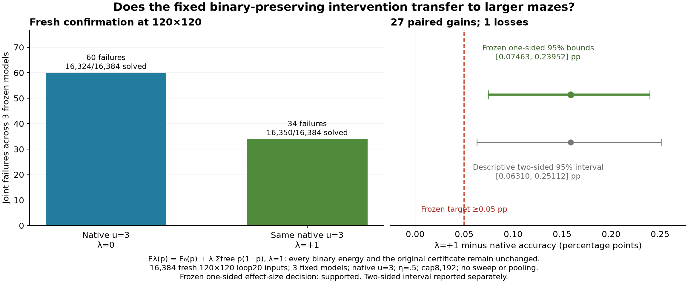

The one regression, input 13642, is informative: all three native outputs solve it, whereas all three λ = +1 outputs stop at the same connected 436-node board with two branch junctions. Their strictly positive original flip margins are 0.233856, 0.184259 and 0.112516. The [complete regression-case graph and paired outputs](../../../results/research/work/larger-relaxation-regression-cases.json) retain it for inspection. Native has 145 endpoint-only and 15 branched wrong outputs; λ = +1 has 64 endpoint-only and 23 branched wrong outputs. All 247 wrong outputs are graph-infeasible and strictly certified; there are no valid longer-path errors, timeouts, nonfinite states or hidden failures. The [classification](../../../results/research/work/larger-relaxation-failure-classification.json) retains every wrong board.

Mean answer updates rise from 414.866 to 461.119; measured answer time rises by 18.31%. Both workers finish in 201.79 and 205.29 seconds, totaling 6.78 GPU-minutes within the frozen 20-minute envelope. A reserved-data 120-grid batch32/64 benchmark measured 1.893× throughput improvement for batch64, with exact boards, steps, flags and logits; batch64 was fixed before the benchmark. Five retained live samples show GPU utilization 54–79% and 49–76% with advancing counters. The independent input audit overlaps inference and takes 19.81 seconds; the output audit takes 17.82 seconds. Every retained final diagnostic is [recomputed](../../../results/research/work/larger-relaxation-diagnostic-recheck.json) with maximum discrepancy zero in 15.94 and 16.22 seconds per GPU, with no new answer trajectories. An initial CPU audit import failed because one dependency was absent on Work; it was copied, the failed log preserved, and the successful audit rerun without affecting inference.

Public [summary](../../../results/research/work/larger-relaxation-summary.json), [per-model runs](../../../results/research/work/larger-relaxation-runs.csv), [model-input diagnostics](../../../results/research/work/larger-relaxation-per-model-input.csv), [paired joint outcomes](../../../results/research/work/larger-relaxation-per-input.csv), [PDF](../../../results/research/work/larger-relaxation.pdf) and [SVG](../../../results/research/work/larger-relaxation.svg) retain the evidence. Recheck using `audit_larger_relaxation_inputs.py`, `audit_larger_relaxation.py`, `recheck_larger_diagnostics.py` and `verify_larger_relaxation_statistics.py`; regenerate with `export_larger_relaxation.py` and `plot_larger_relaxation.py`.

**An explicitly graph-informed selective decoder keeps the gain at lower throughput cost.** H2t introduces task knowledge: accept the native output only when it is certified, finite and a valid simple path on the supplied graph; otherwise run fixed λ = +1 from the same native `u=3`. The exact checker requires both supplied endpoints, no walls, endpoint degree one, other selected degrees two, and a traversal that covers all selected cells. It uses no shortest distances, labels or shortestness-based selection. This is a new decoder derivative, not paper-native CRAM or a change confined to the energy.

Rejected inputs enter per-model queues and are processed in batches of at most 64 **at the end of the cohort**. Native accepted answers are immediately available; rejected answers wait for the cohort. The throughput gain therefore comes with deferred rejection latency, and makes no online per-input latency claim. Hidden couplings from the native pass are retained. The [frozen protocol](selective_fallback-protocol.json) specified 16,384 fresh 120×120 loop20 inputs, the three immutable models, a ≥0.05-point gain **and** ≤2% median measured answer overhead, with three complete timing repetitions and a 30 GPU-minute ceiling. All validator, gather/queue, batch preparation, fallback solve and output-transfer costs count in that overhead.

| Decoder | Joint shortest success / 16,384 inputs | Joint failures | Wrong certified model-inputs |
|---|---:|---:|---:|
| BP AdamW training | Outside this frozen-model inference study | — | — |
| Native | 16,340 | 44 | 114 |
| Always λ = +1 | 16,364 | 20 | 50 |
| Graph-informed selective λ = +1 fallback | 16,364 | 20 | 50 |

H2t supports the frozen conjunction: **24 paired gains, zero losses**, +0.146484 points, with a separately one-sided 95% lower net-gain bound of 0.071365 and upper bound of 0.217879. The independent conservative two-sided 95% interval is [0.061052, 0.228906] points. [SciPy verification](../../../results/research/work/selective-fallback-statistics-verification.json) agrees within 4.78e−13 points. Only **114 of 49,152 model-inputs** trigger fallback; 49,038 native outputs are reused exactly. The actual queued subset produces exactly the same boards, update counts, flags and logits as its always-λ counterparts, without assuming that equality in advance. Native and fallback timing repetitions also match the first repetition exactly on boards, steps and flags.

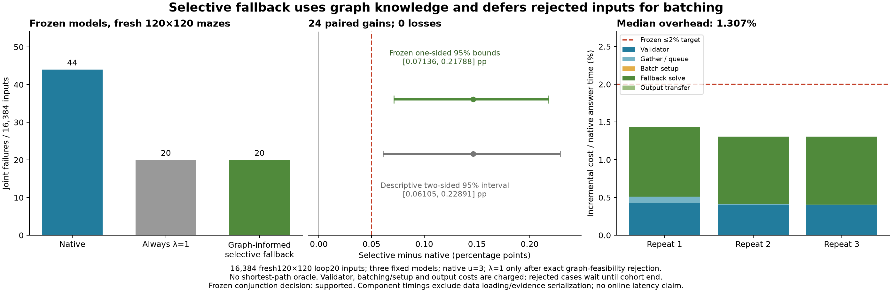

| Timing repetition | Native answer seconds | Validator seconds | Gather / queue seconds | Fallback setup + solve + output seconds | Total incremental seconds | Increment / native answer | Increment / common decoder cost |
|---|---:|---:|---:|---:|---:|---:|---:|
| 1 | 123.219 | 0.529 | 0.100 | 1.140 | 1.770 | 1.436% | 1.246% |
| 2 | 122.853 | 0.491 | 0.010 | 1.105 | 1.606 | 1.307% | 1.134% |
| 3 | 122.767 | 0.488 | 0.010 | 1.104 | 1.602 | 1.305% | 1.131% |

The frozen median answer overhead is **1.307%**, below 2%; none of the three repetitions is dropped. Median overhead relative to the component-summed common decoder cost is 1.134%. That denominator includes model loading, input transfer, hidden settling/readout, native solve and CPU output return. These decoder timings exclude archive loading, warmup and evidence serialization; the full workers take 329.19 and 335.77 seconds including that work and the always-λ control. The [complete timing receipts](../../../results/research/work/selective-fallback-timing.json) retain every component and both worker measurements. They support offline throughput, not a wall-clock service-latency guarantee.

The compiled graph checker passed 4,102 fixtures/random boards and all 98,304 saved H2s outputs against independent graph checks before the fresh trial. A separate seven-repetition alternating benchmark on identical preloaded 256-board arrays measured a 28.30× ratio of median Python to compiled validator times: 61.566 ms versus 2.176 ms, with exact parity. The [validator gate](../../../results/research/work/selective-fallback-validator-gate.json), [benchmark](../../../results/research/work/selective-fallback-validator-benchmark.json) and C source retain the correctness/performance evidence. No implementation changes were made after the scientific protocol freeze.

Native wrong outputs comprise 111 endpoint-only and three branched boards; always-λ and selective each have 39 endpoint-only and 11 branched wrong outputs. All are strictly certified graph-infeasible outputs, with minimum original margins 0.833984 for native and 0.454727 for the intervention. There are no valid-longer-path errors, hidden failures, nonfinite outputs or timeouts. The [failure classification](../../../results/research/work/selective-fallback-failure-classification.json) retains all three logical arms. The [independent GPU rechecks](../../../results/research/work/selective-fallback-diagnostic-recheck.json) reproduce all 98,418 newly retained final diagnostics with maximum error zero in 15.00 and 15.22 seconds and no new answer trajectories. The input audit overlaps inference and takes 19.88 seconds; the independent output/selection/timing audit takes 16.41 seconds.

This study has 192 paired native/always-λ jobs plus six queued fallback jobs: **98,418 new scientific trajectories**, **49,038 exact native-output reuses**, and **98,532 additional trajectories used only for the two timing repetitions**. The logical scientific table has 147,456 arm outcomes. These quantities are kept separate to avoid treating reuse or timing repeats as new independent evidence. Public [summary](../../../results/research/work/selective-fallback-summary.json), [run rows](../../../results/research/work/selective-fallback-runs.csv), [model-input outcomes](../../../results/research/work/selective-fallback-per-model-input.csv), [paired input outcomes](../../../results/research/work/selective-fallback-per-input.csv), [PDF](../../../results/research/work/selective-fallback.pdf) and [SVG](../../../results/research/work/selective-fallback.svg) retain the evidence. Recheck with `audit_selective_inputs.py`, `audit_selective_fallback.py`, `recheck_selective_diagnostics.py` and `verify_selective_statistics.py`; regenerate with `export_selective_fallback.py` and `plot_selective_fallback.py`.

**Bounding fallback delay preserves accuracy but fails the 2% cost target.** H2u uses the same graph-informed fixed λ = +1 fallback and flushes each model queue after **1,024 native inputs on its GPU**, rather than waiting for all 8,192 local model inputs. The [protocol](window_fallback-protocol.json) retained the ≥0.05-point gain and ≤2% median answer-overhead conjunction on another 16,384 fresh 120×120 loop20 inputs. Each scheduling policy independently executes its full native prefix in three alternating-order repetitions, so its measured wall latency contains no work from the competing policy.

Before fresh sampling, [prior-cohort development replays](../../../results/research/work/window-fallback-prior-cohort-pilot.json) showed median fallback-only times of 15.713, 7.727 and 1.103 seconds for 256-, 1,024- and 8,192-input windows respectively, with exact board/step/flag parity. These are explicitly prior-H2t timing-development results, excluded from fresh accuracy evidence. The fixed 1,024 window and 2% target were retained despite the unfavorable forecast.

| Decoder | Joint shortest success / 16,384 inputs | Joint failures | Wrong certified model-inputs |
|---|---:|---:|---:|
| BP AdamW training | Outside this frozen-model inference study | — | — |
| Native | 16,322 | 62 | 166 |
| Fixed 1,024-input fallback window | 16,350 | 34 | 85 |
| Cohort-end fallback control | 16,350 | 34 | 85 |

Accuracy supports the target: **28 gains and zero losses**, +0.170898 points, separately one-sided 95% bounds [0.091077, 0.246902] points. The conservative two-sided 95% interval is [0.080097, 0.258584] points; [SciPy verification](../../../results/research/work/window-fallback-statistics-verification.json) matches within 2.26e−13 points. Actual bounded and cohort-end fallback outputs agree exactly on boards, steps, flags and full logits for all 166 rejected model-inputs. The cost criterion is nevertheless **falsified**, making the frozen conjunction falsified.

| Policy | Answer overhead, repetitions 1 / 2 / 3 | Median answer overhead | Median common-decoder overhead | Fallback batches |
|---|---:|---:|---:|---:|
| Fixed 1,024-input window | 6.963% / 6.905% / 6.875% | **6.905%** | 5.983% | 46 |
| Cohort-end control | 1.333% / 1.325% / 1.321% | 1.325% | 1.149% | 6 |

All validator, gather, queue, batch setup, fallback solve and output-transfer costs are included. Both policies process the same 166 rejects; bounded flushing creates many smaller GPU batches. The complete [timing receipts](../../../results/research/work/window-fallback-timing.json) retain every component, including the fixed 2% target, and show that the cheaper cohort-end result depends on deferral.

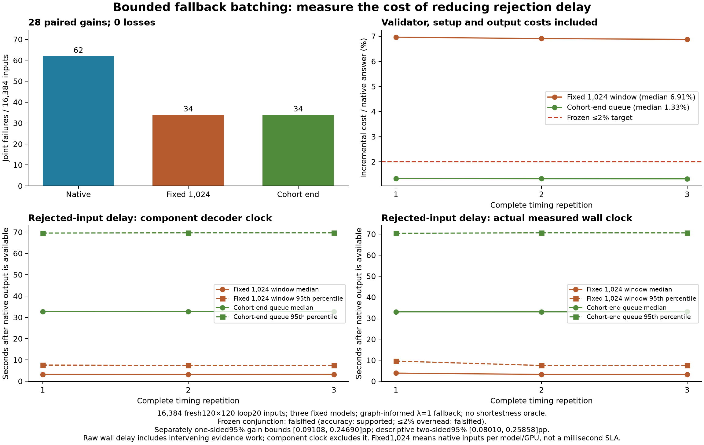

The bounded policy cuts the median-of-repetitions 95th-percentile **component-clock rejection delay** from 69.656 to 7.428 seconds; median delays are 32.677 versus 3.195 seconds. On the independently measured **actual wall clock**, median-of-repetitions 95th-percentile delays fall from 70.565 to 7.533 seconds, with medians 33.015 versus 3.224 seconds. All three repetitions appear in the figure and the [per-case latency table](../../../results/research/work/window-fallback-latencies.csv). Actual wall delay includes intervening artifact/diagnostic work; the first bounded pass also records the native output archive, explaining its higher wall-clock tail. The component clock excludes evidence work but includes every decoder component. From native output availability, the maximum count delay falls from 8,064 to 960 further native inputs of that model/GPU; measured source-ordinal maxima are 8,112 and 1,019. A fixed input-count window is not a millisecond service-level guarantee.

A new descriptive failure mode appears at input 9681: all three models produce a connected **520-node closed cycle through both endpoints**, with every selected degree equal to two. Its original flip margins are 2.630352, 2.608858 and 2.565432. The graph validator correctly rejects it because endpoint degrees must be one; both fallback schedules return the same cycle. The [cycle graph and all paired outputs](../../../results/research/work/window-fallback-cycle-cases.json) retain this counterexample. Native's 166 wrong model-input outputs comprise 151 endpoint-only boards, 12 branched boards and three closed cycles; each fallback has 54 endpoint-only, 28 branched and three closed-cycle outputs. Every wrong output is graph-infeasible and strictly certified. There are no valid-longer-path errors, hidden failures, nonfinite states or timeouts. [All wrong boards](../../../results/research/work/window-fallback-failure-classification.json) remain included.

The workers finish all six policy passes in 460.10 and 472.49 seconds, totaling 15.54 GPU-minutes within the 30-minute envelope. All 49,484 newly retained diagnostics are [independently recomputed](../../../results/research/work/window-fallback-diagnostic-recheck.json) with maximum error zero in 13.02 and 13.25 seconds per GPU. The input audit overlaps inference and takes 19.63 seconds; independent output, selection, timing and latency checks take 14.22 seconds. There are 192 native jobs plus 52 nonempty fallback batches, **49,484 new scientific trajectories**, **97,972 exact native-output reuses**, **246,424 additional timing-repeat trajectories**, and **1,026 prior-cohort pilot trajectories**. These remain separate from the 16,384 independent accuracy inputs and 147,456 logical arm outcomes.

Public [summary](../../../results/research/work/window-fallback-summary.json), [run rows](../../../results/research/work/window-fallback-runs.csv), [model-input outcomes](../../../results/research/work/window-fallback-per-model-input.csv), [paired input outcomes](../../../results/research/work/window-fallback-per-input.csv), [PDF](../../../results/research/work/window-fallback.pdf) and [SVG](../../../results/research/work/window-fallback.svg) retain the evidence. Recheck with `audit_window_inputs.py`, `audit_window_fallback.py`, `recheck_window_diagnostics.py` and `verify_window_statistics.py`; regenerate with `export_window_fallback.py` and `plot_window_fallback.py`.

**A machine-checkable global binary-objective counterexample.** The [predeclared certificate audit](global-bound-protocol.json) returns to exactly the previously selected 90×90 graph with 352,212 shortest paths. It fixes each model's archived hidden readout and clamps walls off and the two endpoints on. The new result covers **all 2^4434 assignments of the free binary answer cells**, including invalid boards and arbitrarily longer selections: for all three frozen models, the board containing **only the disconnected endpoints is the unique global binary minimum**.

The [derivation](global-bound-derivation.md) writes the exact energy difference as `ΔE(x) = Σ h_i x_i + Σ J_ij x_i x_j`. It reconstructs every pair-table, open-cell bias, self-link and clamped-endpoint contribution from the stored float32 parameters and readout, interpreted as exact dyadic constants. Binary entropy is constant and cancels. For each negative edge `Jij = −wij`, an allocation `aij ∈ [0,wij]` gives `−wij xi xj ≥ −aij xi − (wij−aij) xj`. Positive pair terms are nonnegative. Once every resulting node slack is positive, every nonempty free-cell selection has positive excess energy.

| Frozen model | Primary half-allocation minimum slack | Secondary exact asymmetric minimum slack | Conservative float64 comparison allowance | Exact primal–dual gap |
|---|---:|---:|---:|---:|
| 0 | −10.711779: no certificate | **4.358498394556** | 0.000182577 | 5.07e−11 |
| 1 | −10.695391: no certificate | **4.348048597639** | 0.000182266 | 4.90e−11 |
| 2 | −10.670771: no certificate | **4.385751843531** | 0.000182397 | 5.97e−11 |

The primary half-allocation condition fails for all three models, and that failure is retained. The **predeclared secondary** asymmetric-allocation LP succeeds. Its floating allocations are converted to exact rationals and checked independently against every edge bound and node slack. For any nonempty selected free set `S`, the certificate proves `E(S) − E(endpoints) ≥ minimum_slack × |S| > 0`. The normalized nonnegative dual is also checked exactly and brackets the best uniform allocation slack within 6e−11. The dual's tightness is secondary; the verified primal inequality proves the binary minimum.

The [standalone verifier](verify_global_bound.py) independently rebuilds all 4,434 unary and 7,308 pair coefficients per model from public raw constants, checks the separate bias/Maze-Unique/self/clamped contributions, then checks every exact allocation, node slack and dual value. It uses only Python and NumPy. The complete [public proof files](../../../results/research/work/global-bound/), [summary](../../../results/research/work/global-bound-summary.json) and [verification receipt](../../../results/research/work/global-bound-verification.json) include the graph, fixed readouts, answer tensors, coefficient numerators/denominator, allocation, dual and source/checkpoint/readout hashes. An isolated public-file-only run passed without accessing private artifacts or upstream sources, with Torch, SciPy and the local study module explicitly blocked from import:

```bash
python research/20261114/work/verify_global_bound.py
```

Source-to-coefficient checks compare **every unary and pair coefficient** with the original float64 implementation, using nine separated grid-color probes to recover all local interactions. The maximum pair discrepancy is 3.56e−15. Another 256 fixed random binary boards per model agree with the repository's full energy difference within 1.46e−11. The exact certificates exceed the independently reconstructed conservative float64 allowance by more than 23,855 times. Exact rational proof operations themselves have no roundoff; the numerical allowance checks correspondence to float64 evaluation and makes no promise about arbitrary float32 summation order. Reconstruction and source checks take 2.10 CPU seconds, all three secondary LPs and exact checks 0.23 seconds, and the independent public verifier about 0.6 seconds. No new GPU inference, training, graph search or population sample is added.

This is an objective-level counterexample on **one fixed graph and three fixed readouts**. It does not claim a continuous free-energy minimum or generalize to other graphs or exact hidden solves. It strengthens the earlier shortest-path enumeration: every nonempty free binary answer has higher energy, not only the 352,212 shortest paths. Because the compensated λ intervention leaves all binary energies unchanged, it cannot remove this global binary optimum; its observed accuracy gains change inference trajectories toward useful higher-energy answers.

**Scope control: a direct supplied-graph solver is substantially faster and exact here.** Because the selective decoder now consumes explicit graph-feasibility information, the [frozen BFS control](bfs-scope-control-protocol.json) evaluates ordinary single-threaded compiled breadth-first search on the same 16,384 H2u graphs. This is an explicitly **hand-engineered task solver**, not a learned or CRAM baseline, and its results are never fed into CRAM inference or selection.

BFS solves **16,384 / 16,384** inputs with independently verified shortest length, endpoints, walls, degrees and connectivity. Its three complete preloaded solve-and-output timings are **1.67963, 1.67904 and 1.66444 CPU seconds**, including input-wrapper handling, output/status/distance allocation, queue and parent allocation, traversal, path reconstruction and full CPU board output. The median is **1.67904 seconds**, or **0.102481 ms per graph**, on one AMD Ryzen Threadripper 9980X thread. Archive token loading and stacking are measured separately at 0.28218, 0.28346 and 0.28678 seconds; OS caches are not flushed. Artifact serialization and independent checking are outside solver time.

| Method / scope | Correct shortest outputs / measured output count | Complete measured compute | Average compute per output |
|---|---:|---:|---:|
| BP AdamW training | Outside this frozen-model inference study | — | — |
| Hand-engineered BFS, one CPU thread | **16,384 / 16,384** | **1.679 CPU seconds** | **0.102481 ms / graph** |
| Native CRAM, three fixed models on two GPUs | 48,986 / 49,152 | 141.219 summed GPU component seconds | 2.873111 ms / model-input |
| Graph-informed cohort-end fallback | 49,067 / 49,152 | 142.822 summed GPU component seconds | 2.905711 ms / model-input |
| Graph-informed fixed-1,024 fallback | 49,067 / 49,152 | 149.637 summed GPU component seconds | 3.044365 ms / model-input |

The CRAM rows reuse the complete H2u decoder components, including setup, hidden settling, CPU outputs and any validator/fallback costs. Their workload is **three fixed-model outputs per graph**; BFS returns one exact path per graph. The normalized figures are averages per model-input, not three independent accuracy samples and not parallel wall latency. CPU and GPU hardware differ. Under this explicit compute comparison, the cohort-end decoder uses about **28.35×** the time per output of direct BFS; bounded fallback uses about **29.71×**. The supplied unweighted graph already permits an exact polynomial-time shortest-path solver, so these experiments do not establish a practical shortest-path-solving advantage for learned CRAM or the graph-informed derivative.

Five solver fixtures cover a unique detour, tied shortest paths, disconnected endpoints, a missing goal and duplicate starts. All three timing repetitions produce exactly identical boards and distances. An independent eight-process audit checks every output in 19.62 seconds against the frozen input distances and a separate graph/Dijkstra checker. Public [summary and workload comparison](../../../results/research/work/bfs-scope-control-summary.json), [per-input distances and verdicts](../../../results/research/work/bfs-scope-control-per-input.csv) and [all output boards](../../../results/research/work/bfs-scope-control-outputs.npz) retain the evidence. The [C solver](bfs_scope_solver.c), [timing runner](bfs_scope_control.py) and [independent audit](audit_bfs_scope.py) are public; regenerate with `export_bfs_scope.py`. These reused-input CPU control runs add no new independent inputs or learned-model evaluations to the research totals.

**Objective-training comparison: ranking is repaired, validity collapses.** H2v responds to the binary-objective counterexample with a matched training intervention. Its [protocol](contrastive-training-protocol.json), SHA256 `0656e576103ad828d2e0c5d2f3f59e3db9e5ef2cdeab267c5399944206557e47`, was frozen before the six scientific fits and fresh test generation. Both trainable arms start from the same original checkpoint per model, use the actual original 1,000 training mazes, and update only `T`, `b`, and `kappa` with BP AdamW: 400 updates, batch 64, learning rate 0.01, zero weight decay, betas (0.9, 0.999), epsilon 1e−8. Their initial weights, seed-specific minibatch order, optimizer settings, computational graph and update count match. The hidden `mu` and `beta` tensors and their cached readouts are fixed. This is answer-only fine-tuning, deliberately different from the original full-model training.

The intervention adds a fixed weight 0.1 times the batch mean of `softplus(1 + (E(label) − E(endpoints)) / max(1, selected free label cells))` to the original pseudolikelihood loss. The continued-PL control constructs the same graph with weight zero. There is no weight, update, learning-rate or target-accuracy sweep. The [original training arrays](../../../results/research/work/contrastive-training/training-arrays.npz) are loaded directly through the upstream loader, not recreated: array archive SHA256 `2ac6e034cf09cfdfcd00d81b51088c66042b2ec738e39b33496a75aa70aa777d`; source CSV SHA256 `25f9e39b5aee16967da41ba63b2d1d75cf608c2360d8a1419d827f9859dbafa0`. The [manifest](../../../results/research/work/contrastive-training/training-manifest.json), frozen readouts, schedules, original and final checkpoints, optimizer states and all 400-update traces are public under `results/research/work/contrastive-training/`.

The fresh evaluation contains 4,096 independent 120×120 loop20 inputs from base seed 2026111508, with no overlap with the previous four cohorts. All arms use the native decoder with initial logit 3, η = 0.5, cap 8,192 and identical hidden readouts; there is no graph-informed selection, lambda intervention, shortestness oracle or output repair. A ranking success requires every fixed model's float64 normalized `E(label) − E(endpoints)` to be below −1e−6. A task success requires all three outputs to be independently valid shortest paths, finite, certified and hidden-converged. Model repeats do not increase the independent sample count.

| Arm | Joint label-over-endpoints rankings / 4,096 | Joint valid shortest paths / 4,096 | Wrong certified model outputs / 12,288 | Answer timeouts / 12,288 | Summed answer seconds |
|---|---:|---:|---:|---:|---:|
| BP AdamW, continued PL | 0 | 4,089 | 19 | 0 | 28.577 |
| BP AdamW, PL + fixed 0.1 contrastive term | 4,096 | 0 | 11,767 | 521 | 420.518 |
| Unchanged original checkpoints | 0 | 4,088 | 22 | 0 | 30.810 |

The ranking endpoint supports the frozen ≥90-point gain target: **4,096 gains, zero losses**, +100 percentage points; the separately one-sided 95% lower net bound is 99.819960 points. The separate solve-quality endpoint is **falsified**: **4,089 lost joint solves, zero gains**, with one-sided 95% loss-probability lower bound 99.679242 points, far above the 0.1-point noninferiority margin. The frozen conjunction is therefore **falsified**. Ranking success cannot replace task success, and ranking one shortest label against one negative board does not establish a global energy optimum. The continued-PL control's one net additional joint solve versus unchanged checkpoints is descriptive, not an established improvement claim.

The [independent statistical check](../../../results/research/work/contrastive-training-statistics-verification.json) reproduces the custom exact bounds within 2.45e−12 percentage points. Separately one-sided endpoints are not presented as a two-sided 95% interval; the descriptive conservative two-sided net intervals are [99.786148, 100] points for ranking and [−99.940487, −99.512005] points for solve accuracy. No simultaneous 95% coverage claim is made across the two separately frozen endpoints.

The [numerical gate](../../../results/research/work/contrastive-training/numerical-gate.json) independently reconstructs the half-pair/link energy, checks pseudolikelihood using brute single-cell energy flips, verifies gradients for all 23 parameters under both loss weights, and confirms that a small contrast-only gradient step reduces the contrastive loss and normalized energy gap. Maximum finite-difference error is 4.56e−12. All cached training readouts match recomputation exactly. Every fresh ranking is independently recomputed with a separate direct energy formula, maximum normalized discrepancy 3.49e−13; every saved output receives an independent graph audit. All 36,864 native energy/margin/readout diagnostics are [recomputed](../../../results/research/work/contrastive-training-diagnostic-recheck.json) with maximum error zero. Training-state audits verify exactly 400 optimizer steps and unchanged hidden parameters in every fit.

The primary evaluation workers finish in 296.86 and 295.67 seconds, plus 7.11 and 7.02 seconds for training, within the frozen 30 GPU-minute envelope. The contrastive arm costs 14.72× the continued-PL answer time. Its mean recorded stopping/cap count is only 366.16 versus 387.24 for PL, because its 521 long-running inputs keep entire 64-input batches active; stopped rows stay frozen but batch computation continues. There are no nonfinite outputs or hidden convergence failures. The 11,767 wrong certified boards show that the validity collapse is not explained solely by timeouts. Final training minibatch PL losses increase to approximately 0.026–0.029 under the contrastive objective, while continued PL decreases to approximately 1.9–2.1e−5; these are training diagnostics, not test-quality substitutes.

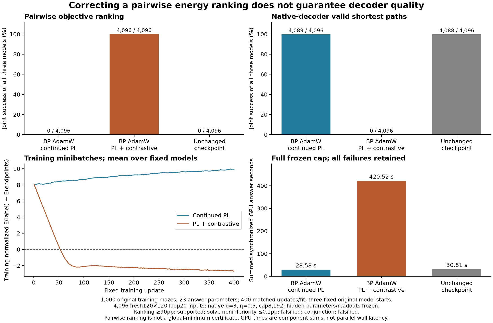

[PDF](../../../results/research/work/contrastive-training.pdf), [SVG](../../../results/research/work/contrastive-training.svg), [complete audit](../../../results/research/work/contrastive-training-summary.json), [per-input paired outcomes](../../../results/research/work/contrastive-training-per-input.csv), and [per-model outcomes](../../../results/research/work/contrastive-training-per-model-input.csv) retain the result. The [training runner](contrastive_training.py), [objective](contrastive_objective.py), [independent audit](audit_contrastive.py) and [exporter](export_contrastive.py) are public. The figure uses public files only.

**Post-outcome diagnosis: a dense competing region remains.** Reusing the saved readouts without new fits or answer trajectories, the [landscape diagnostic](../../../results/research/work/contrastive-training-landscape-summary.json) checks the canonical shortest labels and a new diagnostic board selecting every open cell. The contrastive canonical labels are locally flip-stable on **12,282/12,288** model-inputs, with median minimum flip margin **+0.218912**. No label has a favorable single-cell off-path addition; six have a favorable removal of one path cell. These are checks of one canonical shortest label per maze, not every alternative shortest path.

Nevertheless, selecting all open cells has lower energy than that label on **all 12,288** contrastive model-inputs: median `E(all open) − E(label)` is **−15,252.35**. That fully selected board is itself never flip-stable. Every actual contrastive decoder output is disconnected and branched, with median **15 components**, **730 branch nodes**, and **92.259% of free cells selected**; ranges are 4–33 components, 649–807 branch nodes and 91.676–92.892% selected. The matched PL and unchanged outputs select a median 3.281% of free cells. The failures therefore occupy a dense competing region even though nearly every canonical shortest label remains a local minimum. Enforcing only nonnegative label flip margins would already accept nearly all these labels and would not address the demonstrated dense competitor.

The [full landscape rows](../../../results/research/work/contrastive-training-landscape.csv), [structural classifications](../../../results/research/work/contrastive-training-structures.csv), and [first-input example](../../../results/research/work/contrastive-training-dense-case.json) preserve these descriptive findings separately from the frozen H2v endpoints. All 36,864 output structures are classified, with 144 independent set-based cross-checks. A separate direct half-pair/link energy calculation checks the first input of every shard for each model and arm, verifying both the all-open energy difference and the minimum-label-flip energy difference on 144 fixed cases. These diagnostics add no independent inputs or inference evaluations.

**Source-only feasibility: local and two-sided density constraints can coexist.** Before another training run, H2w asks whether the existing 23-parameter answer architecture can satisfy the desired constraints on the actual 1,000 original training mazes at all. The [frozen protocol](training-feasibility-protocol.json), SHA256 `ea25a2a233d47334d114a08e2f97ffbf4f8afbe79428d88dab3d7ab8ea6e7abb`, leaves all 23 real coordinates unrestricted and fixes each original hidden readout. There is no coefficient bound, sign restriction, gauge fixing or proximity penalty. For every training maze it requires: each free-cell change to its canonical label raises energy by at least 1; `E(endpoints) − E(label)` is at least the number of selected free label cells; and `E(all open) − E(label)` is at least the number of unselected free cells. Thus the sparse and dense ranking constraints have unit margins after their respective count normalization.

All these expressions are linear in the answer parameters when the hidden readout is fixed. Each model has **566,329 inequalities**: 564,329 free-cell flips and 2,000 sparse/dense ranking constraints. The numerical linear program finds a feasible point for each model, and the prespecified factor-two rescaling leaves room for verification error. Every inequality passes independent upstream energy/flip recomputation and a separate [public-only NumPy verifier](verify_training_feasibility.py) using direct pair-table and directed-link arithmetic. The verifier checks **all 1,698,987 inequalities** in 1.24 seconds and subtracts a conservative float64 error allowance even when extended precision is available.

| Frozen readout | Candidate maximum absolute parameter | Minimum normalized constraint margin | Conservative arithmetic allowance | Certified minimum after allowance |
|---|---:|---:|---:|---:|
| Model 0 | 1,177.164 | 2.000000 | 0.001210 | 1.998790 |
| Model 1 | 977.346 | 2.000000 | 0.001004 | 1.998996 |
| Model 2 | 1,245.271 | 2.000000 | 0.001280 | 1.998720 |

H2w is **supported for these training arrays and fixed readouts**: the requested local and sparse/dense ranking inequalities are jointly feasible in the architecture. This is not a test-generalization, decoder-convergence or global-optimality result. The candidate weights are much larger than the original maximum absolute parameters of approximately 14.7. These are arbitrary feasible witnesses, not minimum-norm solutions; they do not show that large weights are necessary or constitute an invariant measure of dynamical stiffness. No target inputs, gradient training or answer trajectories enter this screen.

The three linear programs and their source checks finish in **14.331 seconds**, or **14.339 seconds including the preserved failed import**, within the single frozen 120-second CPU envelope. The first launch attempted a Python 3.12 SciPy dependency from the Python 3.13 upstream interpreter and failed before constructing coefficients or calling the solver. A matching dependency path was prepared without changing the frozen scientific source; an external watchdog charged that failed 0.007879-second attempt against the same budget. Numerical solver infeasibility would have remained inconclusive without an independently verified exact Farkas certificate, but no such claim is needed here. Tiny feature coefficients reach approximately 5e−26; verification uses the complete retained readouts, so the solver's numerical treatment of tiny entries is not assumed correct.

The [summary and provenance](../../../results/research/work/training-feasibility-summary.json), [independent verification](../../../results/research/work/training-feasibility-verification.json), [candidate vectors and receipts](../../../results/research/work/training-feasibility/solver-summary.json), [linear feature builder](feasibility_features.py), [numerical/source gate](gate_feasibility.py), and [solver runner](training_feasibility.py) are public. The verifier needs only NumPy and the published H2v training arrays/readouts plus H2w candidate files; it imports neither Torch nor SciPy and runs no optimizer. These three source-only feasibility solves add no model–maze evaluations or independent inputs.

**Minimum coordinate norm: large coefficients are required by these unit margins.** H2x keeps exactly the H2w constraints and 23 real coordinates but minimizes their maximum absolute coefficient. The [new frozen protocol](training-min-norm-protocol.json), SHA256 `2b6ba6daa177a6bdec98d15ff8e970ebf3f902c98a945d2a473725678c456a79`, supplies a separate 120-second CPU envelope. It optimizes the norm variable rather than imposing an artificial coefficient bound. There are no new target inputs, gradient fits or answer trajectories.

| Frozen readout | Certified minimum-norm lower bound | Verified feasible upper bound | Relative interval width | Lower bound / original maximum coefficient |
|---|---:|---:|---:|---:|
| Model 0 | 300.486755 | 300.579573 | 0.030880% | 20.3728× |
| Model 1 | 300.633470 | 300.726378 | 0.030895% | 20.4108× |
| Model 2 | 302.145587 | 302.239433 | 0.031050% | 20.5230× |

The upper bounds come from saved feasible parameter vectors after a prespecified small safety rescaling and a complete independent recheck of all inequalities. The lower bounds use **14, 12 and 11 nonnegative weighted constraints**, respectively. For rows `A_i θ ≥ 1` and nonnegative weights λ, summing gives `sum(λ) ≤ (Aᵀλ)ᵀθ ≤ ||Aᵀλ||₁ ||θ||∞`. Therefore `sum(λ) / ||Aᵀλ||₁` is a lower bound. Each support row and weight is reconstructed exactly as a rational number from the retained float32 readout and binary energy changes. This argument does not assume exact numerical dual stationarity or trust the solver's reported optimum.

The independent [public verifier](verify_training_min_norm.py) checks all 1,698,987 primal inequalities and all **37 exact rational support rows** in 1.46 seconds. Each interval is far narrower than the frozen 1% target. The three optimization runs, coefficient extraction and certificate preparation take 12.95 CPU seconds in total. The [summary](../../../results/research/work/training-min-norm-summary.json), [verification](../../../results/research/work/training-min-norm-verification.json), [candidate vectors and certificates](../../../results/research/work/training-min-norm/solver-summary.json), [solver](training_min_norm.py), and [exporter](export_training_min_norm.py) retain the evidence. The verifier uses only public files and NumPy, with no solver, Torch or feature-builder dependency.

The exact lower-bound certificates each use one sparse endpoint-ranking constraint and 13, 11 or 10 local-flip constraints, with **zero dense-negative constraints**. Thus the same lower bounds already hold for the sparse-ranking plus local-margin subset. The fully feasible upper-bound witnesses also satisfy that subset, so its optimum lies in the same reported interval. The dense-negative requirement is not responsible for these lower bounds.

A direct algebraic consequence of the existing certificates, without another optimization, is `||θ||∞ ≥ c_local · m + c_endpoint · r`, where `m` is the common local-flip margin and `r` the normalized endpoint-ranking margin. The two coefficients are separately retained as exact rationals and are approximately 150.243377 for model 0, 150.316735 for model 1 and 151.072794 for model 2. Even at `m = 0, r = 1`, nonnegative label stability plus a unit endpoint-ranking margin requires a maximum coefficient of at least **150.24–151.07**, more than ten times the original coordinate norm. This does not rely solely on imposing a positive unit local margin.

These norms are **coordinate, gauge and margin dependent**. They do not provide an invariant stiffness bound, a test-accuracy result, or proof that the canonical labels are global minima over all boards. Uniformly scaling binary energy changes its margins and preserves its binary ranking; the continuous decoder also contains entropy and has its own dynamics. The result establishes the minimum scale for the stated training constraints in the declared parameter representation, not a universal requirement for successful maze solving.

**Norm-matched LP transfer: ranking generalizes, native solving fails.** H2y tests the verified minimum-norm primal vectors after one positive scale per model: original maximum absolute answer parameter divided by the primal's maximum absolute parameter. One float32 cast gives exactly the original coordinate maxima, 14.749387, 14.729138 and 14.722316. The [cast gate](../../../results/research/work/lp-transfer/cast-gate.json) independently verifies all **1,698,987 source inequalities remain strictly positive**, with certified minimum margins 0.0490695, 0.0489774 and 0.0487105. No source models or training arrays are changed. The comparator is the frozen H2v continued-PL BP AdamW fit; LP and BP use different objectives and compute budgets, so this is a model/objective comparison, not an equal-compute optimizer benchmark.

The [frozen protocol](lp-transfer-protocol.json), SHA256 `f94b666a7f4eb18edf5f6137cf119ef8c8a53f3bd8a9adfaccde54b3fa431573`, declares 4,096 fresh 120×120 loop20 inputs, seed base 2026111509, the three fixed hidden readouts, native `u=3`, η = 0.5, batch 64 and cap 8,192. It separately requires a ≥90-point gain in joint-three-model label ranking below **both** endpoints and all-open negatives, and solve noninferiority within 0.1 points against BP AdamW PL. There is no inference fallback, target tuning or cap extension. The original-training first-64 gate had already shown that every norm-matched LP input reached the cap; that unfavorable result was preserved and no settings were changed.

| Answer model | Joint label below both negatives / 4,096 | Joint valid shortest / 4,096 | Wrong certified model-inputs / 12,288 | Timeouts / 12,288 | Answer seconds |
|---|---:|---:|---:|---:|---:|
| BP AdamW continued PL | 0 | 4,082 | 41 | 0 | 28.720 |
| LP primal, matched maximum coefficient | 3,952 | 0 | 0 | 12,288 | 492.143 |
| Unchanged original checkpoint | 0 | 4,080 | 46 | 0 | 30.790 |

The ranking endpoint is **supported**: 3,952 gains and zero losses, +96.484375 points, with separately one-sided 95% net bounds 95.783964 and 97.027234. The solve endpoint and conjunction are **falsified**: zero gains and 4,082 losses, −99.658203 points; the one-sided 95% loss lower bound is 99.466176 points, far above the 0.1-point margin. Independent [SciPy verification](../../../results/research/work/lp-transfer-statistics-verification.json) gives conservative two-sided 95% net intervals [95.676861, 97.099298] for ranking and [−99.829517, −99.283942] for accuracy. These are separate endpoints, with no simultaneous-coverage claim. Every arm's label is below the all-open negative on all inputs/models; endpoint ranking distinguishes the arms. Ranking against these two explicit boards does not establish global label optimality.

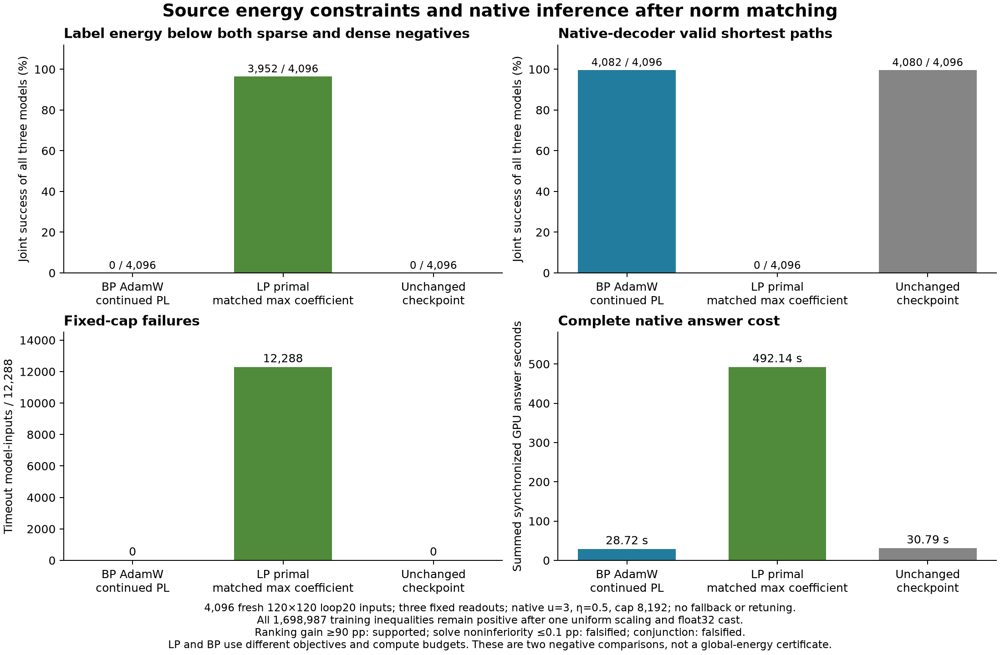

All LP outputs are finite and share converged hidden readouts, but none is a valid path or endpoint-only board; all reach exactly 8,192 answer updates. Per model-input, LP ranks the label below both negatives in 11,870 of 12,288 cases, versus zero for both controls. BP AdamW PL solves 12,247 model-inputs and unchanged solves 12,242. The independent graph and ranking audit checks every outcome, with maximum direct normalized-energy discrepancies 1.83e−12 for endpoints and 6.11e−14 for all-open. [Independent input checks](../../../results/research/work/lp-transfer/independent-input-audit.json) verify Dijkstra distances, uniqueness and exact disjointness from H2r–H2v. All **36,864 saved readout/energy/minimum-flip diagnostics** are [recomputed exactly](../../../results/research/work/lp-transfer-diagnostic-recheck.json), with maximum error zero and no new answer trajectories.

The workers finish in 330.88 and 336.85 seconds, or 11.13 summed GPU-minutes within the frozen 30-minute envelope. Live checks observed both devices at 70–71% utilization with advancing counters; archive serialization explains brief gaps between completed batches. Input checks take 6.18 seconds and the independent CPU outcome audit 107.93 seconds. Synchronized answer timings above exclude shared hidden computation and archive writing. They are one scientific pass, with no runtime confidence interval or H200 speed claim.

**Saved-state diagnosis: fractional near-equilibria fail after rounding.** A post-outcome diagnostic evaluates the native map once and twice from every retained final logit array, without using the stopping mask. These 73,728 map probes at 36,864 existing states are descriptive; they add no independent inputs or primary trajectories and give no post-cap success credit. All 12,288 LP states have free-cell continuous residual at most **6.2943e−5** (median 1.2398e−5). Their two-step return error is at most 4.7684e−5, and every rounded board stays exactly unchanged after both probes. Every LP board remains uncertified: the median board has **838 energy-lowering binary flips**, with median minimum margin −0.133677. The median LP state has 1,127 free probabilities in (0.45, 0.55), and rounding changes its field by a maximum-norm median 14.2902. This supports a fractional near-equilibrium/rounding failure diagnosis, rather than a large-amplitude period-two oscillation. Finite-precision residuals and two probes do not prove exact equilibrium, global convergence or absence of longer cycles.

The BP and unchanged controls are already binary-certified when they stop; their continuous residuals need not be small. Their median residuals are 0.17334 and 0.11086 respectively, and both probes also leave every rounded control board unchanged. The [full diagnostic summary](../../../results/research/work/lp-transfer-dynamics.json), [GPU0 state rows](../../../results/research/work/lp-transfer/dynamics/per-state-gpu0.csv), [GPU1 state rows](../../../results/research/work/lp-transfer/dynamics/per-state-gpu1.csv) and nine deterministic first-input representatives retain the evidence. The public-only [NumPy verifier](verify_lp_dynamics.py) independently reconstructs the full field from pair-table and directed-link energies at four states per representative, checks the two maps and recorded residuals, and obtains maximum float64-versus-float32 field error 1.97e−5. One archive prefetch overlaps decompression with device work; the diagnostic workers finish in 5.29 and 5.24 seconds, including approximately 2.62/2.61 seconds waiting for archives and 2.08/2.05 seconds for probes/transfers. These are diagnostic costs, separate from primary inference.

Public [summary](../../../results/research/work/lp-transfer-summary.json), [run rows](../../../results/research/work/lp-transfer-runs.csv), [model-input rows](../../../results/research/work/lp-transfer-per-model-input.csv), [paired input outcomes](../../../results/research/work/lp-transfer-per-input.csv), [PDF](../../../results/research/work/lp-transfer.pdf) and [SVG](../../../results/research/work/lp-transfer.svg) retain the H2y evidence. Recheck with `audit_lp_inputs.py`, `audit_lp_transfer.py`, `recheck_lp_transfer.py`, `verify_lp_statistics.py` and `verify_lp_dynamics.py`; regenerate using `export_lp_transfer.py` and `plot_lp_transfer.py`.

**Penalizing fractional states preserves binary energies but still fails solving.** H2z adds exactly `4 Σ_free p(1−p)` to the norm-matched LP continuous energy. The added term is zero on every binary board, so every binary ranking and flip certificate is unchanged. The fixed λ = 4 was chosen from curvature, without a target sweep: the coordinate second derivative is `1/[p(1−p)] − 2κ₀aᵢ₀ − 8`. Since all three LP self-link coefficients are positive and attention is nonnegative, this derivative is below −3.9595 whenever `0.45 < p < 0.55`. Such a state cannot be a continuous local minimum. This argument guarantees neither convergence nor correct rounding.

The [source gate](../../../results/research/work/lp-relaxation/numerical-gate.json) verifies exact binary-energy invariance on all 32 boards of a five-free-cell fixture for each model, independently checks all 480 flips against energy differences, and checks the added field against the autograd derivative of the explicit regularizer. On the actual first 64 training inputs per model, both LP variants remain finite but all 384 source trajectories reach the cap. These unfavorable source results are retained without retuning. The [protocol](lp-relaxation-protocol.json), SHA256 `3caeef8da51b0af9530215991af170c5f3c7fecd58bd18af1ce9b87e0ea65968`, freezes 4,096 fresh 120×120 loop20 inputs, seed base 2026111510, three fixed readouts, native `u=3`, η = 0.5, batch 64 and cap 8,192. It separately tests a ≥90-point joint solve gain over LP native and noninferiority within 0.1 points against frozen BP AdamW PL. No graph fallback, target tuning or cap rescue is allowed.

| Answer decoder | Joint valid shortest / 4,096 | Valid shortest model-inputs / 12,288 | Wrong certified stops | Timeouts | Answer seconds |
|---|---:|---:|---:|---:|---:|
| BP AdamW continued PL, native | 4,084 | 12,254 | 34 | 0 | 28.405 |
| LP primal, native λ = 0 | 0 | 0 | 0 | 12,288 | 491.855 |
| LP primal, fixed λ = 4 | 0 | 0 | 0 | 12,288 | 526.096 |

Both endpoints and the conjunction are **falsified**. Against LP native there are zero gains and zero losses, with separately one-sided 95% net bounds ±0.090020 points, far below the 90-point target. Against BP PL there are zero gains and 4,084 losses, −99.707031 points; the one-sided 95% loss lower bound is 99.525759 points. Independent [SciPy checks](../../../results/research/work/lp-relaxation-statistics-verification.json) agree within 2.59e−12 points. Conservative two-sided 95% net intervals are [−0.106926, 0.106926] against LP native and [−99.863171, −99.347361] against BP PL. These are separate endpoints with no simultaneous-coverage claim. LP and BP retain different training objectives and compute budgets.

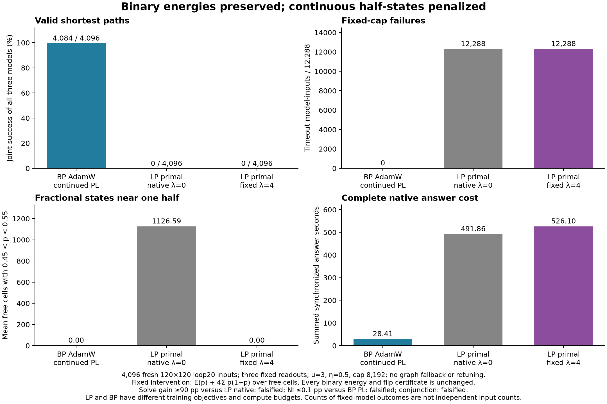

The intended continuous-state change occurs: **none of the λ = 4 free probabilities lies in (0.05, 0.95)**, whereas LP native has a median 1,182 such cells and 1,127 in (0.45, 0.55). Yet all 12,288 λ = 4 rounded outputs equal the supplied **all-open board**, selecting 7,895 cells each; the [exact array-identity audit](../../../results/research/work/lp-relaxation/output-identities.json) checks every output. Neither control produces an all-open output. Every LP output is finite with converged hidden state. The modified λ = 4 field residual is at most 2.28882e−5, with median 3.81470e−6, but the median original binary flip margin is −0.218253. The original continuous-field residual is approximately 4, as expected for the changed field. These results show that removing probabilities near one half is insufficient for original-binary certification in this experiment; a small modified residual alone is not a valid-solution certificate.

All **36,864 saved readout, energy, margin, residual and fractional-count diagnostics** pass [exact GPU recomputation](../../../results/research/work/lp-relaxation-diagnostic-recheck.json), taking 8.01 and 8.07 seconds with no new answer trajectories. A separate [public-only NumPy verifier](verify_lp_relaxation_states.py) checks original/modified fields and binary flips on 144 deterministic final states: the first input of each shard, every model and arm. It reconstructs pair-table/link arithmetic independently, with maximum errors 1.09e−5 for binary margins, 1.42e−5 for original residuals and 1.02e−5 for modified residuals; all fractional counts agree. The [verification](../../../results/research/work/lp-relaxation-independent-state-verification.json) and [fixture manifest](../../../results/research/work/lp-relaxation/state-fixtures/manifest.json) retain every selected constant. The verifier passes with Torch, SciPy, study, solver and feature-builder imports blocked.

An independent scalar counterexample makes the limitation precise. Let `E(p)=p log p+(1−p)log(1−p)+0.1p+4p(1−p)`. The native η = 0.5 map is `T(u)=0.5u+0.5[−0.1+4(2 sigmoid(u)−1)]`. Exact rational bounds on logarithms prove a strict local minimum with `39/40 < p* < 49/50`. They also prove that `T` maps `[3, log 49]` into itself with Lipschitz constant at most 0.69. Thus initialization `u=3` converges to that fixed point and rounds to **1**, even though flipping the binary answer to **0 lowers the energy by 0.1**. The [proof code](certify_scalar_relaxation.py) and [exact rational certificate](../../../results/research/work/lp-relaxation/scalar-counterexample.json) establish this analytic example without numerical root finding. It shows that binary-energy preservation and removal of near-half minima do not imply correct binary certification. It is an illustration independent of maze outcomes, not a proof of the full maze failure mechanism or a new model-input evaluation.

The primary workers finish in 577.32 and 590.27 seconds, **19.46 summed GPU-minutes** within the frozen 30-minute envelope. [Live inventory and counters](../../../results/research/work/lp-relaxation/live-inventory.jsonl) record useful utilization around 65–74% and advancing batches; the verification jobs are queued behind the primary workers. Input distance, uniqueness and prior-cohort disjointness checks take 6.31 seconds. The graph audit overlaps inference; its 551.53-second elapsed time includes waiting for completed archives and is not a standalone CPU compute measurement. Synchronized answer timings exclude shared hidden settling and evidence serialization; this is one scientific pass, with no runtime confidence interval.

Public [summary](../../../results/research/work/lp-relaxation-summary.json), [run rows](../../../results/research/work/lp-relaxation-runs.csv), [model-input rows](../../../results/research/work/lp-relaxation-per-model-input.csv), [joint input outcomes](../../../results/research/work/lp-relaxation-per-input.csv), [PDF](../../../results/research/work/lp-relaxation.pdf) and [SVG](../../../results/research/work/lp-relaxation.svg) retain the evidence. Recheck with `audit_lp_relaxation_inputs.py`, `audit_lp_relaxation.py`, `recheck_lp_relaxation.py`, `verify_lp_relaxation_statistics.py`, `verify_lp_relaxation_states.py` and `classify_lp_relaxation.py`; regenerate with `export_lp_relaxation.py` and `plot_lp_relaxation.py`.

**Discrete descent restores certification and 72.9% joint solving.** H2aa changes only the LP inference procedure, retaining the same binary energy and frozen model/readout. It starts from the all-open binary board, without any continuous prefix. Each sweep visits parity colors `(row mod 2, column mod 2)` in order `(0,0), (0,1), (1,0), (1,1)`. A phase flips every free cell of that color whose original binary energy change is below −1e−8. Cells of one color do not interact through the radius-one pair tables or nearest-neighbor gated links, so the phase's energy change equals the sum of its individual flip changes. The decoder stops after a complete sweep with no eligible flips, or reaches the fixed 512-sweep cap.

The decoder promotes the unchanged float32 parameters and readouts exactly to float64. This is an explicit decoder and arithmetic derivative, not native CRAM or an extension of an earlier timed-out run. Its [protocol](binary-coordinate-protocol.json), SHA256 `f0b19a7d562b289574d6137ce979032d290e266a254f758010078912461cf308`, freezes 4,096 fresh 120×120 loop20 inputs, seed base 2026111511, three fixed models, and native BP PL / LP controls at `u=3`, η = 0.5 and cap 8,192. A common independent original-energy float64 certificate at tolerance −1e−6 and graph-valid shortest-path check scores all arms. No graph search, validation-based selection, label access or repair enters the decoder. It tests a ≥90-point joint solve gain over LP native and noninferiority within 0.1 points against BP PL separately.

The [source correctness gate](../../../results/research/work/binary-coordinate/numerical-gate.json) enumerates all 32 boards of a five-free-cell fixture for each model. Exact rational energy arithmetic checks all 480 single flips, 960 same-color subset identities, and 1,152 phase/board energy changes. Changed phases strictly decrease energy; clamping, final certificates and batch-versus-single stopping behavior pass. On the first 64 actual training inputs per model, all 192 source runs certify within 19 sweeps. Precomputing the binary linear and pair coefficients yields a **2.19–2.33× ratio of median reference to cached solve-loop time** in two alternating source repetitions, with exactly matching boards, sweeps, flags and flip counts. This is a source solve-loop comparison; cache setup and cold-start effects are recorded separately. Production answer timings include cache construction.

| Answer decoder | Joint valid shortest / 4,096 | Valid shortest model-inputs / 12,288 | Wrong certified stops | Timeouts | Answer seconds |
|---|---:|---:|---:|---:|---:|
| BP AdamW continued PL, native | 4,084 | 12,253 | 35 | 0 | 28.487 |
| LP primal, native continuous | 0 | 0 | 0 | 12,288 | 489.912 |
| LP primal, four-color binary descent | 2,987 | 9,005 | 3,283 | 0 | 15.551 |

The decoder gains **2,987 inputs with zero losses** over LP native, +72.924805 points. Its separately one-sided 95% net bounds are 71.445754 and 74.281065 points: a large improvement, but the frozen ≥90-point endpoint is **falsified**. Against BP PL there are zero gains and 1,097 losses, −26.782227 points; the one-sided 95% loss lower bound is 25.644422, so noninferiority and the conjunction are also **falsified**. Independent [SciPy checks](../../../results/research/work/binary-coordinate-statistics-verification.json) agree within 1.60e−11 points. Conservative two-sided 95% net intervals are [71.229162, 74.471879] against LP native and [−28.365878, −25.133825] against BP PL, without a simultaneous-coverage claim.

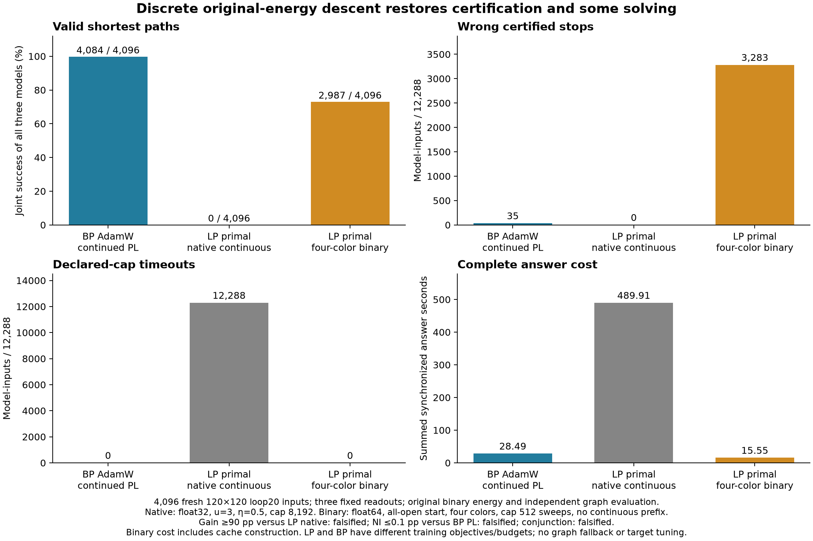

Every binary output certifies, with minimum original flip margin at least **0.000239049**. The solver needs 78–145 sweeps, median 114; these sweeps each contain four phases and are not interchangeable with native continuous updates. No binary run times out or becomes nonfinite, and all hidden readouts converge. The 15.551 answer seconds include 0.193 seconds of cache setup. The complete workers take 314.50 and 323.72 seconds, **10.64 summed GPU-minutes**, within the frozen 30-minute envelope. [Live measurements](../../../results/research/work/binary-coordinate/live-inventory.jsonl) show 70–74% utilization with advancing counters. These are one-pass measurements on Blackwell; the arms use different decoders and BP/LP training objectives, so this is not an equal-compute optimizer or H200-speed comparison.

The [exact GPU recheck](../../../results/research/work/binary-coordinate-diagnostic-recheck.json) reproduces all 36,864 retained readouts, original energies and margins with maximum discrepancy zero in 8.04 and 8.06 seconds, without new answer trajectories. The cached binary margins differ from upstream float64 arithmetic by at most 2.18e−15. A [public-only NumPy verifier](verify_binary_states.py) independently reconstructs the energy and every free-cell flip for 144 deterministic final boards, plus 48 canonical-label diagnostics, using direct extended-precision pair-table and directed-link sums. Final-board energy discrepancy is at most 1.17e−10 and flip discrepancy 3.56e−15. The [full verification](../../../results/research/work/binary-coordinate-independent-state-verification.json) and [fixture manifest](../../../results/research/work/binary-coordinate/state-fixtures/manifest.json) retain the constants. Input audits independently verify shortest distances, uniqueness and disjointness from all declared prior cohorts.

**The remaining failures include both local traps and objective errors.** Every binary output is connected and contains the entire canonical shortest path. All 3,283 wrong outputs add branches: median two branch nodes and 19 extra cells, with maxima 14 and 319. None is an endpoint-only board, an all-open board, a disconnected component collection, or a valid longer path. The [structure rows](../../../results/research/work/binary-coordinate-structures.csv) cover all 12,288 binary outputs, with 48 independent set-based classifier checks.

Every canonical label is itself single-flip stable, with minimum margin at least 0.0133643. Among the 3,283 wrong outputs, **2,620 have higher energy than the label**, consistent with local trapping, while **663 have lower energy than the label** under the unchanged learned objective. There are no ties within 1e−6 among the wrong outputs; the closest nonzero gaps are +0.000739878 and −0.00220081 for `E(label)−E(output)`. Better search alone cannot repair an objective preference for an invalid board over the label. The [landscape rows](../../../results/research/work/binary-coordinate-landscape.csv) and [combined diagnosis](../../../results/research/work/binary-coordinate-diagnosis.json) retain these separate findings. Labels are used only for post-outcome evaluation; no output is selected or repaired using them. Both GPU diagnostic workers take approximately 5.44 seconds, and add no primary trajectories or independent inputs.

For every binary run, the recorded number of individual flips `F` equals initial selected count minus final selected count. Writing removals as `R` and additions as `A`, `F=R+A` and `S₀−S_f=R−A`, so the equality implies `A=0`, conditional on the recorded counter being correct. The frozen helper increments that counter by the changed-bit mask and applies `1−p` exactly at those binary cells. A separate [source event-counter check](../../../results/research/work/binary-coordinate/source-counter-verification.json) independently counts actual transitions between successive phase boards for 96 exhaustive source states and verifies both identities and the stored counters. Target per-phase event traces were not retained, so no independent event-by-event target audit is claimed. The counter evidence indicates deletion-only trajectories that leave connected branched supersets of the label, rather than trajectories that lose the canonical path and later restore it.

Public [summary](../../../results/research/work/binary-coordinate-summary.json), [run rows](../../../results/research/work/binary-coordinate-runs.csv), [model-input rows](../../../results/research/work/binary-coordinate-per-model-input.csv), [joint input outcomes](../../../results/research/work/binary-coordinate-per-input.csv), [PDF](../../../results/research/work/binary-coordinate.pdf) and [SVG](../../../results/research/work/binary-coordinate.svg) retain the evidence. Recheck with `audit_binary_inputs.py`, `audit_binary_coordinate.py`, `recheck_binary_coordinate.py`, `verify_binary_statistics.py`, `verify_binary_states.py` and `classify_binary_outputs.py`; regenerate with `export_binary_coordinate.py` and `plot_binary_coordinate.py`.

The generator, worker source, protocol hashes, immutable model copies, launch receipts, worker logs, per-batch counters, and all predicted boards are retained. There are 1,450 planned jobs, including six H2v fits, with 794,366 new model–maze–arm evaluations, plus 6 descriptive selected-graph jobs with 132 arms: 1,456 included jobs and 794,498 new evaluations in total. The latter include 12 explicit matched baseline arms. The 153,600 H2v training minibatch presentations are separate from evaluation counts. The 12,288 exact native-prefix reuses, 147,010 selective native-output reuses, 344,956 timing-repeat trajectories, 1,026 prior-cohort pilot trajectories, 384 H2z source-gate trajectories, and 1,056,636 exhaustive energy evaluations, source decoder checks/timing replays, mathematical validation checks, source-only feasibility/minimum-norm solves, diagnostic replays/map probes and excluded 30-arm attempt are separate. The original reproduction remains unchanged. Timing reflects PyTorch inference and CPU launch overhead on Blackwell; these experiments establish no H200 speedup. H2v supplies a matched answer-only BP AdamW training control, not a new full baseline-architecture reproduction. Further work is separate from these completed totals.

### H2ab: fitting the mined training failures is feasible

The unchanged H2aa binary decoder produced 285, 286, and 284 wrong outputs on the original 1,000 training mazes for each fixed model, respectively. All 855 were certified local minima. Every wrong board was retained, including duplicates if any, with its training index, full board, and Hamming distance to the canonical label. An independent graph checker validated all 1,000 labels and classified all 3,000 outputs. These are reused training inputs, not new test evidence.

The falsifiable source hypothesis was that all three 23-parameter answer models can satisfy the earlier label-flip and endpoint/all-open ranking constraints together with `E(negative) − E(label) ≥ Hamming(negative, label)` for every mined negative. It is supported by independently verified feasible witnesses. A single fixed HiGHS solve per model, followed by the prespecified doubling of its candidate, used 12.184 aggregate CPU wall-seconds within the 120-second budget. Numerical solver minima are not certified minimum norms.

| Model seed | Retained wrong boards | Witness maximum coefficient | Certified minimum normalized margin |
|---|---:|---:|---:|
| 0 | 285 | 678.6772 | 1.999303 |
| 1 | 286 | 680.5934 | 1.999301 |
| 2 | 284 | 690.3999 | 1.999291 |

The direct extended-precision verifier checked all 1,699,842 inequalities, every negative mapping, and the source graph classifications. It also passed with Torch, SciPy, the numerical solver, the training script, and the linear feature builder blocked from import. GPU mining took 1.553 and 1.273 worker seconds; CPU classification and independent arithmetic verification were timed separately. These witnesses establish feasibility for the listed source inequalities only. They do not establish global label optimality, successful decoding after refitting, or transfer to new mazes.

The H2ab [summary](../../../results/research/work/hard-negative-feasibility-summary.json), [frozen protocol](hard-negative-feasibility-protocol.json), [independent certificate](../../../results/research/work/hard-negative-feasibility/independent-verification.json), [import-isolation check](../../../results/research/work/hard-negative-feasibility/import-isolation.json), and [public verifier](verify_hard_negative_feasibility.py) preserve the source evidence.

### H2ac: one hard-negative round improves transfer but leaves a baseline gap

The [frozen protocol](hard-negative-transfer-protocol.json) tests whether the H2ab source-only fit improves joint success by at least 10 percentage points over the earlier LP binary decoder, and separately whether it is noninferior within 0.1 percentage point to BP AdamW continued PL. Each witness was uniformly scaled once to its original model's maximum answer coefficient, cast once to float32, and frozen before generating any test data. All 1,699,842 training inequalities remain positive after a conservative arithmetic allowance, with minimum certified margins 0.04263–0.04345. No additional source mining, coefficient selection, decoder tuning, or target labels entered this fit.

The unchanged four-color decoder uses the same float64 promotion, all-open start, threshold −1e−8 and cap of 512 sweeps as H2aa. The cached solver remains exactly equal to the uncached original-energy reference on source gates and is approximately 2.33× faster in source solve-loop timing. The test uses 4,096 fresh 120×120 loop20 inputs, generator base 2026111512, three fixed readouts, and paired controls. Independent input checks establish uniqueness, valid shortest labels, and no overlap with eight earlier cohorts.

| Arm | Joint solved / 4,096 | Model-input solved / 12,288 | Wrong certified | Timeouts | Answer seconds |
|---|---:|---:|---:|---:|---:|
| BP AdamW continued PL, native | 4,088 | 12,266 | 22 | 0 | 29.0273 |
| Earlier LP, binary decoder | 2,964 | 8,944 | 3,344 | 0 | 15.6591 |
| Hard-negative LP, binary decoder | **3,956** | **11,868** | 420 | 0 | 15.4268 |

The new fit gains 992 inputs and loses none versus the earlier LP, a **24.21875 percentage-point gain**. The separately one-sided 95% net bounds are [22.8233, 25.5610] percentage points, supporting the prespecified gain of at least 10. It gains none and loses 132 versus BP PL; the one-sided 95% lower bound on the loss rate is 2.78150 percentage points. **Noninferiority within 0.1 point is falsified**, so the conjunction is falsified. These endpoints have separate confidence statements; repeated fixed models do not multiply the number of independent inputs. BP and LP use different fitting objectives and budgets, so this is not an equal-compute optimizer comparison.

All outputs are finite, all hidden solves converge, and both binary arms stop with valid local energy certificates. The new fit takes 77–148 sweeps, median 113. Its summed answer cost includes 0.09715 seconds of coefficient-cache setup; the earlier LP includes 0.19097 seconds. Worker wall-times are 69.687 and 70.431 seconds, totaling 2.335 GPU-minutes within the 20-minute envelope. These timings describe one scientific pass, with rotated arm order, and are not a runtime confidence interval. Live utilization and per-batch counters confirm forward progress; output compression and archiving explain intermittent idle samples.

All 36,864 saved-state energy, margin and readout diagnostics reproduce exactly on GPU without new answer trajectories. A public-only NumPy checker independently verifies 144 deterministic boards and 48 canonical-label states: maximum energy error 2.33e−10 and flip-margin error 3.56e−15. It passes with Torch, SciPy, the study driver, decoder and linear feature builder blocked from import. Independent SciPy confidence limits agree within 1.24e−11 percentage points.

The remaining 420 wrong model-input outputs are all connected branched supersets containing the complete canonical label; median two branch nodes and 59 extra cells, maximum 12 branches and 259 extra cells. Of these, 346 have higher energy than the label and 74 have lower energy; none is tied within 1e−6. Every label is single-flip stable. This preserves evidence for both local trapping and an objective preference for some wrong boards. Saved total counters imply deletion-only trajectories conditional on the counters being correct; target per-phase event traces were not retained. The source event-counter checks apply to the unchanged decoder and remain separate from target evidence.

See the [summary](../../../results/research/work/hard-negative-transfer-summary.json), [paired inputs](../../../results/research/work/hard-negative-transfer-per-input.csv), [model-input results](../../../results/research/work/hard-negative-transfer-per-model-input.csv), [diagnosis](../../../results/research/work/hard-negative-transfer-diagnosis.json), [independent state verification](../../../results/research/work/hard-negative-transfer-independent-state-verification.json), [statistics verification](../../../results/research/work/hard-negative-transfer-statistics-verification.json), and [figure](../../../results/research/work/hard-negative-transfer.png).

Completed totals are now 1,498 planned jobs and 831,230 primary scientific model–maze–arm evaluations; including six descriptive jobs and 132 arms, 1,504 jobs and 831,362 evaluations. H2ab's 3,000 training-source mining trajectories and three LP solves remain separate, as do source gates, independent audits, saved-state diagnostics and timing repeats. These research derivatives do not alter the original reproduction.

### H2ad: a second source round adds margin constraints, not energy-order reversals

The [frozen source protocol](second-hard-negative-feasibility-protocol.json) mines the unchanged decoder on all original 1,000 training inputs using the H2ac coefficients. It retains every earlier H2w and H2ab row and tests whether all three systems remain feasible with at least one genuinely new negative board per model. Before mining, it also declares separate endpoints for new boards, new exact normalized constraint vectors, and violations of the unit Hamming-normalized margin under the previous **unscaled** H2ab feasibility witness.

| Model seed | Wrong source outputs | New boards | New exact rows | Prior unit-margin violations | Feasible witness maximum coefficient |
|---|---:|---:|---:|---:|---:|
| 0 | 5 | 3 | 3 | 2 | 684.1270 |
| 1 | 5 | 3 | 3 | 2 | 686.1777 |
| 2 | 4 | 3 | 3 | 2 | 696.8620 |

All 14 wrong outputs are retained, including five rows already present in H2ab. Board identity includes its original training index. Constraint identity compares exact rational 23-coordinate normalized vectors against every earlier row; all repeated rows remain in the LP. Nine boards and nine constraint rows are genuinely new. Six new rows violate the old unit margin, with normalized values approximately 0.2954–0.5685. **All 14 negatives already have energy above their labels.** The remaining novel row per model has normalized margin 34.39–37.53. This intervention strengthens margins for source local traps; it does not reverse a wrong source energy ordering.

The feasibility hypothesis is supported by independent primal certificates. One fixed solve per model, retaining the earlier 855 negative rows plus these 14 rows, takes 12.168 aggregate CPU wall-seconds within the 120-second envelope. All 1,699,856 retained inequality rows pass direct extended-precision verification; the minimum certified normalized margin is 1.999284. Numerical minimum-norm solutions are not certified norm optima. The 3,000 source trajectories add no independent test inputs.

A separate public-only checker recomputes integer pair histograms and exact rational directed-link sums. Every new row contains a fractional pair/bias coordinate, which algebraically excludes equality with all 564,329 single-flip rows per model. It then compares every endpoint/all-open and earlier mined row, verifies all new-row identities, and exactly checks the prior-witness margins. The complete verifier, including all source graph classifications and primal inequalities, takes 3.752 seconds and also passes with Torch, SciPy, the solver, the mining/novelty implementation, and the linear feature builder blocked from import. Source mining takes 1.553 and 1.288 GPU worker seconds; source graph classification and novelty accounting are separately timed.

See the [summary](../../../results/research/work/second-hard-negative-feasibility-summary.json), [independent primal and novelty verification](../../../results/research/work/second-hard-negative-feasibility/independent-verification.json), and [public verifier](verify_second_hard_negatives.py).

### H2ae: the second margin round has an inconclusive one-point gain

The [frozen protocol](second-negative-transfer-protocol.json) uses the H2ad witnesses after one original-norm match and float32 cast. All 1,699,856 source inequality rows remain positive, with certified minimum margins 0.04224–0.04310. The intervention strengthens unit margins for source local traps; every newly mined source negative was already above its label in energy. The H2aa binary decoder is unchanged. The fresh cohort contains 4,096 independent 120×120 loop20 mazes, base seed 2026111513, with independent shortest-label, uniqueness and prior-cohort disjointness checks.

| Arm | Joint solved / 4,096 | Model-input solved / 12,288 | Wrong certified | Timeouts | Answer seconds |
|---|---:|---:|---:|---:|---:|
| BP AdamW continued PL, native | 4,077 | 12,236 | 52 | 0 | 29.1006 |
| First source round LP, binary | 3,955 | 11,868 | 420 | 0 | 15.6697 |
| Second source round LP, binary | **3,986** | **11,961** | 327 | 0 | 15.4352 |

The second round gains 31 inputs and loses none versus the first round: +0.756836 percentage point. The separately one-sided 95% net bounds [0.424776, 1.072562] straddle the prespecified one-point improvement, so **that hypothesis is inconclusive**. It gains none and loses 91 versus BP PL; the one-sided 95% lower bound on the loss rate is 1.85619 points, falsifying noninferiority within 0.1 point. The conjunction is falsified. Fixed models are repeated measurements on the same inputs, not extra independent samples; endpoint confidence statements are separate. LP and BP have different fitting objectives and budgets.

All outputs are finite, hidden solves converge, and all binary outputs pass their local energy certificates. The new decoder takes 77–146 sweeps, median 113. The table includes 0.19265 and 0.09734 seconds of binary coefficient-cache construction, respectively. Worker walls are 69.720 and 70.338 seconds, or 2.334 GPU-minutes within the 20-minute envelope. All 36,864 retained diagnostics recheck exactly; 144 independent final-board and 48 label checks have maximum energy error 1.17e−10 and flip error 1.78e−15. The independent verifier also passes with the solver, Torch, SciPy, and feature-builder imports blocked. Independent SciPy confidence calculations agree within 3.48e−12 percentage points.

All 327 wrong outputs are connected and branched. Of these, 213 have higher energy than the canonical label, 114 lower, and none is tied within 1e−6. These comparisons concern the supplied canonical valid-shortest label; they do not prove an invalid output beats every valid shortest solution. Three wrong model-input outputs, all from input 2722, miss 177 canonical cells; the first-round control already misses 171 there. Another ten **correct** model-input outputs use alternate shortest paths and are counted solved by the independent graph checker. The canonical labels are locally unstable in these 13 model-input cases; the remaining 12,275 are locally stable. The diagnosis therefore separates label identity, graph correctness, and energy order.

Public [summary](../../../results/research/work/second-negative-transfer-summary.json), [paired outcomes](../../../results/research/work/second-negative-transfer-per-input.csv), [model-input rows](../../../results/research/work/second-negative-transfer-per-model-input.csv), [diagnosis](../../../results/research/work/second-negative-transfer-diagnosis.json), [independent verification](../../../results/research/work/second-negative-transfer-independent-state-verification.json), [confidence verification](../../../results/research/work/second-negative-transfer-statistics-verification.json), and [figure](../../../results/research/work/second-negative-transfer.png) retain the evidence.

Completed fresh-study totals are 1,546 planned jobs and 868,094 primary model–maze–arm evaluations; including six descriptive jobs and 132 arms, 1,552 jobs and 868,226 evaluations. H2ab and H2ad source mining, source-only feasibility solves, gate replays, diagnostics and timings remain separate.

### H2af: the leaf gate fails, and source decoding really regresses

The [frozen source screen](leaf-removability-protocol.json) tests strict removability of every false-positive free leaf in the current H2ae decoder's wrong training outputs. A leaf must be selected, absent from the canonical training label, and have exactly one selected north/east/south/west neighbor. Every eligible leaf is retained. The protocol declares a model uninformative if any wrong board has no such leaf; it does not discard those boards to obtain a feasible subset.

| Model seed | Wrong / 1,000 source inputs | Eligible leaf rows | Distinct exact leaf rows | Wrong boards without a leaf |
|---|---:|---:|---:|---:|
| 0 | 233 | 496 | 6 | 2 |
| 1 | 114 | 224 | 3 | 2 |
| 2 | 233 | 496 | 6 | 2 |

**The predeclared no-leaf gate fails in all three models.** The affected training indices are 578 and 683. Consequently no feasibility LP or conditional Farkas LP was run; the source feasibility question is uninformative under this protocol. Its solver entry/eligibility checks take 0.126 seconds. The 3,000 source trajectories are kept separately from fresh-test counts, and all wrong boards and all 1,216 eligible leaf rows remain available.

The source regression from the first-round fit's 5, 5 and 4 wrong outputs is real under the frozen decoder. A full read-only replay checks all 3,000 source inputs with both the cached and upstream-reference flip calculations: boards, sweeps, stopping flags and flip counters match exactly. It independently confirms original coefficient-norm matching, the single cast, checkpoint values, unchanged hidden tensors and exactly recomputed hidden readouts. The maximum final-margin discrepancy is 1.78e−15. These 6,000 replay trajectories add no independent observations. A separate NumPy/Fraction audit validates the 1,000 training labels, independently classifies every output, checks every source certificate, reconstructs each leaf mask and exact flip cost, and confirms all canonical training labels remain locally stable. The extra margin constraints therefore preserve the source label inequalities while substantially worsening this decoder's source basins.

Every selected leaf has a **strictly positive** removal cost under the current objective: ranges 0.3125–12.3845, 5.2438–12.3717 and 0.3427–12.1762 by model. This is not a zero-cost tie or rounding artifact. All leaf-removal rows differ from prior constraints because their scalar products under the previous cast model are negative, while every prior normalized row has a certified positive margin. Repeated exact leaf rows are identified and retained.

The leafless outputs contain the complete canonical label and have cycle ranks three and one. Their extra four-connected components contain 12 and 8 cells. Removing each complete extra component already lowers energy by approximately 0.51 and 0.34; these component-removal conditions coincide with earlier canonical-label ranking rows. The current one-bit decoder cannot execute those improving block moves. This source diagnosis uses labels to identify the erroneous components and is **not** an inference procedure: any future decoder must choose candidate moves without target labels.

The [public source audit](../../../results/research/work/leaf-removability/independent-source-verification.json), [selection records](../../../results/research/work/leaf-removability/leaf-selection.json), [summary](../../../results/research/work/leaf-removability-summary.json) and [independent verifier](audit_leaf_selection.py) retain the failed gate and regression evidence. No fresh cohort was consumed for this screen.

### H2ag: all strict leaf constraints are jointly feasible

The [separate frozen protocol](leaf-block-feasibility-protocol.json) preserves H2af's failed leaf gate. It reuses all its source outputs, retains all 1,216 leaf-removal rows, and includes each whole false-positive component from the six leafless model-input boards. The six normalized component rows are exact duplicates of existing canonical-label ranking rows and are retained explicitly. They already favor removing those components and do not make the one-bit decoder execute a block move.

All three systems are feasible. A single fixed primal LP per model, followed by the prespecified doubling, takes 12.794 aggregate CPU wall-seconds within the 120-second budget. No conditional Farkas solve is needed. The coordinate maxima are 5,620.5583, 5,419.5890 and 5,298.5223; these are coordinate- and margin-dependent witness norms, not certified minima or invariant stiffness measures. The independent checker verifies all **1,701,078 inequality rows**, all source identities and selection masks, and the exact six duplicate mappings. Certified minimum margins after the arithmetic allowance are at least 1.99422. It also passes with Torch, SciPy, the numerical solver, mining code and linear feature builder blocked from import.

The [public evidence](../../../results/research/work/leaf-block-feasibility-summary.json), [full verification](../../../results/research/work/leaf-block-feasibility/independent-verification.json) and [independent verifier](verify_leaf_block_feasibility.py) establish the stated source feasibility only. No new source trajectories or fresh test inputs are used in this LP study.

### H2ah: fitting leaf removability repairs most source decoding

The [source-only decoder gate](leaf-decoder-gate-protocol.json) uniformly scales each H2ag witness to its original maximum coefficient, casts once, and uses the unchanged all-open four-color decoder. Every one of the 1,701,078 signed constraints stays positive after casting, with minimum certified margins 0.00523–0.00554. The prespecified descriptive target is at least 50% fewer wrong model-inputs than H2af's retained 580 source failures; no case may be excluded.

The new fit leaves **3 wrong outputs per model, 9 total**, always at original training indices 268, 578 and 683. It gains 571 model-inputs and loses none, a **98.4483% source-error reduction**. The descriptive target is met. All outputs are finite and locally certified, with no timeouts; the maximum is 25 sweeps. GPU worker wall-times are 1.611 and 1.276 seconds. These are the original training inputs, with three fixed models; this is not evidence of independent test generalization.

The public-only [independent audit](../../../results/research/work/leaf-decoder-gate/independent-verification.json) reclassifies all 6,000 paired source boards, checks the norm match and exact cast, verifies all 3,000 new final-state certificates and all source labels, and agrees with retained margins within 1.93e−16. It passes with the implementation and model-framework imports blocked. See the [summary](../../../results/research/work/leaf-decoder-gate-summary.json) and [verifier](verify_leaf_decoder_gate.py). The 3,000 new source trajectories and 3,000 reused baseline outcomes are separate from fresh-study totals.

### H2ai: label-free block moves also repair most source failures

This [separately frozen intervention](graph-block-source-protocol.json) keeps the older H2ae coefficients fixed and reuses every H2af binary output. It selects components of selected free cells whose selected four-neighbor degree is one or two. These are maximal degree-two chains with free leaf ends, or closed free cycles. Junctions and all clamps split or exclude candidates. Only components of 2–256 cells are considered. No labels, shortest distances, or graph-validity oracle select candidates.

For each input, the decoder chooses the most negative original-energy deletion below −1e−8, with lexicographic cell-index ties, then runs the unchanged 512-sweep binary descent. It allows at most 16 rounds; native and block caps remain failures. The cost includes every original quadratic interaction, including diagonal terms. Source numerical gates compare the local cost formula with literal full energies and protect all clamps.

The intervention leaves **2 wrong outputs per model, 6 total**, at training indices 268 and 578. It gains 574 model-inputs and loses none, a **98.9655% reduction** from 580 source errors, meeting the separately declared 50% descriptive target. There are 611 accepted block moves, at most two per input, and no endpoint disconnections, nonfinite outputs, native-cap failures or block-cap failures. The eight-cell arc at index 683 is removed. The compound-cycle case at 578 and the case at 268 remain.

A public-only [independent verifier](verify_graph_block_source.py) reconstructs **every candidate set and deterministic choice**, checks all 4,286 candidate deltas against literal before/after original energies, verifies all 611 accepted moves and clamp protections, checks nonincreasing native-descent transitions, and validates every final state. Maximum block-delta error is 5.69e−13, final flip-margin error 1.48e−15, and final energy error 9.89e−12. The [full audit](../../../results/research/work/graph-block-source/independent-verification.json) also passes with the inference helpers, Torch, SciPy and feature builder blocked from import.

CPU graph construction takes 0.066–0.080 seconds per model over 1,000 30×30 source inputs; GPU block scoring takes 0.023–0.105 seconds and post-block descent 0.029–0.255 seconds. These source measurements do not establish a CPU bottleneck at larger grids. The [summary and retained traces](../../../results/research/work/graph-block-source-summary.json) keep timings and the 3,000 source interventions separate from the 3,000 reused prefixes. Fresh-test totals remain **1,546 planned jobs / 868,094 primary evaluations**, or **1,552 included jobs / 868,226 evaluations** with the six descriptive jobs and 132 arms. Fitting and search have each helped these reused training inputs; a new paired factorial cohort is needed to measure their separate and combined transfer.

### H2aj: source fitting fails to transfer; unconstrained blocks gain and lose cases

The [prospective factorial protocol](factorial-transfer-protocol.json) was frozen before its numerical gate and generation of 4,096 independent 120×120 loop20 mazes, base seed 2026111516. It crosses the older H2ae fit and the new H2ag/H2ah leaf fit with the unchanged H2ai block policy. BP AdamW continued PL is the native control. Each model-input uses one identical hidden readout; each block arm reuses its exact binary prefix and is charged the complete prefix plus incremental block cost. A numerical gate on previously seen H2ae inputs verifies exact readout/control-prefix parity, clamping, final certificates and 26,036 literal candidate costs before any fresh inputs are generated. Every fresh shortest label, input uniqueness and disjointness from earlier cohorts pass independent checks.

| Arm | Joint solved / 4,096 | Model-input solved / 12,288 | Wrong certified | Answer seconds, including full prefix |
|---|---:|---:|---:|---:|
| BP AdamW continued PL, native | 4,081 | 12,251 | 37 | 28.9080 |
| Older LP, binary | 3,998 | 11,995 | 293 | 15.6287 |
| Leaf fit LP, binary | 3,998 | 11,995 | 293 | 15.3793 |
| Older LP, binary plus blocks | 4,021 | 12,088 | 200 | 18.9573 |
| Leaf fit LP, binary plus blocks | 4,021 | 12,080 | 208 | 18.6432 |

Three prespecified endpoints are decided separately, with no overall conjunction or simultaneous 95% claim:

- **Blocks on the older fit, gain at least one percentage point: inconclusive.** There are 63 joint gains and 40 losses, net +0.561523 point, with separately one-sided 95% net bounds [−0.143571, 1.265080].
- **Leaf fitting without blocks, gain at least one point: falsified.** There are zero gains and zero losses; the net upper bound is 0.090020 point. All 12,288 old/new binary prediction pairs are exactly identical, despite the large earlier improvement on reused training inputs.
- **Combined arm noninferiority within 0.1 point versus BP: falsified.** There are two joint gains and 62 losses; the one-sided 95% lower loss bound is 1.213635 points. The observed net difference is −1.464844 points.

The descriptive joint interaction is zero. The old/new block arms differ on eight individual model-input predictions despite identical joint solved counts; these are not identical algorithms. Fixed model repeats do not multiply the independent sample size. BP and LP use different fitting objectives and budgets.

All outputs are finite, all hidden solves converge, and there are no native or block caps. Both Work GPU workers finish in 55.754 and 56.658 seconds, within the 20 aggregate GPU-minute envelope. Unique incremental block calls take 3.329 and 3.264 aggregate seconds, including 2.693 and 2.659 seconds of CPU graph construction. Full prefix cost is retained in the table; it is not executed twice. Shared hidden inference takes 5.456 aggregate seconds, diagnostics 7.532, and archiving 30.757. These are one-pass measurements, not runtime confidence intervals. Uniform deflate-level1 archives follow a retained-array benchmark showing 4.66× faster encoding than level6, at 37.8% greater size; exact dtype, shape, bytes and array order survive roundtrip.

The [full independent NumPy audit](../../../results/research/work/factorial-transfer/independent-trace-audit.json) checks all **61,440 final states**, all **13,768 candidate deletion costs** against literal before/after original energies, all **814 accepted moves**, deterministic choices, clamps, prefix reuse, native transitions and flags. Maximum errors are 1.11e−12 for block energy differences, 6.85e−15 for final margins, and 1.25e−10 for energies. Sixteen CPU workers finish in 51.192 seconds. An additional public-only verifier checks 240 deterministic final boards and 48 labels, and passes with Torch, SciPy and inference imports blocked. Independent SciPy beta quantiles verify all three endpoint decisions from the published 4,096 paired rows.

The [post-hoc failure diagnosis](../../../results/research/work/factorial-transfer/failure-diagnosis.json) identifies the block-policy failure mechanism. Every one of the 40 distinct regression inputs disconnects start and goal on its first accepted deletion: 95 old-fit and 103 new-fit model-input cases. Every such deletion and final trajectory lowers the original energy. All 63 gain inputs, covering 188 model-input cases per arm, preserve endpoint connectivity at every accepted deletion. This is diagnosis on an already observed cohort; it is not a new test or an inference-time label rule.

See the [summary](../../../results/research/work/factorial-transfer-summary.json), [paired rows](../../../results/research/work/factorial-transfer-per-input.csv), [model-input rows](../../../results/research/work/factorial-transfer-per-model-input.csv), [state fixtures and verification](../../../results/research/work/factorial-transfer/independent-state-verification.json), [confidence verification](../../../results/research/work/factorial-transfer-statistics-verification.json), and [full independent verifier](verify_factorial_traces.py). Completed totals are **1,594 planned jobs / 929,534 primary model–maze–arm evaluations**, or **1,600 included jobs / 929,666 evaluations** with the six descriptive jobs and 132 arms. The 24,576 reused binary prefixes, source gates, diagnostic replays and audits remain separate from fresh independent inputs.

### H2ak: graph checks remove source regressions and preserve every observed gain

The [post-hoc protocol](connectivity-screen-protocol.json) retains every already seen H2aj input and fixes the older LP coefficients. It adds two explicitly symbolic policies. The first checks whether the initial selected cells form one simple start-to-goal path, without consulting shortest distance or labels. If so, it selects the exact archived binary answer and flags; otherwise it selects the exact archived block answer and flags. This control performs **zero new searches**. A correct initial shortest path is a simple path, so identity on that answer proves it cannot become a paired regression under this control; the amount of retained gain remains a measurement.

The second policy rejects a candidate deletion if start cannot reach goal in the remaining selected four-neighbor graph. It retains the original minimum-energy choice, tie rule, threshold, round cap, and subsequent binary descent. The reachability test happens **before** descent, so any later disconnection must still be counted. Initially disconnected and capped cases remain in the cohort. This is a stronger decoder using supplied graph structure, not a claim about unmodified CRAM inference.

| Arm on reused H2aj inputs | Joint solved / 4,096 | Model-input solved / 12,288 | Joint gain / loss versus older binary |
|---|---:|---:|---:|
| BP AdamW continued PL, native | 4,081 | 12,251 | — |
| Older LP, binary | 3,998 | 11,995 | — |
| Original block policy | 4,021 | 12,088 | 63 / 40 |
| Skip initial simple paths, archived mapping | 4,061 | 12,183 | 63 / 0 |
| Pre-deletion connectivity veto | 4,072 | 12,216 | 74 / 0 |

Both policies separately meet the descriptive zero-regression target and retain **all 63 original joint gains**, exceeding the prespecified 90% retention threshold of 57. The veto adds eleven joint gains. No confidence or fresh-generalization claim is made from this reused cohort. The skip control's zero-loss identity proof is distinct from its measured gain retention; the veto's observed zero losses remain empirical.

The [independent full audit](../../../results/research/work/connectivity-screen/audit.json) verifies every archived selection and output/flag identity, all 12,288 new veto final states, all 872 admitted literal candidate costs, all 6,012 rejected candidates, and all 275 accepted moves. There are **zero native-descent disconnections**, no native or block caps, and no nonfinite cases. There happen to be no initially disconnected binary outputs in this cohort; the policy retains that case rather than excluding it. Maximum error is 6.83e−13 for candidate costs, 1.41e−15 for final margins, and 1.25e−10 for energies. The complete 16-process audit takes 14.236 seconds.

The archived skip mapping takes 4.503 CPU wall-seconds; this is not a deployment runtime estimate. The two new veto workers take 8.268 and 8.187 seconds within the frozen 300-second limits. No binary prefix or hidden readout is recomputed. A public-only [deterministic verifier](verify_connectivity_states.py) checks 240 final states and 48 labels and passes with inference, Torch and SciPy imports blocked. The [summary](../../../results/research/work/connectivity-screen-summary.json), [paired rows](../../../results/research/work/connectivity-screen/per-input.csv), and [public verification](../../../results/research/work/connectivity-screen/independent-state-verification.json) retain this source screen. Its 12,288 new block interventions, 12,288 reused prefixes and 12,288 archived control mappings do not add fresh inputs or primary-study evaluations.

### H2al: adding walls fails the proposed padding-invariance gate

The planned [180×180 protocol](connectivity-transfer-protocol.json) fails its source size gate **before generating any fresh inputs**. The failure and protocol remain separate and immutable. A diagnostic on the first 64 retained H2aj inputs per model finds that all BP and binary final boards match after adding bottom/right walls, and binary sweep counts match. However, native BP stopping counts change by 16–32 updates in 25 of the 192 maze-model cases. Board identity is an observation, not a general shape-invariance result.

The cause is a real objective change. Outside the original grid, the two-channel convolution uses zero padding `(0,0)`. An actual clamped wall has state `(1,0)`. Thus newly added walls create pair-table interactions with formerly exposed free boundary cells. An outgoing added wall contributes the unary coefficient `T[1,0] − T[0,0]`; an incoming one contributes `T[0,1] − T[0,0]`. Their sum changes the energy of a selected boundary cell. These coefficients range from 0 to 2.944 for BP and −0.0783 to 0 for the older LP. Hidden readouts on open cells and the free-cell count remain identical.

The [independent boundary diagnosis](../../../results/research/work/connectivity-size-gate/padding-boundary-diagnosis.json) checks literal binary energies relative to an all-free-off reference, individual flip differences, continuous autograd gradients and model fields on the same padded free graph. Every difference matches those added pair terms: maximum relative-energy error 1.14e−13 and gradient error 7.11e−15. The changed terms are confined to the original boundary. Global normalization or floating-point shape sensitivity is unnecessary to explain the failure.

See the [retained failure](../../../results/research/work/connectivity-size-gate/failed-gate.json), [192-case diagnostic](../../../results/research/work/connectivity-size-gate/failed-padding-gate-diagnosis.json), and [derivation/checker](diagnose_padding_boundary.py). A separate experiment must compare inference and mathematical references on the **same 180×180 objective**, including actual outer boundaries and internal walls. H2al contributes zero fresh inputs or fresh evaluations; completed primary-study totals remain unchanged.

### H2am: blocks transfer to 180×180, with a remaining gap to BP

The [separately frozen protocol](connectivity-transfer-180-protocol.json) preserves H2al's failed gate. Its new source gate compares inference with references on the same 180×180 objective. Deterministically rotated, padded versions of already seen mazes cover all four actual grid boundaries and internal wall interfaces. Upstream native inference and uncached binary inference reproduce boards, iterations and flags exactly. Independent NumPy checks verify literal energies, flip costs, continuous gradients and attention readouts, plus clamps, prefix reuse and candidate connectivity. This gate passes in 12.280 seconds; it makes no shape-invariance claim.

The fresh cohort contains 4,096 independent 180×180 loop20 mazes. Seed 2026111517 is reused from the abandoned H2al plan because that failed gate generated no fresh inputs. Shortest labels, uniqueness and disjointness from every earlier cohort pass before inference. The old LP and BP fits, all inference caps, and the 256-cell block limit remain fixed. Both symbolic block policies share each exact binary prefix.

| Arm | Joint solved / 4,096 | Model-input solved / 12,288 | Wrong certified | Answer seconds, including full prefix |
|---|---:|---:|---:|---:|
| BP AdamW continued PL, native | 4,077 | 12,234 | 54 | 81.9572 |
| Older LP, binary | 3,935 | 11,808 | 480 | 45.5302 |
| Skip initial simple paths, then blocks | 4,048 | 12,149 | 139 | 52.2839 |
| Pre-deletion connectivity veto | 4,048 | 12,149 | 139 | 51.4357 |

**The prespecified veto-arm gain of at least one percentage point over binary descent is supported:** 113 joint gains, zero losses, +2.758789 points, with separately one-sided 95% net bounds [2.188896, 3.307525]. **Noninferiority within 0.1 point versus BP is falsified:** four gains and 33 losses, with a one-sided 95% lower loss bound of 0.590232 point. These are separate endpoint decisions. The skip policy's 113 gains and zero losses are descriptive; its conditional identity on correct initial paths remains a separate proof.

The attribution limit matters. Every maze's endpoints have Manhattan distance 356. Any simple endpoint path therefore has at least 355 free cells, all in one degree-two candidate component. That exceeds the unchanged 256-cell limit, so the original unfiltered block rule also cannot delete a correct simple path in this distribution. **This experiment establishes a block-search gain over one-bit descent; it does not isolate a benefit from the connectivity veto.** No unfiltered-block arm was evaluated here. An [explicit attribution audit](../../../results/research/work/connectivity-transfer-180/attribution-audit.json) verifies the geometric bound and finds identical skip/veto success indicators on all 12,288 model-inputs, but three differing failure boards. Equal success is not algorithm identity.

Both workers complete in 112.698 and 113.993 seconds, within the frozen 300-second limits and ten aggregate GPU-minute envelope. Unique incremental skip and veto work takes 6.754 and 5.905 aggregate seconds; complete reused prefix cost remains charged in the table. Shared hidden inference takes 14.917 seconds, diagnostics 3.822, and archiving 64.748. All outputs are finite, all hidden solves converge, and there are no native or block caps.

The [complete independent NumPy audit](../../../results/research/work/connectivity-transfer-180/independent-trace-audit.json) checks all **49,152 final states**, all **3,479 admitted candidate costs** against literal original energies, all **853 accepted moves**, all **865 vetoed candidates**, and every recorded native transition. No veto native-descent disconnection occurs. Maximum errors are 8.53e−13 for candidate costs, 5.99e−15 for margins and 4.67e−10 for final energies. Sixteen CPU workers finish in 92.417 seconds within the 300-second audit budget. Public-only verification of 192 deterministic states and 48 labels passes with inference/framework imports blocked; independent SciPy bounds agree within 7.30e−12 percentage point.

See the [summary](../../../results/research/work/connectivity-transfer-180-summary.json), [paired outcomes](../../../results/research/work/connectivity-transfer-180-per-input.csv), [model-input results](../../../results/research/work/connectivity-transfer-180-per-model-input.csv), [public state checks](../../../results/research/work/connectivity-transfer-180/independent-state-verification.json), and [confidence verification](../../../results/research/work/connectivity-transfer-180-statistics-verification.json). Completed totals are **1,642 planned jobs / 978,686 primary model–maze–arm evaluations**, or **1,648 included jobs / 978,818 evaluations**. Its 24,576 reused prefixes, source gates and audits remain separate; H2ak and H2al add no independent test inputs.

### H2an: fresh 120×120 inputs confirm veto safety and gain retention

The [prospective protocol](safe-block-transfer-protocol.json) restores the original unfiltered-block control on a fresh 4,096-input 120×120 loop20 cohort, seed 2026111518. At this size a correct path can fit the unchanged 256-cell candidate limit. This permits a direct test of connectivity protection without the geometric attribution limit of H2am. The models, objective, candidate family, energy threshold, tie rule, caps and post-block binary descent remain fixed. All three model outcomes are joined per independent maze; model repetitions are not extra independent samples.

| Arm | Joint solved / 4,096 | Model-input solved / 12,288 | Wrong certified | Answer seconds, including full prefix |
|---|---:|---:|---:|---:|
| BP AdamW continued PL, native | 4,090 | 12,274 | 14 | 28.8915 |
| Older LP, binary | 4,005 | 12,015 | 273 | 15.7178 |
| Original unfiltered blocks | 4,031 | 12,118 | 170 | 19.1780 |
| Pre-deletion connectivity veto | 4,074 | 12,225 | 63 | 19.0028 |

Both separately prespecified primary endpoints are **supported**. The veto has **zero paired regressions among 4,096 inputs** versus binary descent; the exact one-sided 95% upper probability is **0.0731113%**, below the 0.1% target. It retains **55 of 55 original-block joint gain inputs**; the conditional one-sided 95% lower retention probability is **94.6989%**, above the 90% target. The protocol explicitly makes zero gain opportunities inconclusive. These are separate 95% statements, not a simultaneous guarantee or a claim of universal safety.

Descriptively, the veto gains 69 inputs and loses none versus binary descent. It avoids all **29 original-block regressions** and adds fourteen gains beyond the skip-initial-simple-path control. That skip control is mapped exactly from archived binary/original-block answers with zero new searches: 4,060 joint solves, 55 gains and no losses. Its zero-loss identity proof remains distinct from its observed gain retention. The veto gains 43 and loses none versus unfiltered blocks. BP still solves more inputs: the veto gains three and loses nineteen versus BP, a net deficit of sixteen. These latter comparisons are descriptive; the two primary endpoints concern regression probability and conditional gain retention.

The same-objective source gate reproduces all four archived control/treatment boards, iterations, flags, readouts and reused prefixes exactly before fresh generation. All fresh shortest labels, uniqueness and previous-cohort exclusions pass. The workers finish in 47.114 and 47.743 seconds, each within the 300-second limit. Shared hidden inference takes 5.485 aggregate seconds, diagnostics 5.869, and archiving 30.042. Full prefix cost is charged to both block arms but executed only once. All outputs are finite, hidden solves converge, and there are no native or block caps.

The [full independent audit](../../../results/research/work/safe-block-transfer/independent-trace-audit.json) checks all **49,152 final states**, all **7,772 admitted literal candidate costs**, all **622 accepted moves**, all **6,090 vetoed candidates**, and recorded native transitions. There are zero veto native-descent disconnections. Maximum errors are 1.17e−12 for block costs, 6.84e−15 for margins, and 1.31e−10 for final energies. Sixteen CPU workers complete the audit in 40.659 seconds. Public-only verification checks 192 deterministic states and 48 labels with inference/framework imports blocked; an independent SciPy checker reconstructs both probability endpoints from all paired rows.

See the [summary](../../../results/research/work/safe-block-transfer-summary.json), [paired outcomes and descriptive skip mapping](../../../results/research/work/safe-block-transfer-per-input.csv), [model-input results](../../../results/research/work/safe-block-transfer-per-model-input.csv), [public state checks](../../../results/research/work/safe-block-transfer/independent-state-verification.json), and [confidence verification](../../../results/research/work/safe-block-transfer-statistics-verification.json). The explicit reachability prior prevents this measured deletion failure while preserving original-energy descent; it does not eliminate the remaining objective/decoder gap to BP. Completed totals are **1,690 planned jobs / 1,027,838 primary model–maze–arm evaluations**, or **1,696 included jobs / 1,027,970 evaluations**. Reused prefixes, descriptive mappings, source replays and independent audits remain separate.

### H2ao/H2ap: articulation-pendant search has no applicable moves on the remaining failures

The frozen [H2ao protocol](pendant-rescue-protocol.json) stops before new trajectories because its small-board literal-cost gate uses 32 exhaustive 3×3 states with **zero raw or admitted candidates**. The 128 random 5×5 masks do contain 59 admitted candidates, but that first gate used them only for structural checks. The coverage assertion correctly fails; this is not a numerical disagreement. The [failure receipt](../../../results/research/work/pendant-fixture-gate/failed-gate.json) and original protocol remain immutable.

The [H2ap successor](pendant-rescue-v2-protocol.json) keeps the intervention, endpoints, models and budgets unchanged. Its corrected gate checks 12 explicitly enumerated fork, attached-cycle and multiple-pendant motifs in four orientations, including exact cellsets, cut witnesses, counts and old-chain comparisons. It checks all admitted random-mask candidates and the original 120×120 boundary fixtures against literal energies: **939 costs pass in 1.501 seconds**. A separately labeled synthetic unary-energy test sends two exactly tied negative deletions through the unchanged solver and verifies lexicographic choice. No scientific input trajectory is used by that tie test.

The source cohort is all 4,096 previously seen H2an inputs and all three fixed LP models. The new family consists of endpoint-free components behind a selected articulation vertex, size 2–256, with the cut vertex excluded and endpoint reachability preserved. It is an explicit graph prior. Old scoring, native binary descent, thresholds and caps remain unchanged. Initial simple endpoint paths return byte-identical answers and flags; all other eligible outputs enter the new search. Labels and shortest distances never select a move.

A [separate independent control](../../../results/research/work/pendant-fixture-gate/old-chain-fixed-point-control.json) checks every old native margin and every admitted old-chain terminal candidate on **all 12,288 archived outputs**, excluding caps and nonfinite states. It finds 144 admitted terminal candidates, minimum original-energy delta +0.00379482, and minimum native flip margin +0.0422517. Thus the unchanged old policy has no allowed first move: more of its budget cannot change these outputs. The 6.745-second certificate is reused by hash in H2ap, with zero repeated control searches.

| Arm | Joint solved / 4,096 | Model-input solved / 12,288 | Answer seconds, including full prefix |
|---|---:|---:|---:|
| BP AdamW continued PL, native, archived | 4,090 | 12,274 | 28.8915 |
| Older LP binary, archived | 4,005 | 12,015 | 15.7178 |
| Original unfiltered blocks, archived | 4,031 | 12,118 | 19.1780 |
| Connectivity veto, archived | 4,074 | 12,225 | 19.0028 |
| Veto prefix plus articulation-pendant search | 4,074 | 12,225 | 22.8130 |

**The target of rescuing at least 11 of the 22 remaining joint failures is falsified: zero rescues.** The separate zero-regression target is met. This is a finite, posthoc source experiment, with no fresh-sample confidence or generalization claim. All **63 nonsimple model outputs** enter search; the other **12,225** use exact simple-path identity. There are **zero eligible pendant candidates and zero accepted moves**. Identity on initially correct simple paths proves conditional safety; it does not establish rescue ability.

The [independent all-case audit](../../../results/research/work/pendant-rescue/audit.json) verifies all 12,288 final states, every brute-force cut/component list and witness, every retained flag and answer cost, and original energies/margins. It finishes in 10.957 seconds with 16 CPU workers. Maximum margin error is 1.41e−15 and energy error 1.31e−10; no caps, nonfinite states or native disconnections occur. GPU workers finish in 6.163 and 6.161 seconds. Full archived prefix cost, 19.00285 seconds, remains charged; new selector/search adds 3.81011 seconds. Shared archived hidden inference, 5.48466 seconds, remains separate and is not rerun.

A [posthoc residual diagnosis](../../../results/research/work/pendant-rescue/residual-diagnosis.json) finds one connected selected component in every failure: cycle rank one in 53 cases and two in ten. The stored shortest label has lower original energy in only nine of 63 cases, with label-minus-output gaps from −11.4135 to +3.67796. This compares one retained shortest label per input; it does not prove an ordering over every shortest path. The evidence directs the next causal test toward cycle removal and acceptance cost rather than articulation-pendant geometry.

See the [summary](../../../results/research/work/pendant-rescue-summary.json), [paired source outcomes](../../../results/research/work/pendant-rescue/per-input.csv), [numerical gate](../../../results/research/work/pendant-rescue/numerical-gate.json), and [public-only verification](../../../results/research/work/pendant-rescue/independent-state-verification.json). The latter checks 240 deterministic states and 48 labels and passes with inference, Torch and SciPy imports blocked. H2ao/H2ap add zero fresh inputs or primary-study evaluations. Totals remain **1,690 planned jobs / 1,027,838 primary evaluations**, or **1,696 included jobs / 1,027,970 evaluations**; 63 new source searches and 12,288 reused prefixes are counted separately.

### H2aq–H2as: allowing a positive-cost cycle cut rescues 21 source failures

The [H2aq protocol](cycle-cut-rescue-protocol.json) preserves the old chain family, 256-cell limit, connectivity veto, original energy and native binary descent. It additionally requires each deletion to reduce selected-graph cycle rank, `edges − vertices + connected components`, and permits the minimum-cost deletion even when its original-energy cost is positive. This is an explicit graph constraint and energy-increasing intervention. It is not descent on the original energy. Initial simple paths retain exact answers and flags; all 4,096 source inputs and three models remain included.

The [first gate fails](../../../results/research/work/cycle-cut-failed-gate/failed-gate.json) before intervention because the independent reference returns an extra raw-candidate count field. Candidate lists and cycle ranks agree; dictionary schemas differ. H2ar is [preserved as unexecuted](../../../results/research/work/cycle-cut-unexecuted/superseded.json) when the coordinator requests a complete corrected preflight before a successor science freeze. The corrected reference independently checks that count against the raw list before comparing the agreed schema. The [full preflight](../../../results/research/work/cycle-cut-preflight/numerical-gate.json) passes 282 literal original-energy costs plus four positive-acceptance fixtures in 1.443 seconds. In each synthetic fixture, a known +3 deletion reduces cycle rank, native descent restores the cycle, and all sixteen repetitions correctly end as a block-cap failure. These fixtures test the new acceptance and restoration accounting; they are not scientific cohort trajectories. [H2as](cycle-cut-rescue-checked-protocol.json) freezes after this complete preflight and reuses it by hash.

| Arm | Joint solved / 4,096 | Model-input solved / 12,288 | Answer seconds including full prefix |
|---|---:|---:|---:|
| BP AdamW continued PL, native, archived | 4,090 | 12,274 | 28.8915 |
| Older LP binary, archived | 4,005 | 12,015 | 15.7178 |
| Original unfiltered blocks, archived | 4,031 | 12,118 | 19.1780 |
| Connectivity veto, archived | 4,074 | 12,225 | 19.0028 |
| Veto plus energy-ranked cycle cuts | 4,095 | 12,285 | 23.0139 |

**H2as meets its finite source target: 21 of 22 remaining joint failures are rescued, versus the required eleven, with zero regressions.** The old fixed-point certificate establishes that unchanged old-policy budget alone cannot move any starting output. All 63 nonsimple model outputs enter search; 12,225 simple paths are reused exactly. The [independent audit](../../../results/research/work/cycle-cut-rescue/audit.json) checks all 12,288 final states, 158 literal candidate costs and 67 accepted moves. Sixty moves increase original energy, by at most +3.677956; seven decrease it. Every immediate deletion decreases cycle rank. Native descent restores zero deleted vertices and zero cycles. There are no caps, nonfinite states or native disconnections.

The GPU workers finish in 6.203 and 6.198 seconds. Full answer cost is 19.00285 archived-prefix seconds plus 4.01109 incremental seconds; archived hidden inference is separate. The full NumPy audit takes 10.904 seconds on sixteen workers. Maximum literal cost error is 1.42e−13, margin error 1.41e−15 and final energy error 1.31e−10. The [public verifier](../../../results/research/work/cycle-cut-rescue/independent-state-verification.json) checks 240 deterministic states and 48 labels with inference, Torch and SciPy imports blocked. The [paired results](../../../results/research/work/cycle-cut-rescue/per-input.csv) establish this source result only; the apparent advantage over archived BP is not a fresh generalization claim.

### H2at: learned energy ranking adds no source rescue over lexicographic choice

The [separately frozen control](lexical-cycle-cut-protocol.json) changes only candidate selection to the smallest lexicographic sorted cell tuple. Candidates, graph prior, positive acceptance, original native descent, caps and archived starting outputs remain identical. Full original costs are still computed for matched auditing and charging; this is not an optimized lexical-runtime test. The [complete selector preflight](../../../results/research/work/lexical-cycle-preflight/numerical-gate.json) verifies the sole source-code change and forces different choices on four known-energy two-cycle fixtures: energy ranking chooses cost +3, lexical chooses +6, and both retain the expected restoration/cap failures. A receipt serialization error caught before any science freeze is retained separately; it did not alter the algorithm.

**The hypothesis that learned ranking adds at least one joint rescue is falsified on this finite cohort:** energy-ranked-only gains are zero and lexical-only gains are zero. The separate zero-loss condition is met. Both policies solve **4,095/4,096** inputs jointly and **12,285/12,288** model-inputs. Equal success does not assert identical boards. Lexical search makes seventy moves, including 67 positive-cost moves with maximum +10.637516; energy ranking makes 67 moves with sixty positive. Both avoid native restoration and all caps. Thus the observed source rescue does not require learned energy ordering. The graph constraint and permission to cross an energy barrier remain explicit parts of the intervention.

The [full independent lexical audit](../../../results/research/work/lexical-cycle-cut/audit.json) checks all 12,288 final states and 164 literal candidate costs in 10.744 seconds. The workers take 6.153 and 6.164 seconds; charged answer time is 23.01392 seconds. Public verification again passes for 240 deterministic states and 48 labels with inference imports blocked. See the [direct paired ranking table](../../../results/research/work/lexical-cycle-cut/paired-ranking.csv) and [summary](../../../results/research/work/lexical-cycle-cut-summary.json).

H2aq and H2ar add no cohort searches. H2as and H2at each add 63 source searches and reuse all 12,288 veto prefixes; neither adds fresh inputs or primary-study evaluations. Completed totals remain **1,690 planned jobs / 1,027,838 primary evaluations**, or **1,696 included jobs / 1,027,970 evaluations**. A prospective cohort is required before claiming the cycle-cut policy transfers.

### H2au: fixed cycle-cut policies solve the fresh 8,192-input cohort

The [prospective protocol](cycle-transfer-protocol.json) fixes all five policies before generating **8,192 independent 120×120 loop20 mazes**, using seed base 2026111520. A pre-draw registry confirms that base is absent from all 52 preceding Work protocols. Independent input checks validate all shortest labels and exact uniqueness, with zero overlap against 472 dataset files in eighteen registered prior manifests. The three LP and BP fits remain fixed; no optimizer updates occur.

A complete integration preflight compares six already seen 64-input batches, including every one of the 63 nonsimple H2an model cases, with archived BP, binary, veto, energy-cut and lexical-cut answers. All boards, iterations, flags and hidden readouts match exactly. All 619 literal candidate costs pass. Both earlier synthetic positive-acceptance and lexical-choice gates are retained by hash. The preflight completes in 9.770 seconds before the new science freeze and fresh draws.

| Arm | Joint solved / 8,192 | Model-input solved / 24,576 | Wrong certified | Answer seconds including full prefix |
|---|---:|---:|---:|---:|
| BP AdamW continued PL, native | 8,177 | 24,534 | 42 | 58.0766 |
| Older LP binary | 8,015 | 24,045 | 531 | 31.2571 |
| Connectivity veto | 8,151 | 24,456 | 120 | 37.8258 |
| Veto plus energy-ranked cycle cuts | 8,192 | 24,576 | 0 | 44.3458 |
| Veto plus lexicographic cycle cuts | 8,192 | 24,576 | 0 | 44.3293 |

Both separately prespecified primary endpoints are **supported**. Lexical cuts gain **41 joint inputs and lose zero** versus the veto solver, **+0.500488 percentage points**, with separately one-sided 95% net bounds **[0.314371, 0.678363]**. The lower bound exceeds the +0.2-point target. Versus BP they gain **fifteen and lose zero**, **+0.183105 points**, with net bounds **[0.057498, 0.301825]**; the lower bound exceeds the −0.1-point noninferiority threshold. These are two separate endpoint decisions, not a simultaneous 95% guarantee. Here noninferiority concerns the **net accuracy difference**; it is not the earlier standalone paired-loss probability endpoint.

The independent maze is the inferential unit: an input succeeds only if all three fixed models succeed. Each net bound combines exact Clopper–Pearson gain/loss marginal bounds at one-sided alpha 0.025. An [independent SciPy reconstruction](../../../results/research/work/cycle-transfer/statistics-verification.json) agrees within 5.64e−12 percentage point. Energy-ranked and lexical policies have zero paired outcome differences; their comparison is descriptive. These data provide no advantage attributable to learned ranking. The result combines a learned prediction with an explicit symbolic cycle constraint and permits energy-increasing moves; it is not a result for original-energy descent alone. Solving this entire finite cohort is not a universal guarantee.

The [full independent audit](../../../results/research/work/cycle-transfer-summary.json) checks **122,880 final states**, **2,183 literal candidate costs**, **764 accepted moves**, **12,878 vetoed candidates**, all cycle-rank transitions, original-energy margins, prefix identity, native flags and cost accounting. The veto takes 503 moves, energy cuts 129 and lexical cuts 132. Their positive-cost move counts are zero, 123 and 129, respectively. No deleted vertex or cycle regrows during native descent; no native disconnection occurs. All hidden solves converge, all outputs are finite, and no native or block caps occur. Maximum errors are 8.53e−13 for literal costs, 7.10e−15 for margins and 1.27e−10 for final energies. Sixteen CPU workers finish in **85.465 seconds**, within the 300-second audit budget.

The two inference workers complete all 48 assigned jobs in **98.164 and 99.180 seconds**, within the 300-second limits and ten aggregate GPU-minute envelope. Live five-second SM samples show intermittent GPU use while counters advance: CPU graph selection and archiving separate GPU bursts. Across the full cohort, shared hidden inference takes 10.285 aggregate seconds, diagnostics 14.899, and archiving 60.292. Each cycle arm is charged its full binary and veto prefix even though those prefixes execute once. Lexical scoring remains present for the matched audit; this is not a claim about an optimized lexical implementation.

See the [paired input outcomes](../../../results/research/work/cycle-transfer-per-input.csv), [model-input outcomes](../../../results/research/work/cycle-transfer-per-model-input.csv), [run table](../../../results/research/work/cycle-transfer-runs.csv), and [public state verifier](../../../results/research/work/cycle-transfer/independent-state-verification.json). Public-only verification checks 480 deterministic states and 96 shortest labels and passes with inference, Torch and SciPy imports blocked. Completed totals are **1,786 planned jobs / 1,150,718 primary evaluations**, or **1,792 included jobs / 1,150,850 evaluations**. Gates, reused prefixes and source controls remain separately accounted.

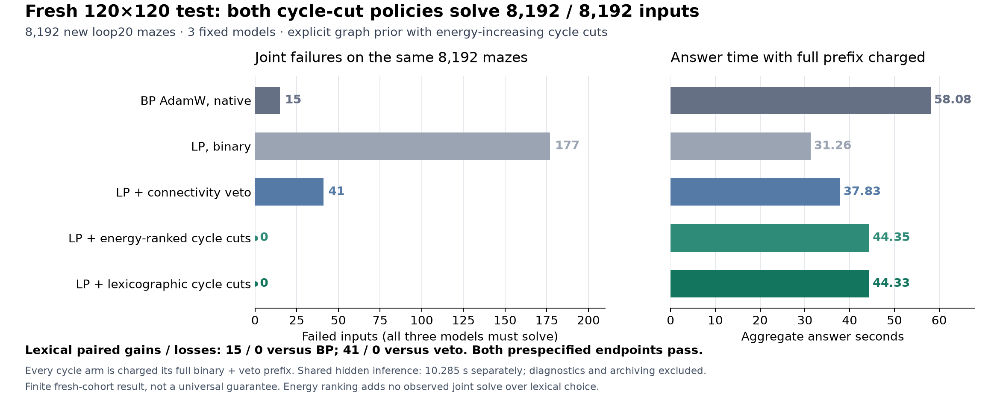

### H2av: the cycle-cut gain transfers to 180×180, but BP noninferiority is inconclusive

The [size-transfer protocol](cycle-transfer-180-protocol.json) fixes the same five policies, three models, 256-cell candidate limit, native descent and iteration caps before drawing **4,096 new 180×180 loop20 mazes**. Seed base 2026111521 is absent from all 53 preceding Work protocols. Independent label and uniqueness checks pass, with no overlap against 504 previous dataset files in nineteen registered manifests. No optimizer updates occur.

The complete preflight uses actual retained 180×180 inputs, not an assumption that padding preserves the objective. Retained BP, binary and veto boards, iterations, flags and hidden readouts reproduce exactly. Upstream native inference and uncached binary descent agree with the new shared-prefix runner. Independent original energies, flip costs, continuous gradients and attention readouts pass for all five policies, with free cells on every actual outer boundary and internal wall interfaces. The gate checks 57 literal candidate costs and finishes in 17.910 seconds. The earlier H2al failed padding-invariance result remains unchanged and explicitly linked in the new protocol.

| Arm | Joint solved / 4,096 | Model-input solved / 12,288 | Wrong certified | Answer seconds including full prefix |
|---|---:|---:|---:|---:|
| BP AdamW continued PL, native | 4,078 | 12,238 | 50 | 82.4931 |
| Older LP binary | 3,930 | 11,793 | 495 | 45.6359 |
| Connectivity veto | 4,027 | 12,085 | 203 | 52.6030 |
| Veto plus energy-ranked cycle cuts | 4,070 | 12,210 | 78 | 59.5015 |
| Veto plus lexicographic cycle cuts | 4,068 | 12,204 | 84 | 59.0013 |

**The prespecified lexical gain of at least 0.5 percentage point over veto is supported:** 41 joint gains, zero losses, **+1.000977 points**, with separately one-sided 95% net bounds **[0.629229, 1.355511]**. **Net noninferiority within 0.1 point versus BP is inconclusive:** fifteen gains and 25 losses, **−0.244141 points**, with bounds **[−0.694583, 0.207926]**, which cross −0.1. These decisions remain separate. The 120×120 success therefore does not establish the same accuracy relation at larger spatial scale.

Energy ranking descriptively gains **two joint inputs and loses zero** versus lexical choice. This differs from the zero paired outcome difference at 120×120. Its net bounds, [−0.084106, 0.176272] points, do not establish a general learned-ranking advantage. The symbolic graph prior, permission to increase energy, and unchanged 256-cell limit remain explicit parts of both algorithms.

The [complete independent audit](../../../results/research/work/cycle-transfer-180-summary.json) checks **61,440 final states**, **2,046 literal candidate costs**, **680 accepted moves**, and **1,614 vetoed candidates**. Move counts are 391 for veto, 143 for energy cuts and 146 for lexical cuts; 137 and 143 of the respective cycle cuts increase original energy. Every admitted cut decreases cycle rank immediately. Native descent restores no deleted vertex or cycle and causes no disconnection. All outputs are finite, all hidden solves converge, and no native or block caps occur. Maximum literal-cost error is 1.03e−12, margin error 8.95e−15 and final-energy error 4.81e−10. Sixteen CPU workers finish in **115.063 seconds**, within the 300-second audit budget.

Both GPU workers complete their 24 jobs in **116.935 and 119.587 seconds**. Live SM samples and increasing batch counters confirm productive work; graph selection and archiving separate GPU bursts. Shared hidden inference takes 14.831 aggregate seconds, diagnostics 4.870 and archiving 65.417. Each cycle answer is charged its full reused binary and veto prefix. The [independent SciPy check](../../../results/research/work/cycle-transfer-180/statistics-verification.json) reconstructs both endpoint decisions within 3.83e−12 point. Public-only verification passes for 240 deterministic states and 48 labels with inference, Torch and SciPy imports blocked.

A [posthoc size diagnosis](../../../results/research/work/cycle-transfer-180/residual-size-diagnosis.json) identifies a concrete remaining restriction. Every failed cycle output is still nonsimple; there are no valid-but-longer paths among these failures. All **84 lexical model failures on 28 inputs**, and all **78 energy-ranked failures on 26 inputs**, have connectivity-preserving, cycle-reducing chain components of **259–385 cells**. None is admitted by the unchanged 256-cell limit; each would admit a candidate at 512. The diagnostic independently reconstructs geometry and literal costs, but runs no solver trajectories. Newly admitting a candidate is not yet evidence of a rescue. A separate source intervention is required to test that causal explanation.

See the [paired outcomes](../../../results/research/work/cycle-transfer-180-per-input.csv), [model-input outcomes](../../../results/research/work/cycle-transfer-180-per-model-input.csv), [run table](../../../results/research/work/cycle-transfer-180-runs.csv), and [public state checks](../../../results/research/work/cycle-transfer-180/independent-state-verification.json). Completed totals are **1,834 planned jobs / 1,212,158 primary evaluations**, or **1,840 included jobs / 1,212,290 evaluations**. The cap diagnosis adds no fresh inputs or evaluations.

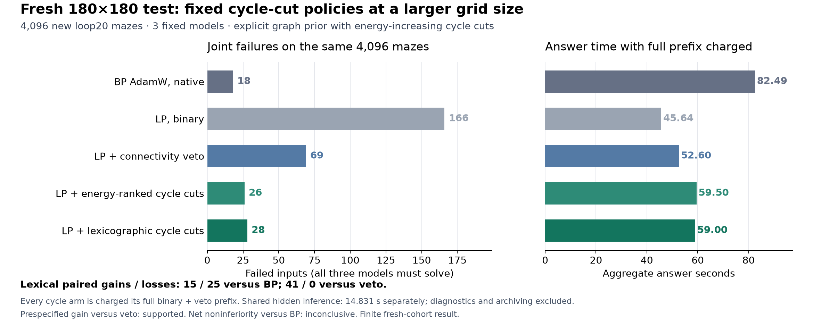

### H2aw: raising the chain limit rescues all remaining 180×180 source failures

The [frozen source protocol](large-cycle-cut-protocol.json) tests the size-cap explanation suggested by H2av. Both new arms start from **the same archived lexical256 output** on every one of the 4,096 H2av inputs and all three fixed models. The only candidate-family change is the maximum chain size, from 256 to 512 cells. One policy chooses the lexicographic minimum and the other chooses minimum original energy with lexicographic ties. Both preserve the same connectivity and cycle-rank filters, original energy/readout, 512-sweep native descent, sixteen block rounds, and exact identity on initial simple paths. The energy512 arm is therefore a continuation of lexical256, not of the earlier energy256 arm.

Before freezing, an [independent old-cap certificate](../../../results/research/work/large-cycle-cut/old256-fixed-point-control.json) checks all 12,288 starts: 12,204 simple-path identities and 84 nonsimple fixed points, with **zero admitted old256 candidates**. Their minimum native flip margin is +0.0411501. More iterations alone cannot move these old answers. The [complete numerical gate](../../../results/research/work/large-cycle-cut/numerical-gate.json) checks all 168 actual new candidate deletions, sized 259–385 cells; explicit size boundaries 1/2/256/257/512/513; and a synthetic lexical-versus-energy selector case whose native restoration correctly triggers the sixteen-round cap. All gates pass before source trajectories.

| Arm | Joint solved / 4,096 | Model-input solved / 12,288 | Answer seconds including full prefix | Evidence |
|---|---:|---:|---:|---|
| BP AdamW continued PL, native | 4,078 | 12,238 | 82.4931 | Archived H2av |
| Older LP binary | 3,930 | 11,793 | 45.6359 | Archived H2av |
| Connectivity veto | 4,027 | 12,085 | 52.6030 | Archived H2av |
| Veto plus energy-ranked cycle256 | 4,070 | 12,210 | 59.5015 | Archived H2av |
| Veto plus lexical cycle256 | 4,068 | 12,204 | 59.0013 | Shared archived starting policy |
| Lexical256 then lexical512 | **4,096** | **12,288** | 64.6003 | New source continuation |
| Lexical256 then energy512 | **4,096** | **12,288** | 64.5980 | New same-start ranking control |

The prespecified source target of at least fourteen rescues is **met: 28/28 joint failures are rescued**. The separate zero-regression target is **met: zero regressions**. Both policies search 84 nonsimple model outputs, take exactly 84 deletions, and preserve all 12,204 initial simple paths. Their joint outcomes do not differ. Every new deletion **lowers original energy**; none is positive or near zero. This supports the chain-size restriction as the cause of the residual failure on these source states. It does not establish that negative-energy large cuts alone solve the original problem: the shared archived prefix includes the earlier positive-cost cycle cuts. The 4,096 inputs are previously seen, so the result supplies no fresh generalization or confidence claim and does not retroactively change H2av's inconclusive BP noninferiority endpoint.

The [full independent audit](../../../results/research/work/large-cycle-cut-summary.json) checks all **24,576 new final states**, **336 literal candidate costs**, **168 accepted moves**, candidate geometry/choice, cycle-rank changes, original-energy margins, native flags and full-prefix charging. Neither policy regrows deleted vertices or cycles, disconnects a path, reaches a cap, or produces a nonfinite answer. Maximum literal-cost discrepancy is 1.37e−12, final-margin discrepancy 1.41e−15, and final-energy discrepancy 4.81e−10. The sixteen-process audit takes **47.522 seconds**. The two GPU workers finish all 48 jobs each in **21.692 and 21.687 seconds**, below the frozen 300-second limits. Each adds about **5.60 aggregate answer seconds** to the fully charged 59.0013-second archived prefix. Hidden inference is inherited and charged separately; no hidden or baseline computation is rerun.

[Public fixtures](../../../results/research/work/large-cycle-cut/state-fixtures/manifest.json) contain the first input of every shard/model plus every frozen nonsimple source state, without selecting on new outcomes: **660 states and 132 labels**. Independent original-energy/margin/shortest-path verification passes, including with Torch, SciPy and decoder imports blocked. The initial remote public check lacked a shared verifier module; [the environment receipt](../../../results/research/work/large-cycle-cut/verification-environment.json) records the failure and successful local verification of the same hashed fixtures. The [paired outcome table](../../../results/research/work/large-cycle-cut/per-input.csv) retains every input. This source intervention adds no fresh samples, optimizer updates, or primary evaluation totals: totals remain **1,834 planned jobs / 1,212,158 primary evaluations**, or **1,840 included jobs / 1,212,290 evaluations**.


### H2ax: fresh 180×180 cap confirmation supports safety and BP noninferiority; the minimum-gain target remains inconclusive

The [confirmation protocol](cap-transfer-protocol.json) fixes **4,096 new 180×180 loop20 inputs**, three unchanged models and six policies before drawing data. Both larger-cap policies use the complete **lexical256 then cap512 composition**; neither substitutes a direct 512 policy. The six-arm replay gate checks 180 previously seen model-inputs, including every one of the 84 H2aw nonsimple starts. Predictions, iterations, flags, readouts and block flags match their archived counterparts exactly. Independent objective/flip checks and 432 literal candidate costs pass in 41.675 seconds. Earlier actual-boundary, gradient/readout, upstream/native, size-boundary and synthetic restoration/selector gates are retained by hash.

Seed base 2026111522 is absent from all 55 preceding Work protocols. The independent input audit checks every shortest label, all 4,096 unique inputs, and zero overlap against 520 dataset files across twenty prior manifests. It finishes in 14.394 seconds. There are no optimizer updates, reused scientific samples, or changed inference budgets.

| Arm | Joint solved / 4,096 | Model-input solved / 12,288 | Wrong certified | Answer seconds including full prefix |
|---|---:|---:|---:|---:|
| BP AdamW continued PL, native | 4,072 | 12,218 | 70 | 82.1555 |
| Older LP binary | 3,928 | 11,790 | 498 | 45.7093 |
| Connectivity veto | 4,026 | 12,083 | 205 | 52.1337 |
| Veto plus lexical cycle256 | 4,077 | 12,231 | 57 | 58.5988 |
| Lexical256 then lexical512 | **4,096** | **12,288** | 0 | 64.2271 |
| Lexical256 then energy512 | **4,096** | **12,288** | 0 | 64.2140 |

The three separately prespecified endpoints have distinct conclusions:

- **Net gain of at least +0.2 percentage point over lexical256: inconclusive.** There are nineteen joint gains and zero losses, an observed **+0.463867 points**, with separately one-sided 95% net bounds **[0.189482, 0.723442]**. The lower bound remains below the frozen +0.2 threshold. The observed perfect cohort does not change this decision, and the sample is not extended.
- **Paired regression probability at most 0.1% versus lexical256: supported.** Zero of 4,096 inputs regress; the one-sided 95% exact upper bound is **0.0731113%**. Initial simple-path identity is a separate structural property, not a replacement for this declared probability endpoint.
- **Net noninferiority within 0.1 percentage point versus BP AdamW: supported.** There are 24 gains and zero losses, **+0.585938 points**, with net bounds **[0.285751, 0.870582]**. The lower bound exceeds −0.1.

Each maze is one independent unit and must be solved by all three fixed models. Paired-net bounds combine Clopper–Pearson gain/loss marginals at one-sided alpha 0.025 each; the standalone regression bound uses one-sided alpha 0.05. These are three separate decisions, with no simultaneous familywise 95% claim. The [independent SciPy reconstruction](../../../results/research/work/cap-transfer/statistics-verification.json) agrees within 2.64e−12 percentage point. The energy-ranked continuation has zero paired outcome differences from lexical choice and remains a descriptive control. All conclusions concern this generated maze distribution and these fixed models, not a universal guarantee.

The [full independent audit](../../../results/research/work/cap-transfer-summary.json) checks **73,728 final states**, **2,337 literal candidate costs**, **700 accepted moves** and **1,645 vetoed candidates**, including all geometries, selectors, cycle-rank transitions, original-energy margins, flags and prefix charges. Veto, lexical256, lexical512 continuation and energy512 continuation take 392, 194, 57 and 57 moves, respectively. Lexical256 takes 179 positive-cost moves; all new cap512 moves lower the original energy. No deleted vertex or cycle regrows, no path disconnects, no native or block cap occurs, every output is finite and every hidden solve converges. Maximum errors are 1.48e−12 for literal costs, 6.85e−15 for margins and 4.51e−10 for final energies. Sixteen CPU processes finish the audit in **135.990 seconds**, inside the 300-second budget.

Both GPU workers finish their 24 jobs in **120.360 and 121.555 seconds**. [Live process samples and advancing counters](../../../results/research/work/cap-transfer/live-progress.json) verify useful work on both GPUs; saved samples show 40–53% SM utilization during the run. Shared hidden inference takes 14.952 aggregate seconds, diagnostics 5.845 and archiving 66.106. Every answer receives its full binary/veto/lexical256 prefix charge even though the prefix executes once. Candidate scoring remains in lexical policies for matched verification, so these timings do not claim an optimized lexical implementation.

[Public-only verification](../../../results/research/work/cap-transfer/independent-state-verification.json) passes for 288 deterministic states and 48 labels, including with inference, Torch and SciPy imports blocked. See the [paired outcomes](../../../results/research/work/cap-transfer-per-input.csv), [per-model outcomes](../../../results/research/work/cap-transfer-per-model-input.csv), and [run table](../../../results/research/work/cap-transfer-runs.csv). Completed totals become **1,882 planned jobs / 1,285,886 primary evaluations**, or **1,888 included jobs / 1,286,018 evaluations**. The nineteen additional fresh rescues support the proposed mechanism descriptively while leaving the stated minimum-gain endpoint inconclusive.


### H2ay: the larger-cap gain fails at higher density; the remaining barrier is the block-round limit

The [density protocol](density-transfer-protocol.json) fixes **4,096 new 180×180 mazes with 50% of eligible closed connectors opened**, using seed base 2026111523. The same six policies, models, batch size, iteration limits and three endpoint thresholds from H2ax remain fixed. Both cap512 arms still start from the same lexical256 output and only continue eligible finite, stopped parents. This is a distribution-shift test; the loop20 and loop50 inputs are not matched counterfactual mazes and are not pooled.

No prior loop50 source cohort exists. The gate therefore reuses the unchanged six-arm actual180 source parity and numerical/synthetic fixtures by hash, and adds [32 tiny generator fixtures](../../../results/research/work/density-transfer/density-generator-preflight.json) covering 0/20/50/100% loop quotas, independent shortest-label checks and boundary clamps. Source/schema checks precede the freeze. The seed is absent from all 56 prior Work protocols; every fresh label passes, and all 4,096 inputs are unique with zero overlap against 536 prior files in twenty-one manifests. The input audit takes 16.049 seconds.

| Arm | Joint solved / 4,096 | Model-input solved / 12,288 | Wrong certified | Block caps | Answer seconds, full prefix |
|---|---:|---:|---:|---:|---:|
| BP AdamW continued PL, native | 3,935 | 11,847 | 441 | 0 | 70.5261 |
| Older LP binary | 2,608 | 7,883 | 4,405 | 0 | 34.1999 |
| Connectivity veto | 3,103 | 9,366 | 2,912 | 10 | 116.0515 |
| Veto plus lexical cycle256 | 4,024 | 12,084 | 0 | 204 | 227.1507 |
| Lexical256 then lexical512 | 4,024 | 12,084 | 0 | 204 inherited | 232.0256 |
| Lexical256 then energy512 | 4,024 | 12,084 | 0 | 204 inherited | 232.0187 |

**The minimum +0.2-point cap gain is falsified.** Lexical512 has zero joint gains and zero losses versus lexical256; its separately one-sided 95% net bounds are **[−0.090020, 0.090020]** percentage point, entirely below +0.2. **The regression-probability endpoint is supported:** zero losses, with one-sided 95% upper bound **0.0731113%**, below 0.1%. **Net BP noninferiority is supported:** 152 gains and 63 losses, **+2.172852 points**, with bounds **[1.189427, 3.152130]**, above −0.1. The BP result is a net tradeoff; it does not mean no regressions against BP. The energy512 control has no outcome differences from lexical512. All three decisions are separate, with the same CP marginal levels as H2ax and no familywise 95% claim. [Independent SciPy calculations](../../../results/research/work/density-transfer/statistics-verification.json) agree within 4.58e−12 point.

Neither cap512 continuation takes a move. All 204 lexical256 model failures are block-cap failures; they are ineligible for continuation under the frozen stopped-parent rule. Ten caps originate in veto, and 194 arise during lexical cycle cutting. A [no-trajectory residual certificate](../../../results/research/work/density-transfer/residual-cap-diagnosis.json) checks all 204 states on 72 inputs: **28 already form valid shortest paths and admit no cycle256 candidate**, while the remaining **176 admit cycle-reducing candidates at both 256 and 512**. Every state has a positive original native flip margin, with minimum +0.000437745. No certificate flag is changed by this diagnosis. The larger-chain restriction therefore does not explain these residuals; stopping at the block-round limit and skipping capped prefixes are the concrete next issues to test. Extra iterations are not yet demonstrated rescues.

The original full audit [reached its frozen 300-second limit](../../../results/research/work/density-transfer/audit-budget-exhausted.json) with exit 124. Eighteen ordered job-completion events had been emitted, but the original collector did not persist partial rows; it produced no complete audit or endpoint decision. This failure remains recorded. A separate, subsequently frozen H2az verifier optimization, described below, checks the retained outputs in **235.342 seconds** under its own 600-second budget. Inference is never rerun, and the original audit gate is not retroactively marked passed.

The [successful successor audit](../../../results/research/work/density-transfer-summary.json) verifies **73,728 final states**, **429,409 candidate costs**, **26,251 accepted moves** and **62,417 vetoed candidates**, with every candidate geometry, choice, cycle transition, margin, native flag and prefix charge retained. Veto takes 10,689 moves; lexical256 takes 15,562, of which 6,751 increase original energy. No deleted vertex or cycle regrows and no path disconnects. All hidden solves converge, all states are finite, and no native cap occurs; block caps remain failures. Maximum discrepancies are 6.12e−13 for candidate costs, 9.36e−15 for margins and 4.64e−10 for final energies. [Public-state verification](../../../results/research/work/density-transfer/independent-state-verification.json) separately passes for 288 deterministic states and 48 labels with inference, Torch and SciPy imports blocked.

The two GPU workers complete 24 jobs each in **211.655 and 208.703 seconds**, within the frozen 300-second ceilings. [Live counters and process samples](../../../results/research/work/density-transfer/live-progress.json) verify progress; graph work and archiving separate GPU bursts. Aggregate shared hidden time is 13.151 seconds, diagnostics 5.816 and archiving 90.629. The first 28 completed jobs' timing receipts identify CPU graph work as 91.689 seconds of 250.305 aggregate job seconds; this motivates a separate exact inference-geometry optimization, not a mid-study change. Answer costs here retain the original full-prefix charges and unoptimized graph implementation.

See [paired outcomes](../../../results/research/work/density-transfer-per-input.csv), [per-model outcomes](../../../results/research/work/density-transfer-per-model-input.csv), and [runs](../../../results/research/work/density-transfer-runs.csv). After complete successor verification, totals become **1,930 planned jobs / 1,359,614 primary evaluations**, or **1,936 included jobs / 1,359,746 evaluations**. H2az verification, profiling and replay add no new scientific samples or inference evaluations.

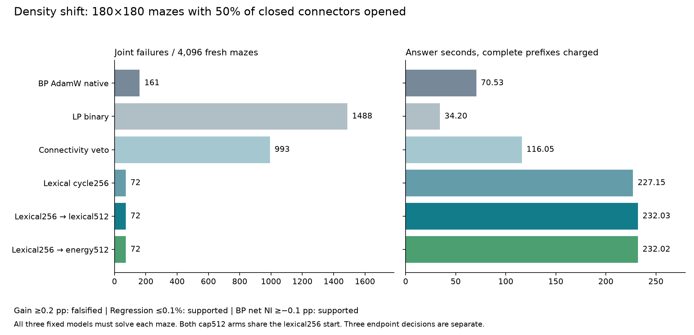

### H2az: independent local-factor cancellation accelerates verification without changing inference

The [separate verification protocol](local-factor-audit-protocol.json) follows the recorded H2ay audit timeout. A bounded 60-second source profile confirms that full-grid energy calculations dominate: energy self-time is 32.58 seconds, full-grid flip checks 11.76 and NumPy reductions 5.98. The interrupted profile's cumulative times are not interpreted as wall times. The first density job alone contains 13,458 candidate costs, versus 2,337 in the entire H2ax study.

The [mathematical rationale](LOCAL_FACTOR_AUDIT.md) is direct factor cancellation. A deletion changes only unary terms at deleted free cells and pair/directed-link factors incident to those cells. For each offset, the verifier takes the unique union of changed source coordinates and changed destination coordinates shifted back to their sources. It evaluates original table entries and directed products before and after deletion in long double, counting self-links and factors with two changed endpoints once. It does not call the production flip/quadratic scorer. Full-grid final energies and native margins, graph checks, published cost order and choices remain independently verified.

Before freezing, the [equivalence gate](../../../results/research/work/local-factor-audit/numerical-gate.json) checks all **19,683 = 3⁹** small-grid selected/deleted configurations, including 512 empty changes; 96 wall/endpoint/rectangular-boundary cases; all 168 long-chain H2aw candidates; and the first 344 H2ay candidates in immutable trace order. The last two groups form **512 fixed actual deletions**, without new outcome selection. The gate takes 27.287 seconds. Maximum local-versus-full-grid discrepancy is 2.98e−13, and discrepancy from published GPU candidate costs is 1.34e−12.

The prespecified **at least 2× median paired process-time speedup is met** on those 512 deletions. Three alternating-order repeats give **18.624×, 18.740× and 18.749×**, with median **18.7396×**. Full-grid evaluation takes about 2.50 process seconds per repeat and local-factor evaluation 0.134. Loading and lossless promotion occur before timing for both implementations; both are pinned to Work CPU 0. This fixed microbenchmark is distinct from full-job performance.

Both complete source-job audits also finish inside their separately frozen 120-second limits: **118.606 seconds** for full-grid costs and **53.857 seconds** for local factors, a measured **2.20223× wall-time speedup** on that one matched job. All scientific audit fields agree exactly; only elapsed times and floating-point error maxima are excluded from equality. This is a complete audit-job measurement, not an inference speedup or a multi-sample timing confidence claim. The [comparison receipts](../../../results/research/work/local-factor-audit/full-job-comparison.json) retain both runs.

Finally, the new sixteen-process audit verifies every H2ay state and candidate in 235.342 seconds and persists all 48 rows atomically as completed. Its separate 600-second budget remains explicit; the original 300-second failure remains intact. The complete new cost count is 429,409, with maximum cost discrepancy 6.12e−13. There are **zero new inputs, inference trajectories, optimizer updates or scientific evaluation totals**.

The [published 512-deletion fixtures](../../../results/research/work/local-factor-audit/fixtures/manifest.json) are self-contained. Their [independent full-grid check](../../../results/research/work/local-factor-audit/public-fixture-verification.json) and blocked-import smoke pass without Torch, SciPy, study code or production decoders. To reconstruct published statistical endpoints directly from either layout, run `artifacts/statistics-venv/bin/python research/20261114/work/verify_public_transfer_statistics.py results/research/work cap-transfer` or replace the final argument with `density-transfer`. This wrapper handles the public sibling summary/CSV layout without changing either frozen statistical checker.


### H2ba: ten known bookkeeping rescues and 52 additional search rescues

The [source protocol](terminal-cycle-protocol.json) separates terminal certification from extra search on all **4,096 archived H2ay inputs and three models**. Both new arms leave the ten inherited veto-capped model states on five inputs unchanged, including their flags. Only the **194 newly capped lexical256 states** are eligible. The terminal-only arm enumerates the unchanged 256-cell candidate family and marks a native-stable state stopped if no cycle candidate remains; it changes no board, iteration count or move count. The second arm starts from the identical source board and terminal-only decision, then applies the unchanged lexical256 solver for at most sixteen additional rounds to the remaining **167 states**, followed by a final candidate-absence check at the round boundary.

The terminal-only effect is descriptive: the preceding diagnosis already predicts 27 model certifications and ten joint rescues. The new, separately frozen source targets require at least **31 additional joint rescues beyond terminal-only**, among 62 remaining inputs, and **zero regressions**. All 4,096 inputs remain in the denominator, including the five containing upstream veto caps. No shortest labels or distances guide candidate selection or certification.

A prefreeze gate checks all 194 eligible states, 2,096 actual candidate costs, and five synthetic terminal-at-round-sixteen flag cases. Terminal, nonterminal, native-failed, nonfinite and negative-margin states remain distinct; boards and move/iteration counts remain unchanged by terminal certification. The gate passes in 21.934 seconds. A [prefreeze metadata assertion failure](../../../results/research/work/terminal-cycle/preflight-schema-failure.json) is preserved: the first checker incorrectly nested a separately stored candidate count inside geometry metadata. This was corrected before freezing and before any source trajectory; no frozen science changed.

| Arm | Joint solved / 4,096 | Model-input solved / 12,288 | Model block caps | Answer seconds, full prefix | Evidence |
|---|---:|---:|---:|---:|---|
| BP AdamW continued PL, native | 3,935 | 11,847 | 0 | 70.5261 | Archived H2ay |
| Older LP binary | 2,608 | 7,883 | 0 | 34.1999 | Archived H2ay |
| Connectivity veto | 3,103 | 9,366 | 10 | 116.0515 | Archived H2ay |
| Lexical256 source | 4,024 | 12,084 | 204 | 227.1507 | Archived H2ay |
| Terminal certification only | 4,034 | 12,111 | 177 | 228.0456 | New source flag control; predicted effect |
| Terminal plus sixteen extra lexical256 rounds | **4,086** | **12,263** | **25** | 236.8904 | New source trajectories |

**Both primary source targets are met:** extra search rescues **52 joint inputs beyond terminal-only**, exceeding 31, and loses zero. It recovers 152 model-input successes beyond the 27 known terminal certifications. The new searches take **1,050 moves**, of which 282 increase original energy. Three additional states become terminal exactly at the final added round and are certified by the final check. These results separate known bookkeeping recovery from new search progress; they are not fresh generalization evidence and do not change H2ay's frozen density-shift decisions.

The [complete independent audit](../../../results/research/work/terminal-cycle-summary.json) verifies **24,576 new final states**, **12,854 original candidate costs**, every geometry/selector/native transition, both terminal checks, flags, upstream cap identity and full-prefix charges. No deleted vertex or cycle regrows, no path disconnects, and no native cap or nonfinite state occurs. Maximum errors are 1.94e−13 for candidate costs, 1.95e−15 for margins and 4.64e−10 for final energies. Sixteen CPU processes finish in **46.374 seconds**, inside the 300-second limit. Worker receipts verify 24 completed jobs each in **15.709 and 14.593 seconds**. These short runs completed before live SM sampling, so no live utilization claim is made for them.

A [no-trajectory residual check](../../../results/research/work/terminal-cycle/residual-cap-diagnosis.json) retains **25 capped model states on ten inputs**: the ten deliberately unchanged upstream veto caps, plus fifteen remaining lexical caps. All fifteen new lexical caps still admit cycle256 candidates. One inherited veto-capped state is already a valid shortest path; it remains capped as required by the control. This identifies remaining lineage and budget limits without claiming that another continuation rescues them.

[Public fixtures](../../../results/research/work/terminal-cycle/state-fixtures/manifest.json) contain the first input of each shard/model plus all 204 original capped model states, including upstream controls: **1,260 states and 252 labels**, with no selection on new outcomes. Independent objective/margin/shortest checks and blocked Torch/SciPy/decoder imports pass. See [paired outcomes](../../../results/research/work/terminal-cycle/per-input.csv). Both new arms pay the complete archived lexical256 prefix; terminal enumeration adds 0.895 aggregate seconds and added search 8.845. Hidden inference and baseline computation are inherited. Completed totals remain **1,930 planned jobs / 1,359,614 primary evaluations**, or **1,936 included jobs / 1,359,746 evaluations**.

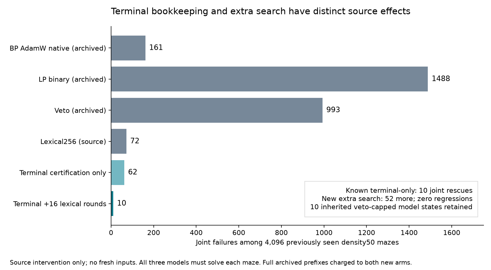

### H2bb: disjoint cap-family interventions recover the ten remaining source failures

The [frozen residual protocol](residual-factorial-protocol.json) uses the same H2ba final states on every one of the 4,096 source mazes and three models. The remaining fifteen lexical-capped model states belong to five inputs; the ten inherited veto-capped states belong to five different inputs. The two families have no input overlap. One new arm continues only lexical-capped states, and another continues only inherited veto-capped states. Eligible starts must be finite, free of a native cap, and native-stable under the original margin threshold. Each receives terminal certification before and after at most sixteen unchanged lexical256 rounds. There are no new veto moves, 512-cell candidates, training updates, or label-dependent choices.

The prefreeze gate verifies all 25 source cap states, every current candidate geometry, 259 literal original costs, and positive native margins, in 16.898 seconds. The unchanged terminal helper retains the prior terminal-at-round-boundary synthetic gate by hash. One veto-family model state is already terminal; its certification is known bookkeeping. It alone rescues no joint input. The remaining **24 states** receive new trajectories: fifteen lexical-family and nine veto-family cases.

The prespecified finite-source targets are at least **three rescues among each family's five failed inputs**, at least **six combined rescues among ten**, and zero regressions for each comparison. Each branch executes once. The joint arm is an exact per-state composition of disjoint branch outputs, with no duplicate trajectory or interaction claim.

| Arm | Joint solved / 4,096 | Model-input solved / 12,288 | Answer seconds including full source prefix | Evidence |
|---|---:|---:|---:|---|
| BP AdamW continued PL, native | 3,935 | 11,847 | 70.5261 | Archived H2ay |
| Older LP binary | 2,608 | 7,883 | 34.1999 | Archived H2ay |
| H2ba source after terminal checks and extra rounds | 4,086 | 12,263 | 236.8904 | Archived source |
| Continue lexical-cap family only | 4,091 | 12,278 | 237.8654 | New branch |
| Admit and continue veto-cap family only | 4,091 | 12,273 | 237.8070 | New branch |
| Compose both disjoint branches | **4,096** | **12,288** | **238.7819** | Exact composition, no new trajectory |

**Every source target is met:** each branch rescues all **five of five** family inputs with zero regressions; the composition rescues all **ten of ten**. The combined result is the union of the branch effects, not extra independent evidence. The veto-family branch's five joint rescues require added search beyond the known one-model terminal certification. The lexical branch takes 72 moves, including fifteen positive-cost moves; the veto branch takes 53, including 24 positive-cost moves. All family states finish without a remaining cap; each isolated arm preserves the other family's caps unchanged.

The [full independent audit](../../../results/research/work/residual-factorial-summary.json) checks all **24,576 new branch final states**, **1,101 candidate costs**, candidate lists, lexical choices, native transitions, terminal checks, source identity outside each family, disjoint composition and cost accounting. There is no native restoration of deleted vertices or cycles, no path disconnection, native cap or nonfinite output. Maximum candidate-cost error is 3.04e−13, margin error 1.17e−15 and final-energy error 4.64e−10. Sixteen CPU processes finish in **88.427 seconds**. Both GPU workers finish all 48 output jobs in **19.610 and 19.600 seconds**; [live SM samples](../../../results/research/work/residual-factorial/live-sm-progress.txt) show brief 1% bursts and mostly zero usage, consistent with only 24 small continuations amid archive reads and identity copies. No redundant trajectories were added for utilization.

Each isolated arm pays the full 236.8904-second source prefix plus its own terminal enumeration and search. The composition pays that prefix once plus both increments, totaling 238.7819 seconds; archived hidden time remains separate. [Public fixtures](../../../results/research/work/residual-factorial/state-fixtures/manifest.json) include the first input of every shard/model and all 25 frozen residual cap states, without selecting on new results: **438 states and 73 labels**. Independent original-objective/margin/shortest checks and blocked-inference-import smoke pass. See the [paired outcomes](../../../results/research/work/residual-factorial/per-input.csv).

This completes a sequence of source repairs, not fresh confirmation of their combined decoder. The original H2ay and H2ax endpoint decisions remain unchanged. A new study must freeze one unified bounded policy before drawing another cohort. Counts remain **1,930 planned jobs / 1,359,614 primary evaluations**, or **1,936 included jobs / 1,359,746 evaluations**; source continuations and deterministic composition add no fresh scientific totals.

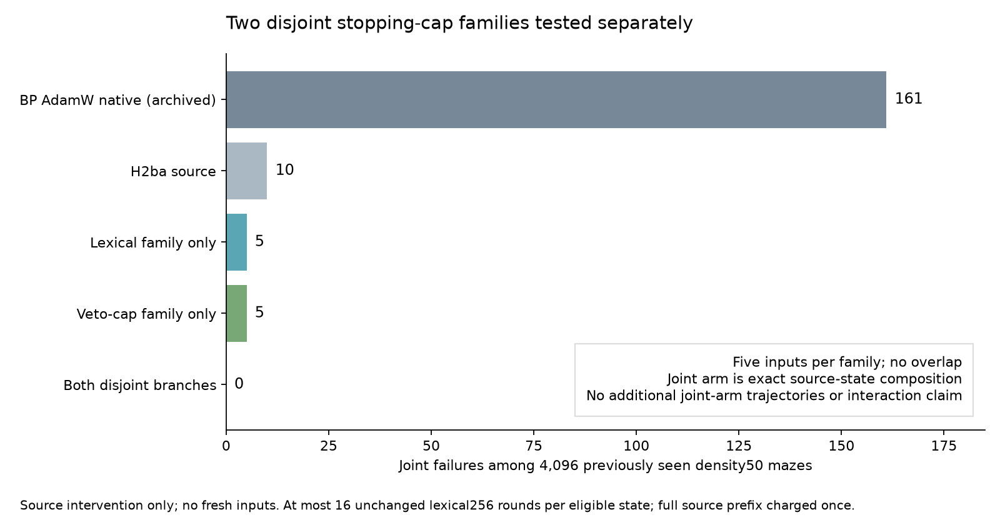

### H2bc: fresh bounded-decoder confirmation supports the budget mechanism, while the one-point gain target remains inconclusive

The [new protocol](unified-cycle-protocol.json) freezes one bounded policy before generating **4,096 fresh 180×180 loop50 mazes**, with base seed 2026111525 and the same three fixed model seeds. It compares BP AdamW, LP binary, connectivity veto, original lexical16, corrected unified16, and unified48. The corrected policies admit finite, native-stable veto-capped states and certify candidate absence at the cycle-budget boundary; native failures remain failures. Unified16 allows at most sixteen cycle moves in total. Unified48 shares that exact prefix and allows at most 32 more, for a fixed total of 48. Both retain the 256-cell candidate family, lexical choice, original native descent, and energy-increasing graph moves. No labels or shortest distances guide the decoder; this remains a task-informed research decoder rather than paper-native inference.

The [prefreeze source gate](../../../results/research/work/unified-cycle/numerical-gate.json) checks **252 source cases**, comprising every one of the 204 original H2ay cap states and the first input of each shard/model. All four original controls reproduce archived boards, iterations and flags exactly. Unified48 exactly matches the H2bb composed source outputs, including native and block-cap flags. Six-arm original energies and margins, 152,453 candidate costs, cycle geometry and terminal checks pass in **254.629 seconds**. This is implementation verification, not fresh evidence. The subsequent [input audit](../../../results/research/work/unified-cycle/independent-input-audit.json) checks every fresh label and finds 4,096 distinct inputs with zero overlap against **552 prior dataset files** registered before generation.

| Arm | Joint solved / 4,096 | Model-input solved / 12,288 | Model block caps | Answer seconds, full prefix |
|---|---:|---:|---:|---:|
| BP AdamW continued PL, native | 3,938 | 11,845 | 0 | 79.5413 |
| Older LP binary | 2,610 | 7,895 | 0 | 37.9325 |
| Connectivity veto | 3,145 | 9,474 | 10 | 117.4235 |
| Original lexical16 | 4,039 | 12,124 | 164 | 221.8612 |
| Unified16: corrected eligibility and terminal checks | 4,053 | 12,161 | 127 | 223.6023 |
| Unified48: identical prefix plus at most 32 rounds | **4,096** | **12,288** | **0** | **228.6422** |

All 4,096 inputs remain in every denominator. Joint success requires all three fixed models; the maze is the independent unit. The four prespecified decisions are separate:

| Endpoint | Paired gains / losses | Observed gain | Prespecified bounds | Decision |
|---|---:|---:|---|---|
| Unified48 gain ≥1.0 point versus original16 | 57 / 0 | +1.391602 points | Net lower 0.965624; upper 1.799265 points | **Inconclusive** |
| Regression probability ≤0.1% versus original16 | 57 / 0 | Zero observed regressions | One-sided 95% upper 0.0731113% | **Supported** |
| Net BP noninferiority ≥−0.1 point | 158 / 0 | +3.857422 points | Net lower 3.198561; upper 4.493219 points | **Supported** |
| Unified48 gain ≥0.5 point versus unified16 | 43 / 0 | +1.049805 points | Net lower 0.670742; upper 1.411501 points | **Supported** |

The complete observed recovery does **not** establish the frozen one-point minimum gain: its lower bound is just below one point. The extra-budget endpoint does support additional search beyond corrected eligibility and bookkeeping. No sample extension, target reduction or pooling with the source repairs is used. Net bounds use the declared CP gain/loss marginals at one-sided alpha 0.025 each; the standalone regression endpoint uses alpha 0.05. There is no simultaneous familywise 95% claim. [Independent SciPy calculations](../../../results/research/work/unified-cycle/statistics-verification.json) agree within 4.70e−12 point.

The [full independent audit](../../../results/research/work/unified-cycle-summary.json) verifies **73,728 final states**, **354,116 original candidate costs**, **24,408 accepted moves** and 58,499 vetoed candidates. Every geometry, lexical choice, native transition, initial/final terminal enumeration, eligibility decision and complete-prefix charge is checked. Original lexical search takes 13,433 moves, the corrected eligibility branch 69, and the extra-budget branch 649; their positive-cost move counts are 5,904, 23 and 143. No deleted vertex or cycle regrows, no path disconnects, and there are no native caps, nonfinite states or hidden convergence failures. Maximum discrepancies are 6.91e−13 for candidate costs, 9.13e−15 for margins and 4.78e−10 for energies. Sixteen CPU processes finish in **222.491 seconds**, saving all 48 audit rows atomically.

The GPU workers finish in **215.584 and 221.297 seconds**, inside their fixed 600-second limits. [Live process and GPU-counter samples](../../../results/research/work/unified-cycle/live-progress.json) confirm productive progress on both devices; the CPU audit overlaps the later inference jobs. All arms pay their full dependency chains, although common prefixes execute once. Unified48 adds 6.781 aggregate answer seconds over original16; hidden inference, diagnostics and archiving remain separately recorded. This is a measured cost comparison on this cohort, not an independent speed hypothesis.

[Public fixtures](../../../results/research/work/unified-cycle/state-fixtures/manifest.json) retain the first input of every shard/model, without outcome selection: **288 states and 48 labels**. Independent original-objective, margin and shortest-path checks pass with Torch, SciPy, study code and production decoders blocked. See [joint outcomes](../../../results/research/work/unified-cycle/per-input.csv), [per-model outcomes](../../../results/research/work/unified-cycle/per-model-input.csv) and [run accounting](../../../results/research/work/unified-cycle/runs.csv). Completed totals become **1,978 planned jobs / 1,433,342 primary evaluations**, or **1,984 included jobs / 1,433,474 evaluations**, including the unchanged six descriptive jobs and 132 arms. Source gates, replays and audits add no scientific samples.

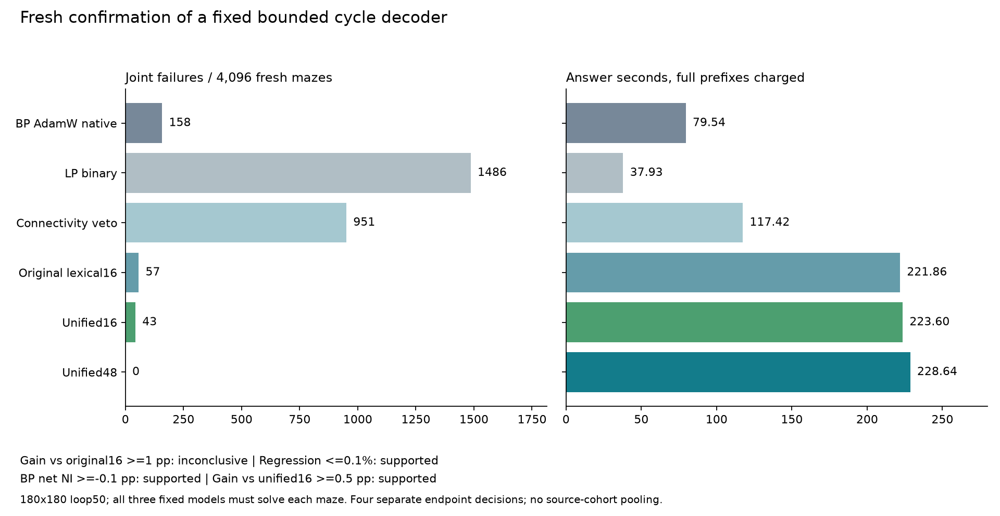

### H2bd: exact bridge geometry meets separate geometry and complete-policy speed targets

The [prospective optimization protocol](geometry-speed-protocol.json) changes only the implementation of lexical256 candidate geometry. Raw selected-free degree-one/two chains, candidate limits, ordering, original costs, positive-cost permission, native descent and stopping rules remain identical to H2bc. One selected-graph traversal identifies bridges, components and whether a bridge separates the task endpoints. A chain containing such a bridge is vetoed. A complete isolated cycle, or a two-anchor chain with an alternative connection, removes exactly one independent cycle; other admitted chains preserve cycle rank. The existing chain decomposition still runs. Returned `reachability_checks` counts logical predicates, rather than claiming that the old number of separate graph traversals occurred.

Correctness precedes timing. The [synthetic gate](../../../results/research/work/geometry-speed/synthetic-gate.json) compares the legacy implementation, bridge implementation and independent NumPy geometry on **4,617 exhaustive small-board assignments**, 96 fixed rectangular cases and twelve chain-size boundaries. The [archive gate](../../../results/research/work/geometry-speed/archive-gate.json) then checks **35,382 active or terminal geometry states** and **355,232 candidate tuples** from every H2ay and H2bc lexical trace, including empty candidate lists. It identifies 12,220 unique token/board states and finishes in 16.345 seconds using sixteen CPU processes. The complete optimized unified48 pipeline also reproduces all prefixes, choices, traces, boards, iterations and flags for **256 H2bc shard00 inputs and all three models**; the two source-gate workers take 9.087 and 5.169 seconds. These are source verification runs, not fresh accuracy evidence.

The geometry benchmark fixes the **1,024 states with smallest declared SHA256 hashes** from that complete unique-state set before measuring speed. Inputs are loaded first; both implementations receive the same 32-state warmup. Work CPU0 is available in the process affinity and has zero measured busy time in the preceding one-second sample. Four complete paired sweeps run in the balanced orders old/fast, fast/old, fast/old, old/fast. Complete geometry includes raw-chain construction, all graph decisions and returned metadata. Legacy process time is 3.943–3.991 seconds per sweep; accelerated time is 0.793–0.819. The paired ratios are **4.9732×, 5.0063×, 4.8729× and 4.9949×**, with median **4.98408×**. The separately frozen **at least 2× geometry target is met**.

Complete-policy timing uses all 256 source mazes and three fixed models in every pair. GPU0 runs the first two pairs and GPU1 the last two, preserving balanced order within each device. The measured path includes CPU-to-GPU token transfer, hidden settling/readout, binary and veto prefixes, both cycle stages, all native suffixes, eligibility and terminal checks, and CPU-returned final boards/counters/flags. Input loading, model loading, diagnostic comparison and lossless archiving are reported separately; both implementations receive identical first-32-input/all-model warmups. There is no JIT compilation. BP remains a separately labelled archived control and is not part of the implementation timing ratio.

| Method | Joint solved / 256 source mazes | Complete-policy seconds across four pairs | Evidence |
|---|---:|---|---|
| BP AdamW continued PL, native | 238 | Not measured in this benchmark | Archived H2bc accuracy; different policy |
| Unified48, legacy geometry | 256 | 13.8771, 13.8569, 14.0055, 14.0795 | Four complete timing replays |
| Unified48, accelerated exact geometry | 256 | 10.4011, 10.5276, 10.5282, 10.5171 | Four paired timing replays |

The four complete-policy ratios are **1.33420×, 1.31625×, 1.33028× and 1.33872×**, with median **1.33224×**. The separate **at least 1.1× complete-policy target is met**. This measured pipeline gain is smaller than the geometry gain because native inference and other unchanged work still execute. All eight replays match the archived source and one another in final boards, iterations, native/block flags, every candidate choice and every trace. Neither target is substituted for the other, and no timing confidence interval or universal speed claim is made.

The workers finish in **53.465 and 53.952 seconds**, inside their fixed 240-second caps. Loading and reference preparation take 0.941 and 0.968 seconds. Legacy warmups take 1.244 and 1.252 seconds; accelerated warmups take 0.685 and 0.697. [Live SM/process samples](../../../results/research/work/geometry-speed/live-sm-progress.txt) show useful work on both GPUs. No repeat, cohort or budget is extended after observing timings.

The [independent public check](../../../results/research/work/geometry-speed/public-verification.json) reconstructs all 1,024 geometries and 9,443 selected candidate tuples using separate NumPy graph code, proves the published hash-selection ordering against all 12,220 hashes, checks all 256 shortest labels and 768 source boards, compares **6,144 timed output boards/counters/flags** and their source trace hashes, and recomputes both timing medians and decisions. It passes with Torch, SciPy, study code and all production decoders blocked. The [fixtures](../../../results/research/work/geometry-speed/public-fixtures/manifest.json), [timing receipts](../../../results/research/work/geometry-speed/audit.json), and [full summary](../../../results/research/work/geometry-speed-summary.json) are self-contained. Run `upstream/.venv/bin/python research/20261114/work/verify_geometry_public.py results/research/work/geometry-speed` to repeat the public checks.

This establishes an exact implementation improvement on the fixed replay cohort. It adds **zero fresh inputs, optimizer updates or scientific evaluations**. Totals remain **1,978 planned jobs / 1,433,342 primary evaluations**, or **1,984 included jobs / 1,433,474 evaluations**. H2bc's one-point accuracy endpoint remains inconclusive; an acceleration result does not change that decision.

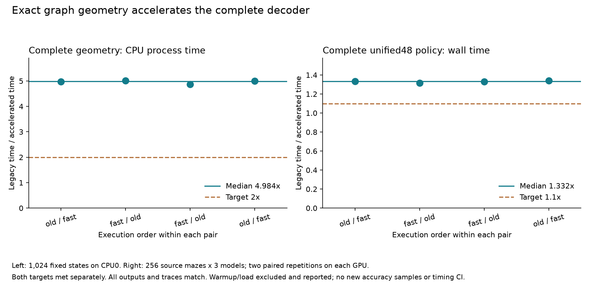

### H2be: denser mazes falsify 99.9% sufficiency of the fixed 48-round decoder

The [density80 protocol](loop80-transfer-protocol.json) keeps the same three fixed models, six policies, 256-cell candidate family and total sixteen/48-cycle budgets, while increasing opened-connector density from 50% to 80%. It retains all four H2bc endpoint thresholds and adds a separately declared absolute target: **at least 99.9% joint success**. Every policy uses the proven-equivalent H2bd lexical geometry implementation. There is no new training, larger candidate family or adaptive search extension.

Before generation, a [six-arm gate](../../../results/research/work/loop80-transfer/numerical-gate.json) exactly reproduces 96 H2bc source cases, including boards, iterations, flags, 464 candidate-cost records, every choice and terminal check, in 3.299 seconds. The helper's solver body is unchanged; only geometry imports differ, and H2bd's complete parity evidence is hash-bound. An [independent statistics gate](../../../results/research/work/loop80-transfer/absolute-statistics-gate.json) checks the new absolute CP calculation at ten boundary/interior counts against SciPy. For this fixed sample size, zero failures support the 99.9% target, one through eight are inconclusive, and nine or more falsify it. These rules precede all fresh outcomes.

The new cohort contains **4,096 distinct 180×180 loop80 mazes**, base seed 2026111526, with no replacement or outcome exclusions. The [input audit](../../../results/research/work/loop80-transfer/independent-input-audit.json) verifies every shortest label and zero overlap against 568 prior dataset files registered before generation. Each maze is one independent unit; joint success requires all three fixed models.

| Arm | Joint solved / 4,096 | Model-input solved / 12,288 | Model block caps | Answer seconds, full prefix |
|---|---:|---:|---:|---:|
| BP AdamW continued PL, native | 3,911 | 11,765 | 0 | 76.3650 |
| Older LP binary | 2,424 | 7,317 | 0 | 30.7040 |
| Connectivity veto | 2,695 | 8,123 | 85 | 176.0857 |
| Original lexical16 | 3,623 | 10,895 | 1,393 | 251.6606 |
| Unified16 | 3,667 | 11,026 | 1,262 | 257.1613 |
| Unified48 | **4,044** | **12,140** | **148** | **302.6444** |

**Absolute 99.9% sufficiency is falsified.** Unified48 succeeds on 98.730469% of the new mazes, with separately one-sided 95% CP success bounds **[98.403139%, 99.004269%]**; even the upper bound lies below 99.9%. Its 52 joint failures and 148 model block caps remain in the results. No new trajectories are added to this cohort to meet the target.

The four relative endpoints are supported independently. Versus BP, unified48 has **178 gains and 45 losses**, a net **+3.247070 points**, with net bounds **[2.274564, 4.213223]** above the −0.1-point noninferiority threshold. This is a net tradeoff and includes 45 BP-paired regressions. Versus original16, it has **421 gains and zero losses**, **+10.278320 points**, with bounds **[9.274679, 11.249028]**, above the one-point gain target. Zero losses give the standalone regression-probability upper bound **0.0731113%**, below 0.1%. Versus unified16, its **377 gains and zero losses** yield **+9.204102 points**, with bounds **[8.245903, 10.130961]**, above the half-point extra-budget target. Supporting these relative comparisons does not establish the absolute sufficiency target.

As frozen, net endpoints use CP gain/loss marginal one-sided alpha 0.025, the regression endpoint uses alpha 0.05, and the absolute success endpoint uses alpha 0.05 directly on the joint-success count. The five decisions are separate, with no familywise 95% claim and no pooling with density50 or source repairs. [Independent SciPy reconstruction](../../../results/research/work/loop80-transfer/statistics-verification.json) agrees within 1.14e−11 point.

The [complete independent audit](../../../results/research/work/loop80-transfer-summary.json) checks **73,728 final states**, **1,667,096 original candidate costs**, **69,277 accepted moves** and **158,349 vetoed candidates**. Original lexical16 takes 36,465 moves, corrected cap eligibility adds 1,033, and the remaining 32-round stage adds 19,206; their positive-cost move counts are 10,267, 220 and 4,112. Every geometry, choice, native transition, eligibility/terminal decision and prefix charge is verified. There are no native caps, nonfinite states, hidden convergence failures, disconnected paths or restored deleted vertices/cycles. Original16, unified16 and unified48 have no wrong certified outputs; their remaining failures are block caps. Maximum cost, margin and energy discrepancies are 2.78e−13, 9.13e−15 and 5.15e−10. Sixteen CPU workers finish in **370.098 seconds**, inside the **1,200-second audit cap declared before generation**, and retain all 48 atomic audit rows.

GPU workers finish in **258.429 and 264.261 seconds**, inside their fixed 600-second caps. [Live process and counter samples](../../../results/research/work/loop80-transfer/live-progress.json) verify progress; CPU verification overlaps the later GPU jobs. All arms retain complete-prefix charges. A [bounded read-only cost profile](../../../results/research/work/loop80-transfer/timing-profile.json) of the first sixteen immutable completed jobs records 167.252 aggregate job seconds: 64.479 in graph work, including **41.572 in legacy veto reachability**, and 37.172 in archiving. This identifies a concrete next implementation bottleneck without changing the frozen experiment.

The [public fixtures](../../../results/research/work/loop80-transfer/state-fixtures/manifest.json) retain the first input of every shard/model: **288 states and 48 labels**, with no selection on results. Independent original-energy, margin and shortest-path checks pass with Torch, SciPy, study code and production decoders blocked. See [joint outcomes](../../../results/research/work/loop80-transfer/per-input.csv), [per-model outcomes](../../../results/research/work/loop80-transfer/per-model-input.csv) and [run accounting](../../../results/research/work/loop80-transfer/runs.csv). Completed totals become **2,026 planned jobs / 1,507,070 primary evaluations**, or **2,032 included jobs / 1,507,202 evaluations**. Verification and performance replays add no fresh scientific samples.

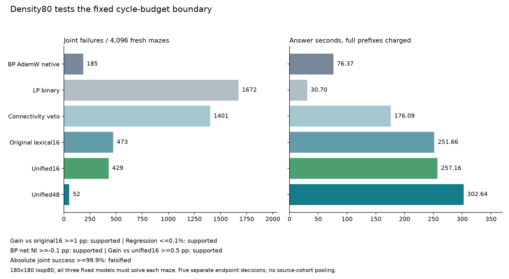
