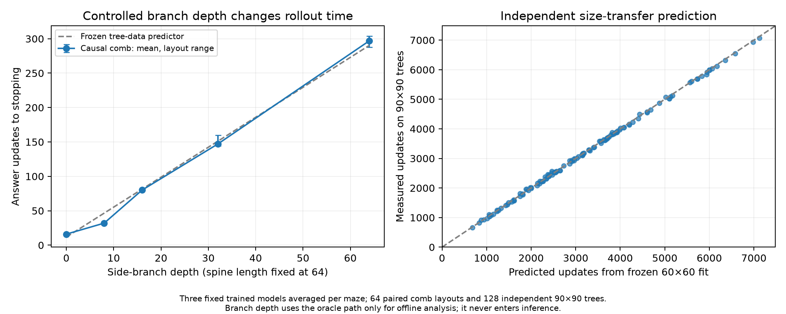
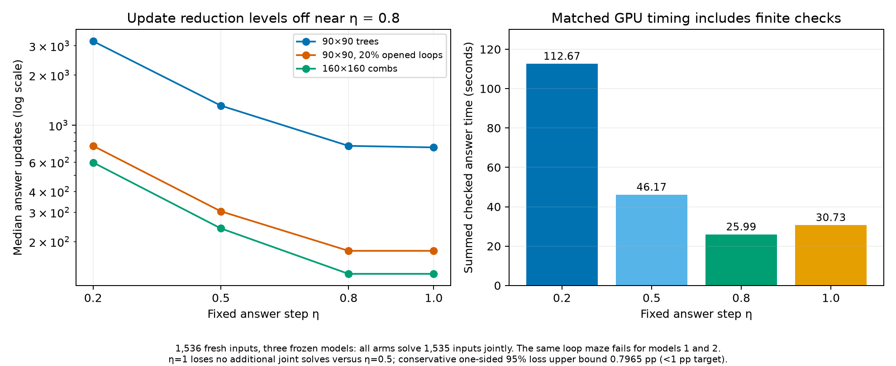

The frozen Maze-Hard energy transfers to larger generated mazes when its answer rollout has enough time. The failure at the paper's 2,048-update budget is concentrated in long tree branches. Changing the latent mass did not improve it. A controlled comb experiment supports branch-pruning depth as the cause of the additional rollout time. A subsequent frozen test increased only the answer step from 0.2 to 0.5: it reduced median answer updates by 2.38–2.42× on new 60×60 and 90×90 cohorts, with no observed accuracy loss.

A larger independent stability test also found a rare absolute-reliability failure: the same cyclic maze defeated two models at every tested step size. At η = 0.2/0.5/0.8 they certified invalid answers; at η = 1 they entered a period-two oscillation. The predictions, model weights, graph, energies and full local states are retained. The tested relative instability hypothesis was falsified, because η = 1 lost no additional joint solves compared with η = 0.5. This does not establish universal stability or correctness.

These are new research experiments on a declared randomized DFS-tree distribution, with optional opened loops. They are not new official Maze-Hard benchmark results. All experiments reuse the three fresh 29-parameter models from the completed reproduction, preserve learned weights, and run on Work's two RTX PRO 6000 Blackwell GPUs. Generated labels and graph algorithms are correctness oracles and offline diagnostics; they never enter model inference.

| Model / control | Role |
|---|---|
| BP AdamW | Outside this frozen-model inference intervention; no new baseline training |
| Frozen CRAM+z, original mass | Matched primary control |
| Frozen CRAM+z, mass×(30/L)² | Training-free intervention, no answer-energy changes |
| Frozen CRAM+z, 8,192 answer updates | Budget intervention, original mass and identical update rule |
| Frozen CRAM+z, answer step η = 0.5 | Matched step-size intervention against η = 0.2, both capped at 8,192 |
| BFS / independent Dijkstra | Label and shortest-path oracles, not learned competitors |

The native PyTorch hidden solver keeps its 4,000-update limit, tolerance 1e-6 and checks every 8 updates. Answer relaxation uses step 0.2, initial logit 3, fixed-point checks every 16 updates, and the declared 2,048 or 8,192 cap. Both stopped correctness and independently valid shortest paths are required. Hidden failures, answer timeouts, and wrong fixed points remain failures. Saved final boards permit independent validity checks.

**Size-transfer hypotheses.** H2 predicted at least 99% of 60×60 generated mazes would be solved by all three models under the original 2,048 cap. H2b predicted at least 5 percentage points improvement from mass scaling. Each cohort contains 128 independently generated mazes at each of three loop-opening rates; training-model repeats are not counted as additional independent mazes.

| Cohort and topology | Unique mazes | Original solved, each model | Mass-scaled solved, each model |
|---|---:|---:|---:|
| Discovery, 30×30, all three loop rates |384|384|Alias of original: scaling factor 1 |
| Discovery, 60×60, tree |128|92|92|
| Discovery, 60×60, 5% loops |128|128|128|
| Discovery, 60×60, 20% loops |128|128|128|
| Reserved confirmation, 30×30, all rates |384|384|Alias of original |
| Reserved confirmation, 60×60, tree |128|96|96|
| Reserved confirmation, 60×60, 5% loops |128|128|128|
| Reserved confirmation, 60×60, 20% loops |128|128|128|

H2 is falsified: discovery joint success was 348/384=90.625% with one-sided 95% upper bound 92.9613%; independent confirmation was 352/384=91.6667%, upper bound 93.8703%. All failed cases exhausted the answer budget. There were no wrong stops or hidden failures. H2b is also falsified: paired gain was 0 percentage points in both cohorts, with no discordant solve outcome. The exact one-sided 95% upper bound on the unseen discordant fraction is 0.7771 percentage points per cohort, also below the 5-point target. These conclusions concern the specified distribution, masses and budget.

**Longer rollout.** The next protocol used a new 256-tree 60×60 cohort. Raising only the answer cap from 2,048 to 8,192 improved every model from 203/256 to 256/256. Paired gain was 20.7031 points, with 95% paired-maze bootstrap interval 16.0156–25.7813. The required 5-point gain is supported. The absolute 99% population claim remained inconclusive at that sample count: even 256/256 gives a one-sided 95% lower bound 98.8366%.

A separate, frozen 384-tree 60×60 confirmation then solved 384/384 with every model. Its one-sided 95% lower bound 99.2229% supports the 99% joint-success hypothesis. All three models also solved 128/128 new 90×90 trees at the same 8,192 cap, with no budget increase; this smaller 90×90 cohort supports perfect observed success but not a 99% population lower bound (97.6868%). The maximum 90×90 mean stopping time across the three models was 7,072 updates.

**Mechanism and causal control.** On the earlier 256-tree cohort, the preregistered exploratory association of stopping time with maximum distance from any open node to the unique S–G path had Spearman ρ = 0.99914. Association with tree diameter was 0.00851, and with S–G path length was −0.84633. The latter correlations alone do not identify a cause.

The linear predictor fitted only on that 256-tree cohort was frozen as `updates=4.352984700053693×branch_depth+11.720719172409504`. On the new 128-tree 90×90 cohort it predicted all 128 mean stopping times within 10% relative error (mean 1.20%, maximum 4.31%). The one-sided 95% lower bound for within 10% coverage is 97.6868%, supporting the preregistered 95% coverage target. Computing branch depth requires an oracle S–G path: this is an offline mechanistic explanation, not a practical model-only budget selector.

The causal intervention used 90×90 comb mazes with eight nonadjacent branches and 64 paired translation/rotation/reflection layouts. All layouts and conditions retained the same three trained models. Graph connectivity, acyclicity, exact spine length, eight branch junctions, and branch depth were independently verified. All 1,344 model–maze evaluations produced valid shortest paths.

| S–G spine length | Branch depth | Mean answer updates | Range across layout means |
|---:|---:|---:|---:|
|64|0|16.000|16–16|
|64|8|32.000|32–32|
|64|16|80.000|80–80|
|64|32|147.000|144–160|
|64|64|296.917|288–304|
|16|16|80.000|80–80|
|32|16|80.000|80–80|

Increasing branch depth from 0 to 64 at fixed spine 64 added 280.917 updates (95% paired-layout bootstrap 279.25–282.58), exceeding the frozen 200-update target. Increasing spine length 16 to 64 at fixed branch depth 16 changed stopping time by exactly 0 updates, satisfying the frozen ±32-update equivalence margin. All eight orientations solved correctly; orientation-specific counts and timings remain in the audit, rather than being hidden by the mean.

[PDF](../../../results/research/work/pruning-mechanism.pdf) and [SVG](../../../results/research/work/pruning-mechanism.svg) are standalone scientific figures.

**Evidence and commands.** Protocols were frozen before the outcomes of their respective cohorts: [initial](protocol.json), [unchanged confirmation](confirmation-protocol.json), [budget intervention](budget_extension-protocol.json), [independent horizon and size transfer](horizon_transfer-protocol.json), and [causal combs](causal_comb-protocol.json). The initial dense linear solve and independent reference checks at 4, 8, 30 and 60 grids agreed to less than 9e-15 in double precision. No dimension-specific energy change was required.

**Step-size intervention.** H2g predicted at least a 2× reduction in median answer updates for η = 0.5 versus 0.2 at each size, with no lost joint three-model solves and a one-sided 95% upper bound on loss probability below 1 percentage point. The [frozen eta protocol](eta-protocol.json) used 768 new mazes: 384 per size, equally divided across tree, 5% loop, and 20% loop strata, with the same three trained models. Both arms retained the 8,192 cap, identical hidden states and learned energy. Model stopping steps were averaged within each maze before computing medians; 10,000 paired bootstrap samples preserved loop strata and all model repeats.

| Size | Median updates, η = 0.2 | Median updates, η = 0.5 | Ratio and paired 95% CI | Joint success, each arm | Joint success by 2,048, η = 0.2 → 0.5 |
|---|---:|---:|---:|---:|---:|
| 60×60 | 762.667 | 320.000 | 2.3833× [2.3500, 2.4737] | 384/384 | 351/384 → 384/384 |
| 90×90 | 1,192.000 | 493.333 | 2.4162× [2.3958, 2.4598] | 384/384 | 285/384 → 370/384 |

Both per-size hypotheses are supported. The exact one-sided 95% upper bound on an unseen lost-solve probability is 0.7771 percentage points at each size. This is a bound for the specified generator mixture and three fixed models, not for arbitrary mazes or training seeds. All 4,608 saved model–maze–arm boards passed independent shortest-path audit; there were no wrong stops, hidden failures or censored rollouts. These are per-size intervals without a multiplicity-adjusted combined claim.

Matched native answer times after warmup gave 2.4466× and 2.4382× speed ratios at 60 and 90; including identical shared hidden preparation gave 2.0897× and 2.2058×. Both arms ran on the same GPU per job, with alternating arm order and CUDA synchronization. Diagnostic replay was excluded from timing. On the prespecified first eight seed-0 mazes in each of six size/topology cells, both arms exactly matched native outcomes, showed no sampled energy increases every 16 updates, and triggered no two-cycle flags. This finite diagnostic does not prove global stability. Continuous-logit residuals remained nonzero at some discrete flip-stable stopping points, as the solver's stopping criterion permits. A separate 2,048-cap preflight verified that first-stop steps correctly recover the prefix success counts above.

Public [eta summary](../../../results/research/work/eta-summary.json), [per-model runs](../../../results/research/work/eta-runs.csv), [paired per-maze values](../../../results/research/work/eta-per-maze.csv), [PDF](../../../results/research/work/eta-acceleration.pdf), and [SVG](../../../results/research/work/eta-acceleration.svg) retain exact outcomes and figure data. Recheck the full local evidence using `upstream/.venv/bin/python research/20261114/work/audit_eta.py`; regenerate the figure with `artifacts/plotting-venv/bin/python research/20261114/work/plot_eta.py`.

**Independent causal test of acceleration.** H2h predicted that the ratio of branch-depth slopes at η = 0.2 and 0.5 would lie within [2, 3], a ±20% equivalence band around the inverse-step prediction 2.5. The [new frozen protocol](eta_comb-protocol.json) used 64 fresh paired translation/orientation layouts on 160×160 grids, branch depths 32, 64 and 128 at fixed spine 64, and separate spine 16/128 controls at depth 64. The larger grid accommodates these deliberately long branches. Three fixed models and both eta arms evaluated every condition. OLS slopes were fitted across the three declared depths within each layout, then averaged; the bootstrap preserved all paired conditions and model repeats.

The measured slopes were 4.670201 and 1.860491 updates per branch-depth unit for η = 0.2 and 0.5. Their ratio was 2.510198, with paired-layout 95% bootstrap interval [2.495415, 2.524831], supporting the frozen equivalence hypothesis. Changing spine 16 to 128 at depth 64 changed the mean by exactly zero updates in both arms; each paired interval was [0, 0], inside the separate ±32-update equivalence margins. All 1,920 model–maze–arm boards were valid shortest paths. Independent topology checks confirmed connectivity, acyclicity, eight branch junctions and exact spine/depth for all 320 condition/layout graphs. Diagnostic replays matched native outputs and showed no sampled energy increases or two-cycle flags. This supports the branch-pruning-rate explanation for these models and constructed mazes; it does not establish a universal step-size stability theorem.

Public [comb eta summary](../../../results/research/work/eta-comb-summary.json), [per-model runs](../../../results/research/work/eta-comb-runs.csv), [paired layout data](../../../results/research/work/eta-comb-per-layout.csv), [PDF](../../../results/research/work/eta-pruning-rate.pdf), and [SVG](../../../results/research/work/eta-pruning-rate.svg) retain the exact results. Recheck with `upstream/.venv/bin/python research/20261114/work/audit_eta_comb.py`; plot using `artifacts/plotting-venv/bin/python research/20261114/work/plot_eta_comb.py`.

Independent saved-board audits, exact binomial bounds, paired bootstrap statistics and hashes are retained for [discovery](../../../results/research/work/discovery-audit.json), [confirmation](../../../results/research/work/confirmation-audit.json), [budget intervention](../../../results/research/work/budget_extension-audit.json), [horizon transfer](../../../results/research/work/horizon_transfer-audit.json), and [combs](../../../results/research/work/causal_comb-audit.json). Recompute these without inference using `upstream/.venv/bin/python research/20261114/work/audit.py --campaign discovery`, the same command with `confirmation` or `budget_extension`, and `audit_followups.py --campaign horizon_transfer`or`causal_comb`. Plot regeneration is `artifacts/plotting-venv/bin/python research/20261114/work/plot_results.py`.

**Stability boundary and a retained exception.** The [frozen four-arm protocol](eta_boundary-protocol.json) tested η = 0.2, 0.5, 0.8 and 1 on 1,536 new inputs: 512 trees, 512 mazes with 20% opened loops, and 512 combs. All three fixed models evaluated every input. The cap remained 8,192; no failed run received a rescue. H2i predicted that η = 1 would lose at least 1 percentage point of joint solves that η = 0.5 achieved. There were zero such losses or gains. The conservative one-sided 95% upper bound was 0.79649 percentage points, formed from equal-weight stratum bounds with Bonferroni correction, so H2i is falsified. A zero-width empirical bootstrap interval is also retained but is not used as a population guarantee.

| Answer step η | Joint solved / unique inputs | Median updates, including caps | Wrong certified stops / model-inputs | Budget failures / model-inputs | Checked answer seconds |
|---|---:|---:|---:|---:|---:|
| 0.2 | 1,535 / 1,536 | 752 | 2 / 4,608 | 0 / 4,608 | 112.666 |
| 0.5 | 1,535 / 1,536 | 304 | 2 / 4,608 | 0 / 4,608 | 46.171 |
| 0.8 | 1,535 / 1,536 | 176 | 2 / 4,608 | 0 / 4,608 | 25.993 |
| 1.0 | 1,535 / 1,536 | 176 | 0 / 4,608 | 2 / 4,608 | 30.727 |

All arms had zero hidden or nonfinite failures. The same loop-maze input 38 caused both model-seed failures. These timings use identical finite-logit checks in every arm and matched GPU execution; they are separate from the earlier native-timing results. No new eta was selected from these exploratory comparisons.

Independent forensic replay matched the original 32-input batch predictions, stopping steps and flags exactly for all three models and four eta values. The selected graph has 352,212 shortest paths of 204 edges, whose union contains 654 cells. Model 0 solves it under every eta. Models 1 and 2 at η = 0.2/0.5 retain a connected 246-cell subgraph with two branching junctions; at η = 0.8 they retain only the two disconnected endpoints. All selected cells lie within the union of shortest paths. At η = 1 the failed models exhibit a measured period-two cycle and exhaust the cap.

The invalid certified answers have strictly positive single-flip margins: 0.9260/1.1330 for the two branched answers, and 4.3480/4.3858 for the endpoint-only answers. Tightening the −1e-6 certificate tolerance cannot reject these states. The hidden solver reaches exactly zero measured residual after 208 updates. For model 2, the endpoint-only discrete energy is −62,991.921875, lower than the valid oracle-path energy −61,435.00390625; the branched answer's energy is −61,121.47265625. Thus this exception includes a learned-energy connectivity failure, not just insufficient rollout time. These are selected, post-outcome diagnostics; they do not replace the frozen trial or establish that shortest-path multiplicity is the cause.

Public [boundary summary](../../../results/research/work/eta-boundary-summary.json), [per-model results](../../../results/research/work/eta-boundary-runs.csv), [paired maze data](../../../results/research/work/eta-boundary-per-maze.csv), [failure classification and energies](../../../results/research/work/cyclic-failure-classification.json), and [exact failure graph, predictions and three model state dictionaries](../../../results/research/work/cyclic-failure-case.json) support independent examination. Full logits, continuous states, couplings, hidden states, flip deltas and energy trajectories remain in the local `artifacts/research/20261114/work/eta_boundary/failure-forensics/` archive. Recheck the trial with `audit_eta_boundary.py`; reproduce the selected-case graph classification with `classify_boundary_failure.py`. Exact-board caching verified 18,432 outputs through 1,539 unique input/prediction graph checks in 6.91 seconds, reusing only byte-identical boards on the same input.

**Independent tests of the tie explanation.** Two new frozen studies tested whether equal shortest routes alone explain the retained failure. The [serial-cycle protocol](tie_controls-protocol.json) paired equal routes against two unequal-route controls on graphs with 1, 4, 8 or 12 cycles. There were 64 fresh layout/geometry clusters and three fixed models. The paired conditions match node count, edge count, degree histogram and cycle sizes; moving ports by ±2 cells changes the number of shortest paths from 2, 16, 256 or 4,096 to one. The unequal path is 4 edges shorter per cycle, an explicit remaining difference. Every one of the 2,304 model-input evaluations solved correctly at η = 0.5. The predicted 10-point joint-success loss on tied graphs is falsified: observed difference 0, no discordant cluster, and an exact one-sided 95% upper bound of 4.573 points on unseen discordant clusters. The paired bootstrap [0, 0] is retained but is not treated as a population guarantee.

The failed graph contains two 42-edge routes around one retained 84-edge cycle, longer than each individual route in the first control study. A [distinct extension](long_ties-protocol.json) therefore froze isolated cycle route lengths 28, 42 and 64, with 128 new paired layout/width clusters. Again, tied and ±2 port-shift controls match graph topology, node/edge counts and degrees; their shortest path lengths differ by 4. All 3,456 model-input evaluations solved. The primary 10-point loss hypothesis, averaged over route lengths 42 and 64, is also falsified: zero difference and a 2.313-point upper bound on unseen discordant clusters. Route 28 also had zero difference. These controls show that neither many ties nor long isolated ties are sufficient to produce the selected random-maze failure in these families. They do not explain away that failure or test all combinations of heterogeneous cycles and branches.

Public exact values are in the [serial-cycle summary](../../../results/research/work/tie_controls-summary.json), [serial-cycle runs](../../../results/research/work/tie_controls-runs.csv), [paired serial-cycle data](../../../results/research/work/tie_controls-per-layout.csv), [long-cycle summary](../../../results/research/work/long_ties-summary.json), [long-cycle runs](../../../results/research/work/long_ties-runs.csv), and [paired long-cycle data](../../../results/research/work/long_ties-per-layout.csv). Recheck with `audit_tie_controls.py` and `audit_long_ties.py`. Independent audits verify every graph's connectivity, shortest distance, exact number of shortest paths, cycle count, and matched structural counts.

**Selected-graph interventions are descriptive.** A separate [edit protocol](forensic_edits-protocol.json) chose one central interior node from each retained 42-edge branch, and 32 seeded matched noncritical nodes outside the union of all shortest paths. The choices were fixed before observing the edited outcomes. Every edit removes one degree-2 node and two edges with the same neighborhood degrees, preserves connectivity and shortest distance 204, and produces matching node/edge counts and degree histograms.

Deleting either targeted branch node restored all three models at unchanged η = 0.5. Both failing models still gave wrong certified stops after every one of the 32 matched noncritical deletions; model 0 solved all edits. The targeted graphs still contain 299,328 and 334,932 shortest paths, while controls retain 352,212. The effect is specific to the retained branch, despite abundant remaining degeneracy. These 102 model-input evaluations concern one selected graph and support no population recovery claim. All original failures remain in the earlier trial. The [edit audit](../../../results/research/work/forensic-edits-summary.json) and [per-model edit results](../../../results/research/work/forensic-edits-cases.csv) retain each outcome, energy and margin.

The [separate energy decomposition](../../../results/research/work/cyclic-failure-energy-decomposition.json) evaluates the saved coefficients in float64 and matches the repository energy within 1e-8. For model 2:

| State | Latent-gated links | Maze-Unique pair term | Maze-Unique bias term | Total energy |
|---|---:|---:|---:|---:|
| Valid oracle path | −2,950.772 | −32,024.525 | −26,459.681 | −61,434.979 |
| Branched η = 0.5 answer | −3,553.938 | −31,646.483 | −25,921.028 | −61,121.450 |
| Endpoint-only η = 0.8 answer | 0.905 | −33,866.126 | −29,126.670 | −62,991.892 |

The endpoint-only state's pair and bias terms improve by 4,508.590 energy units, outweighing its lost 2,951.677 units of latent-link reward. This explains its lower energy for these frozen coefficients. It does not identify which graph feature causes the coefficients to admit the invalid state. Entropy is negligible for these discrete answers; small differences from the earlier float32 totals are rounding. Full per-cell energy terms and latent log conductance, diagonal and source maps are retained alongside the full states.

**Readout versus geometry on the selected graph.** The [corrected reciprocal-swap protocol](coupling_swap_corrected-protocol.json) transferred the latent attention readout between the original graph and each of the two successful branch deletions, plus the first previously fixed noncritical deletion. Learned parameters and η = 0.5 remain fixed. Transfer uses the intersection of donor and recipient open-cell supports, with valid self coefficients preserved and deleted-node incident coefficients zeroed. There is no renormalization. Every source graph and model passed exact identity-transfer agreement with native full logits, stopping steps, stop flags and final boards before the counterfactual runs.

Transferring either targeted edit's readout onto the unchanged original geometry restores all three models. Keeping the original readout on the targeted edited geometry does not restore models 1 or 2; for branch B that reciprocal condition also fails model 0. The matched noncritical readout swaps leave models 1 and 2 failing. Thus changed readout is sufficient on the original geometry in this selected case, while physical node removal with original readout and incident-link masking is insufficient. This does not yet isolate which nonincident coefficients matter or establish population robustness. The corrected 30-arm study includes 12 matched baseline arms and 18 swaps.

The [corrected audit](../../../results/research/work/coupling-swap-corrected-summary.json), [per-arm outcomes and energy terms](../../../results/research/work/coupling-swap-corrected-arms.csv), and [identity-transfer receipt](../../../results/research/work/coupling-swap-identity-preflight.json) retain the full evidence. Active-coefficient change statistics exclude irrelevant wall-query attention entries. For model 2, the targeted readouts change nonincident coefficients by L1 totals 3.4635 and 31.2139; reciprocal original-readout arms change none away from the deleted node. These magnitudes are descriptive, not a fitted recovery criterion.

An earlier 30-arm swap attempt was excluded because its mask incorrectly assumed zero self coefficients and did not fully mask donor wall-query outgoing coefficients. Native solver parity did not detect that error: both solver implementations received the same incorrectly transformed tensor. The corrected identity-transfer gate checks the intervention itself against each graph's unmodified native trajectory. The [excluded-attempt receipt](../../../results/research/work/coupling-swap-excluded-v1.json), flawed source, protocol and all raw outputs are preserved separately, with no causal conclusion taken from that attempt.

**Independent free-fork angle control.** The [next frozen protocol](fork_angle-protocol.json) tested whether right-angle alternatives at free degree-3 junctions cause a 10-point joint-success loss relative to opposite alternatives. Both conditions use one cycle with two equal routes of length 28, 42 or 64, plus two 16-edge tails ending at S and G. Within each of 128 new paired layout/width clusters, the conditions match node and edge counts, degree histogram, cycle perimeter, tail lengths, S–G distance and exactly two shortest paths. Independent checks verify that alternative neighboring cells interact through a diagonal pair term only in the corner condition.

All three models solved all 768 inputs at fixed η = 0.5: 2,304 valid outputs. H2l is falsified, with 0 points difference at every route length, no discordant cluster, and a 2.313-point upper bound on unseen discordant clusters. Mean updates were 51.17 versus 54.54 at route 28 and exactly 80 and 128 for both conditions at routes 42 and 64. The positive diagonal interaction coefficients range from 1.6100 to 1.6278 across the three models. The [summary and actual pair tables](../../../results/research/work/fork-angle-summary.json), [per-model runs](../../../results/research/work/fork-angle-runs.csv), [paired layout results](../../../results/research/work/fork-angle-per-layout.csv), and [all fork attention/readout measurements](../../../results/research/work/fork-angle-readouts.csv) are public. This negative result rules out the proposed large loss in this matched family; it does not isolate the readout feature responsible for the selected random-maze failure.

The generator, worker source, protocol hashes, immutable model copies, launch receipts, worker logs, per-batch counters, and all predicted boards are retained. There are 210 planned jobs with 44,352 model–maze–arm evaluations, plus 6 descriptive selected-graph jobs with 132 arms: 216 included jobs and 44,484 evaluations in total. The latter include 12 explicit matched baseline arms. Other diagnostic replays and the excluded 30-arm attempt are separate. The original reproduction remains unchanged. Timing reflects PyTorch inference and CPU launch overhead on Blackwell; these experiments establish no H200 speedup or new baseline-training comparison. Further research is separate from these completed totals.
