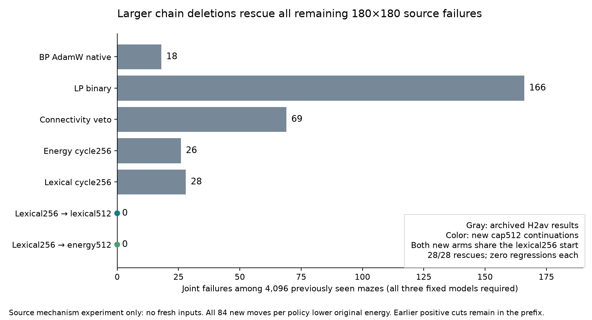
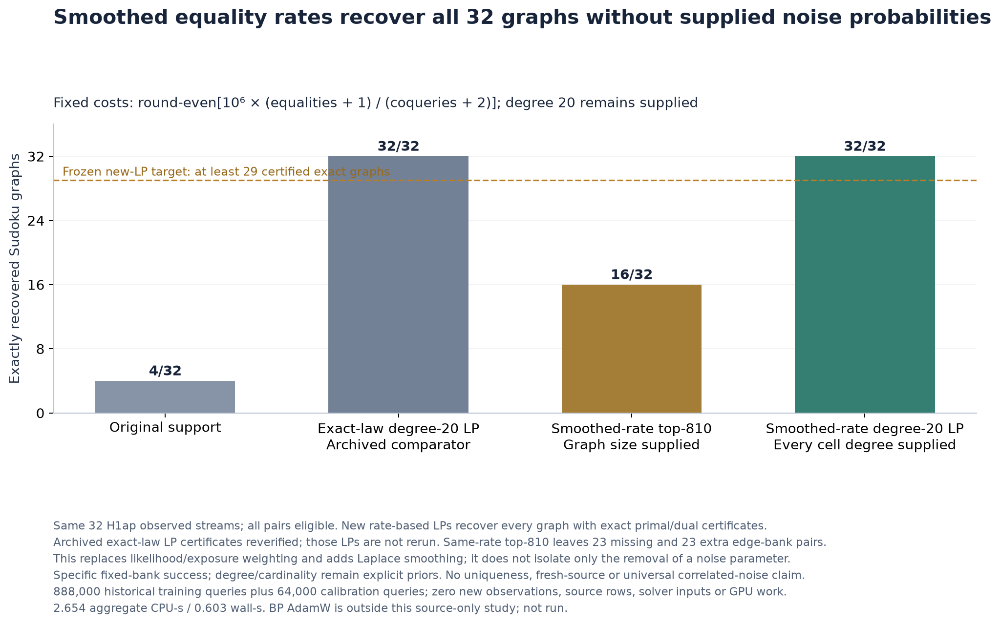
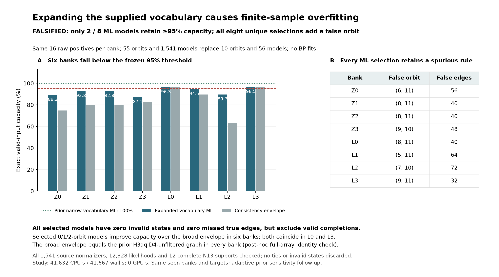
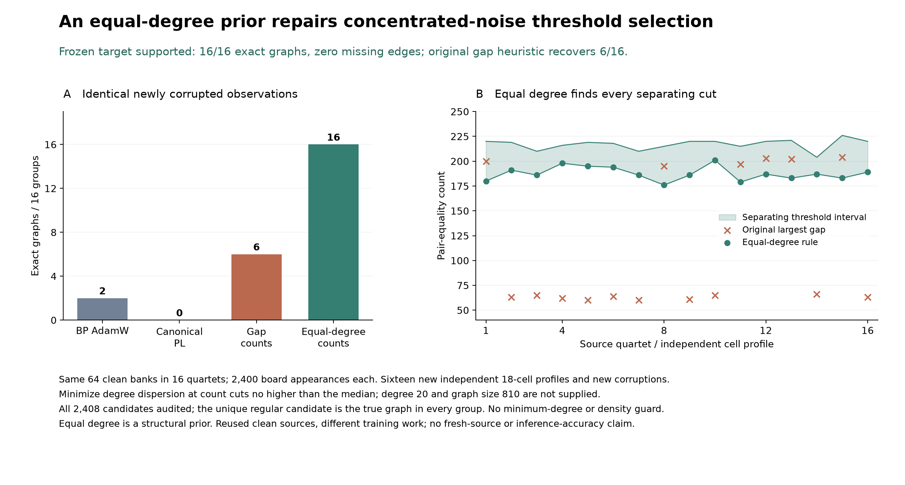
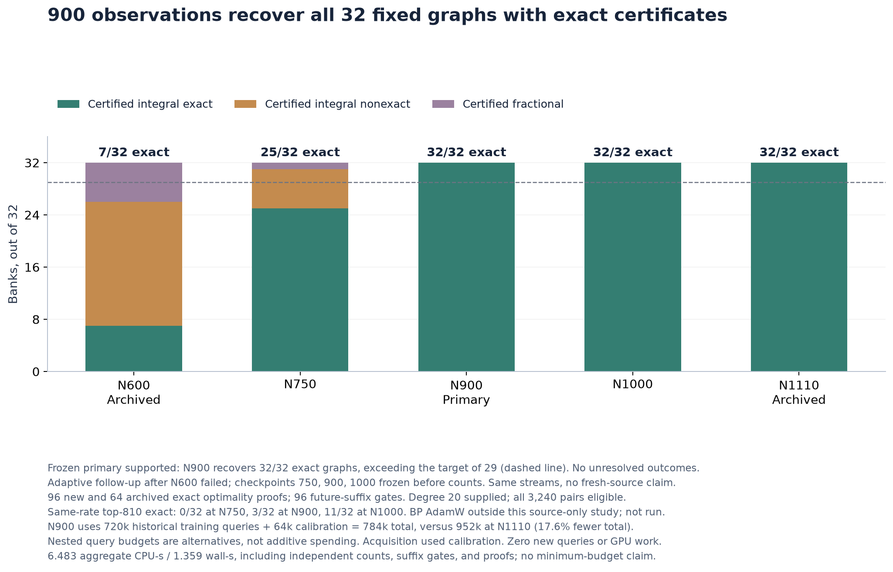
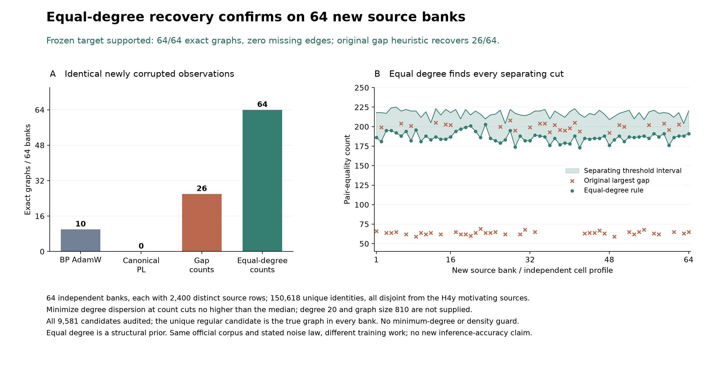
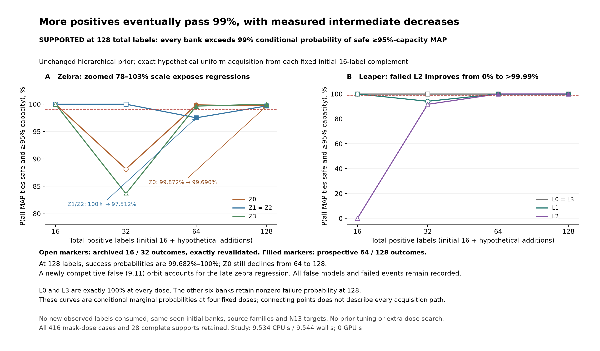
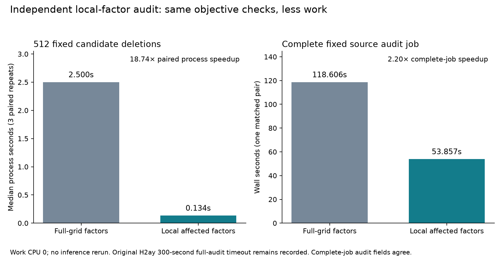
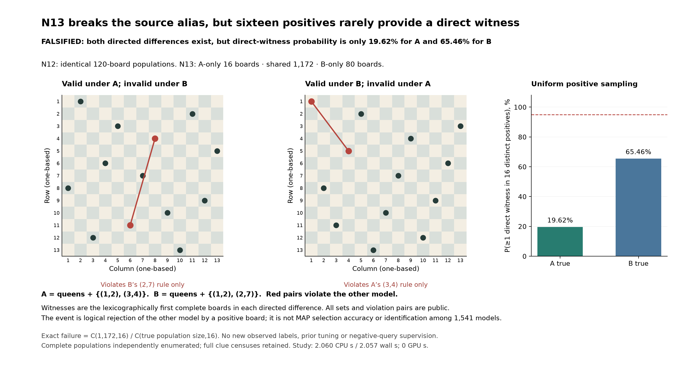

# Public results

Weight-Space Programming extension: [Complete WSP benchmark report](../docs/WSP_BENCHMARK_REPORT.md) and [consolidated comparison tables](wsp/wsp-comparison-tables.json) covering zero-training (`k=0`, `0` learned parameters, `wsp.free_model.static_problems == []`) evaluations across [Sudoku-Extreme (`412,786` test & `10k` sweeps)](wsp/sudoku/), [Maze-Unique, Maze-Hard & dense `180×180` three-cohort mazes](wsp/maze/), and [N-Queens, Graph Coloring & `N=13` Queen+Leaper](wsp/multi/). All `66/66` frozen CRAM reproduction exports remain untouched.

Final round: [Source diversity recovers the graph in 72/72 fresh source banks versus 0/72 with correlated repeats](../research/20261114/ripper/REPORT-diversity-after-correlation.md), with equal noisy-label budgets, three times as many sources and a disclosed monitoring fault. [Repeated independent measurements recover 256/256 examined synthetic graphs versus 253/256](../research/20261114/foureyes/REPORT-repeat-diversity.md). [Packed maze dispatch saves 31.34% versus the original dispatcher](../research/20261114/work/REPORT.md#h2bs-stable-offline-packing-supports-the-10-complete-cost-saving-target). Research is stopped; [prepared but unrun studies](../docs/RESEARCH_STATUS.md) have no experimental conclusions.

Previous: [Correlated repeats falsify both recovery targets at 0/72](../research/20261114/ripper/REPORT-correlated-repeat.md). [Changing tree weights while retaining MAP routing saves 6.64% of paid queries](../research/20261114/loki/h3ca/REPORT.md), with the same 1,008/1,024 exact identifications and 16 retained failures.

Recent: [Fresh pooling with a retained audit correction](../research/20261114/foureyes/REPORT-fresh-pooled-donor.md) recovers 253/256 versus 239/256. [Mixed-maze dispatch](../research/20261114/work/REPORT.md#h2br-endpoint-dispatch-preserves-accuracy-but-falsifies-both-cost-targets) preserves 4,096/4,096 accuracy but fails both cost targets.

These compact exports contain the measurements and provenance used by the repository's figures. They exclude full raw datasets and predicted-board archives. The matched maze training study includes small model and optimizer states, its 1,000 training fixtures, and frozen readouts.

- [Within-bank noise variation: scalar inference matches a privileged per-cell-channel control at 70/72 fresh graphs](../research/20261114/ripper/REPORT-cell-channel.md)
- [Uniform fitted query weights save 11.21% of calls but lose one prior success, falsifying the joint no-loss target](../research/20261114/loki/h3bz/REPORT.md)
- [Pooling the same 1,800 observations recovers 254/256 graphs versus 229 with donor masking; 25 gains, zero losses](../research/20261114/foureyes/REPORT-pooled-donor.md)
- [Fresh noise-rate variation: estimated and supplied channels each recover the same 67/72 graphs](../research/20261114/ripper/REPORT-heterogeneous-channel.md)
- [Fresh opposite-region maze endpoints: all 4,096 cases solved and 18.43% complete answer-cost saving](../research/20261114/work/REPORT.md#h2bq-opposite-region-endpoints-preserve-joint-success-and-save-1843-complete-answer-cost)
- [A 1,200-row donor reaches 229/256 graphs; masking preserves exactly the same successes](../research/20261114/foureyes/REPORT-larger-donor.md)
- [A disjoint 600-row donor recovers 122/256, losing 49 detector successes; separate audit repair preserves the original failed run](../research/20261114/foureyes/REPORT-disjoint-donor.md)
- [Estimating the noise channel from repeated observations retains 62/64 graphs and all nominal-control successes](../research/20261114/ripper/REPORT-estimated-channel.md)
- [Uniform-truth prior shift: fixed deeper questions save 2.89% of paid calls across 4,096 fresh paired cases](../research/20261114/loki/h3by/REPORT.md)
- [Uniform open-cell endpoints: all 4,096 maze cases solved, but the cascade costs 15.54% more than LP96](../research/20261114/work/REPORT.md#h2bp-uniform-endpoints-preserve-joint-success-but-falsify-the-cost-saving-target)
- [Half and double assumed noise rates each retain 62/64 graphs with zero nominal-control regressions](../research/20261114/ripper/REPORT-channel-misspecification.md)
- [Opposite-half conflict masks recover only 38/256 graphs, losing 95 detector successes; both targets fail](../research/20261114/foureyes/REPORT-crossfit-conflicts.md)
- [Fresh deeper question trees save 2.57% of paid calls with all 4,096 paired cases retained](../research/20261114/loki/h3bx/REPORT.md)
- [Nonlinear pair likelihood recovers 62/64 examined graphs without regressions, missing its 63/64 target](../research/20261114/ripper/REPORT-pair-likelihood.md)
- [Fresh BP-first maze cascade solves 4,096/4,096 across three models and saves 35.40% complete answer cost](../research/20261114/work/REPORT.md#h2bo-fresh-confirmation-supports-999-joint-success-and-saves-3540-complete-answer-cost)
- [Perfect mask precision still gives 130/256; matched rowwise recall at random true locations gives 237/256](../research/20261114/foureyes/REPORT-purified-detector.md)
- [All three residual posterior failures strictly exclude truth; removing integer rounding alone cannot fix them](../research/20261114/ripper/REPORT-posterior-residual-gap.md)
- [Observable conflict masks recover 130/256 versus 71/256 random; the absolute recovery target fails](../research/20261114/foureyes/REPORT-conflict-mask.md)
- [Fresh posterior-label confirmation recovers 61/64 graphs versus 51/64 with hard decoding and 64/64 with more boards](../research/20261114/ripper/REPORT-posterior-fresh-confirm.md)
- [Posterior scoring recovers 63/64 on the examined repeated-query cohort](../research/20261114/ripper/REPORT-posterior-query-labels.md)
- [Exact deeper question trees finish all 4,096 cases and save 2.14% of total paid queries](../research/20261114/loki/h3bw/REPORT.md)
- [Actual BP-first maze cascade preserves source success and saves 37.03% complete answer cost](../research/20261114/work/REPORT.md#h2bn-the-actual-bp-first-geometry-cascade-preserves-source-success-and-saves-3703-complete-answer-cost)
- [Partial masks: 256/256 graphs at 90% corruption-location recall, with supplied perfect precision](../research/20261114/foureyes/REPORT-partial-mask-recall.md)
- [Raw-count quantization control recovers 49/64 versus 50/64, failing both improvement targets](../research/20261114/ripper/REPORT-raw-count-quantization.md)
- [Exact pruning reaches 3,836/4,096 cases before its state cap; study remains incomplete](../research/20261114/loki/h3bv/REPORT.md)
- [Discarding known-corrupted pair observations recovers 256/256 examined graphs; privileged masks required](../research/20261114/foureyes/REPORT-corruption-censor.md)
- [Equal query cost: 270 boards once recover 64/64 graphs versus 50/64 from 90 boards three times](../research/20261114/ripper/REPORT-repeat-query-tradeoff.md)
- [Exact diagnosis: nine strict exclusions among 14 repeated-query failures; ten-exclusion target fails](../research/20261114/ripper/REPORT-repeated-objective-gap.md)
- [Deeper question-tree study reaches its state cap; whole-cohort hypothesis remains untested](../research/20261114/loki/h3bu/REPORT.md)
- [Fresh 270-row confirmation recovers 64/64; paired gain of six misses its eight-gain target](../research/20261114/ripper/REPORT-fixed-270-confirm.md)
- [All 510 archived BP errors violate simple-path geometry](../research/20261114/work/REPORT.md#h2bm-all-510-archived-bp-failures-violate-simple-path-geometry)
- [Privileged corruption masks do not rescue the attenuation correction: 88/256 versus 129/256](../research/20261114/foureyes/REPORT-oracle-attenuation.md)
- [Stopping on repeated graphs recovers 32/32; its separate label-budget target fails](../research/20261114/ripper/REPORT-stability-stopping.md)
- [Additional LP certificate rejects only 1 of 510 BP graph errors](../research/20261114/work/REPORT.md#h2bl-an-additional-lp-certificate-rejects-only-1-of-510-bp-graph-errors)
- [Exact expected-cost guard saves 0.62% of total queries, missing its 2% target](../research/20261114/loki/h3bt/REPORT.md)
- [Fresh dense-maze confirmation solves 4,096/4,096; no fallback is triggered](../research/20261114/work/REPORT.md#h2bk-fresh-lp96-solves-40964096-the-fallback-branch-is-never-used)
- [Conditional signal test: 32/32 examined real detections, 0/32 fresh null detections; no graph-confidence claim](../research/20261114/ripper/REPORT-signal-detection.md)
- [Per-cell deficit normalization reduces exact graph recovery from 129/256 to 98/256](../research/20261114/foureyes/REPORT-normalized-deficit.md)
- [Exact vote-cost diagnosis: 30 of 31 lost graphs are strictly excluded by the bootstrap objective](../research/20261114/foureyes/REPORT-consensus-gap.md)
- [Early question-tree handoff preserves recovery but raises total paid calls by 5.62%](../research/20261114/loki/h3bs/REPORT.md)
- [Bootstrap consensus reduces graph recovery from 129/256 to 108/256; both targets fail](../research/20261114/foureyes/REPORT-bootstrap-consensus.md)
- [Histogram-preserving shuffles: all 32 real banks retain a stronger curvature signal in both mask arms](../research/20261114/ripper/REPORT-marginal-shuffle.md)
- [Independent-label nulls separate structure detection from graph-recovery confidence](../research/20261114/ripper/REPORT-null-signal.md)
- [Numerical fallback verifies the known BP rescue and both original energy certificates](../research/20261114/work/REPORT.md#h2bj-the-known-bp-rescue-executes-correctly-and-also-passes-the-original-lp-certificate)
- [Matched-prior question policy: posterior saves 13.52% continuation calls, 0.63% total calls](../research/20261114/loki/h3br/REPORT.md)
- [Bounded asynchronous archives: 1.28× complete research-pipeline speed with identical artifacts](../research/20261114/work/REPORT.md#h2bi-bounded-asynchronous-archives-improve-complete-research-pipeline-throughput-by-1279)
- [Exact objective diagnosis: truth is strictly suboptimal in 385/394 selected graph failures](../research/20261114/foureyes/REPORT-objective-gap.md)
- [Balanced observation masks tie uniform masks at 32/32; the advantage target fails](../research/20261114/ripper/REPORT-balanced-masks.md)
- [Harder independent noise: balanced 26/32 versus uniform 25/32; the four-recovery advantage fails](../research/20261114/ripper/REPORT-higher-noise.md)
- [Fresh selected-truth query confirmation: uniform trees save 3.98% versus first-lex and 8.02% versus posterior](../research/20261114/loki/h3bq/REPORT.md)
- [Fresh dense mazes: 4,095/4,096 at 96 rounds; the 99.9% reliability target remains inconclusive](../research/20261114/work/REPORT.md#h2bh-fresh96-reaches-40954096-the-absolute-999-target-remains-inconclusive)
- [Smaller synthetic samples: all degrees correct, all four 600-row exact-graph targets fail](../research/20261114/foureyes/REPORT-prefix-budget.md)
- [Independent 5% noise: doubling fresh data recovers 32/32 graphs versus 12/32 prefix graphs](../research/20261114/ripper/REPORT-iid-row-budget.md)
- [Equal marginal noise rates differ: 30/32 bursty versus 15/32 independent corruption](../research/20261114/ripper/REPORT-corruption-law.md)
- [Uniform question trees save 2.83% actual calls but fail the 5% target](../research/20261114/loki/h3bp/REPORT.md)
- [Selected source-posterior diagnostic: 0.811 bits worse true-model logloss than uniform](../research/20261114/loki/h3bo/REPORT.md)
- [Weighted question planning reduces its expected objective but raises actual query cost6.90%](../research/20261114/loki/h3bn/REPORT.md)
- [Connected synthetic graphs:64/64 exact at degrees four and six](../research/20261114/foureyes/REPORT-cycle-power.md)
- [Matched pair budgets:31/32 dense versus30/32 sparse; the two-recovery advantage target fails](../research/20261114/ripper/REPORT-matched-coquery.md)
- [Equal label cost: dense queries recover32/32 noisy graphs versus6/32 for sparse queries](../research/20261114/ripper/REPORT-coverage-tradeoff.md)
- [Synthetic transfer: degree curvature recovers64/64 cycles and64/64 nine-clique graphs](../research/20261114/foureyes/REPORT-varying-degree.md)
- [Extended cycle rounds rescue all148 examined maze caps](../research/20261114/work/REPORT.md#h2bg-more-rounds-repair-every-archived-loop80-cap-a-larger-chain-limit-changes-nothing)
- [Eight positives fail the rule-reliability target:1354/1408 versus1408/1408 with sixteen](../research/20261114/loki/h3bm/REPORT.md)
- [Exact weighted trees reduce expected continuation cost13.99% on examined checkpoints](../research/20261114/loki/h3bl/REPORT.md)
- [Retained technical failure: exact weighted-tree aggregate exceeded the serialization limit](../research/20261114/loki/h3bk/REPORT.md)
- [Fresh uniform32 queries tie donor-guided queries at32/32 exact graphs](../research/20261114/ripper/REPORT-uniform32.md)
- [Fresh paired question planning identifies 1,408/1,408 models: 37 gains, zero losses, 19 additional labels](../research/20261114/loki/h3bj/REPORT.md)
- [Exact veto geometry makes the complete dense-maze policy 1.46× faster with identical outputs](../research/20261114/work/REPORT.md#h2bf-exact-veto-geometry-meets-its-own-local-and-complete-policy-speed-targets)
- [Fresh strong-noise confirmation: degree curvature recovers all 64 graphs, with new BP and count controls](../research/20261114/foureyes/REPORT-fresh-curvature.md)
- [Seven extra observed cells repair all 64 partial-observation graphs at a larger declared query budget](../research/20261114/ripper/REPORT-extra-coverage.md)
- [Exact question trees can resolve every examined hard-tail checkpoint within four further labels](../research/20261114/loki/h3bi/REPORT.md)
- [Denser mazes: four relative targets pass, but 52 failures falsify 99.9% success](../research/20261114/work/REPORT.md#h2be-denser-mazes-falsify-999-sufficiency-of-the-fixed-48-round-decoder)
- [Partial observations: curvature infers degree 20 on all 64 examined banks, retaining the existing graph errors](../research/20261114/ripper/REPORT-partial-degree.md)
- [Eight-query continuation identifies 1,371/1,408 selected hard-tail models; the stronger per-truth target fails](../research/20261114/loki/h3bh/REPORT.md)
- [LP curvature selects the degree and exactly recovers all64 examined strong-noise graphs](../research/20261114/foureyes/REPORT-degree-curvature.md)
- [Fresh dense-maze decoder solves4096/4096; one-point gain inconclusive, three other targets supported](../research/20261114/work/REPORT.md#h2bc-fresh-bounded-decoder-confirmation-supports-the-budget-mechanism-while-the-one-point-gain-target-remains-inconclusive)
- [Exact bridge geometry:4.98× candidate generation and1.33× complete inference](../research/20261114/work/REPORT.md#h2bd-exact-bridge-geometry-meets-separate-geometry-and-complete-policy-speed-targets)
- [Fresh static-feedback transfer fails both targets:28/32 aligned and25/32 permuted](../research/20261114/ripper/REPORT-fresh-transfer.md)
- [Source-MAP-guided questions identify106/108 examined models, with two retained failures](../research/20261114/loki/h3bd/REPORT.md)
- [Full supplied truth-class study identifies1489/1511 models within four binary queries](../research/20261114/loki/h3be/REPORT.md)
- [Selected hard-tail replication fails: only6/22 truths meet75% recovery](../research/20261114/loki/h3bf/REPORT.md)
- [Exact ceiling: all704 hard-tail query failures remain identifiable in principle at N13](../research/20261114/loki/h3bg/REPORT.md)
- [Centering cell counts improves recovery to33/64 but fails its frozen target](../research/20261114/foureyes/REPORT-centered-regularity.md)
- [Fixed feedback transfers between source-disjoint banks, with full donor costs](../research/20261114/ripper/REPORT-transfer-feedback.md)
- [Permuting static transferred feedback loses four exact recoveries on the examined sources](../research/20261114/ripper/REPORT-permuted-transfer.md)
- [Supplied degree20 repairs all64 strong-noise Sudoku graphs; top810 recovers four](../research/20261114/foureyes/REPORT-intensity-degree.md)
- [Freezing acquisition feedback after300 rows retains29/32 aggregate recoveries but changes failed banks](../research/20261114/ripper/REPORT-frozen-feedback.md)
- [Removing complete-source queen classes defeats the four-query target:27/108 identified](../research/20261114/loki/h3bc/REPORT.md)
- [Stronger concentrated corruption defeats equal-degree thresholds: paired 4/64 versus 64/64](../research/20261114/foureyes/REPORT-regularity-intensity.md)
- [Fresh noisy acquisition confirms aligned feedback: 29/32 versus 20/32 permuted](../research/20261114/ripper/REPORT-fresh-soft-feedback.md)
- [Separate maze residual interventions repair all ten examined failures](../research/20261114/work/REPORT.md#h2bb-disjoint-cap-family-interventions-recover-the-ten-remaining-source-failures)
- [Active binary queries identify all seventeen supplied queen aliases within three labels](../research/20261114/loki/h3bb/REPORT.md)
- [Dense-maze repair: ten terminal-check rescues plus 52 extra-search rescues, without regressions](../research/20261114/work/REPORT.md#h2ba-ten-known-bookkeeping-rescues-and-52-additional-search-rescues)
- [Aligned soft feedback recovers 31/32 noisy graphs versus 26/32 for permuted feedback](../research/20261114/ripper/REPORT-soft-feedback.md)
- [Complete N12/N13 populations identify all 1,511 eligible queen models; zero N14 populations measured](../research/20261114/loki/h3ba/REPORT.md)
- [Denser mazes expose a round-limit barrier; larger-cut gain fails](../research/20261114/work/REPORT.md#h2ay-the-larger-cap-gain-fails-at-higher-density-the-remaining-barrier-is-the-block-round-limit)
- [Independent factor cancellation accelerates verification: 18.7× candidate checks, 2.2× one complete audit job](../research/20261114/work/REPORT.md#h2az-independent-local-factor-cancellation-accelerates-verification-without-changing-inference)
- [Balancing unlabeled pair exposure still fails the Sudoku recovery target](../research/20261114/ripper/REPORT-balanced-mask.md)
- [N12-identical queen rules behave differently at N13, but random positives rarely distinguish them](../research/20261114/loki/h3ay/REPORT.md)
- [Complete N12 population partition finds 17 eligible models in five alias classes](../research/20261114/loki/h3az/REPORT.md)
- [Fresh Sudoku confirmation: equal-degree thresholds recover all 64 concentrated-noise graphs](../research/20261114/foureyes/REPORT-regularity-fresh.md)
- [Fresh noisy acquisition: 32/32 exact graphs with 784,000 new queries](../research/20261114/ripper/REPORT-fresh-rate.md)
- [Uniform queries lose nine exact Sudoku recoveries on the same corrupted boards](../research/20261114/ripper/REPORT-uniform-mask.md)
- [More positive labels can reduce exact queen-rule recovery reliability](../research/20261114/loki/h3av/REPORT.md) · [Exact conditional learning curves through 128 labels](../research/20261114/loki/h3aw/REPORT.md)
- [Two-rule queen families expose source aliasing and prior underfitting](../research/20261114/loki/h3ax/REPORT.md)
- [Fresh larger maze confirmation: 4,096/4,096 solves; two targets pass and minimum-gain target remains inconclusive](../research/20261114/work/REPORT.md#h2ax-fresh-180180-cap-confirmation-supports-safety-and-bp-noninferiority-the-minimum-gain-target-remains-inconclusive)
- [Equal-degree count thresholds repair all sixteen new concentrated-noise graphs](../research/20261114/foureyes/REPORT-regularity-gap.md)
- [Noisy Sudoku recovery fails at 600 observations, then succeeds at 900 on fixed streams](../research/20261114/ripper/REPORT-prefix-rate.md) · [Intermediate-prefix follow-up](../research/20261114/ripper/REPORT-intermediate-rate.md)
- [A fixed complexity prior repairs seven queen banks but preserves a failed eighth](../research/20261114/loki/h3au/REPORT.md)
- [Larger maze moves rescue all 28 source failures with zero regressions](../research/20261114/work/REPORT.md#h2aw-raising-the-chain-limit-rescues-all-remaining-180180-source-failures)
- [Smoothed equality rates plus degree 20 recover all 32 fixed noisy Sudoku graphs without supplied noise probabilities](../research/20261114/ripper/REPORT-laplace-rate.md)
- [Exact sixteen-label recovery probabilities under the narrow queen-rule vocabulary](../research/20261114/loki/h3as/REPORT.md)
- [Expanded queen vocabulary overfits all eight source banks and loses capacity](../research/20261114/loki/h3at/REPORT.md)
- [Concentrated Sudoku noise: recovery failure despite count separation, with exact invalid certificates](../research/20261114/foureyes/REPORT-heterogeneous-noise.md)
- [Degree-20 prior recovers all 32 noisy Sudoku graphs with exact LP certificates](../research/20261114/ripper/REPORT-degree-prior.md)
- [Reopening prematurely excluded edges enables exact degree-constrained repair](../research/20261114/ripper/REPORT-exclusion-repair.md)
- [Sixteen-label queen safety comes at a capacity cost; metadata failure retained](../research/20261114/loki/h3aq/REPORT.md)
- [A supplied finite queen-rule vocabulary recovers all eight graphs; likelihood adds no gain over its control](../research/20261114/loki/h3ar/REPORT.md)
- [Larger maze transfer: gain supported, BP noninferiority inconclusive](../research/20261114/work/REPORT.md#h2av-the-cycle-cut-gain-transfers-to-180180-but-bp-noninferiority-is-inconclusive)
- [Fresh maze transfer: both cycle-cut policies solve all 8,192 inputs across three models](../research/20261114/work/REPORT.md#h2au-fixed-cycle-cut-policies-solve-the-fresh-8192-input-cohort)
- [32-example queen fits recover exact graphs; 16-example count controls admit invalid states](../research/20261114/loki/h3ao/REPORT.md)
- [Maze cycle cuts rescue 21/22 archived failures; learned cut ordering adds no rescue](../research/20261114/work/REPORT.md#h2aqh2as-allowing-a-positive-cost-cycle-cut-rescues-21-source-failures)
- [Likelihood mixture preserves true constraints but increases false exclusions](../research/20261114/ripper/REPORT-mixture-replay.md)
- [Same noisy Sudoku observations: majority fails its no-missing-edge target; pooling recovers all 16 graphs](../research/20261114/foureyes/REPORT-pooled-source.md)
- [New queen families: eight baseline fits already exact, falsifying additional symmetry benefit](../research/20261114/loki/h3an/REPORT.md)
- [Adaptive known-law queries reduce false constraints on fixed source banks](../research/20261114/ripper/REPORT-adaptive-null.md)
- [Symmetry views improve exact positive-acquisition reliability](../research/20261114/loki/h3am/REPORT.md)
- [Maze pendant moves: retained fixture failure and zero-rescue result](../research/20261114/work/REPORT.md)
- [Exact proofs: all 64 reduced Sudoku graphs are globally sound](../research/20261114/foureyes/REPORT-strong-support-soundness.md)
- [Fresh maze confirmation: regressions removed and original gains retained](../research/20261114/work/REPORT.md)
- [Exact reliability of positive-witness repair across all random draws](../research/20261114/loki/h3al/REPORT.md)
- [Known-law noise calibration restores true constraints at a recovery cost](../research/20261114/ripper/REPORT-null-replay.md)
- [Missing Sudoku edges versus global soundness: proofs, counterexamples and unresolved cases](../research/20261114/ripper/REPORT-permuted-soundness.md)
- [Positive-witness acquisition repairs N15 camel capacity](../research/20261114/loki/h3ak/REPORT.md)
- [Deleting weak Sudoku constraints: certificates return, gain target fails](../research/20261114/foureyes/REPORT-strong-support-study.md)
- [Connectivity checks repair observed maze regressions; retained padding-gate failure](../research/20261114/work/REPORT.md)
- [Digit-count-preserving corruption defeats the balance filter](../research/20261114/ripper/REPORT-permuted-noise.md)
- [Weaker positive Sudoku penalties: retained failed five-point gain target](../research/20261114/foureyes/REPORT-weak-weight-study.md)
- [Clean positive witnesses recover all 32 graphs on fixed filtered streams](../research/20261114/ripper/REPORT-positive-witness.md)
- [Shared-collapse filter: true constraints retained, exact-recovery target fails](../research/20261114/ripper/REPORT-balanced-filter.md)
- [Complete N15 camel capacity census: extra exclusions limit every fit](../research/20261114/loki/h3aj/REPORT.md)
- [Destructive shared label noise: true constraints lost in all 32 banks](../research/20261114/ripper/REPORT-collapsed-noise.md)
- [N15 compiler integration: exact certificates and measured total cost](../research/20261114/loki/h3ai/REPORT.md)
- [Occupied-pair certificates: exact-count microbenchmark](../research/20261114/loki/h3ah/REPORT.md)
- [N15 compiled verifier: completed comparison and failed 10× target](../research/20261114/loki/h3ag/REPORT.md)
- [Maze training and block-move factorial: fresh transfer and connectivity failures](../research/20261114/work/REPORT.md)
- [Shared label permutations: calibration failure with preserved constraints](../research/20261114/ripper/REPORT-correlated-noise.md)
- [Fresh-bank confirmation of coefficient-magnitude weighting](../research/20261114/foureyes/REPORT-canonical-confirm.md)
- [N15 exact compilation: retained CPU-budget gate failure](../research/20261114/loki/h3af/REPORT.md)
- [Exact compilation of learned queen constraints versus GPU search](../research/20261114/loki/h3ae/REPORT.md)
- [Stricter confidence weights on fresh puzzles: retained failed targets and auditor correction](../research/20261114/ripper/REPORT-confidence-strict.md)
- [Oracle diagnosis of the confidence-weight budget boundary](../research/20261114/ripper/REPORT-confidence-oracle.md)
- [Confidence-weighted Sudoku under 5% query noise](../research/20261114/ripper/REPORT-confidence-weight.md)
- [Confidence weighting at half the training budget](../research/20261114/ripper/REPORT-confidence-budget.md)
- [Queen search across four freshly fitted source banks](../research/20261114/loki/h3ac/REPORT.md)
- [Matched-time search on two additional queen families](../research/20261114/loki/h3ad/REPORT.md)
- [Maze hard-negative constraints and fresh transfer](../research/20261114/work/REPORT.md)
Increasing the maze chain limit to 512 rescues **all 28/28 remaining 180×180 joint failures**, with zero regressions, whether the new cuts are ordered lexicographically or by energy. Both arms continue the same archived lexical256 output; every new deletion lowers energy, while earlier positive-cost cuts remain in the shared prefix. This isolates the size cap on seen inputs and leaves fresh transfer to a separate test. [Full source intervention and all-state audit](../research/20261114/work/REPORT.md#h2aw-raising-the-chain-limit-rescues-all-remaining-180180-source-failures)

Replacing supplied noise probabilities with a fixed **Laplace-smoothed equality rate** still recovers **32/32 exact Sudoku graphs** under the degree-20 LP, with exact optimality certificates. The same-rate top-810 control recovers 16/32. Exposure weighting and smoothing also change, so this establishes that the specified recovery procedure works without supplied noise probabilities on these fixed streams; it does not isolate calibration's effect or remove the degree prior. [Costs, controls and certificate replay](../research/20261114/ripper/REPORT-laplace-rate.md)

Under the supplied 56-model queen vocabulary, exact finite-population analysis gives sixteen-label unique-recovery failure probabilities of **6.94×10⁻¹³ and 8.91×10⁻¹⁰** for the two fixed families. The consistency control has the same recovery event. Expanding that vocabulary to 1,541 models causes every one of the eight fixed-bank likelihood selections to add a spurious orbit; only **2/8** retain at least 95% valid-input capacity. All remain safe. These paired studies expose how strongly recovery depends on the supplied model class. [Exact acquisition reliability](../research/20261114/loki/h3as/REPORT.md) · [Vocabulary sensitivity](../research/20261114/loki/h3at/REPORT.md)

An **equal-degree prior** repairs count-threshold selection under sixteen new concentrated-noise profiles: **16/16 exact Sudoku graphs**, versus 6/16 for the original gap heuristic on identical observations. The selector receives neither degree twenty nor edge count 810; it minimizes degree dispersion across all nonempty count cuts at or below the median. Every group's unique regular candidate is the true graph. This is new randomization on reused clean sources, with no solver-accuracy claim. [All 2,408 candidate thresholds, controls and raw audit](../research/20261114/foureyes/REPORT-regularity-gap.md)

The smoothed-rate degree-20 LP has a sharp observed data boundary: **7/32 exact graphs at 600 rows**, **25/32 at 750**, and **32/32 at 900, 1,000 and 1,110**. The frozen 600-row target fails; the subsequently frozen 900-row target passes. These are adaptively chosen nested prefixes of the same streams, with exact optimality certificates and future-data exclusion checks. They do not establish a population sample-complexity threshold. [Retained short-prefix failure](../research/20261114/ripper/REPORT-prefix-rate.md) · [Intermediate recovery study and full query costs](../research/20261114/ripper/REPORT-intermediate-rate.md)

A declared **uniform-over-rule-count prior** repairs seven of eight expanded-vocabulary queen fits. The eighth still adds a false rule and has 89.66% capacity, falsifying the all-bank 95% target. The exact posterior odds explain why the fixed prior is insufficient there; no prior coefficient is retuned. [Full posterior scores, imported control and complete target census](../research/20261114/loki/h3au/REPORT.md)

The fixed compositional maze policy then solves **4,096/4,096 new 180×180 inputs**, requiring success from all three models. BP AdamW solves 4,072; the 256-cell policy solves 4,077. Both new ordering variants give the same joint successes. Zero regressions support the ≤0.1% regression endpoint, and BP noninferiority passes. The prespecified ≥0.2-point gain remains **inconclusive**: 19 paired gains and zero losses yield bounds [0.189482, 0.723442] points. All 73,728 states are independently audited. [Fresh protocol, controls and full cost accounting](../research/20261114/work/REPORT.md#h2ax-fresh-180180-cap-confirmation-supports-safety-and-bp-noninferiority-the-minimum-gain-target-remains-inconclusive)

The equal-degree count selector confirms on **64/64 new source banks**, versus 26/64 for the unchanged gap heuristic under identical concentrated corruption. All 150,618 unique source identities are disjoint from the H4y motivating banks. Every one of 9,581 threshold candidates is audited, and each bank has a unique regular candidate equal to the true graph. Equal degree remains supplied structure; no new inference result is claimed. [Frozen design, source exclusions and raw CSV verification](../research/20261114/foureyes/REPORT-regularity-fresh.md)

The smoothed-rate degree-20 LP also confirms on **32/32 fresh noisy acquisition streams** at 900 training rows per bank. The same-cost top-810 control recovers 2/32. All 59,819 unique calibration/training identities are disjoint from the archived Ripper source ledger; this does not establish global novelty across every experiment. The study charges **784,000 new queries**, including calibration, and independently verifies exact LP certificates. [Fresh-source protocol, acquisition and proof replay](../research/20261114/ripper/REPORT-fresh-rate.md)

Under the fixed hierarchical queen-rule prior, **more positive labels can lower recovery reliability**. Exact conditional analysis shows that adding sixteen random positives takes one already-correct bank from 100% to 83.66% probability of selecting a safe model with at least 95% capacity. A later frozen dose study reaches at least 99% in all eight banks at 128 total labels, while retaining additional nonmonotonic dips. These are exact distributions of hypothetical future uniform draws from fixed source populations; no new observed labels are consumed. [Retained 32-label failure](../research/20261114/loki/h3av/REPORT.md) · [All eight learning curves and complete combinatorial audit](../research/20261114/loki/h3aw/REPORT.md)

Replacing calibrated adaptive Sudoku queries with **uniform 25-cell masks** reduces certified exact recovery from 32/32 to **23/32**, falsifying the ≥29 target. Sources, corrupted boards and the rate-based degree-20 recovery rule stay fixed. This also removes exposure/exclusion feedback, so failure does not establish that calibration alone is necessary. Actual incremental queries and alternative deployment budgets are separately counted. [Mask isolation, fractional optimum and query accounting](../research/20261114/ripper/REPORT-uniform-mask.md)

Across a fixed **45-family two-rule queen grid**, twenty families have fewer than sixteen source states and remain ineligible. Both ML and MAP recover **91/100** fresh eligible banks, but two families fail every draw. One exposes identical complete N12 populations under different N13 rule graphs; the other exposes MAP underfitting a genuine second rule. Equal aggregate exactness hides different wrong models. [All families, all ties and source-identifiability limit](../research/20261114/loki/h3ax/REPORT.md)

At **50% loop density**, the maze policy solves **4,024/4,096 fresh inputs**. Both 512-cell continuations take zero moves because all remaining outputs are capped and thus ineligible for continuation. The larger-cut gain target fails; regression and net BP noninferiority pass separately. All 204 capped states are retained: 28 already form shortest paths, while 176 still admit cycle cuts. [Density protocol and complete residual audit](../research/20261114/work/REPORT.md#h2ay-the-larger-cap-gain-fails-at-higher-density-the-remaining-barrier-is-the-block-round-limit)

The original full audit exceeded its frozen 300-second limit. A separately frozen **local-factor verifier** reproduces full-grid candidate costs and runs **18.74× faster** on 512 fixed deletions and **2.20× faster** on one complete matched audit job. It then verifies all 73,728 states and 429,409 costs in 235.342 seconds under a new 600-second verification budget. Inference is not rerun; the original timeout remains public. [Mathematical cancellation, exhaustive fixtures and measured costs](../research/20261114/work/REPORT.md#h2az-independent-local-factor-cancellation-accelerates-verification-without-changing-inference)

Making noisy Sudoku query coverage nearly uniform reduces exposure variance by **98.505%**, yet the fixed degree-20 recovery reaches only **25/32 exact graphs**, below its ≥29 target. Six uniform-query failures improve and four successes worsen. This rejects the specific exposure-balancing remedy while leaving the value of label-dependent acquisition to a separate control. [Fixed mask policy, exact proofs and query unions](../research/20261114/ripper/REPORT-balanced-mask.md)

Two queen-rule models with **identical complete N12 populations** have different valid N13 states in both directions. Only sixteen of one model's 1,188 N13 states reject the alternative; a uniform sixteen-positive sample contains such a witness with **19.62% probability**, versus 65.46% in the reverse direction. Both fail the frozen 95% target. These are probabilities of direct logical rejection, not MAP accuracy. [Complete state sets, exact fractions and concrete boards](../research/20261114/loki/h3ay/REPORT.md)

The complete N12 partition of 1,541 supplied queen models finds **17 eligible models in five nontrivial equivalence classes**. Within the predeclared radius-five two-rule truth grid, complete N12 evidence identifies 24 eligible models uniquely and N13 resolves the remaining known pair. The study's N14 implication is therefore logically supported by unique model identity, with **zero N14 populations evaluated**. The other four alias classes remain visible for broader follow-up. [Full partition, strong complete-source assumptions and explicit vacuous cases](../research/20261114/loki/h3az/REPORT.md)

- [Coefficient-magnitude weights on fixed likelihood supports](../research/20261114/foureyes/REPORT-canonical-weights.md)
- [Convex digit-invariant PL: accuracy, incorrect stops and exact soundness proofs](../research/20261114/foureyes/REPORT-canonical-study.md)
- [Sudoku projection, sparsity and held-out tests](research/ripper/README.md)
- [Sudoku count-energy and long-budget study](../research/20261114/foureyes/REPORT-budget.md)
- [Sudoku fixed-restart control](../research/20261114/foureyes/REPORT-restart.md)
- [Sudoku allocation across search chains](../research/20261114/foureyes/REPORT-chain-budget.md)
- [Sudoku focused and uniform exploration](../research/20261114/foureyes/REPORT-focus.md)
- [Sudoku counts from raw, unaugmented solutions](../research/20261114/ripper/REPORT-raw-compare.md)
- [Sudoku matched transformed-PL control](../research/20261114/foureyes/REPORT-raw-transform.md)
- [Sudoku constraint recovery from clues alone](../research/20261114/ripper/REPORT-clues.md)
- [Sudoku label noise and tolerant counting](../research/20261114/foureyes/REPORT-noise.md)
- [Sudoku noise curve and a fixed adaptive count threshold](../research/20261114/foureyes/REPORT-noise-curve.md)
- [Sudoku exact-recovery scores versus solve accuracy](../research/20261114/foureyes/REPORT-noise-solver.md)
- [Sudoku noisy-label likelihood fits and count controls](../research/20261114/foureyes/REPORT-noisy-pl.md)
- [Sudoku logical soundness certificates and invalid zero-energy witnesses](../research/20261114/foureyes/LOGICAL_SOUNDNESS.md)
- [Sudoku larger fresh confirmation of logically implied constraints](../research/20261114/foureyes/REPORT-logical-completion-confirm.md)
- [Sudoku weaker-penalty numerical gate failure](../research/20261114/foureyes/GATE_WEAK_PENALTY.md)
- [Sudoku fresh search with logically implied constraints](../research/20261114/foureyes/REPORT-logical-completion.md)
- [Sudoku matched 32-versus-256 update test under label noise](../research/20261114/foureyes/REPORT-noisy-pl-long.md)
- [Sudoku exact origin certificates for the digit-averaged regularized objective](../research/20261114/foureyes/UNIFORM_PL_ORIGIN.md)
- [Sudoku noise-law thresholds: safety versus exact recovery](../research/20261114/foureyes/REPORT-chernoff-replication.md)
- [Sudoku restricted-gap threshold confirmation](../research/20261114/foureyes/REPORT-restricted-gap.md)
- [Sudoku independent fresh-bank and corruption replication](../research/20261114/foureyes/REPORT-noise-source-replication.md)
- [Sudoku independent corruption replication and conditional bounds](../research/20261114/foureyes/REPORT-noise-replication.md)
- [Sudoku heavier cell corruption and sample-size boundary](../research/20261114/foureyes/REPORT-noise-boundary.md)
- [Sudoku official versus uniform clue masks](../research/20261114/ripper/REPORT-masks.md)
- [Sudoku training-set compression and lower bounds](../research/20261114/ripper/REPORT-compression.md)
- [Sudoku online acquisition of training clues](../research/20261114/ripper/REPORT-online.md)
- [Sudoku fresh-bank online acquisition confirmation](../research/20261114/ripper/REPORT-online-confirm.md)
- [Sudoku spike-mixture acquisition policy](../research/20261114/ripper/REPORT-spike.md)
- [Sudoku query-score denominator ablation](../research/20261114/ripper/REPORT-exponential.md)
- [Sudoku sample-count graph recovery confirmation](../research/20261114/ripper/REPORT-recovery.md)
- [Sudoku fresh-bank recovery confirmation at fixed N600](../research/20261114/ripper/REPORT-recovery-confirm.md)
- [Sudoku noisy adaptive acquisition and sequential evidence](../research/20261114/ripper/REPORT-noisy.md)
- [Sudoku conservative noise calibration and its power cost](../research/20261114/ripper/REPORT-noise-bound.md)
- [Sudoku noise calibration learned from repeated queries](../research/20261114/ripper/REPORT-calibrated.md)
- [Sudoku calibration and training allocation at equal query cost](../research/20261114/ripper/REPORT-equal-budget.md)
- [Sudoku noise calibration transferred from 1% to 5% noise](../research/20261114/ripper/REPORT-rate-transfer.md)
- [Sudoku mixture evidence law and compatibility diagnosis](../research/20261114/ripper/REPORT-mixture-law.md)
- [Sudoku bounded evidence priorities and the failed usefulness target](../research/20261114/ripper/REPORT-bounded-selector.md)
- [Sudoku likelihood-ratio query priorities and the starvation failure](../research/20261114/ripper/REPORT-lr-selector.md)
- [Sudoku doubled training at 5% noise](../research/20261114/ripper/REPORT-scaled-noise.md)
- [Sudoku stopping interventions](research/foureyes/README.md)
- [Maze transfer and inference acceleration](../research/20261114/work/REPORT.md)
- [N-Queens optimizer controls](research/loki/README.md)
- [N-Queens generalization to unseen complete patterns](../research/20261114/loki/h3g/REPORT.md)
- [N-Queens displacement-sharing ablation](../research/20261114/loki/h3h/REPORT.md)
- [N-Queens symmetry augmentation repair](../research/20261114/loki/h3i/REPORT.md)
- [N-Queens transfer to a larger board](../research/20261114/loki/h3j/REPORT.md)
- [N-Queens source-bank robustness](../research/20261114/loki/h3k/REPORT.md)
- [Superqueen rule-transfer boundary](../research/20261114/loki/h3l/REPORT.md)
- [Superqueen smaller-source control](../research/20261114/loki/h3m/REPORT.md)
- [Superqueen downward transfer from larger sources](../research/20261114/loki/h3n/REPORT.md)
- [Superqueen upward-transfer boundary](../research/20261114/loki/h3o/REPORT.md)
- [Superqueen prospective upward-transfer confirmation](../research/20261114/loki/h3p/REPORT.md)
- [Superqueen exact certificate-capacity census](../research/20261114/loki/h3q/REPORT.md)
- [Superqueen source-exposure filter](../research/20261114/loki/h3r/REPORT.md)
- [Source-record replication sensitivity](../research/20261114/loki/h3s/REPORT.md)
- [Queen-plus-camel transfer test](../research/20261114/loki/h3t/REPORT.md)
- [Queen-plus-camel learned soft weights and incorrect certificates](../research/20261114/loki/h3u/REPORT.md)
- [Queen-plus-camel weighted versus uniform search on one fixed zero set](../research/20261114/loki/h3v/REPORT.md)
- [Queen-plus-camel permutation initialization and search prior](../research/20261114/loki/h3w/REPORT.md)
- [Queen-plus-camel search at matched measured GPU time](../research/20261114/loki/h3ab/REPORT.md)
- [Queen-plus-camel shared-initialization proposal control](../research/20261114/loki/h3aa/REPORT.md)
- [Complete-source minimum-rule selection and inherited oracle identity](../research/20261114/loki/h3x/REPORT.md)
- [Minimum-rule transfer across a fixed 18-case family/size grid](../research/20261114/loki/h3y/REPORT.md)
- [Pooled smaller-source completeness and remaining rule ambiguity](../research/20261114/loki/h3z/REPORT.md)
- [Original reproduction evidence](reproduction/README.md)

Audits retain SHA-256 identities for the source files and raw results they checked. A hash is a provenance reference, not a substitute for the missing raw array. The full saved-board audits require the local artifact archive. The README figures can be regenerated from the public JSON/CSV files alone; see [the figure guide](../docs/FIGURES.md).
