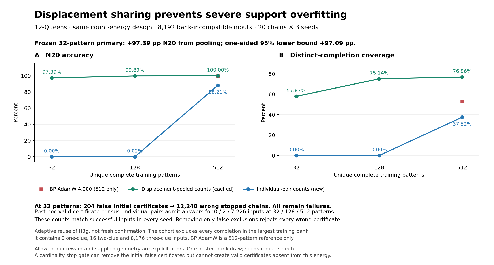

# H3h: displacement-sharing ablation

The frozen 32-pattern hypothesis is supported: displacement-pooled counts achieve 97.387695% N20 accuracy; individual-pair counts achieve 0%. The paired gain's one-sided 95% lower bound is 97.094727 percentage points.

All 12,240 wrong stopped chains are the unchanged three-clue inputs from 204 false initial certificates. Removing only the false exclusions rejects every one. A post hoc exhaustive census finds no valid certificate for any of the 8,192 inputs under the 32-pattern individual-pair model. A cardinality stop gate alone cannot repair that missing support.

This adaptively reuses H3g's bank-incompatible cohort and cached offset controls. It is not fresh confirmation. The three seeds repeat search for one nested bank draw.

[Full report](../../../../research/20261114/loki/h3h/REPORT.md), [frozen protocol](../../../../research/20261114/loki/h3h/protocol.json), [summary and hashes](summary.json), [integer per-seed counts](per_seed.csv), [SVG figure](offset-sharing-ablation.svg), [plot provenance](plot-provenance.json).
