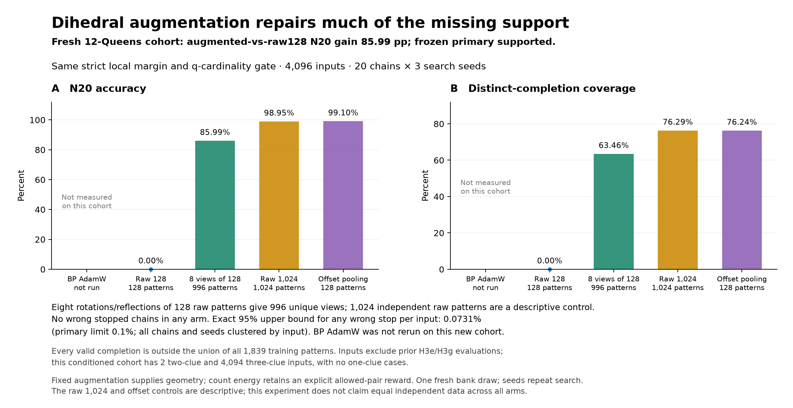

# H3i: fixed dihedral augmentation

The frozen primary is supported: eight rotations/reflections of 128 raw patterns give 996 unique views and raise N20 accuracy from 0% to 85.986328%. No wrong stopped chains occur. The exact 95% upper probability of any wrong stop per input is 0.073111%, below the 0.1% limit.

Descriptive controls reach 98.950195% with 1,024 independent raw patterns and 99.096680% with displacement pooling of 128 patterns. All arms share the same q-cardinality gate and strict local margin. BP AdamW was not rerun on this fresh cohort.

Every valid answer to each of the 4,096 new inputs lies outside the union of all 1,839 training patterns. This is one new bank draw and three search seeds, with a deliberately conditioned input distribution.

[Full report](../../../../research/20261114/loki/h3i/REPORT.md), [frozen protocol](../../../../research/20261114/loki/h3i/protocol.json), [summary and hashes](summary.json), [integer per-seed counts](per_seed.csv), [SVG figure](dihedral-repair.svg), [figure provenance](plot-provenance.json).
