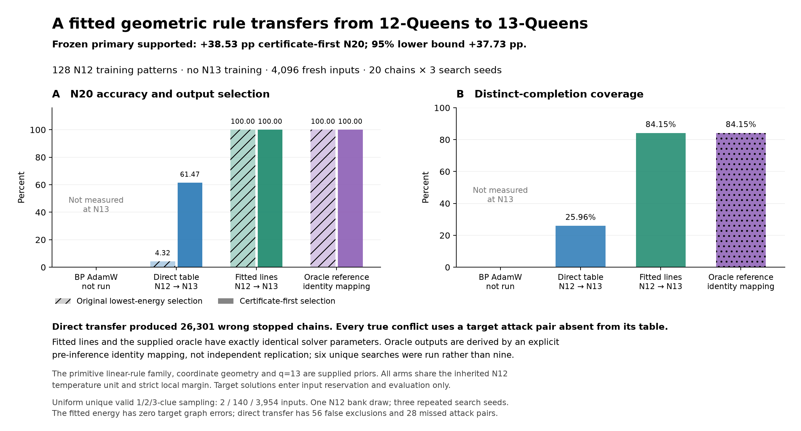

# H3j: zero-shot N12-to-N13 line extrapolation

The frozen primary is supported: the N12-fitted line rule reaches 100% N20 accuracy and 84.149184% coverage at N13, versus direct-table transfer's 61.474609% certificate-first accuracy and 25.959487% coverage. The fitted rule has zero wrong stopped chains; direct transfer has 26,301.

The primitive-line family, coordinate geometry and q = 13 are explicit priors. No N13 example enters model construction or calibration. The oracle has exactly identical solver parameters and is reported through an explicit pre-inference output mapping, not an independent accuracy replication.

Direct transfer's original lowest-energy accuracy is 4.321289%, making the output convention consequential. This study uses 4,096 fresh unique inputs and three search seeds for one source training bank.

[Full report](../../../../research/20261114/loki/h3j/REPORT.md), [frozen protocol](../../../../research/20261114/loki/h3j/protocol.json), [summary and hashes](summary.json), [integer per-seed counts](per_seed.csv), [SVG figure](zero-shot-n13.svg), [figure provenance](plot-provenance.json).
