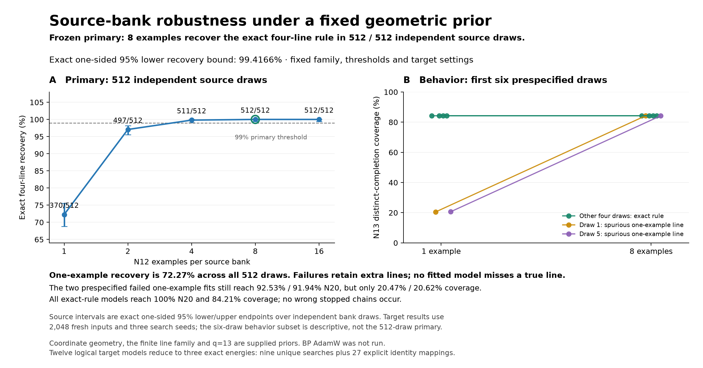

# H3k: source-bank robustness

The frozen eight-pattern primary is supported: 512/512 independent source draws recover exactly the four-line rule, with an exact one-sided 95% lower recovery bound of 99.416604%. One-example recovery is 370/512 (72.265625%). All 2,560 fits and their failures remain exported.

The prespecified first six one/eight-example models reduce to three distinct energies. The two failed one-example fits reach about 92% N20 but only about 20.5% coverage; exact-rule models reach 100% N20 and 84.209534% coverage. Nine unique searches and 27 explicit identity mappings preserve every logical draw without duplicating GPU work.

The finite line family, coordinates and target cardinality are supplied priors. Source-bank uncertainty and repeated-search variation are reported separately. Target behavior is descriptive for the first six draws only.

[Full report](../../../../research/20261114/loki/h3k/REPORT.md), [frozen protocol](../../../../research/20261114/loki/h3k/protocol.json), [summary](summary.json), [all source draws](source_draws.csv), [recovery counts](source_recovery.csv), [target per-seed counts](per_seed.csv), [SVG figure](source-bank-robustness.svg), [plot provenance](plot-provenance.json).
