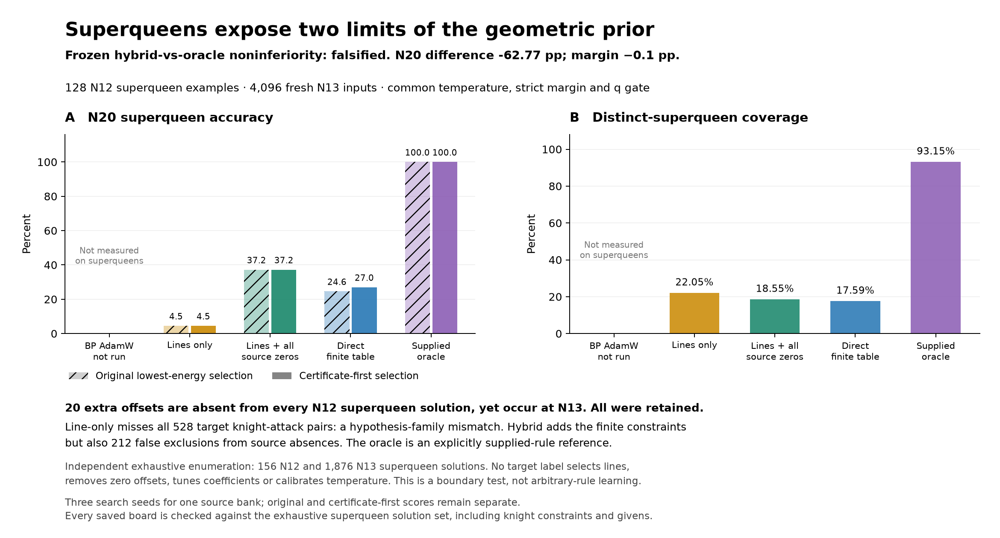

# H3l: superqueen hypothesis-family boundary

The frozen hybrid noninferiority hypothesis is falsified: 37.231445% N20 versus the supplied oracle's 100%, a −62.768555-point difference. The hybrid has zero wrong stops but admits a valid certificate for only 1,525 of 4,096 inputs.

Line-only inference misses 528 knight-attack pairs and produces 234,457 wrong stopped boards. Adding all finite source-zero offsets fixes those omissions but imports 212 false exclusions. Twenty extra offsets are absent from all 156 source-size solutions yet occur at the target size; every one was retained.

The study preserves its declared priors and does not use target labels to repair the models. All 983,040 saved boards were checked against the complete superqueen solution set, including knight attacks and givens.

[Full report](../../../../research/20261114/loki/h3l/REPORT.md), [frozen protocol](../../../../research/20261114/loki/h3l/protocol.json), [summary](summary.json), [integer per-seed counts](per_seed.csv), [extra source offsets](extra_source_offsets.csv), [SVG figure](superqueen-boundary.svg), [figure provenance](plot-provenance.json).
