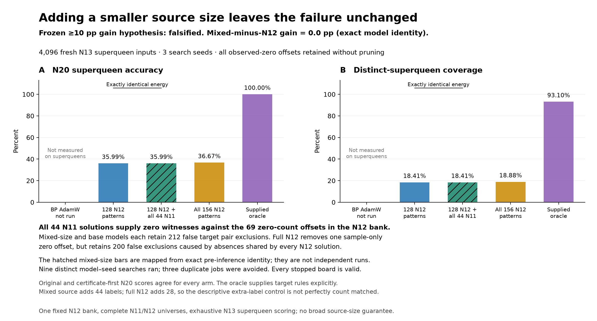

# H3m: mixed-size superqueen source

The frozen ≥10-point improvement hypothesis is falsified by exact model identity. Adding all 44 N11 solutions to the 128 N12 source patterns changes none of the 69 zero offsets. Both arms reach 35.986328% N20 accuracy and 18.411400% coverage; the mapped mixed-size outcomes are not independent replication.

Full N12 resolves only one sample-only offset and reaches 36.669922%, versus the supplied oracle's 100%. All arms have zero wrong stops. Source breadth and count are not perfectly matched: mixed source adds 44 labels, full N12 adds 28.

[Full report](../../../../research/20261114/loki/h3m/REPORT.md), [frozen protocol](../../../../research/20261114/loki/h3m/protocol.json), [summary and hashes](summary.json), [per-seed counts and mapping status](per_seed.csv), [all source-zero offsets](source_zero_offsets.csv), [SVG figure](multisize-source.svg), [figure provenance](plot-provenance.json).
