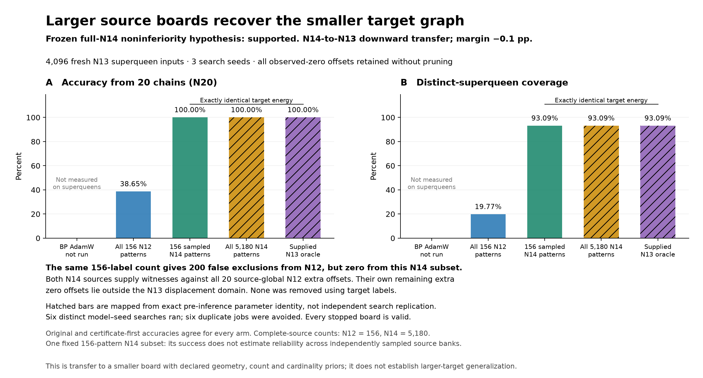

# H3n: larger-source downward transfer

The frozen full-N14 noninferiority hypothesis is supported: 100% accuracy from 20 chains and 93.094794% coverage on fresh N13 inputs, with zero wrong stops. Both the prespecified 156-pattern N14 subset and all 5,180 N14 patterns produce exactly the supplied N13 oracle energy. Full N14 and oracle outcomes are explicitly mapped, not independent replications.

At the same 156-label count, full N12 reaches 38.647461% accuracy and retains 200 false target exclusions. Both N14 sources provide witnesses for every extra N12-global zero. Their remaining extra offsets cannot occur within the smaller N13 board and are never manually removed.

This is **downward transfer**. It does not test extrapolation beyond the source displacement domain or reliability across independent source subsets.

[Full report](../../../../research/20261114/loki/h3n/REPORT.md), [frozen protocol](../../../../research/20261114/loki/h3n/protocol.json), [summary and hashes](summary.json), [per-seed counts](per_seed.csv), [extra source zeros](extra_source_offsets.csv), [N12-zero witnesses](n12_zero_offset_witnesses.csv), [SVG figure](downward-transfer.svg), [figure provenance](plot-provenance.json).
