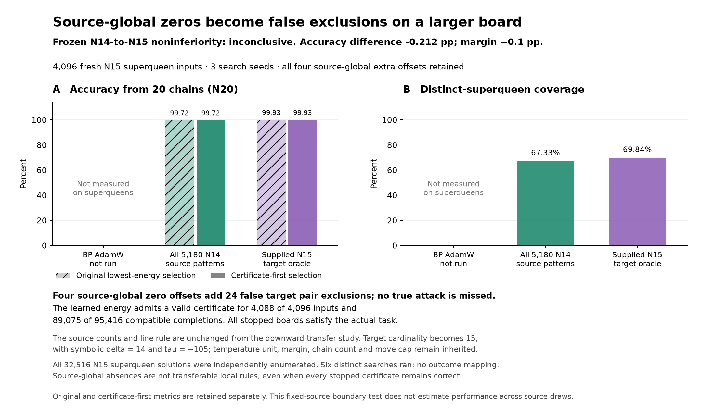

# H3o: N14-to-N15 upward transfer

The frozen 0.1-point noninferiority hypothesis is **inconclusive**: learned accuracy from 20 chains is 99.723307%, versus the oracle's 99.934896%. The paired difference is −0.211589 points with one-sided 95% bootstrap endpoints [−0.349935, −0.089518], crossing the falsification margin. Zero wrong stops occurred.

Four offsets absent from every N14 solution cause 24 false exclusions on N15. They remove all valid certificates for eight of 4,096 inputs and reduce coverage by 2.517595 points. All six distinct searches and 491,520 saved boards were audited against the complete N15 superqueen solution set.

[Full report](../../../../research/20261114/loki/h3o/REPORT.md), [frozen protocol](../../../../research/20261114/loki/h3o/protocol.json), [summary and hashes](summary.json), [per-seed counts](per_seed.csv), [extra source zeros](extra_source_offsets.csv), [SVG figure](upward-transfer.svg), [figure provenance](plot-provenance.json).
