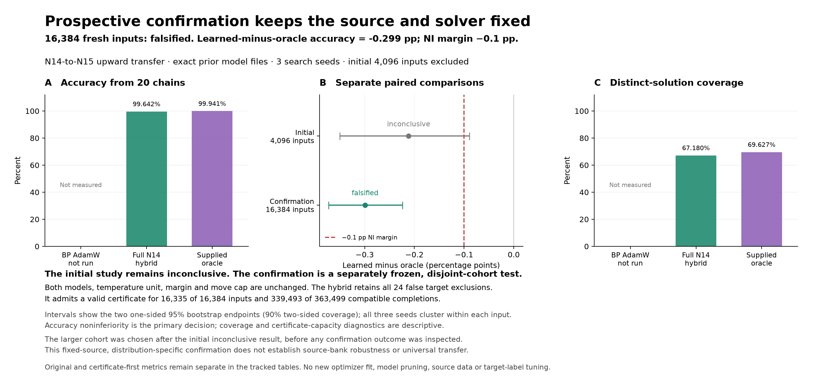

# H3p: prospective upward-transfer confirmation

The frozen 0.1-point accuracy noninferiority hypothesis is **falsified** on 16,384 fresh inputs: 99.641927% for the unchanged learned model versus 99.940999% for the oracle. The paired difference is −0.299072 points, with one-sided 95% endpoints [−0.372314, −0.223796]. Zero wrong stops occurred.

The initial H3o study remains inconclusive. This separately frozen confirmation uses disjoint inputs, exact prior model files and unchanged settings. Forty-nine inputs lack any valid learned-model certificate and fail in every seed. Coverage drops by 2.447417 points.

All 1,966,080 saved boards were independently audited. The run used 17.052 aggregate GPU-minutes within its 25-minute limit.

[Full report](../../../../research/20261114/loki/h3p/REPORT.md), [frozen protocol](../../../../research/20261114/loki/h3p/protocol.json), [summary and hashes](summary.json), [per-seed counts](per_seed.csv), [source-zero evidence](extra_source_offsets.csv), [SVG figure](upward-confirmation.svg), [figure provenance](plot-provenance.json).
