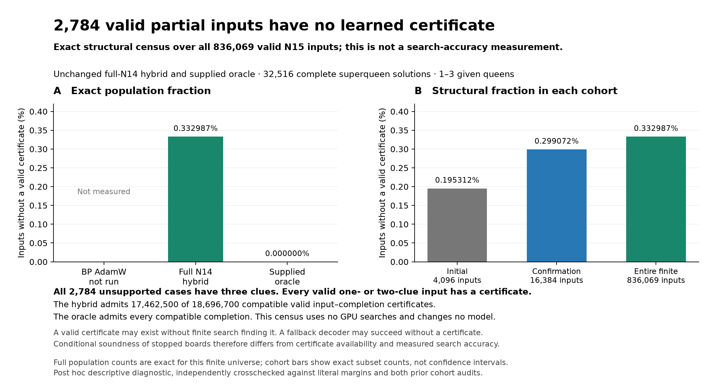

# H3q: exact certificate-capacity census

The unchanged full-N14 hybrid has no valid certificate for **2,784 / 836,069** valid N15 partial inputs (**0.332986871%**). Every unsupported input has three clues. All one- and two-clue inputs retain at least one certificate; the oracle certifies every compatible completion.

This is an exact post hoc structural census, not another accuracy test. It distinguishes correctness conditional on stopping, certificate existence and finite-budget search success. It exactly crosschecks the earlier cohorts and exports every input's capacity, all unsupported keys and a conditional soundness derivation. Runtime: 3.426 seconds, one CPU thread, no GPU work.

[Full report](../../../../research/20261114/loki/h3q/REPORT.md), [frozen scope](../../../../research/20261114/loki/h3q/protocol.json), [conditional soundness](../../../../research/20261114/loki/h3q/SOUNDNESS.md), [summary](summary.json), [clue-count table](by_clues.csv), [unsupported keys](inputs_without_certificate.csv), [full capacity archive](per-input-capacity.npz), [export provenance](export-provenance.json), [SVG figure](certificate-census.svg), [figure provenance](plot-provenance.json).
