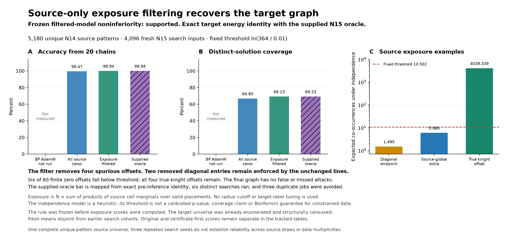

# H3r: source-only exposure filter

The frozen noninferiority hypothesis is supported: the filtered model exactly equals the supplied N15 oracle, reaching 99.943034% accuracy from 20 chains and 69.228472% coverage, with zero wrong stops. The oracle outcomes are explicitly mapped, not independent replication.

A fixed source-only marginal-exposure threshold removes all four spurious offsets. Two removed finite diagonal entries remain enforced by unchanged inferred lines. The unfiltered control reaches 99.471029% accuracy. No radius cutoff or target-label threshold tuning is used.

The score is an **independence-model heuristic**, without calibrated p-values, coverage or Bonferroni guarantees for constrained solutions. It was frozen before exposure inspection and evaluated on a fresh search cohort; the target universe was already known.

[Full report](../../../../research/20261114/loki/h3r/REPORT.md), [frozen protocol](../../../../research/20261114/loki/h3r/protocol.json), [summary](summary.json), [per-seed counts](per_seed.csv), [all source exposures](source_offset_exposures.csv), [removed offsets](removed_zero_offsets.csv), [SVG figure](exposure-filter.svg), [figure provenance](plot-provenance.json).
