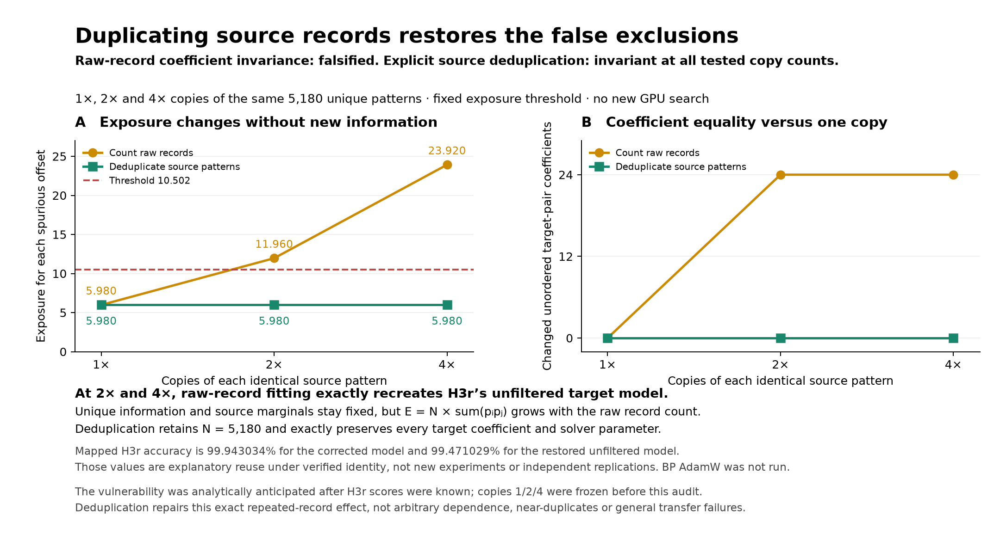

# H3s: duplicate-record invariance

Raw-record invariance is **falsified**: copying each source pattern twice or four times changes 24 target pair coefficients and restores the unfiltered model. The unique 5,180-pattern information is unchanged, but exposure scales with the record count.

An explicit source-deduplicated derivative preserves every coefficient and solver parameter at 1×/2×/4× copies. Exact model identities permit explanatory mappings to H3r outcomes; **no new GPU searches or independent replications** are claimed. The deterministic audit took 2.895 CPU seconds.

[Full report](../../../../research/20261114/loki/h3s/REPORT.md), [frozen protocol](../../../../research/20261114/loki/h3s/protocol.json), [summary](summary.json), [model identities](model_identity.csv), [exposure scores](offset_exposure.csv), [mapped outcomes](mapped_outcomes.csv), [SVG figure](record-replication.svg), [figure provenance](plot-provenance.json).
